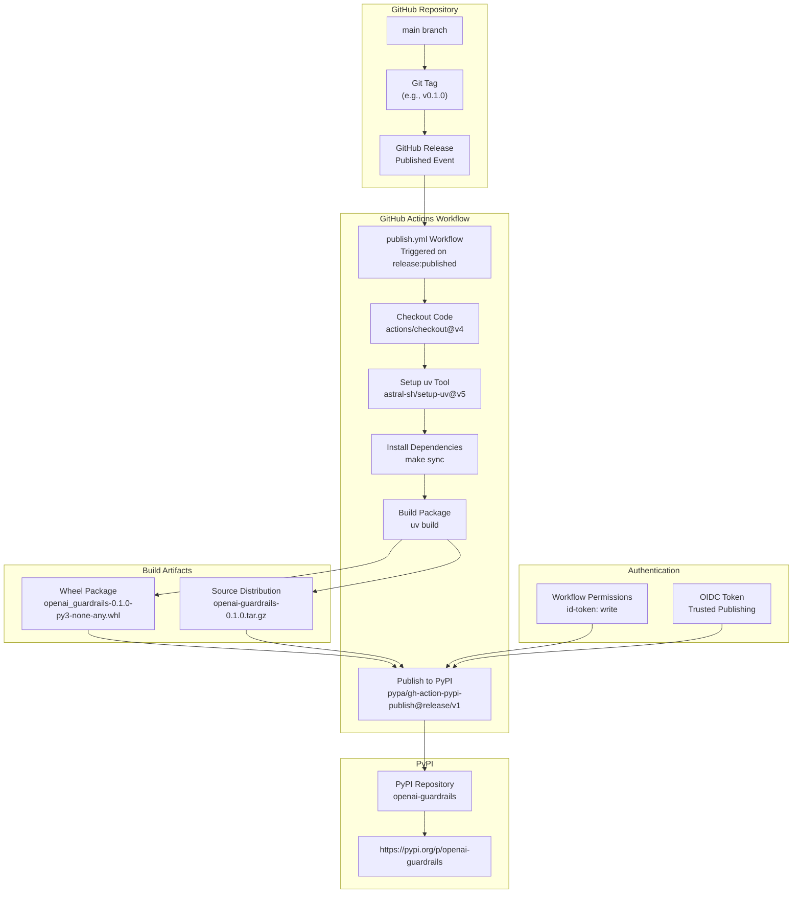
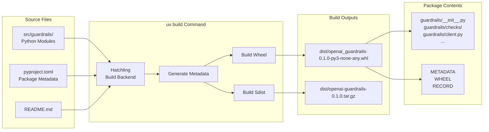
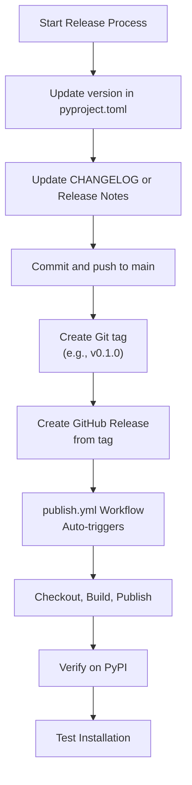

<!-- source: DeepWiki mcp.deepwiki.com · repo openai/openai-guardrails-python · page 8.6 Release Process · fetched 2026-10-26 -->

# Release Process

<details>
<summary>Relevant source files</summary>

The following files were used as context for generating this wiki page:

- [.github/workflows/ci.yml](.github/workflows/ci.yml)
- [.github/workflows/docs.yml](.github/workflows/docs.yml)
- [.github/workflows/publish.yml](.github/workflows/publish.yml)
- [pyproject.toml](pyproject.toml)
- [src/guardrails/__init__.py](src/guardrails/__init__.py)

</details>


This document describes the procedures and automated workflows for publishing new versions of the `openai-guardrails` package to PyPI. It covers version management, the GitHub Actions-based publish workflow, build processes, and trusted publishing configuration.

For information about local development and testing before releases, see [Development Workflow](#8.2). For details about CI/CD quality gates that run before releases, see [CI/CD Pipeline](#8.4).

---

## Overview

The openai-guardrails project uses an automated release process triggered by GitHub Releases. When a new release is published on GitHub, a GitHub Actions workflow automatically builds and publishes the package to PyPI using trusted publishing (OIDC authentication). Version information is managed centrally in `pyproject.toml` and extracted at runtime from package metadata.

**Key Components:**
- **Version Declaration**: [pyproject.toml:3]()
- **Build Configuration**: [pyproject.toml:69-74]()
- **Publish Workflow**: [.github/workflows/publish.yml]()
- **Runtime Version Access**: [src/guardrails/__init__.py:69]()

---

## Version Management

### Version Declaration

The package version is declared in a single location: the `version` field in `pyproject.toml`.

```toml
[project]
name = "openai-guardrails"
version = "0.1.0"
description = "OpenAI Guardrails: A framework for building safe and reliable AI systems."
```

**Sources:** [pyproject.toml:1-4]()

### Runtime Version Extraction

The version is extracted at runtime using Python's `importlib.metadata` API, ensuring consistency between the installed package metadata and the version reported by the library:

```python
from importlib import metadata as _m

__version__: str = _m.version("openai-guardrails")
```

This approach avoids version duplication and ensures the version reported by `guardrails.__version__` always matches the installed package version.

**Sources:** [src/guardrails/__init__.py:12](), [src/guardrails/__init__.py:69]()

---

## Release Workflow Architecture



**Diagram: Release Workflow from GitHub Release to PyPI Publication**

The workflow is triggered exclusively by the `release:published` event, ensuring that only official GitHub Releases trigger PyPI publications. The workflow uses the `pypi` environment and OIDC-based trusted publishing, eliminating the need for long-lived API tokens.

**Sources:** [.github/workflows/publish.yml:1-32]()

---

## Publish Workflow Configuration

### Workflow Trigger

The publish workflow is defined in `.github/workflows/publish.yml` and triggers on GitHub Release publication:

```yaml
on:
  release:
    types:
      - published
```

This trigger only activates when a release is explicitly published through the GitHub UI or API, not when drafts are created or edited.

**Sources:** [.github/workflows/publish.yml:3-6]()

### Workflow Permissions and Environment

The workflow runs in the `pypi` environment and requires specific permissions for trusted publishing:

```yaml
permissions:
  contents: read

jobs:
  publish:
    environment:
      name: pypi
      url: https://pypi.org/p/openai-guardrails
    permissions:
      id-token: write # Important for trusted publishing to PyPI
```

The `id-token: write` permission enables GitHub Actions to generate OIDC tokens for authenticating with PyPI without requiring stored credentials.

**Sources:** [.github/workflows/publish.yml:8-17]()

### Workflow Steps

The workflow executes five steps in sequence:

| Step | Action | Purpose |
|------|--------|---------|
| 1 | `actions/checkout@v4` | Check out the repository at the release tag |
| 2 | `astral-sh/setup-uv@v5` | Install the `uv` package manager with caching enabled |
| 3 | `make sync` | Synchronize dependencies from `pyproject.toml` |
| 4 | `uv build` | Build wheel and source distribution packages |
| 5 | `pypa/gh-action-pypi-publish@release/v1` | Publish packages to PyPI using trusted publishing |

**Sources:** [.github/workflows/publish.yml:20-32]()

---

## Build System Configuration

### Build Backend

The project uses the Hatchling build backend, specified in the `[build-system]` section:

```toml
[build-system]
requires = ["hatchling"]
build-backend = "hatchling.build"
```

Hatchling is a modern, standards-compliant Python build backend that supports PEP 517 and PEP 660.

**Sources:** [pyproject.toml:69-71]()

### Package Structure

The build configuration specifies which directories to include in the wheel:

```toml
[tool.hatch.build.targets.wheel]
packages = ["src/guardrails"]
```

This configuration tells Hatchling to package the `src/guardrails` directory, following the src-layout convention for Python packages.

**Sources:** [pyproject.toml:73-74]()

---

## Build Process Detail



**Diagram: Build Process from Source to Distribution Packages**

The `uv build` command invokes Hatchling, which reads `pyproject.toml` to extract package metadata, then builds both a wheel (`.whl`) and a source distribution (`.tar.gz`). The wheel is a binary distribution containing the compiled package ready for installation, while the source distribution contains the raw source code.

**Sources:** [.github/workflows/publish.yml:30](), [pyproject.toml:69-74]()

---

## PyPI Publication

### Trusted Publishing

The workflow uses PyPI's trusted publishing feature, which eliminates the need for manually created API tokens:

```yaml
- name: Publish to PyPI
  uses: pypa/gh-action-pypi-publish@release/v1
```

The action automatically uses the OIDC token generated by GitHub Actions to authenticate with PyPI. This requires:

1. **PyPI Configuration**: The `openai-guardrails` project must be configured on PyPI to trust the GitHub Actions OIDC provider for the `openai/openai-guardrails-python` repository.
2. **Workflow Permissions**: The `id-token: write` permission must be granted to the workflow.
3. **Environment**: The workflow must run in a protected environment (in this case, `pypi`).

**Sources:** [.github/workflows/publish.yml:31-32](), [.github/workflows/publish.yml:14-17]()

### Package Distribution

Once published, the package becomes available on PyPI at:
- **URL**: https://pypi.org/p/openai-guardrails
- **Installation**: `pip install openai-guardrails`

The package includes optional extras defined in `pyproject.toml`:
- **Base Installation**: `pip install openai-guardrails` (core functionality only)
- **Examples Extra**: `pip install openai-guardrails[examples]` (adds `pillow`, `rich`)
- **Benchmark Extra**: `pip install openai-guardrails[benchmark]` (adds `numpy`, `scikit-learn`, `matplotlib`, etc.)

**Sources:** [pyproject.toml:33-44]()

---

## Version Release Checklist



**Diagram: Release Process Checklist**

### Pre-Release Steps

1. **Update Version**: Modify the `version` field in [pyproject.toml:3]()
2. **Update Documentation**: Ensure documentation reflects new features or changes
3. **Update Release Notes**: Prepare changelog or release notes describing the changes
4. **Commit Changes**: Commit version bump and documentation updates to `main`
5. **Run Quality Gates**: Ensure all CI checks pass (see [CI/CD Pipeline](#8.4))

### Release Execution

1. **Create Git Tag**: Create an annotated tag matching the version (e.g., `v0.1.0`)
2. **Push Tag**: Push the tag to GitHub: `git push origin v0.1.0`
3. **Create GitHub Release**: Use the GitHub UI or API to create a release from the tag
4. **Publish Release**: Publish the release (not a draft) to trigger the workflow

### Post-Release Verification

1. **Monitor Workflow**: Watch the `publish.yml` workflow execution in GitHub Actions
2. **Verify PyPI**: Check that the package appears at https://pypi.org/p/openai-guardrails
3. **Test Installation**: Run `pip install openai-guardrails==0.1.0` in a clean environment
4. **Verify Version**: Confirm `import guardrails; print(guardrails.__version__)` shows correct version

**Sources:** [.github/workflows/publish.yml:1-32](), [pyproject.toml:1-4]()

---

## Package Metadata

### Project Information

The following metadata is included in published packages:

| Field | Value | Source |
|-------|-------|--------|
| Package Name | `openai-guardrails` | [pyproject.toml:2]() |
| Description | "OpenAI Guardrails: A framework for building safe and reliable AI systems." | [pyproject.toml:4]() |
| License | MIT | [pyproject.toml:7]() |
| Python Requirement | `>=3.11` | [pyproject.toml:6]() |
| Homepage | https://openai.github.io/openai-guardrails-python/ | [pyproject.toml:30]() |
| Repository | https://github.com/openai/openai-guardrails-python | [pyproject.toml:31]() |

### Classifiers

The package includes PyPI classifiers for discoverability:

```toml
classifiers = [
  "Typing :: Typed",
  "Intended Audience :: Developers",
  "Programming Language :: Python :: 3",
  "Programming Language :: Python :: 3.11",
  "Programming Language :: Python :: 3.12",
  "Programming Language :: Python :: 3.13",
  "Operating System :: OS Independent",
  "Topic :: Software Development :: Libraries :: Python Modules",
  "License :: OSI Approved :: MIT License",
]
```

These classifiers indicate the package is fully typed, supports Python 3.11-3.13, and is OS-independent.

**Sources:** [pyproject.toml:16-27](), [pyproject.toml:29-31]()

---

## Dependency Management

### Core Dependencies

The package declares core dependencies required for all installations:

```toml
dependencies = [
    "openai>=1.75.0",
    "pydantic>=2.11.3",
    "openai-agents>=0.3.3",
    "pip>=25.0.1",
    "presidio-analyzer>=2.2.358",
]
```

These dependencies are automatically installed with `pip install openai-guardrails`.

**Sources:** [pyproject.toml:9-15]()

### Optional Dependencies

Optional extras enable specific functionality:

**Examples Extra** (`pip install openai-guardrails[examples]`):
- `pillow>=11.2.1` - Image processing for examples
- `rich>=14.0.0` - Rich terminal output

**Benchmark Extra** (`pip install openai-guardrails[benchmark]`):
- `numpy>=1.24.0` - Numerical computing
- `scikit-learn>=1.3.0` - Machine learning metrics
- `matplotlib>=3.7.0` - Plotting
- `seaborn>=0.12.0` - Statistical visualization
- `pandas>=2.0.0` - Data manipulation

**Sources:** [pyproject.toml:33-44]()

---

## Troubleshooting Releases

### Common Issues

| Issue | Cause | Solution |
|-------|-------|----------|
| Workflow not triggering | Release is a draft | Publish the release from the GitHub UI |
| Build failure | Syntax error in `pyproject.toml` | Validate TOML syntax and fix errors |
| PyPI authentication failure | Trusted publishing not configured | Configure OIDC trust relationship on PyPI |
| Version conflict | Version already exists on PyPI | Bump version number in `pyproject.toml` |
| Import error after install | Source layout not configured | Verify `[tool.hatch.build.targets.wheel]` configuration |

### Workflow Logs

If a release fails, examine the GitHub Actions logs:

1. Navigate to **Actions** tab in the repository
2. Find the failed `Publish to PyPI` workflow run
3. Expand each step to identify the failure point
4. Check the logs for error messages and stack traces

### PyPI Status

Verify PyPI is operational before releasing:
- Check https://status.python.org/ for service status
- Test authentication with `twine check` if manually publishing

**Sources:** [.github/workflows/publish.yml:20-32]()

---

## Future Considerations

### Automated Version Bumping

Currently, versions are manually updated in `pyproject.toml`. Future enhancements could include:
- Automated version bumping tools (e.g., `bump2version`, `semantic-release`)
- Changelog generation from commit messages
- Pre-release and beta channel support

### Release Notes Automation

The workflow could be extended to automatically generate release notes from:
- Pull request titles and descriptions
- Commit messages following conventional commits
- Labels on merged PRs

### Multi-Environment Testing

Before PyPI publication, the workflow could deploy to TestPyPI for validation:
1. Publish to TestPyPI
2. Install from TestPyPI in test environment
3. Run integration tests
4. Publish to production PyPI if tests pass

**Sources:** [.github/workflows/publish.yml](), [pyproject.toml]()

---

