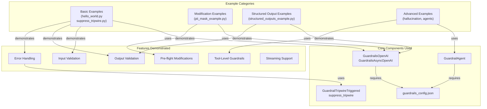
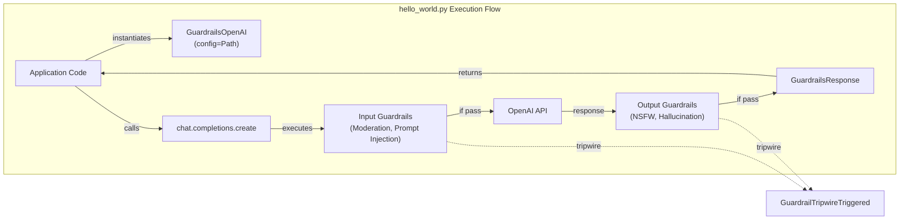
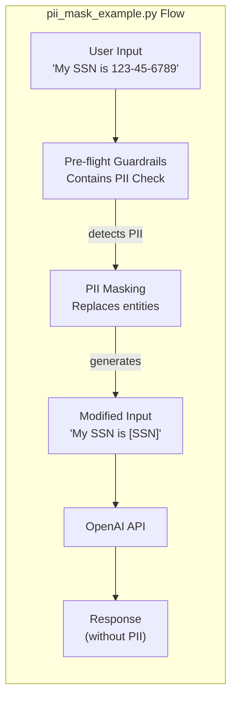
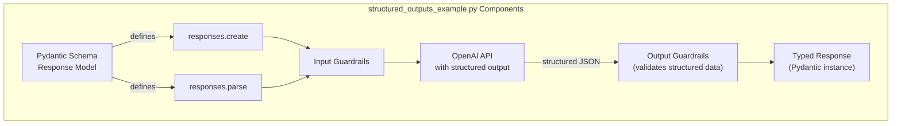
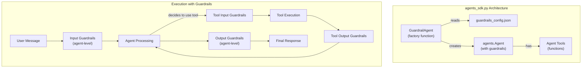
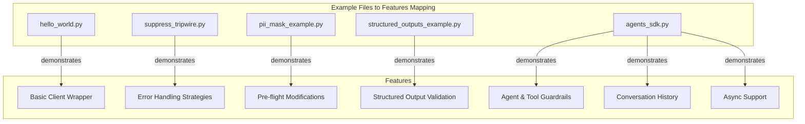

<!-- source: DeepWiki mcp.deepwiki.com · repo openai/openai-guardrails-python · page 9 Examples · fetched 2026-10-26 -->

# Examples

<details>
<summary>Relevant source files</summary>

The following files were used as context for generating this wiki page:

- [README.md](README.md)
- [docs/assets/images/guardrails-python-config-screenshot-100pct-q70.webp](docs/assets/images/guardrails-python-config-screenshot-100pct-q70.webp)

</details>


This page provides practical examples demonstrating common use cases for OpenAI Guardrails. Each example is a complete, runnable script that illustrates specific features and integration patterns. The examples are located in the `examples/` directory and are designed to help developers quickly understand how to integrate guardrails into their applications.

For configuration details referenced in these examples, see [Configuration Files](#2.2). For detailed API documentation, see [Client Integration](#4) and [Agent Integration](#5).

---

## Overview of Example Structure

The examples demonstrate three primary integration patterns: drop-in client replacement, pre-flight modifications, and agent-based workflows. Each example is self-contained and can be run after installing the package with example dependencies.



**Sources:** [README.md:156-166](), [README.md:41-93]()

---

## 9.1 Basic Examples

The basic examples demonstrate fundamental usage patterns for the `GuardrailsOpenAI` client wrapper.

### hello_world.py - Basic Client Usage

This example shows the simplest integration: using `GuardrailsOpenAI` as a drop-in replacement for the OpenAI client. The client automatically applies configured guardrails to both inputs and outputs.



**Key Code Pattern:**
```python
from pathlib import Path
from guardrails import GuardrailsOpenAI, GuardrailTripwireTriggered

# Initialize client with config file
client = GuardrailsOpenAI(config=Path("guardrail_config.json"))

try:
    # Standard Chat Completions API
    chat = client.chat.completions.create(
        model="gpt-4",
        messages=[{"role": "user", "content": "Hello world"}],
    )
    print(chat.choices[0].message.content)
except GuardrailTripwireTriggered as e:
    print(f"Guardrail triggered: {e}")
```

**Sources:** [README.md:41-64](), [README.md:160]()

### suppress_tripwire.py - Graceful Error Handling

This example demonstrates the `suppress_tripwire` parameter, which prevents exceptions from being raised when guardrails trigger. Instead, violations are recorded in the response metadata.

```mermaid
graph TB
    subgraph "suppress_tripwire=False (Default)"
        Call1["chat.completions.create"]
        Check1["Guardrail Triggers"]
        Raise1["Raises GuardrailTripwireTriggered"]
        NoResp1["No response returned"]
        
        Call1 --> Check1
        Check1 --> Raise1
        Raise1 --> NoResp1
    end
    
    subgraph "suppress_tripwire=True"
        Call2["chat.completions.create<br/>(suppress_tripwire=True)"]
        Check2["Guardrail Triggers"]
        Record["Records in GuardrailResults"]
        RetResp["Returns GuardrailsResponse"]
        Access["Access via .guardrails_results"]
        
        Call2 --> Check2
        Check2 --> Record
        Record --> RetResp
        RetResp --> Access
    end
```



**Key Code Pattern:**
```python
# Suppress exceptions, get response with violation metadata
response = client.chat.completions.create(
    model="gpt-4",
    messages=[{"role": "user", "content": "potentially problematic input"}],
    suppress_tripwire=True,  # Don't raise exception
)

# Check guardrail results
if response.guardrails_results:
    for stage, results in response.guardrails_results.items():
        for result in results:
            if result.tripwire_triggered:
                print(f"{stage} guardrail triggered: {result.info}")
```

**Sources:** [README.md:165]()

---

## 9.2 PII Masking Example

The PII masking example demonstrates pre-flight guardrails that modify inputs before they reach the LLM. This is particularly useful for redacting sensitive information like personally identifiable information (PII).



**Configuration Pattern:**

The `Contains PII` guardrail in pre-flight stage automatically masks detected entities when configured:

```json
{
  "pre_flight_guardrails": [
    {
      "name": "Contains PII",
      "config": {
        "entities": ["PERSON", "EMAIL_ADDRESS", "PHONE_NUMBER", "US_SSN"],
        "mask_entities": true
      }
    }
  ]
}
```

**Key Integration Points:**
- Pre-flight guardrails execute in [src/guardrails/runtime.py]() via the three-stage pipeline
- PII detection uses the Presidio framework (see [6.6](#6.6) for details)
- Masked text is automatically passed to subsequent stages

**Sources:** [README.md:164](), [README.md:189]()

---

## 9.3 Structured Outputs Example

The structured outputs example demonstrates using the Responses API with guardrails. This shows how guardrails work with typed, structured outputs including both the `responses.create` and `responses.parse` methods.



**Key Code Pattern:**

```python
from pydantic import BaseModel

# Define response schema
class ProductInfo(BaseModel):
    name: str
    price: float
    description: str

# Use with guardrails
response = client.responses.parse(
    model="gpt-4",
    messages=[{"role": "user", "content": "Tell me about your premium plan"}],
    response_format=ProductInfo,
)

# Access typed data
product: ProductInfo = response.parsed
print(f"Product: {product.name}, Price: ${product.price}")
```

**Guardrail Application:**
- Input guardrails validate the prompt (e.g., checking for jailbreak attempts)
- Output guardrails validate the structured response (e.g., checking for hallucinations in generated content)
- All guardrail results are available via `response.guardrails_results`

**Sources:** [README.md:56-61](), [README.md:163]()

---

## 9.4 Hallucination Detection Example

This example demonstrates hallucination detection using vector stores and the File Search tool. It shows how to configure guardrails to validate LLM outputs against a knowledge base.

```mermaid
graph TB
    subgraph "Hallucination Detection Setup"
        VectorStore["Vector Store<br/>(OpenAI File Search)"]
        KnowledgeBase["Knowledge Base Files<br/>(uploaded documents)"]
        Config["guardrails_config.json<br/>hallucination config"]
        
        KnowledgeBase -->|uploaded to| VectorStore
        VectorStore -->|referenced in| Config
    end
    
    subgraph "Runtime Execution"
        Query["User Query"]
        InputGR["Input Guardrails"]
        LLM["LLM Response"]
        HalCheck["Hallucination Detection<br/>Guardrail"]
        VectorLookup["Vector Store Lookup<br/>validate claims"]
        Decision["Pass/Fail Decision"]
        
        Query --> InputGR
        InputGR --> LLM
        LLM --> HalCheck
        HalCheck -->|queries| VectorLookup
        VectorLookup --> Decision
    end
```



**Configuration Requirements:**

The Hallucination Detection guardrail requires a vector store ID in the configuration:

```json
{
  "output_guardrails": [
    {
      "name": "Hallucination Detection",
      "config": {
        "knowledge_source": "vs_abc123",  // Vector store ID
        "threshold": 0.8
      }
    }
  ]
}
```

**Setup Steps:**
1. Upload knowledge base documents to OpenAI (creates vector store)
2. Reference the vector store ID in guardrails configuration
3. The guardrail automatically validates LLM outputs against the knowledge base
4. Claims not supported by the vector store trigger the guardrail

**Integration with File Search:**
- The hallucination guardrail uses the same vector store infrastructure as the File Search tool
- It performs semantic search to validate factual claims
- See [Hallucination Detection](#6.5) for detailed configuration options

**Sources:** [README.md:190]()

---

## 9.5 Agents SDK Example

The agents SDK example demonstrates integrating guardrails with the OpenAI Agents SDK using `GuardrailAgent`. This enables both agent-level and tool-level validation.



**Key Code Pattern:**

```python
import asyncio
from pathlib import Path
from agents import Runner, InputGuardrailTripwireTriggered, OutputGuardrailTripwireTriggered
from guardrails import GuardrailAgent

# Create agent with guardrails
agent = GuardrailAgent(
    config=Path("guardrails_config.json"),
    name="Customer support agent",
    instructions="You are a customer support agent.",
    tools=[search_tool, update_tool],  # Tools with guardrails
)

async def main():
    try:
        result = await Runner.run(
            agent, 
            "Help me with my account",
            run_config=RunConfig(tracing_disabled=True)
        )
        print(result.final_output)
    except (InputGuardrailTripwireTriggered, OutputGuardrailTripwireTriggered):
        print("Guardrail triggered!")

asyncio.run(main())
```

**Guardrail Stages in Agents:**

| Stage | When Applied | Configuration Key |
|-------|-------------|-------------------|
| Agent Input | Before agent processes user message | `input_guardrails` |
| Tool Input | Before each tool execution | `tool_input_guardrails` |
| Tool Output | After each tool execution | `tool_output_guardrails` |
| Agent Output | Before final response to user | `output_guardrails` |

**Exception Handling:**
- `raise_guardrail_errors=True` (default): Raises exceptions on violations
- `raise_guardrail_errors=False`: Records violations without raising
- `block_on_tool_violations=True`: Blocks tool execution on violations
- See [Agent Exception Handling](#5.4) for detailed behavior

**Sources:** [README.md:70-93](), [README.md:161]()

---

## Running the Examples

### Prerequisites

Install the package with example dependencies:

```bash
pip install -e .
pip install "openai-guardrails[examples]"
```

Set up your OpenAI API key:

```bash
export OPENAI_API_KEY="your-api-key"
```

### Execution

All examples can be run directly:

```bash
# Basic example
python examples/basic/hello_world.py

# Agents SDK integration
python examples/basic/agents_sdk.py

# PII masking
python examples/basic/pii_mask_example.py

# Structured outputs
python examples/basic/structured_outputs_example.py

# Suppress tripwire handling
python examples/basic/suppress_tripwire.py
```

### Configuration Files

Each example expects a `guardrails_config.json` file. Generate this configuration at [guardrails.openai.com](https://guardrails.openai.com) or use the examples provided in the repository.

**Sources:** [README.md:168-181]()

---

## Example Integration Patterns Summary



| Example | Primary Feature | Secondary Features | Related Documentation |
|---------|----------------|-------------------|----------------------|
| `hello_world.py` | Basic client usage | Exception handling, chat completions | [4.1](#4.1), [4.3](#4.3) |
| `suppress_tripwire.py` | Error handling | Violation metadata access | [2.3](#2.3) |
| `pii_mask_example.py` | Pre-flight modifications | PII detection and masking | [3.1](#3.1), [6.6](#6.6) |
| `structured_outputs_example.py` | Responses API | Type-safe outputs, Pydantic integration | [4.4](#4.4) |
| `agents_sdk.py` | Agent integration | Tool-level guardrails, async execution | [5.1](#5.1), [5.2](#5.2) |

**Sources:** [README.md:156-166]()

---

