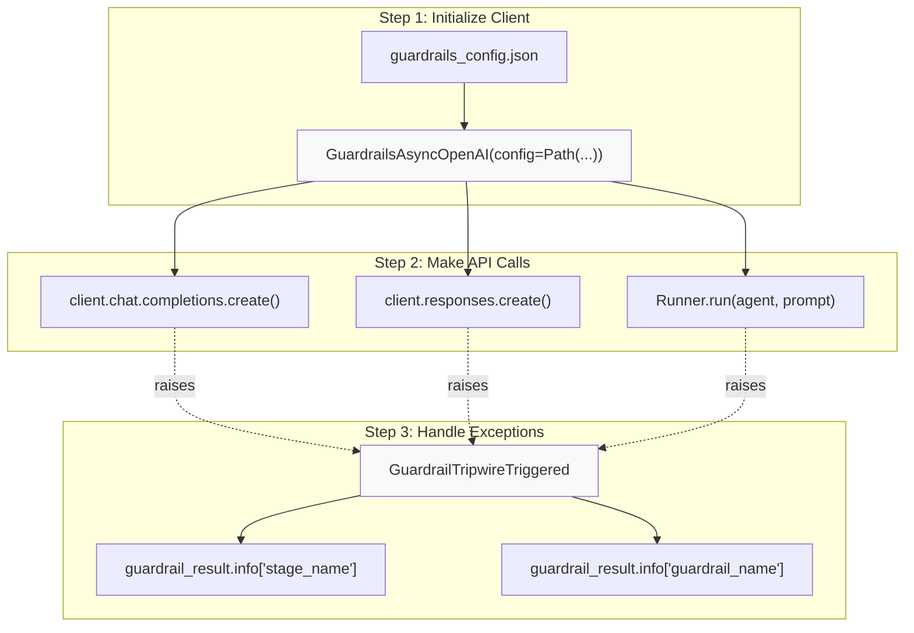
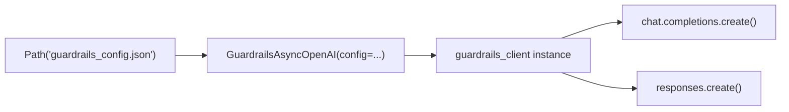
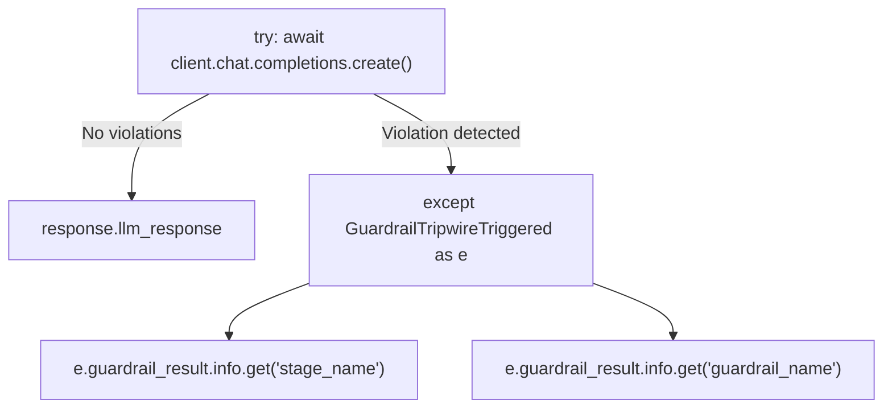
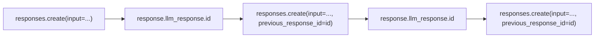
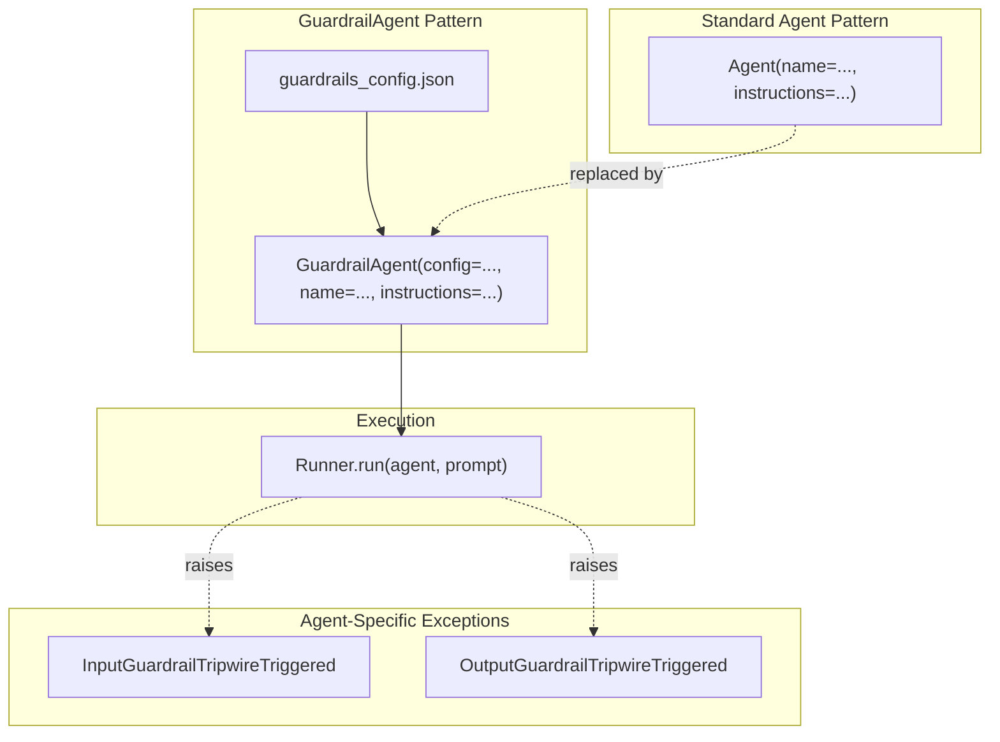
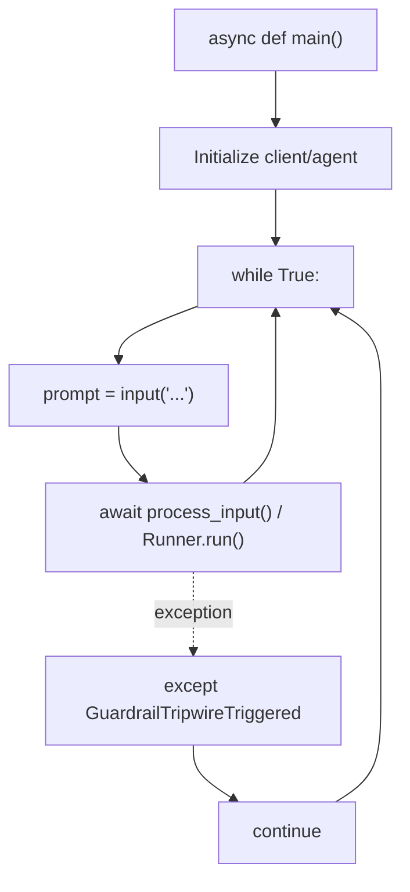

<!-- source: DeepWiki mcp.deepwiki.com · repo openai/openai-guardrails-python · page 9.1 Basic Examples · fetched 2026-10-26 -->

# Basic Examples

<details>
<summary>Relevant source files</summary>

The following files were used as context for generating this wiki page:

- [README.md](README.md)
- [docs/assets/images/guardrails-python-config-screenshot-100pct-q70.webp](docs/assets/images/guardrails-python-config-screenshot-100pct-q70.webp)
- [src/guardrails/resources/chat/chat.py](src/guardrails/resources/chat/chat.py)
- [src/guardrails/resources/responses/responses.py](src/guardrails/resources/responses/responses.py)
- [tests/unit/test_context.py](tests/unit/test_context.py)

</details>


## Purpose and Scope

This page provides simple, foundational examples demonstrating how to integrate guardrails into basic LLM workflows. These examples focus on the minimal code required to get started with guardrails for common use cases.

For more advanced patterns, see:
- PII masking workflows: [PII Masking Example](#9.2)
- Structured data validation: [Structured Outputs Example](#9.3)
- Hallucination detection: [Hallucination Detection Example](#9.4)
- Agent integration details: [Agents SDK Example](#9.5)
- Initial setup and installation: [Quickstart Guide](#2.1)
- Configuration file structure: [Configuration Files](#2.2)

## Basic Workflow Pattern

All basic guardrail integrations follow a common three-step pattern, regardless of the API surface used:



**Sources:** [examples/implementation_code/blocking/blocking_completions.py:14-48](), [examples/implementation_code/blocking/blocking_responses.py:14-52](), [examples/implementation_code/blocking/blocking_agents.py:15-41]()

## Chat Completions Example

The simplest integration uses `GuardrailsAsyncOpenAI` as a drop-in replacement for the standard OpenAI async client. The client automatically runs guardrails based on the configuration file.

### Client Initialization



The client initialization pattern is shown in [examples/implementation_code/blocking/blocking_completions.py:32]():

```python
guardrails_client = GuardrailsAsyncOpenAI(config=Path("guardrails_config.json"))
```

**Sources:** [examples/implementation_code/blocking/blocking_completions.py:30-32]()

### Making Protected API Calls

Once initialized, the client is used exactly like the standard OpenAI client. Guardrails run automatically in the three-stage pipeline (pre-flight, input, output) as defined in [System Architecture](#1.2):

| Code Location | Method Call | Purpose |
|---------------|-------------|---------|
| [blocking_completions.py:19-22]() | `guardrails_client.chat.completions.create()` | Chat completions with automatic guardrail validation |
| [blocking_completions.py:24]() | `response.llm_response.choices[0].message.content` | Access the LLM response content |

The complete call pattern from [examples/implementation_code/blocking/blocking_completions.py:19-22]():

```python
response = await guardrails_client.chat.completions.create(
    messages=[{"role": "user", "content": user_input}],
    model="gpt-4.1-nano",
)
```

**Sources:** [examples/implementation_code/blocking/blocking_completions.py:14-28]()

### Exception Handling Pattern

When guardrails detect violations, they raise `GuardrailTripwireTriggered` exceptions. The exception contains metadata about which guardrail and stage triggered:



The exception handling pattern from [examples/implementation_code/blocking/blocking_completions.py:40-44]():

```python
except GuardrailTripwireTriggered as e:
    stage_name = e.guardrail_result.info.get("stage_name", "unknown")
    guardrail_name = e.guardrail_result.info.get("guardrail_name", "unknown")
    print(f"🛑 Guardrail '{guardrail_name}' triggered in stage '{stage_name}'!")
```

**Sources:** [examples/implementation_code/blocking/blocking_completions.py:40-44](), [examples/implementation_code/blocking/blocking_responses.py:45-49]()

## Responses API Example

The Responses API pattern is nearly identical to Chat Completions, but uses conversational state management via `response_id`:

### Key Differences from Chat Completions

| Aspect | Chat Completions | Responses API |
|--------|------------------|---------------|
| Method | `chat.completions.create()` | `responses.create()` |
| Messages | `messages=[...]` | `input=user_input` |
| State tracking | Manual message history | `previous_response_id=response_id` |
| Return value | `response.llm_response.choices[0]` | `response.llm_response.output_text` |

### Response Chaining Pattern



The response chaining implementation from [examples/implementation_code/blocking/blocking_responses.py:19-27]():

```python
response = await guardrails_client.responses.create(
    input=user_input,
    model="gpt-4.1-nano",
    previous_response_id=response_id
)

print(f"\nAssistant: {response.llm_response.output_text}")
return response.llm_response.id
```

The `response_id` is tracked in the main loop at [examples/implementation_code/blocking/blocking_responses.py:37-42]() to maintain conversation context across turns.

**Sources:** [examples/implementation_code/blocking/blocking_responses.py:14-52]()

## Agents SDK Integration

For agent workflows using the OpenAI Agents SDK, use `GuardrailAgent` instead of `GuardrailsAsyncOpenAI`:

### Agent Initialization Mapping



The agent initialization pattern from [examples/implementation_code/blocking/blocking_agents.py:17-21]():

```python
agent = GuardrailAgent(
    config=Path("guardrails_config.json"),
    name="Customer support agent",
    instructions="You are a customer support agent...",
)
```

**Sources:** [examples/implementation_code/blocking/blocking_agents.py:15-21]()

### Agent Exception Handling

Agents use specialized exception types to distinguish input (prompt injection) from output (response) violations:

| Exception Type | Stage | Raised When |
|----------------|-------|-------------|
| `InputGuardrailTripwireTriggered` | Input stage | User prompt violates guardrails |
| `OutputGuardrailTripwireTriggered` | Output stage | Agent response violates guardrails |

The agent exception handling pattern from [examples/implementation_code/blocking/blocking_agents.py:35-38]():

```python
except (InputGuardrailTripwireTriggered, OutputGuardrailTripwireTriggered) as exc:
    stage_name = "input" if isinstance(exc, InputGuardrailTripwireTriggered) else "output"
    print(f"🛑 Guardrail triggered in stage '{stage_name}'!")
```

For more details on agent-specific guardrail behavior, see [Agent Integration](#5).

**Sources:** [examples/implementation_code/blocking/blocking_agents.py:35-38]()

## Configuration File Basics

All examples assume a `guardrails_config.json` file exists in the working directory. The minimal structure defines guardrails for each pipeline stage:

```json
{
  "version": 2,
  "pre_flight": {
    "version": 1,
    "guardrails": []
  },
  "input": {
    "version": 1,
    "guardrails": [
      {
        "name": "jailbreak_detection",
        "config": {"model": "gpt-5-mini"}
      }
    ]
  },
  "output": {
    "version": 1,
    "guardrails": [
      {
        "name": "moderation"
      }
    ]
  }
}
```

The three stages (`pre_flight`, `input`, `output`) correspond to the pipeline architecture described in [Three-Stage Pipeline Architecture](#3.1). For comprehensive configuration documentation, see [Configuration Files](#2.2).

**Sources:** [examples/implementation_code/blocking/blocking_completions.py:5-6](), [examples/implementation_code/blocking/blocking_responses.py:5-6](), [examples/implementation_code/blocking/blocking_agents.py:18]()

## Common Patterns Summary

### Import Statements

| Use Case | Required Imports |
|----------|------------------|
| Chat/Responses (async) | `from guardrails import GuardrailsAsyncOpenAI, GuardrailTripwireTriggered` |
| Chat/Responses (sync) | `from guardrails import GuardrailsOpenAI, GuardrailTripwireTriggered` |
| Agents SDK | `from guardrails import GuardrailAgent`<br>`from agents import InputGuardrailTripwireTriggered, OutputGuardrailTripwireTriggered` |

**Sources:** [examples/implementation_code/blocking/blocking_completions.py:11](), [examples/implementation_code/blocking/blocking_responses.py:11](), [examples/implementation_code/blocking/blocking_agents.py:6-12]()

### Main Loop Structure

All examples follow this pattern:



This pattern enables interactive testing while gracefully handling guardrail violations without exiting the loop.

**Sources:** [examples/implementation_code/blocking/blocking_completions.py:30-48](), [examples/implementation_code/blocking/blocking_responses.py:33-50](), [examples/implementation_code/blocking/blocking_agents.py:15-41]()

## File Locations

All basic examples are located in the repository under `examples/implementation_code/blocking/`:

- Chat Completions: [examples/implementation_code/blocking/blocking_completions.py]()
- Responses API: [examples/implementation_code/blocking/blocking_responses.py]()
- Agents SDK: [examples/implementation_code/blocking/blocking_agents.py]()

For streaming variants (output shown while guardrails run in parallel), see the `examples/implementation_code/streaming/` directory referenced in [docs/examples.md:11]().

**Sources:** [docs/examples.md:1-26]()

---

