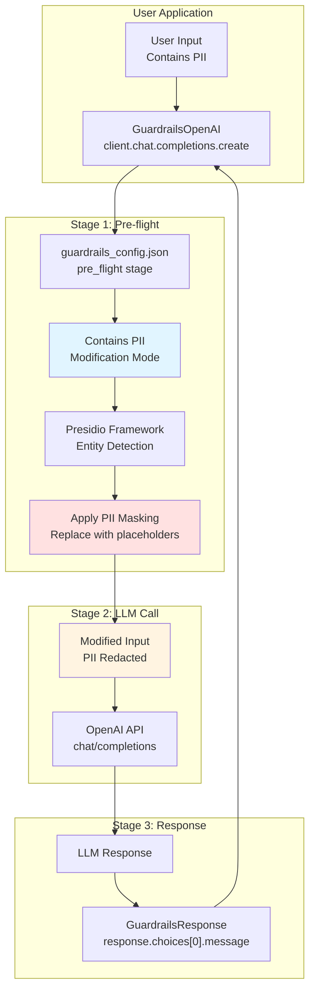
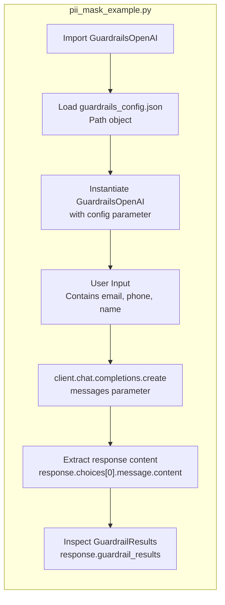
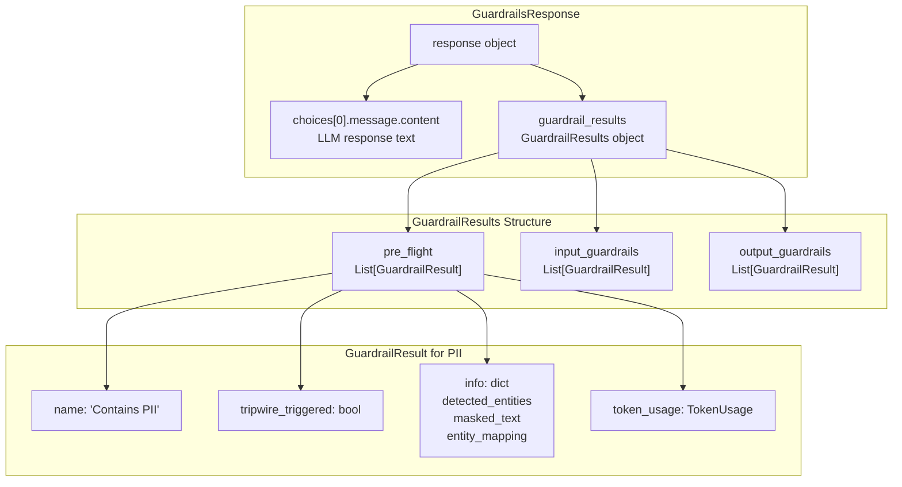
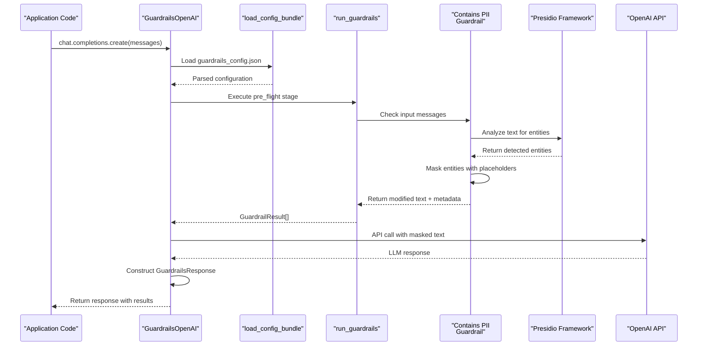

<!-- source: DeepWiki mcp.deepwiki.com · repo openai/openai-guardrails-python · page 9.2 PII Masking Example · fetched 2026-10-26 -->

# PII Masking Example

<details>
<summary>Relevant source files</summary>

The following files were used as context for generating this wiki page:

- [README.md](README.md)
- [docs/assets/images/guardrails-python-config-screenshot-100pct-q70.webp](docs/assets/images/guardrails-python-config-screenshot-100pct-q70.webp)

</details>


## Purpose and Scope

This page documents the PII masking example that demonstrates the **pre-flight modification workflow**. Pre-flight guardrails run before the LLM call and can transform input data, such as masking personally identifiable information (PII) before it reaches the model. This example shows how to configure and use the `Contains PII` guardrail in modification mode to automatically detect and redact sensitive information.

For information about the `Contains PII` guardrail detection capabilities, see [PII Detection and URL Filtering](#6.6). For general pre-flight stage concepts, see [Three-Stage Pipeline Architecture](#3.1).

## Pre-flight Modification Overview

Pre-flight guardrails execute in **Stage 1** of the pipeline, before any LLM interaction occurs. Unlike input or output guardrails that validate content, pre-flight guardrails can **modify** the data flowing through the system. This is particularly useful for:

- **PII Masking**: Redacting sensitive information before it reaches the LLM
- **URL Validation**: Transforming or filtering URLs in prompts
- **Input Sanitization**: Normalizing or cleaning user input

The key characteristic of pre-flight guardrails is that their modifications are applied to the conversation before the LLM call, ensuring sensitive data never leaves your application boundary.

**Sources:** README.md:164, High-Level System Architecture Diagrams (Diagram 2: Pre-flight stage)

## PII Masking Mechanism

### Detection Engine

The `Contains PII` guardrail uses the **Presidio framework**, an open-source PII detection library, to identify sensitive entities in text. Presidio recognizes multiple entity types including:

| Entity Type | Description |
|------------|-------------|
| `PERSON` | Names of individuals |
| `EMAIL_ADDRESS` | Email addresses |
| `PHONE_NUMBER` | Phone numbers |
| `CREDIT_CARD` | Credit card numbers |
| `US_SSN` | Social Security Numbers |
| `IP_ADDRESS` | IP addresses |
| `LOCATION` | Geographic locations |

### Modification Mode

When configured in **modification mode**, the guardrail:
1. Detects PII entities in the input text
2. Replaces detected entities with placeholder tokens (e.g., `<PERSON>`, `<EMAIL_ADDRESS>`)
3. Passes the modified text to the LLM
4. Optionally stores the mapping for later de-masking

**Sources:** README.md:189, README.md:204-205, High-Level System Architecture Diagrams (Diagram 4: API-Based Guardrails)

## Pipeline Position and Data Flow



**Diagram: PII Masking Pre-flight Pipeline**

This diagram shows how PII masking intercepts the input before it reaches the OpenAI API. The original user input containing PII never reaches the LLM; only the masked version is transmitted.

**Sources:** High-Level System Architecture Diagrams (Diagram 2: Guardrail Execution Pipeline)

## Example Code Structure

The example file demonstrates the complete workflow:



**Diagram: Example Execution Flow**

**Sources:** README.md:164, README.md:42-64

## Configuration Requirements

### guardrails_config.json Structure

The configuration file must define the `Contains PII` guardrail in the `pre_flight` stage:

```json
{
  "guardrails": {
    "pre_flight": [
      {
        "name": "Contains PII",
        "enabled": true,
        "params": {
          "action": "modify",
          "entities": ["PERSON", "EMAIL_ADDRESS", "PHONE_NUMBER"],
          "anonymizer": "replace"
        }
      }
    ],
    "input_guardrails": [],
    "output_guardrails": []
  }
}
```

### Key Configuration Parameters

| Parameter | Description | Values |
|-----------|-------------|--------|
| `action` | What to do when PII is detected | `"detect"` or `"modify"` |
| `entities` | List of PII entity types to detect | Array of entity type strings |
| `anonymizer` | How to mask detected PII | `"replace"`, `"redact"`, `"hash"` |

When `action` is set to `"modify"`, the guardrail will transform the input. When set to `"detect"`, it will only flag PII presence without modification.

**Sources:** High-Level System Architecture Diagrams (Diagram 5: Configuration Management), README.md:2-19

## Client Integration

### Basic Usage Pattern

```python
from pathlib import Path
from guardrails import GuardrailsOpenAI

# Initialize client with PII masking configuration
client = GuardrailsOpenAI(
    config=Path("guardrails_config.json")
)

# User input containing PII
user_message = "My email is john.doe@example.com and my phone is 555-1234"

# Make API call - PII is automatically masked before reaching LLM
response = client.chat.completions.create(
    model="gpt-4",
    messages=[
        {"role": "user", "content": user_message}
    ]
)

# The LLM receives: "My email is <EMAIL_ADDRESS> and my phone is <PHONE_NUMBER>"
# But your application still sees the original user input
print(response.choices[0].message.content)
```

The `GuardrailsOpenAI` client acts as a drop-in replacement for the standard `OpenAI` client, automatically applying pre-flight modifications based on the loaded configuration.

**Sources:** README.md:38-64

## Inspection and Debugging

### GuardrailResults Object

The response includes metadata about what modifications were applied:



**Diagram: Response Object Structure with Guardrail Results**

### Accessing Modification Details

```python
# Access guardrail results
results = response.guardrail_results

# Inspect pre-flight results
for result in results.pre_flight:
    if result.name == "Contains PII":
        print(f"PII detected: {result.tripwire_triggered}")
        print(f"Entities found: {result.info.get('detected_entities')}")
        print(f"Masked text: {result.info.get('masked_text')}")
```

The `info` dictionary contains:
- `detected_entities`: List of PII entities found with their types and locations
- `masked_text`: The modified text sent to the LLM
- `entity_mapping`: Mapping between original values and placeholders (if configured)

**Sources:** High-Level System Architecture Diagrams (Diagram 6: GuardrailsResponse structure)

## Code Entity Mapping

### Key Components

| Component | Location | Purpose |
|-----------|----------|---------|
| `GuardrailsOpenAI` | Client class | Drop-in replacement for OpenAI client with guardrail support |
| `guardrails_config.json` | Configuration file | Defines pre-flight guardrails including PII masking |
| `Contains PII` guardrail | Built-in check | Presidio-based PII detection and masking |
| `pre_flight` stage | Pipeline stage | First stage where modifications occur |
| `GuardrailResult` | Type definition | Result object containing detection/modification info |
| `GuardrailsResponse` | Response wrapper | Enhanced response with guardrail_results attribute |

### Related Runtime Functions

The example implicitly uses these internal functions (no direct invocation needed):

- `run_guardrails()`: Executes all configured guardrails in order
- `instantiate_guardrails()`: Creates guardrail instances from configuration
- `load_config_bundle()`: Loads and parses guardrails_config.json

**Sources:** README.md:38-64, High-Level System Architecture Diagrams (Diagram 1: Core Framework Components)

## Execution Sequence



**Diagram: PII Masking Execution Sequence**

This sequence diagram shows the flow of control from the application through the guardrails system to the OpenAI API. The key point is that the original text is modified by the PII guardrail before reaching the API, and the modification metadata is preserved in the response.

**Sources:** High-Level System Architecture Diagrams (Diagram 2: Multi-Stage Architecture, Diagram 6: Data Flow)

## Example File Location

The complete working example can be found at:
- [examples/basic/pii_mask_example.py]()

This example demonstrates:
1. Loading a configuration with pre-flight PII masking enabled
2. Creating a `GuardrailsOpenAI` client instance
3. Making a chat completion request with PII in the input
4. Accessing the masked text sent to the LLM
5. Inspecting the guardrail results to see what was detected

**Sources:** README.md:158-165, README.md:168-181

## Use Cases

### Compliance and Privacy

Pre-flight PII masking is essential for:

- **GDPR Compliance**: Preventing personal data from being sent to third-party LLM providers
- **HIPAA Compliance**: Masking protected health information (PHI) in healthcare applications
- **PCI DSS Compliance**: Redacting payment card information before processing
- **Data Minimization**: Ensuring only necessary data is transmitted to external services

### Logging and Debugging

Masked inputs provide safer logging:
- Original user messages can contain sensitive data that shouldn't be persisted
- Masked versions can be safely logged for debugging without privacy concerns
- Entity mappings can be stored separately with proper encryption if de-masking is needed

### Multi-tenant Applications

In SaaS applications:
- Tenant-specific PII can be automatically masked based on configuration
- Different masking rules can apply to different tenant tiers
- Ensures isolation of sensitive data between tenants

**Sources:** README.md:202-206

## Relationship to Other Guardrails

### Pre-flight vs Input Guardrails

| Aspect | Pre-flight | Input Guardrails |
|--------|-----------|------------------|
| **Timing** | Before LLM call | Concurrent with LLM call |
| **Purpose** | Transform data | Validate data |
| **Can modify input** | Yes | No |
| **Blocks on tripwire** | Optional | Yes (by default) |
| **Example** | PII Masking | Prompt Injection Detection |

Pre-flight guardrails run in **Stage 1** and can modify the input. Input guardrails run in **Stage 2** concurrently with the LLM call and validate but don't modify data.

### Complementary Guardrails

PII masking often works alongside:
- **Moderation**: Ensures masked inputs still comply with content policies
- **Prompt Injection**: Validates that masked inputs don't contain injection attempts
- **URL Filter**: Validates any URLs in the input before masking

**Sources:** High-Level System Architecture Diagrams (Diagram 2: Multi-Stage Architecture)

## Advanced Configuration

### Entity-Specific Masking

Different anonymization strategies can be applied per entity type:

```json
{
  "name": "Contains PII",
  "params": {
    "action": "modify",
    "entities_config": {
      "PERSON": {"anonymizer": "replace", "placeholder": "<NAME>"},
      "EMAIL_ADDRESS": {"anonymizer": "hash"},
      "PHONE_NUMBER": {"anonymizer": "redact"}
    }
  }
}
```

### Conditional Masking

Masking can be conditional based on conversation context or user roles, configured through custom parameters in the guardrails configuration.

**Sources:** High-Level System Architecture Diagrams (Diagram 5: Configuration Management)

## Related Documentation

- For the full `Contains PII` guardrail reference, see [PII Detection and URL Filtering](#6.6)
- For pre-flight stage architecture details, see [Three-Stage Pipeline Architecture](#3.1)
- For configuration file structure, see [Configuration Files](#2.2)
- For the `GuardrailsOpenAI` client API, see [GuardrailsOpenAI Client](#4.1)
- For more examples, see [Basic Examples](#9.1)

---

