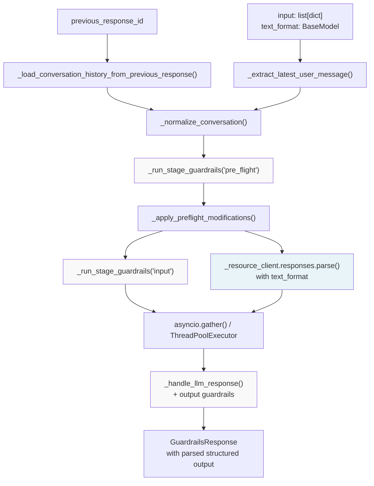
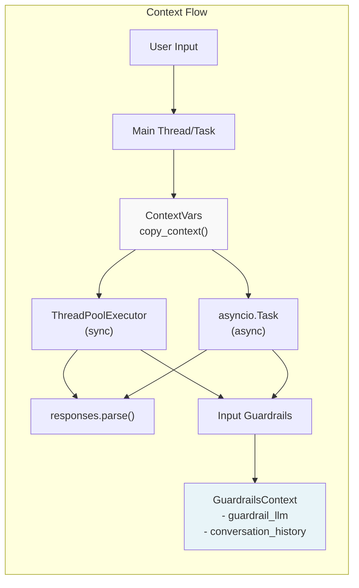
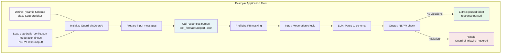

<!-- source: DeepWiki mcp.deepwiki.com · repo openai/openai-guardrails-python · page 9.3 Structured Outputs Example · fetched 2026-10-26 -->

# Structured Outputs Example

<details>
<summary>Relevant source files</summary>

The following files were used as context for generating this wiki page:

- [README.md](README.md)
- [docs/assets/images/guardrails-python-config-screenshot-100pct-q70.webp](docs/assets/images/guardrails-python-config-screenshot-100pct-q70.webp)
- [src/guardrails/resources/chat/chat.py](src/guardrails/resources/chat/chat.py)
- [src/guardrails/resources/responses/responses.py](src/guardrails/resources/responses/responses.py)
- [tests/unit/test_context.py](tests/unit/test_context.py)

</details>


This page documents how to use the Responses API's `parse` method with guardrails to generate structured outputs validated by Pydantic models. The `parse` method enables type-safe, schema-validated responses while maintaining full guardrail protection across all pipeline stages.

For basic Responses API usage without structured outputs, see [Responses API](#4.4). For information about the underlying execution pipeline, see [Three-Stage Pipeline Architecture](#3.1).

---

## Overview

The `responses.parse()` method combines OpenAI's structured output capabilities with guardrail validation. It accepts a Pydantic `BaseModel` class as the `text_format` parameter, ensuring the LLM response conforms to the specified schema while simultaneously validating inputs and outputs through configured guardrails.

**Key Features:**
- Type-safe outputs using Pydantic models
- Full three-stage guardrail pipeline (preflight, input, output)
- Conversation history support via `previous_response_id`
- Concurrent input validation during LLM inference
- Preflight modifications (e.g., PII masking) applied before parsing

Sources: [src/guardrails/resources/responses/responses.py:110-164](), [README.md:163]()

---

## Method Signatures

### Synchronous

```python
def parse(
    self, 
    input: list[dict[str, str]], 
    model: str, 
    text_format: type[BaseModel], 
    suppress_tripwire: bool = False, 
    **kwargs
) -> GuardrailsResponse
```

### Asynchronous

```python
async def parse(
    self, 
    input: list[dict[str, str]], 
    model: str, 
    text_format: type[BaseModel], 
    stream: bool = False,
    suppress_tripwire: bool = False, 
    **kwargs
) -> GuardrailsResponse | AsyncIterator[Any]
```

**Parameters:**
- `input`: List of message dictionaries with `role` and `content` keys
- `model`: Model identifier (e.g., `"gpt-5"`)
- `text_format`: Pydantic `BaseModel` subclass defining the output schema
- `suppress_tripwire`: If `True`, returns results without raising exceptions
- `previous_response_id`: Optional conversation history identifier
- `stream`: (Async only) Enable streaming structured outputs
- `**kwargs`: Additional parameters passed to underlying OpenAI client

Sources: [src/guardrails/resources/responses/responses.py:110-111](), [src/guardrails/resources/responses/responses.py:271-273]()

---

## Execution Flow



**Execution Flow for responses.parse() with Guardrails**

Sources: [src/guardrails/resources/responses/responses.py:110-164](), [src/guardrails/resources/responses/responses.py:271-335]()

---

## Pipeline Stages

### Stage 1: Conversation Preparation

The method begins by loading any previous conversation history and normalizing the current input:

| Step | Method | Purpose |
|------|--------|---------|
| Load history | `_load_conversation_history_from_previous_response()` | Retrieve prior conversation turns |
| Normalize current | `_normalize_conversation()` | Convert input to standardized format |
| Extract latest | `_extract_latest_user_message()` | Identify the current user message for validation |
| Merge | Combine prior + current | Build full conversation context |

Sources: [src/guardrails/resources/responses/responses.py:112-121]()

### Stage 2: Preflight Guardrails

Preflight guardrails run **synchronously** before the LLM call, enabling input transformations:

```python
preflight_results = await self._client._run_stage_guardrails(
    "pre_flight",
    latest_message,
    conversation_history=normalized_conversation,
    suppress_tripwire=suppress_tripwire,
)

modified_input = self._client._apply_preflight_modifications(
    input, 
    preflight_results
)
```

**Common preflight guardrails:**
- PII masking/redaction (modifies input)
- URL validation and sanitization
- Input format transformations

Sources: [src/guardrails/resources/responses/responses.py:124-132](), [src/guardrails/resources/responses/responses.py:286-295]()

### Stage 3: Concurrent Input Validation and LLM Parsing

Input guardrails execute **concurrently** with the LLM call to minimize latency:

**Synchronous (ThreadPoolExecutor):**
```python
with ThreadPoolExecutor(max_workers=1) as executor:
    llm_kwargs = {
        "input": modified_input,
        "model": model,
        "text_format": text_format,
        **kwargs,
    }
    if supports_safety_identifier(self._client._resource_client):
        llm_kwargs["safety_identifier"] = SAFETY_IDENTIFIER
    
    llm_call_fn = partial(
        self._client._resource_client.responses.parse, 
        **llm_kwargs
    )
    ctx = copy_context()
    llm_future = executor.submit(ctx.run, llm_call_fn)
    
    input_results = self._client._run_stage_guardrails(
        "input",
        latest_message,
        conversation_history=normalized_conversation,
        suppress_tripwire=suppress_tripwire,
    )
    llm_response = llm_future.result()
```

**Asynchronous (asyncio.gather):**
```python
input_check = self._client._run_stage_guardrails(
    "input",
    latest_message,
    conversation_history=normalized_conversation,
    suppress_tripwire=suppress_tripwire,
)

llm_kwargs = {...}
llm_call = self._client._resource_client.responses.parse(**llm_kwargs)

input_results, llm_response = await asyncio.gather(input_check, llm_call)
```

Sources: [src/guardrails/resources/responses/responses.py:134-156](), [src/guardrails/resources/responses/responses.py:298-318]()

### Stage 4: Output Validation and Response Wrapping

The structured output is validated by output guardrails and wrapped in a `GuardrailsResponse`:

```python
return self._client._handle_llm_response(
    llm_response,
    preflight_results,
    input_results,
    conversation_history=normalized_conversation,
    suppress_tripwire=suppress_tripwire,
)
```

The `_handle_llm_response()` method:
1. Runs output guardrails on the parsed text
2. Checks for tripwire triggers
3. Wraps the structured response with guardrail results
4. Returns `GuardrailsResponse` containing both the parsed object and validation metadata

Sources: [src/guardrails/resources/responses/responses.py:158-164](), [src/guardrails/resources/responses/responses.py:329-335]()

---

## Context Propagation



**Context Propagation in Concurrent Execution**

The synchronous version uses `copy_context()` to ensure conversation-aware guardrails receive proper context when executed in a separate thread:

```python
ctx = copy_context()
llm_future = executor.submit(ctx.run, llm_call_fn)
```

This pattern ensures:
- Conversation history is accessible to LLM-based guardrails
- Thread-safe context isolation
- Proper propagation of `GuardrailsContext` state

Sources: [src/guardrails/resources/responses/responses.py:147-148](), [tests/unit/test_context.py:42-66]()

---

## Structured Output Schema

The `text_format` parameter accepts any Pydantic `BaseModel` subclass. The model definition determines the structure and validation rules for the LLM output:

**Example Schema:**
```python
from pydantic import BaseModel

class ProductReview(BaseModel):
    product_name: str
    rating: int  # 1-5
    summary: str
    pros: list[str]
    cons: list[str]
    would_recommend: bool
```

**Usage:**
```python
response = client.responses.parse(
    input=[
        {"role": "user", "content": "Review this laptop..."}
    ],
    model="gpt-5",
    text_format=ProductReview
)

# Access structured data
review = response.parsed  # ProductReview instance
print(review.rating)      # Type-safe access
```

The parsed output is automatically validated against the schema, with parsing errors handled by the underlying OpenAI client.

Sources: [src/guardrails/resources/responses/responses.py:110](), [src/guardrails/resources/responses/responses.py:272]()

---

## Safety Identifier Integration

The `parse` method conditionally includes OpenAI's `safety_identifier` header based on the client type:

```python
if supports_safety_identifier(self._client._resource_client):
    llm_kwargs["safety_identifier"] = SAFETY_IDENTIFIER
```

This header is added for:
- Standard OpenAI clients (`openai.OpenAI`, `openai.AsyncOpenAI`)

This header is **not** added for:
- Azure OpenAI clients
- Local model integrations (Ollama, vLLM)

Sources: [src/guardrails/resources/responses/responses.py:143-144](), [src/guardrails/resources/responses/responses.py:313-314]()

---

## Streaming Support (Async Only)

The async version supports streaming structured outputs when `stream=True`:

```python
async def parse(
    self, 
    input: list[dict[str, str]], 
    model: str, 
    text_format: type[BaseModel], 
    stream: bool = False,
    suppress_tripwire: bool = False, 
    **kwargs
) -> GuardrailsResponse | AsyncIterator[Any]:
    # ... preflight and input validation ...
    
    if stream:
        return self._client._stream_with_guardrails(
            llm_response,
            preflight_results,
            input_results,
            conversation_history=normalized_conversation,
            suppress_tripwire=suppress_tripwire,
        )
    else:
        return await self._client._handle_llm_response(...)
```

**Streaming behavior:**
- Input and preflight guardrails complete before streaming begins
- Chunks are yielded as they arrive
- Output guardrails run on the complete accumulated response
- Final `GuardrailsResponse` includes all validation results

Sources: [src/guardrails/resources/responses/responses.py:320-327]()

---

## Key Differences from responses.create()

| Aspect | `responses.create()` | `responses.parse()` |
|--------|---------------------|-------------------|
| **Input format** | `str` or `list[dict]` | `list[dict]` only |
| **Output format** | Unstructured text | Pydantic model instance |
| **Schema validation** | None | Automatic via `text_format` |
| **text_format parameter** | Not present | Required `type[BaseModel]` |
| **Streaming** | Supported (sync + async) | Async only |
| **Use case** | General-purpose responses | Type-safe, structured data extraction |

Both methods share identical guardrail pipeline architecture and support the same configuration options.

Sources: [src/guardrails/resources/responses/responses.py:27-108](), [src/guardrails/resources/responses/responses.py:110-164]()

---

## Error Handling

### Tripwire Exceptions

By default, guardrail violations raise exceptions:

```python
from guardrails import GuardrailTripwireTriggered

try:
    response = client.responses.parse(
        input=messages,
        model="gpt-5",
        text_format=MyModel
    )
except GuardrailTripwireTriggered as e:
    print(f"Guardrail triggered: {e}")
    print(f"Stage: {e.stage}")
    print(f"Results: {e.guardrail_results}")
```

### Suppressing Tripwires

Set `suppress_tripwire=True` to inspect results without exceptions:

```python
response = client.responses.parse(
    input=messages,
    model="gpt-5",
    text_format=MyModel,
    suppress_tripwire=True
)

# Check for violations manually
if response.guardrail_results.has_tripwire:
    print("Guardrails triggered:", response.guardrail_results.triggered_guardrails)
else:
    print("Parsed output:", response.parsed)
```

For detailed exception handling strategies, see [Error Handling and Tripwires](#2.3).

Sources: [src/guardrails/resources/responses/responses.py:110](), [src/guardrails/resources/responses/responses.py:154-155]()

---

## Complete Usage Example



**Typical Structured Output Flow with Guardrails**

```python
from pathlib import Path
from pydantic import BaseModel
from guardrails import GuardrailsOpenAI, GuardrailTripwireTriggered

# 1. Define structured output schema
class SupportTicket(BaseModel):
    category: str
    priority: str  # "low", "medium", "high", "urgent"
    summary: str
    customer_email: str
    requires_followup: bool

# 2. Initialize client with guardrails
client = GuardrailsOpenAI(
    config=Path("guardrails_config.json")
)

# 3. Prepare conversation
messages = [
    {
        "role": "system",
        "content": "Extract support ticket information from customer messages."
    },
    {
        "role": "user",
        "content": "My account won't let me log in! Email: user@example.com"
    }
]

# 4. Parse with guardrails
try:
    response = client.responses.parse(
        input=messages,
        model="gpt-5",
        text_format=SupportTicket
    )
    
    # 5. Access structured, validated data
    ticket = response.parsed
    print(f"Priority: {ticket.priority}")
    print(f"Category: {ticket.category}")
    print(f"Email: {ticket.customer_email}")
    
    # 6. Inspect guardrail results
    print(f"Guardrails executed: {len(response.guardrail_results)}")
    
except GuardrailTripwireTriggered as e:
    print(f"Request blocked: {e}")
    print(f"Triggered guardrails: {e.guardrail_results.triggered_guardrails}")
```

Sources: [README.md:56-64](), [src/guardrails/resources/responses/responses.py:110-164]()

---

## Conversation History

The `previous_response_id` parameter enables multi-turn conversations with persistent context:

```python
# First turn
response1 = client.responses.parse(
    input=[{"role": "user", "content": "Tell me about your pricing."}],
    model="gpt-5",
    text_format=PricingInfo
)

# Save response ID
response_id = response1.id

# Follow-up turn with history
response2 = client.responses.parse(
    input=[{"role": "user", "content": "What about enterprise plans?"}],
    model="gpt-5",
    text_format=PricingInfo,
    previous_response_id=response_id  # Includes prior context
)
```

The conversation history is automatically:
- Loaded via `_load_conversation_history_from_previous_response()`
- Merged with current turn
- Passed to conversation-aware guardrails
- Maintained across multiple parsing calls

For details on conversation management, see [Conversation History Management](#4.6).

Sources: [src/guardrails/resources/responses/responses.py:112-113](), [src/guardrails/resources/responses/responses.py:275-276]()

---

## Integration with Other APIs

The `responses.parse()` method integrates seamlessly with other Guardrails components:

| Component | Integration Point | Description |
|-----------|------------------|-------------|
| **Chat Completions** | Alternative API | Use `chat.completions.create()` for unstructured text |
| **responses.create()** | Sibling method | Use when structured output isn't needed |
| **responses.retrieve()** | Historical access | Retrieve and re-validate previous responses |
| **Agents SDK** | Not applicable | Agents use tool schemas, not `responses.parse()` |
| **Evaluation Framework** | Dataset testing | Test structured output guardrails with labeled data |

Sources: [src/guardrails/resources/responses/responses.py:1-353](), [src/guardrails/resources/chat/chat.py:1-195]()

---

## Related Documentation

- [Responses API](#4.4) - General Responses API documentation
- [Three-Stage Pipeline Architecture](#3.1) - Detailed pipeline mechanics
- [Error Handling and Tripwires](#2.3) - Exception handling patterns
- [Conversation History Management](#4.6) - Multi-turn conversation support
- [Type System and Context Propagation](#3.3) - Context and result types
- [Chat Completions API](#4.3) - Alternative unstructured API

---

