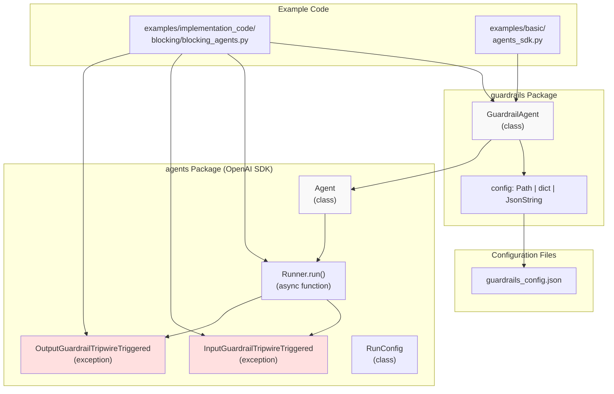
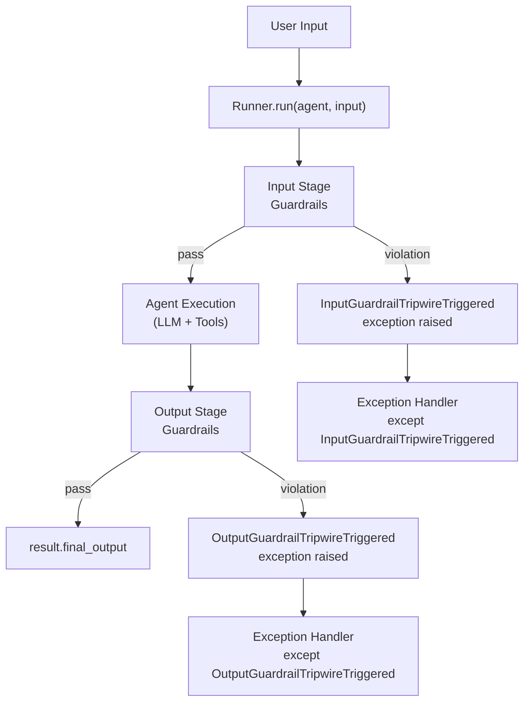
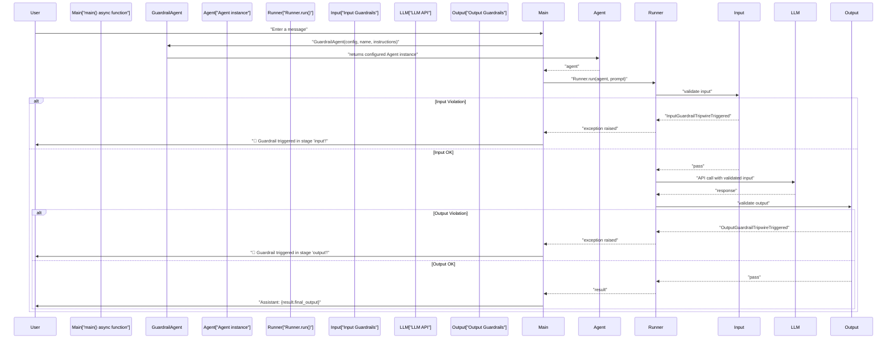

<!-- source: DeepWiki mcp.deepwiki.com · repo openai/openai-guardrails-python · page 9.5 Agents SDK Example · fetched 2026-10-26 -->

# Agents SDK Example

<details>
<summary>Relevant source files</summary>

The following files were used as context for generating this wiki page:

- [README.md](README.md)
- [docs/assets/images/guardrails-python-config-screenshot-100pct-q70.webp](docs/assets/images/guardrails-python-config-screenshot-100pct-q70.webp)
- [examples/basic/agents_sdk.py](examples/basic/agents_sdk.py)
- [src/guardrails/_streaming.py](src/guardrails/_streaming.py)
- [src/guardrails/agents.py](src/guardrails/agents.py)
- [tests/unit/test_agents.py](tests/unit/test_agents.py)

</details>


## Purpose and Scope

This page demonstrates practical usage of `GuardrailAgent` for integrating guardrails with the OpenAI Agents SDK. It shows how to use `GuardrailAgent` as a drop-in replacement for the `Agent` class, configure guardrails from a pipeline configuration file, and handle guardrail exceptions in agent workflows.

For general information about the `GuardrailAgent` class and its architecture, see [Agent Integration](#5). For other client integration patterns using `GuardrailsOpenAI` or `GuardrailsAzureOpenAI`, see [Client Integration](#4).

**Sources:** [docs/agents_sdk_integration.md:1-90](), [docs/examples.md:1-26]()

---

## GuardrailAgent Overview

The `GuardrailAgent` class provides seamless integration with the OpenAI Agents SDK by serving as a drop-in replacement for the SDK's `Agent` class. It automatically configures guardrails from your pipeline configuration and returns a standard `Agent` instance that works with all Agents SDK features.

### Key Characteristics

| Feature | Description |
|---------|-------------|
| **Drop-in Replacement** | Replace `Agent` with `GuardrailAgent` - no other code changes required |
| **Configuration-Driven** | Uses standard `guardrails_config.json` pipeline configuration |
| **Returns Agent Instance** | Returns a regular `Agent` object that works with `Runner.run()` |
| **Specialized Exceptions** | Uses `InputGuardrailTripwireTriggered` and `OutputGuardrailTripwireTriggered` from Agents SDK |
| **Tool-Level Prompt Injection** | Prompt injection checks run at each tool call (see [Tool-Level vs Agent-Level Guardrails](#5.2)) |

**Sources:** [docs/agents_sdk_integration.md:5-16]()

---

## Class and Module Structure

The following diagram maps the key code entities involved in the Agents SDK integration:



**Sources:** [docs/agents_sdk_integration.md:21-62](), [examples/implementation_code/blocking/blocking_agents.py:1-42]()

---

## Basic Usage Pattern

The simplest integration uses `GuardrailAgent` with a configuration file path. The constructor accepts the same parameters as the Agents SDK `Agent` class, plus a `config` parameter for guardrail configuration.

### Minimal Example

[examples/implementation_code/blocking/blocking_agents.py:15-21]() demonstrates the basic instantiation:

```python
agent = GuardrailAgent(
    config=Path("guardrails_config.json"),
    name="Customer support agent",
    instructions="You are a customer support agent. You help customers with their questions.",
)
```

The `agent` object is a standard Agents SDK `Agent` instance that can be used with `Runner.run()`:

[examples/implementation_code/blocking/blocking_agents.py:26-30]()

```python
result = await Runner.run(
    agent,
    prompt
)
print(f"\nAssistant: {result.final_output}")
```

**Sources:** [examples/implementation_code/blocking/blocking_agents.py:1-42](), [docs/agents_sdk_integration.md:17-62]()

---

## Configuration Options

`GuardrailAgent` supports three configuration formats, consistent with other guardrails clients:

### Configuration Format Comparison

| Format | Use Case | Example |
|--------|----------|---------|
| **Path Object** | Standard file-based config (recommended) | `config=Path("guardrails_config.json")` |
| **Dictionary** | Dynamic runtime configuration | `config={"version": 1, "input": {...}, "output": {...}}` |
| **JsonString** | String-based JSON (rare) | `config=JsonString('{"version": 1, ...}')` |

### Configuration Structure

The configuration file follows the standard `PipelineBundles` format with `pre_flight`, `input`, and `output` stages. See [Configuration Files](#2.2) for detailed schema documentation.

**Sources:** [docs/agents_sdk_integration.md:63-82]()

---

## Exception Handling

Agent guardrails use specialized exception types from the Agents SDK that distinguish between input and output stage violations. This allows different handling strategies for each stage.

### Exception Flow Diagram



### Exception Handling Pattern

[examples/implementation_code/blocking/blocking_agents.py:35-38]() shows the exception handling structure:

```python
except (InputGuardrailTripwireTriggered, OutputGuardrailTripwireTriggered) as exc:
    stage_name = "input" if isinstance(exc, InputGuardrailTripwireTriggered) else "output"
    print(f"\n🛑 Guardrail triggered in stage '{stage_name}'!")
    continue
```

**Sources:** [examples/implementation_code/blocking/blocking_agents.py:23-38](), [docs/agents_sdk_integration.md:45-50]()

---

## Complete Example Walkthrough

The following sequence diagram illustrates the complete execution flow for an agent with guardrails:



### Complete Example Code Structure

[examples/implementation_code/blocking/blocking_agents.py:1-42]() provides a full implementation:

| Line Range | Component | Purpose |
|------------|-----------|---------|
| [1-12]() | Imports | Import `GuardrailAgent`, `Runner`, exception types |
| [15-21]() | Agent Creation | Instantiate `GuardrailAgent` with config and instructions |
| [23-38]() | Main Loop | Interactive loop with `Runner.run()` and exception handling |
| [35-38]() | Exception Handling | Catch and distinguish `Input` vs `Output` exceptions |

**Sources:** [examples/implementation_code/blocking/blocking_agents.py:1-42]()

---

## Comparison with Other Client Types

The following table compares `GuardrailAgent` with other guardrails client classes:

| Feature | GuardrailAgent | GuardrailsOpenAI | GuardrailsAsyncOpenAI |
|---------|----------------|------------------|----------------------|
| **Use Case** | Agents SDK integration | Standard OpenAI chat/responses | Async OpenAI chat/responses |
| **Base Class** | Returns `Agent` instance | Wraps `OpenAI` client | Wraps `AsyncOpenAI` client |
| **Exception Type** | `InputGuardrailTripwireTriggered`<br/>`OutputGuardrailTripwireTriggered` | `GuardrailTripwireTriggered` | `GuardrailTripwireTriggered` |
| **API Methods** | Via `Runner.run(agent, ...)` | `chat.completions.create()`<br/>`responses.create()` | Same as sync (async) |
| **Streaming Support** | Via Agents SDK streaming | Via `stream=True` parameter | Via `stream=True` parameter |
| **Tool-Level Checks** | Prompt injection at tool level | N/A | N/A |

For examples using `GuardrailsOpenAI` or `GuardrailsAsyncOpenAI`, see:
- [examples/implementation_code/blocking/blocking_completions.py:1-49]() - Chat completions example
- [examples/implementation_code/blocking/blocking_responses.py:1-53]() - Responses API example

**Sources:** [examples/implementation_code/blocking/blocking_agents.py:1-42](), [examples/implementation_code/blocking/blocking_completions.py:1-49](), [examples/implementation_code/blocking/blocking_responses.py:1-53](), [docs/agents_sdk_integration.md:1-90]()

---

## Running the Example

To run the agents SDK example:

1. **Install dependencies:**
   ```bash
   pip install openai-guardrails[examples]
   ```

2. **Create configuration file:**
   Create a `guardrails_config.json` file (see [Configuration Files](#2.2)) or use the [Guardrails Wizard](https://guardrails.openai.com/).

3. **Set API key:**
   ```bash
   export OPENAI_API_KEY='your-api-key'
   ```

4. **Run the example:**
   ```bash
   python examples/implementation_code/blocking/blocking_agents.py
   ```

The example enters an interactive loop where you can test various inputs and observe guardrail behavior.

**Sources:** [docs/agents_sdk_integration.md:84-90](), [docs/examples.md:19-26]()

---

## Key Takeaways

1. **Drop-in Replacement:** `GuardrailAgent` requires minimal code changes - just replace `Agent` with `GuardrailAgent` and add `config` parameter
2. **Standard Agent Instance:** Returns a regular Agents SDK `Agent` that works with all SDK features
3. **Specialized Exceptions:** Use `InputGuardrailTripwireTriggered` and `OutputGuardrailTripwireTriggered` for stage-specific handling
4. **Configuration Consistency:** Uses the same `guardrails_config.json` format as other client types
5. **Tool-Level Prompt Injection:** Unlike agent-level guardrails, prompt injection detection runs at each tool call

For detailed information on the guardrail execution model in agents, see [Tool-Level vs Agent-Level Guardrails](#5.2) and [Agent Exception Handling](#5.3).

**Sources:** [docs/agents_sdk_integration.md:5-90](), [examples/implementation_code/blocking/blocking_agents.py:1-42]()

---

