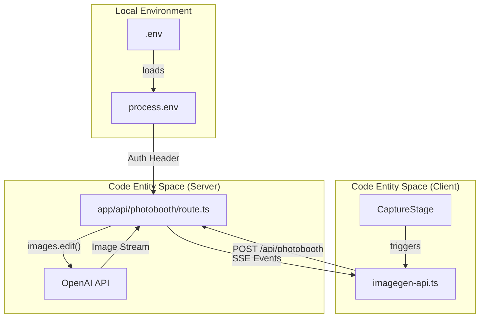
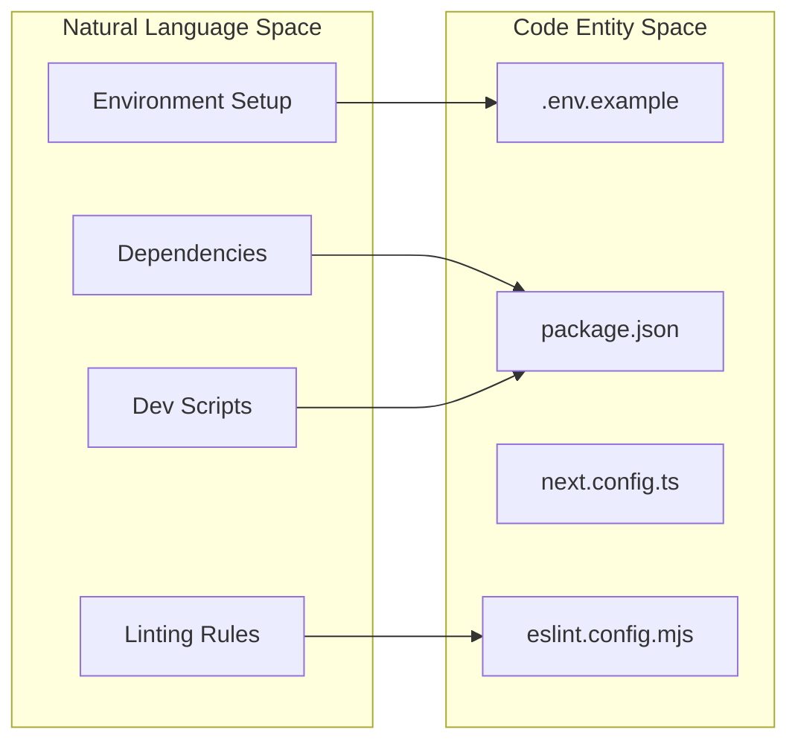

<!-- source: DeepWiki mcp.deepwiki.com · repo openai/openai-imagegen-demo · page 1.1 Getting Started · fetched 2026-10-26 -->

# Getting Started

<details>
<summary>Relevant source files</summary>

The following files were used as context for generating this wiki page:

- [.env.example](.env.example)
- [.gitignore](.gitignore)
- [eslint.config.mjs](eslint.config.mjs)
- [next.config.ts](next.config.ts)
- [package-lock.json](package-lock.json)
- [package.json](package.json)
- [postcss.config.mjs](postcss.config.mjs)
- [tsconfig.json](tsconfig.json)

</details>


This page provides a technical guide for setting up the OpenAI ImageGen Photobooth demo locally and deploying it to production. The application is built on **Next.js 15** and utilizes the **OpenAI DALL-E 2 API** (specifically the image editing endpoint) to transform user-captured photos into various artistic styles.

## Prerequisites

Before beginning, ensure you have the following installed:
*   **Node.js**: Version 20 or higher (recommended for Next.js 15 compatibility).
*   **npm**: Included with Node.js.
*   **OpenAI API Key**: A valid key with access to DALL-E models.

## Initial Setup

### 1. Clone the Repository
Clone the codebase to your local machine:
```bash
git clone https://github.com/openai/openai-imagegen-demo.git
cd openai-imagegen-demo
```

### 2. Configure Environment Variables
The application requires an OpenAI API key to function. The backend API route expects this variable to be available in the environment.

1.  Locate `.env.example` in the root directory [.env.example:1-1]().
2.  Create a new file named `.env` or `.env.local`.
3.  Add your OpenAI API key:
    ```text
    OPENAI_API_KEY="your_api_key_here"
    ```
Note that `.env*` files are ignored by git to prevent credential leakage [.gitignore:38-39]().

### 3. Install Dependencies
The project uses `npm` for package management. Install the required dependencies defined in `package.json` [package.json:11-33]().

```bash
npm install
```

## Local Development

The project provides several scripts for development and maintenance [package.json:5-10]():

| Script | Command | Purpose |
| :--- | :--- | :--- |
| `dev` | `next dev` | Starts the Next.js development server on `http://localhost:3000`. |
| `build` | `next build` | Compiles the application for production. |
| `start` | `next start` | Starts the production server after a build. |
| `lint` | `eslint` | Runs ESLint to check for code quality and Next.js best practices. |

To start the development server:
```bash
npm run dev
```

### Configuration Files
*   **Next.js Config**: `next.config.ts` disables the development indicator for a cleaner UI [next.config.ts:3-5]().
*   **TypeScript**: Configured in `tsconfig.json` with strict type checking and path aliasing (`@/*` maps to the root) [tsconfig.json:7-22]().
*   **Styling**: Uses Tailwind CSS v4 via `@tailwindcss/postcss` [postcss.config.mjs:2-2]().

## Deployment

### Vercel Deployment
The application is optimized for **Vercel**. When deploying, ensure you configure the `OPENAI_API_KEY` in the Vercel Project Settings under "Environment Variables".

### Data Flow Overview
The following diagram illustrates the relationship between the local environment, the Next.js server, and the OpenAI API.

**System Initialization and Request Flow**

**Sources:** [.env.example:1-1](), [package.json:6-6](), [tsconfig.json:21-23]()

## Project Structure
The repository follows the Next.js App Router convention:

**Core Logic Mapping**

**Sources:** [.env.example:1-1](), [package.json:5-34](), [eslint.config.mjs:12-23](), [next.config.ts:3-5]()

*   **`app/`**: Contains the Next.js routes and layouts.
*   **`components/`**: React components including Radix UI primitives and photobooth-specific UI.
*   **`lib/`**: Utility functions, style definitions, and API services.
*   **`public/`**: Static assets like the mask image required for DALL-E editing.

**Sources:**
*   Environment Variables: [.env.example:1-1]()
*   Git Ignored Files: [.gitignore:1-46]()
*   ESLint Configuration: [eslint.config.mjs:1-26]()
*   Next.js Configuration: [next.config.ts:1-8]()
*   Project Metadata/Scripts: [package.json:1-35]()
*   TypeScript Configuration: [tsconfig.json:1-28]()

---

