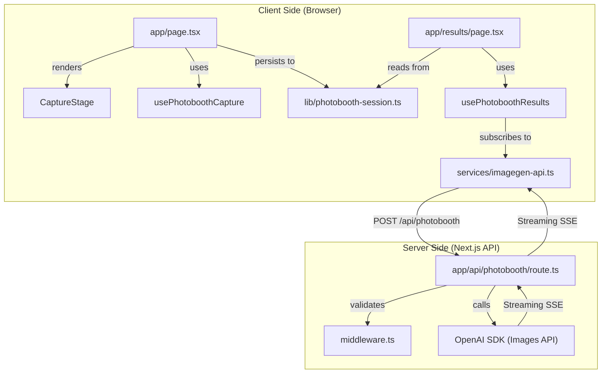
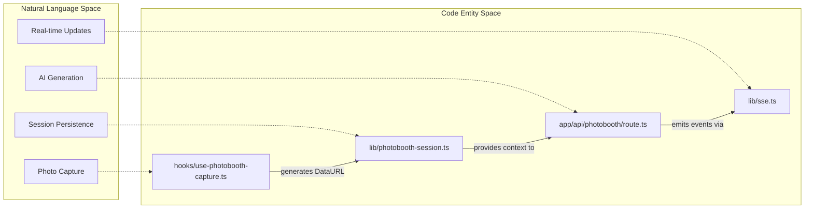

<!-- source: DeepWiki mcp.deepwiki.com · repo openai/openai-imagegen-demo · page 1.2 Application Architecture · fetched 2026-10-26 -->

# Application Architecture

Relevant source files

The following files were used as context for generating this wiki page:

- [app/layout.tsx](app/layout.tsx)
- [app/page.tsx](app/page.tsx)
- [app/results/page.tsx](app/results/page.tsx)
- [next-env.d.ts](next-env.d.ts)

The OpenAI ImageGen Photobooth is a full-stack Next.js application designed to provide a real-time, AI-powered photo transformation experience. It utilizes the Next.js App Router for routing and layout management, and integrates with the OpenAI Images API (DALL-E) via a streaming backend.

## System Overview

The application is structured around a two-page flow: **Capture** and **Results**. Data is passed between these pages using client-side session storage to accommodate large base64 image payloads that exceed URL length limits.

### Component Relationship Diagram
This diagram illustrates how the primary UI components and services interact across the frontend/backend boundary.

"Application Component Relationships"

Sources: [app/page.tsx:5-14](), [app/results/page.tsx:8-10](), [app/api/photobooth/route.ts:1-20](), [middleware.ts:1-10]()

---

## The Two-Page Flow

The application logic is split into two distinct phases to separate the resource-heavy camera/upload operations from the asynchronous AI generation process.

### 1. Capture Phase (`/`)
The entry point of the application is the home page [app/page.tsx:16-138](). 
- **Image Acquisition**: Users can capture a photo via the `MediaDevices` API or upload an existing file. This is managed by the `usePhotoboothCapture` hook [app/page.tsx:14-37]().
- **Style Selection**: Users select up to 4 styles from the `PHOTOBOOTH_STYLES` catalog.
- **Session Handover**: When `onGenerate` is triggered, the `savePhotoboothRequest` function [app/page.tsx:65-82]() stores the base64 `imageDataUrl` and selected `styleIds` into `sessionStorage`. The application then navigates to `/results` via the Next.js router [app/page.tsx:81]().

### 2. Results Phase (`/results`)
The results page [app/results/page.tsx:13-124]() handles the lifecycle of the AI generation.
- **Session Recovery**: Upon mount, the `usePhotoboothResults` hook loads the data from `sessionStorage` [app/results/page.tsx:15]().
- **SSE Subscription**: The client establishes a connection to the `/api/photobooth` route.
- **Incremental UI Updates**: As the server streams back partial and final images, the `ResultImageCard` components update their state from "loading" to "streaming" to "done" [app/results/page.tsx:76-90]().

---

## Technical Stack & Data Flow

### Code Entity Mapping
The following diagram maps high-level concepts to the specific code entities that implement them.

"Conceptual to Code Entity Mapping"

Sources: [hooks/use-photobooth-capture.ts:1-20](), [lib/photobooth-session.ts:1-15](), [app/api/photobooth/route.ts:1-10](), [lib/sse.ts:1-10]()

### Backend Integration
The application uses a Next.js Route Handler [app/api/photobooth/route.ts:1-20]() to act as a proxy between the client and OpenAI. This architecture provides several benefits:
1. **Security**: The `OPENAI_API_KEY` remains on the server and is never exposed to the client.
2. **Middleware Protection**: The `middleware.ts` file ensures that only requests from the same origin are processed [middleware.ts:1-20]().
3. **Concurrency**: The server-side route handles multiple concurrent requests to OpenAI (one per selected style) and multiplexes their responses into a single Server-Sent Events (SSE) stream.

### Key Infrastructure Files
| File | Role |
| :--- | :--- |
| `app/layout.tsx` | Defines the root HTML structure, Geist font variables, and global metadata [app/layout.tsx:1-39](). |
| `app/globals.css` | Contains the Tailwind CSS v4 configuration and design system tokens. |
| `next-env.d.ts` | Provides TypeScript definitions for Next.js routes and image types [next-env.d.ts:1-7](). |

Sources: [app/layout.tsx:1-39](), [app/api/photobooth/route.ts:1-20](), [middleware.ts:1-20](), [next-env.d.ts:1-7]()

---

