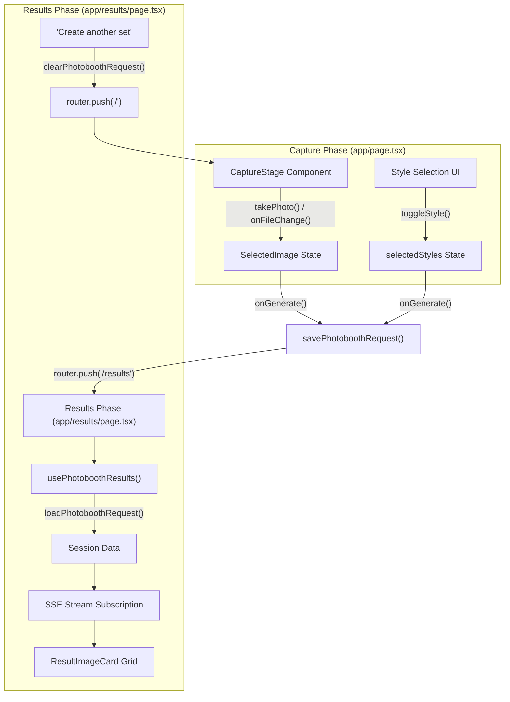

<!-- source: DeepWiki mcp.deepwiki.com · repo openai/openai-imagegen-demo · page 2 User Flow & Pages · fetched 2026-10-26 -->

# User Flow & Pages

Relevant source files

The following files were used as context for generating this wiki page:

- [app/page.tsx](app/page.tsx)
- [app/results/page.tsx](app/results/page.tsx)

This section describes the end-to-end user journey within the ImageGen Photobooth application. The application follows a linear two-page progression: capturing or uploading a source image on the home page, followed by viewing AI-generated transformations on the results page.

## Journey Overview

The user flow is designed for rapid iteration, allowing users to select multiple artistic styles and see them generated in parallel.

### User Flow Diagram

The following diagram maps the user's path through the frontend components and the underlying session persistence mechanism.

**Application Navigation Flow**

Sources: [app/page.tsx:16-138](), [app/results/page.tsx:13-123](), [lib/photobooth-session.ts:1-40]()

---

## Capture & Style Selection

The entry point of the application is the `HomePage` [app/page.tsx:16](). It serves as the "Photobooth" interface where users provide a source image and select which AI styles they wish to apply.

The page utilizes the `usePhotoboothCapture` hook to manage complex media interactions, including webcam access and drag-and-drop file handling [app/page.tsx:21-37](). Users can select up to a maximum number of styles defined by `MAX_SELECTED_STYLES` [lib/constants.ts:10]().

When the user clicks the generate button, the `onGenerate` function [app/page.tsx:65-82]() performs the following:
1. Validates that an image and at least one style are selected.
2. Persists the image data and style IDs to `sessionStorage` via `savePhotoboothRequest` [app/page.tsx:68-71]().
3. Navigates the user to the `/results` route [app/page.tsx:81]().

For details on image acquisition and the style selection UI, see [Capture & Style Selection Page](#2.1).

**Sources:** [app/page.tsx:65-82](), [lib/constants.ts:9-11]()

---

## Results Page

The `ResultsPage` [app/results/page.tsx:13]() is responsible for orchestrating the generation process and displaying the output. It relies on the `usePhotoboothResults` hook to retrieve the session data and manage the Server-Sent Events (SSE) stream [app/results/page.tsx:15]().

### Result Visualization
The page renders a responsive grid of `ResultImageCard` components [app/results/page.tsx:83-88](). These cards transition through several states:
- **Loading/Queued**: Waiting for the API to begin processing the specific style.
- **Streaming**: Displaying partial image chunks as they arrive from the OpenAI API.
- **Done**: Displaying the final high-resolution image with download options.

### Interaction & Reset
Users can click on any card to open a `ResultPreviewModal` for a larger view [app/results/page.tsx:112-120](). To start over, the "Create another set" button invokes `clearPhotoboothRequest` [app/results/page.tsx:103]() and redirects back to the home page, ensuring a fresh state for the next session.

For details on the streaming implementation and the result UI states, see [Results Page](#2.2).

**Sources:** [app/results/page.tsx:15-109](), [hooks/use-photobooth-results.ts:1-50]()

---

## Session Bridge

Because the source image is a potentially large base64 Data URL, the application does not pass state via URL parameters. Instead, it uses a client-side session utility to bridge the two pages.

| Function | File | Purpose |
| :--- | :--- | :--- |
| `savePhotoboothRequest` | `lib/photobooth-session.ts` | Writes `imageDataUrl` and `styleIds` to `sessionStorage`. |
| `loadPhotoboothRequest` | `lib/photobooth-session.ts` | Reads the session data to initialize the results stream. |
| `clearPhotoboothRequest`| `lib/photobooth-session.ts` | Purges the storage to prevent stale data on re-entry. |

**Sources:** [lib/photobooth-session.ts:1-40]()

---

