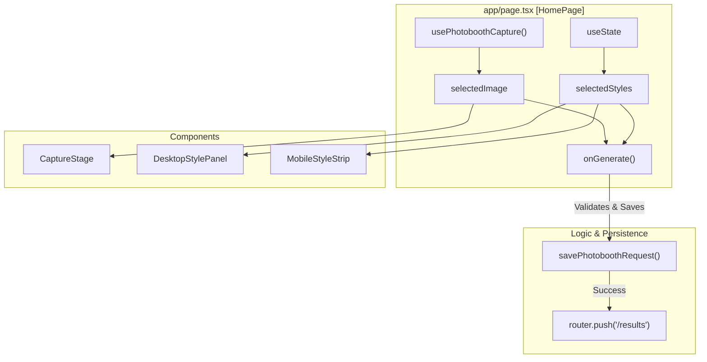
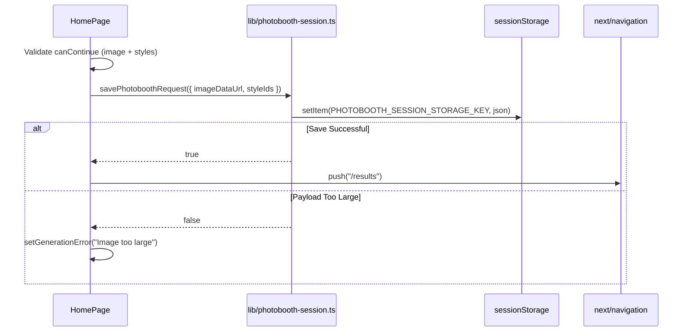

<!-- source: DeepWiki mcp.deepwiki.com · repo openai/openai-imagegen-demo · page 2.1 Capture & Style Selection Page · fetched 2026-10-26 -->

# Capture & Style Selection Page

Relevant source files

The following files were used as context for generating this wiki page:

- [app/page.tsx](app/page.tsx)
- [components/photobooth/capture-stage.tsx](components/photobooth/capture-stage.tsx)
- [components/photobooth/desktop-style-panel.tsx](components/photobooth/desktop-style-panel.tsx)
- [components/photobooth/mobile-style-strip.tsx](components/photobooth/mobile-style-strip.tsx)
- [components/photobooth/style-option-card.tsx](components/photobooth/style-option-card.tsx)
- [components/photobooth/style-options-list.tsx](components/photobooth/style-options-list.tsx)
- [hooks/use-photobooth-capture.ts](hooks/use-photobooth-capture.ts)

The **Capture & Style Selection Page** is the entry point of the application, located at `app/page.tsx`. It provides the user interface for acquiring a source image and selecting the AI styles to be applied. The page integrates camera access, file system uploads, drag-and-drop interactions, and a responsive style selection system.

## Overview of implementation

The page is a client-side component that orchestrates state between the image acquisition logic (encapsulated in a custom hook) and the UI components. It manages the list of selected styles and handles the transition to the results phase by persisting the session data.

### Core Logic & Data Flow

The following diagram illustrates how the `HomePage` component connects user actions to the underlying logic and navigation.

**Diagram: Capture Page Logic Flow**

**Sources:** [app/page.tsx:16-138](), [hooks/use-photobooth-capture.ts:6-176]()

---

## Image Acquisition

Image acquisition is managed by the `usePhotoboothCapture` hook, which abstracts three primary methods: webcam capture, file upload, and drag-and-drop.

### 1. Webcam Capture
*   **Media Access:** Uses `navigator.mediaDevices.getUserMedia` to request a video stream [hooks/use-photobooth-capture.ts:58-61]().
*   **Mirroring:** The UI mirrors the video feed for a natural "mirror" feel [components/photobooth/capture-stage.tsx:76]().
*   **Snapshot:** When `takePhoto` is called, the current video frame is drawn to a hidden `<canvas>`. To ensure the resulting image matches the preview, the canvas context is flipped horizontally before drawing [hooks/use-photobooth-capture.ts:91-95]().

### 2. File Upload & Drag-and-Drop
*   **File Selection:** A hidden `<input type="file">` is triggered via a ref [app/page.tsx:120-126]().
*   **Processing:** Files (whether dropped or uploaded) are processed by `handleUploadFile`, which utilizes `resizeImageFileAsDataUrl` to ensure the image meets size requirements before being converted to a base64 Data URL [hooks/use-photobooth-capture.ts:105-122]().
*   **Drag States:** `onDragOver`, `onDragLeave`, and `onDrop` manage the `isDragActive` state to provide visual feedback [hooks/use-photobooth-capture.ts:135-157]().

**Sources:** [hooks/use-photobooth-capture.ts:52-157](), [components/photobooth/capture-stage.tsx:70-118]()

---

## Style Selection UI

The application allows users to select up to a maximum number of styles (defined by `MAX_SELECTED_STYLES`) [lib/constants.ts:10](). The UI adapts based on the viewport size.

### Component Hierarchy
The style selection is split into two responsive views:
1.  **DesktopStylePanel:** A sidebar appearing on large screens (`lg:block`) [components/photobooth/desktop-style-panel.tsx:18]().
2.  **MobileStyleStrip:** A horizontal scrolling strip appearing on smaller screens (`lg:hidden`) [components/photobooth/mobile-style-strip.tsx:18]().

Both components wrap the `StyleOptionsList`, which iterates over `PHOTOBOOTH_STYLES` to render `StyleOptionCard` components [components/photobooth/style-options-list.tsx:31-48]().

### Selection Logic
The `toggleStyle` function in `app/page.tsx` manages the `selectedStyles` array:
*   If the style is already selected, it is removed [app/page.tsx:53]().
*   If the selection is below the limit, the new style is added [app/page.tsx:56]().
*   If the limit is reached, the selection is ignored, and a tooltip (`STYLE_LIMIT_TOOLTIP`) is displayed on the card [components/photobooth/style-option-card.tsx:34]().

**Sources:** [app/page.tsx:50-58](), [components/photobooth/style-options-list.tsx:19-49](), [components/photobooth/style-option-card.tsx:13-53]()

---

## Generation Flow (`onGenerate`)

The `onGenerate` function serves as the bridge between the selection phase and the results phase.

**Diagram: Data Persistence & Navigation**

### Implementation Details
*   **Validation:** The `canContinue` memoized boolean ensures the "Generate" button is only active when an image is present and at least one style is selected [app/page.tsx:60-63]().
*   **Persistence:** The image and style data are passed to `savePhotoboothRequest` [app/page.tsx:68-71](). This helper uses `sessionStorage` because the base64 image data is typically too large for URL parameters [lib/photobooth-session.ts]().
*   **Error Handling:** If `savePhotoboothRequest` returns `false` (usually due to `sessionStorage` quota limits), a `generationError` is displayed to the user [app/page.tsx:73-78]().

**Sources:** [app/page.tsx:65-82](), [lib/photobooth-session.ts:12]()

---

## Component Reference Table

| Component | File Path | Responsibility |
| :--- | :--- | :--- |
| `CaptureStage` | `components/photobooth/capture-stage.tsx` | Renders the video feed, selected image, or upload placeholders. |
| `DesktopStylePanel` | `components/photobooth/desktop-style-panel.tsx` | Vertical sidebar for style selection on desktop. |
| `MobileStyleStrip` | `components/photobooth/mobile-style-strip.tsx` | Horizontal scrollable list for style selection on mobile. |
| `StyleOptionsList` | `components/photobooth/style-options-list.tsx` | Maps the style catalog to individual cards. |
| `StyleOptionCard` | `components/photobooth/style-option-card.tsx` | The clickable tile for an individual AI style. |

**Sources:** [components/photobooth/capture-stage.tsx:21](), [components/photobooth/desktop-style-panel.tsx:12](), [components/photobooth/mobile-style-strip.tsx:12](), [components/photobooth/style-options-list.tsx:19](), [components/photobooth/style-option-card.tsx:13]()

---

