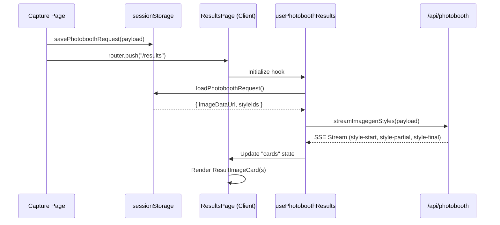
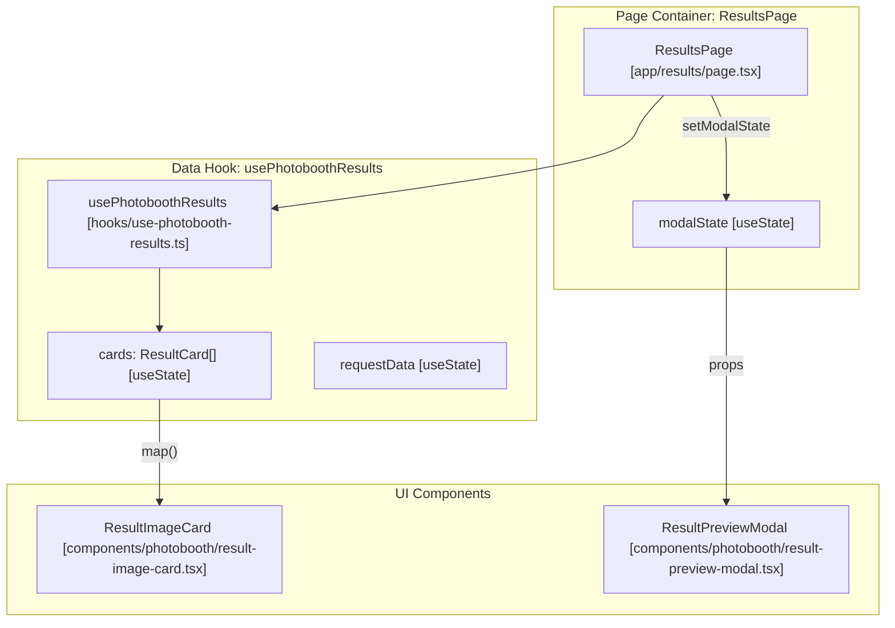

<!-- source: DeepWiki mcp.deepwiki.com · repo openai/openai-imagegen-demo · page 2.2 Results Page · fetched 2026-10-26 -->

# Results Page

Relevant source files

The following files were used as context for generating this wiki page:

- [app/results/page.tsx](app/results/page.tsx)
- [components/photobooth/result-image-card.tsx](components/photobooth/result-image-card.tsx)
- [components/photobooth/result-preview-modal.tsx](components/photobooth/result-preview-modal.tsx)
- [hooks/use-photobooth-results.ts](hooks/use-photobooth-results.ts)

The Results Page (`app/results/page.tsx`) is the final destination in the photobooth user journey. It is responsible for orchestrating the generation of AI-styled portraits by consuming a server-sent events (SSE) stream and rendering the results in a responsive, interactive grid.

## Overview and Purpose

The page serves three primary technical functions:
1.  **Session Restoration**: Retrieving the base64 image and selected style IDs from `sessionStorage` via the `usePhotoboothResults` hook [app/results/page.tsx:15]().
2.  **Streaming Orchestration**: Managing the lifecycle of multiple concurrent image generations, updating individual `ResultCard` states as partial and final images arrive [hooks/use-photobooth-results.ts:42-111]().
3.  **Interaction Management**: Providing a fullscreen preview modal with client-side image optimization and a download mechanism for generated assets [app/results/page.tsx:19-58]().

### Data Flow: Capture to Results
The following diagram illustrates how data captured on the home page is transitioned to and processed by the Results Page.

**Session Transition and Generation Flow**

Sources: [app/results/page.tsx:15](), [hooks/use-photobooth-results.ts:23-31](), [hooks/use-photobooth-results.ts:113-118]()

---

## State Management

The page state is primarily driven by the `usePhotoboothResults` hook, which manages an array of `ResultCard` objects.

### The ResultCard State Machine
Each card in the grid follows a specific state transition based on the SSE event type received:

| Event Name | Target Status | Description |
| :--- | :--- | :--- |
| `session-start` | `queued` | Initial state before generation begins. |
| `style-start` | `streaming` | The API has started processing this specific style [hooks/use-photobooth-results.ts:62-68](). |
| `style-partial` | `streaming` | A low-resolution preview image is available [hooks/use-photobooth-results.ts:70-80](). |
| `style-final` | `done` | The high-resolution final image is received [hooks/use-photobooth-results.ts:82-94](). |
| `style-error` | `error` | Generation failed for this specific style [hooks/use-photobooth-results.ts:96-106](). |

### Entity Mapping: Component to State
The following diagram maps UI components to their corresponding data entities and state hooks.

**Component and State Relationship**

Sources: [app/results/page.tsx:15-16](), [hooks/use-photobooth-results.ts:17-20](), [app/results/page.tsx:83-87]()

---

## Component Implementation

### ResultImageCard
The `ResultImageCard` component handles the visual representation of a style's generation progress. It dynamically toggles between different loading indicators:
*   **Centered Spinner**: Shown when the style is `queued` or `streaming` but no image data (partial or final) is yet available [components/photobooth/result-image-card.tsx:22]().
*   **Top-Right Spinner**: Shown when an image is being displayed but the status is still `streaming`, indicating a higher-quality version is pending [components/photobooth/result-image-card.tsx:23]().
*   **Zoom Cursor**: Applied only when `activeImage` is present, signaling that the card can be clicked to open the preview modal [components/photobooth/result-image-card.tsx:31]().

### Fullscreen Preview and Optimization
When a user clicks a card, `handleOpenPreview` is triggered. Before opening the `ResultPreviewModal`, the application attempts to resize the image using `resizeImageDataUrl` [app/results/page.tsx:27](). This ensures that even if the raw generated image is large, the preview modal remains performant.

The `ResultPreviewModal` itself is a fixed-position overlay that uses `role="dialog"` and `aria-modal="true"` for accessibility [components/photobooth/result-preview-modal.tsx:23-24]().

### Download Functionality
Downloading is handled via a utility function `downloadUrl` [lib/browser/file-utils.ts](). 
1.  **Grid Download**: Users can download directly from the card once `status === "done"` [app/results/page.tsx:39-43]().
2.  **Modal Download**: The modal checks if the current style in view is finished (`canDownloadPreview`) before showing the download button [app/results/page.tsx:45-52]().

Sources: [components/photobooth/result-image-card.tsx:17-24](), [app/results/page.tsx:19-37](), [components/photobooth/result-preview-modal.tsx:36-46]()

---

## Reset Flow: 'Create another set'

The reset flow allows users to return to the capture phase while ensuring a clean state.
1.  **Clear Session**: The `clearPhotoboothRequest()` function is called to remove the `PHOTOBOOTH_SESSION_STORAGE_KEY` from `sessionStorage` [app/results/page.tsx:103]().
2.  **Navigation**: The user is routed back to the root path `/` [app/results/page.tsx:104]().
3.  **Cleanup**: The `usePhotoboothResults` hook includes a cleanup effect that calls `controller.abort()`, immediately terminating any active SSE connections to the API if the user navigates away mid-generation [hooks/use-photobooth-results.ts:133]().

Sources: [app/results/page.tsx:100-108](), [hooks/use-photobooth-results.ts:133-134]()

---

