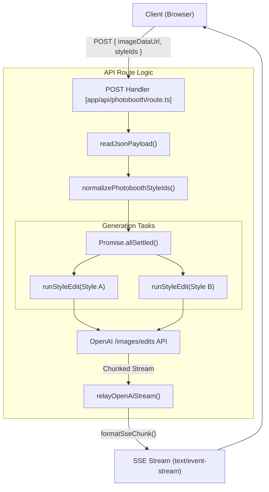
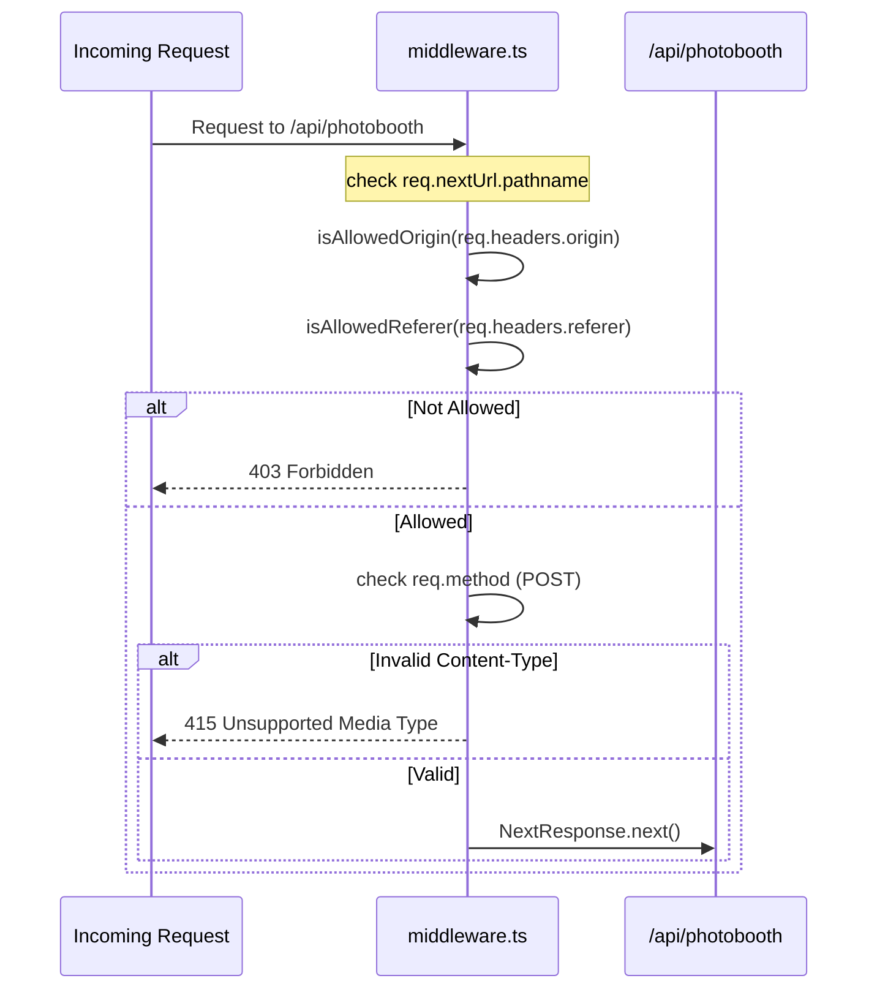

<!-- source: DeepWiki mcp.deepwiki.com · repo openai/openai-imagegen-demo · page 3 Backend API & Streaming · fetched 2026-10-26 -->

# Backend API & Streaming

Relevant source files

The following files were used as context for generating this wiki page:

- [app/api/photobooth/route.ts](app/api/photobooth/route.ts)
- [middleware.ts](middleware.ts)

The backend layer of the ImageGen Photobooth is a Next.js Route Handler that orchestrates concurrent requests to the OpenAI `images/edits` API. It utilizes Server-Sent Events (SSE) to stream generation progress and final results back to the client in real-time, ensuring a responsive user experience even during long-running AI generations.

## Architecture Overview

The backend is structured to handle high-concurrency image generation while maintaining strict security boundaries. When a user submits a photo, the backend triggers multiple parallel requests—one for each selected style—and aggregates their streams into a single SSE response.

### System Data Flow: Request to Stream

The following diagram illustrates how the natural language request for "styles" is transformed into code entities and processed through the streaming pipeline.

**Backend Request Processing Flow**

Sources: [app/api/photobooth/route.ts:239-300](), [app/api/photobooth/route.ts:158-164]()

## Core Components

### Photobooth API Route
The primary entry point is the `POST` handler in `app/api/photobooth/route.ts`. It validates the incoming base64 image data and the requested `styleIds` before initiating the generation process. It uses `Promise.allSettled` to manage multiple style generations concurrently, ensuring that a failure in one style (e.g., a safety filter trigger) does not terminate the entire session.

For details, see [Photobooth API Route](#3.1).

### SSE Protocol & Client Service
Communication between the server and client relies on a custom implementation of the Server-Sent Events protocol. The server uses `formatSseChunk` to wrap OpenAI's raw data and internal lifecycle events (like `style-start`) into a format the client can easily parse. On the frontend, a dedicated service consumes this stream and updates the UI state incrementally.

For details, see [SSE Protocol & Client Service](#3.2).

### Middleware & Security
All `/api/*` routes are protected by a middleware layer that enforces origin and referer validation. This prevents unauthorized external usage of the API. The middleware also handles CORS preflight requests and ensures that `POST` requests provide the correct `application/json` content type.

For details, see [Middleware & Security](#3.3).

## Security & Environment Configuration

The backend relies on several environment variables to configure its behavior and security posture.

| Variable | Description | Usage Site |
| :--- | :--- | :--- |
| `OPENAI_API_KEY` | Secret key for OpenAI authentication. | [app/api/photobooth/route.ts:240-241]() |
| `NEXT_PUBLIC_APP_URL` | The primary allowed origin for API requests. | [middleware.ts:6-8]() |
| `VERCEL_URL` | Automatically set by Vercel; used for preview deployments. | [middleware.ts:10-12]() |
| `OPENAI_BASE_URL` | Optional override for the OpenAI API endpoint. | [app/api/photobooth/route.ts:173-174]() |

### Security Validation Logic
The middleware ensures that only requests originating from the application's own domain are processed.

**Middleware Validation Sequence**

Sources: [middleware.ts:30-68]()

## Technical Specifications

- **Runtime**: Node.js (`export const runtime = "nodejs"`) [app/api/photobooth/route.ts:18]()
- **Max Duration**: 300 seconds to accommodate slow AI generations [app/api/photobooth/route.ts:20]()
- **Streaming**: Uses `ReadableStream` and `TextEncoder` to pipe events to the client [app/api/photobooth/route.ts:275-298]()
- **OpenAI Integration**: Calls the `/images/edits` endpoint with `stream: true` and `partial_images` enabled [app/api/photobooth/route.ts:175-203]()

---

