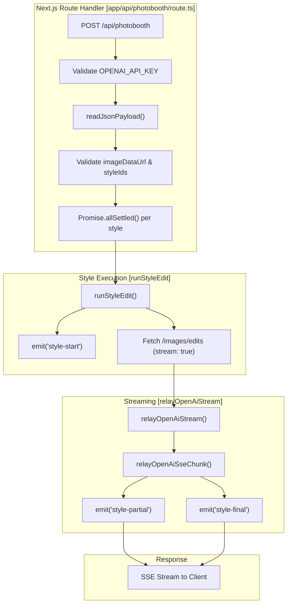
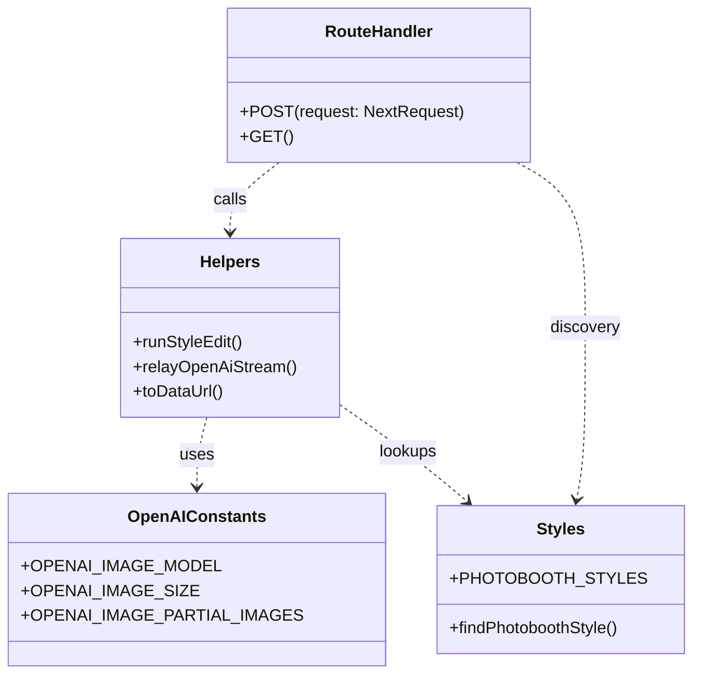

<!-- source: DeepWiki mcp.deepwiki.com · repo openai/openai-imagegen-demo · page 3.1 Photobooth API Route · fetched 2026-10-26 -->

# Photobooth API Route

Relevant source files

The following files were used as context for generating this wiki page:

- [app/api/photobooth/route.ts](app/api/photobooth/route.ts)
- [lib/constants.ts](lib/constants.ts)
- [lib/photobooth-style-utils.ts](lib/photobooth-style-utils.ts)

The Photobooth API route is the primary backend handler for processing image generation requests. It acts as an orchestrator that receives a user-provided image and a set of style identifiers, executes concurrent calls to the OpenAI `images/edits` endpoint for each style, and streams the results back to the client using Server-Sent Events (SSE).

## Route Overview

The route is implemented as a Next.js App Router Route Handler. It supports two HTTP methods:
- **GET**: A discovery endpoint that returns the available photobooth styles.
- **POST**: The main processing endpoint that handles image uploads and generation.

The route is configured with a `nodejs` runtime and a `maxDuration` of 300 seconds to accommodate the latency of multiple concurrent AI image generation tasks [app/api/photobooth/route.ts:18-20]().

### Request Data Flow

The following diagram illustrates how the `POST` handler processes an incoming request and interfaces with OpenAI.

**Diagram: Request Processing Flow**

Sources: [app/api/photobooth/route.ts:239-270](), [app/api/photobooth/route.ts:158-171](), [app/api/photobooth/route.ts:117-124]()

## Core Implementation Details

### Request Validation
The `POST` handler first ensures that the `OPENAI_API_KEY` is configured [app/api/photobooth/route.ts:240-248](). It then parses the JSON body using `readJsonPayload` and validates the inputs:
- `imageDataUrl`: Must be a string starting with `data:image/` and containing `;base64,` [app/api/photobooth/route.ts:35-41]().
- `styleIds`: Processed via `normalizePhotoboothStyleIds` to ensure they are valid, unique, and do not exceed `MAX_SELECTED_STYLES` [lib/photobooth-style-utils.ts:7-26]().

### Concurrent Style Execution
The route processes styles in parallel using `Promise.allSettled`. This allows the server to trigger multiple OpenAI requests simultaneously, significantly reducing the total time the user waits for all results [app/api/photobooth/route.ts:289-301](). Each style is handled by the `runStyleEdit` function.

### OpenAI Integration (`runStyleEdit`)
This function constructs the multipart-like request for the OpenAI `/images/edits` endpoint [app/api/photobooth/route.ts:173-175](). Key parameters used include:
- **Model**: `OPENAI_IMAGE_MODEL` (e.g., `gpt-image-2`) [lib/constants.ts:18]().
- **Prompt**: A combination of the style-specific prompt and `OPENAI_IMAGE_OUTPUT_REQUIREMENTS` to ensure subject preservation [app/api/photobooth/route.ts:196]().
- **Stream**: Set to `true` to receive partial generation updates [app/api/photobooth/route.ts:201]().
- **Partial Images**: Configured via `OPENAI_IMAGE_PARTIAL_IMAGES` [lib/constants.ts:22]().

### Streaming Logic
The route uses a `ReadableStream` to send events back to the client. The `emit` helper function formats data using `formatSseChunk` [app/api/photobooth/route.ts:272-277]().

1.  **`relayOpenAiStream`**: Reads the raw `Uint8Array` stream from OpenAI, decodes it into text, and manages a buffer to identify complete SSE chunks separated by `\n\n` [app/api/photobooth/route.ts:117-142]().
2.  **`relayOpenAiSseChunk`**: Parses individual chunks from OpenAI. If the chunk contains a `partial_image`, it emits a `style-partial` event. If it indicates completion, it emits `style-final` [app/api/photobooth/route.ts:69-107]().
3.  **`toDataUrl`**: A utility that normalizes the `b64_json` returned by OpenAI back into a standard Data URL format (e.g., `data:image/png;base64,...`) for client-side consumption [app/api/photobooth/route.ts:60-67]().

**Table: SSE Event Types Emitted**
| Event Name | Trigger | Payload Contents |
| :--- | :--- | :--- |
| `session-start` | Request received | `styleIds` |
| `style-start` | Before OpenAI call | `styleId`, `label` |
| `style-partial` | OpenAI partial chunk | `styleId`, `imageDataUrl`, `partialIndex` |
| `style-final` | OpenAI completion | `styleId`, `imageDataUrl` |
| `style-error` | Per-style failure | `styleId`, `message` |
| `session-complete` | All styles finished | N/A |

Sources: [app/api/photobooth/route.ts:281-325](), [app/api/photobooth/route.ts:88-107]()

## Abort Handling
The route monitors the `AbortSignal` from the `NextRequest`. If the user closes the browser or cancels the request, the `signal` is passed to the OpenAI `fetch` call [app/api/photobooth/route.ts:193](). The `isAbortError` utility identifies these interruptions to prevent logging standard cancellations as server errors [app/api/photobooth/route.ts:151-156]().

## Discovery Endpoint (GET)
The `GET` handler provides a simple way for the client to discover supported styles without hardcoding them in the frontend [app/api/photobooth/route.ts:339-341]().

**Diagram: Entity Mapping**

Sources: [app/api/photobooth/route.ts:1-15](), [lib/constants.ts:18-22](), [lib/photobooth-styles.ts:12-15]()

---

