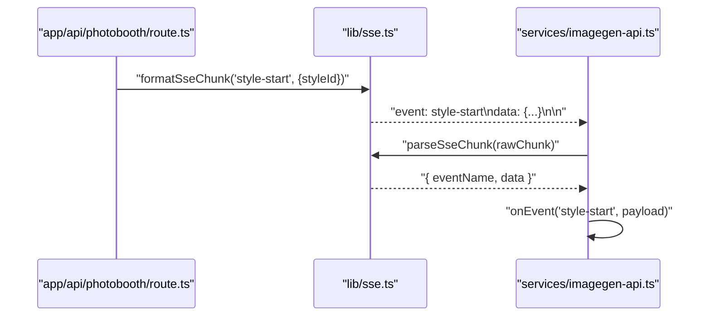
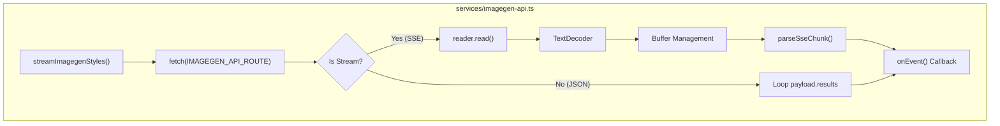

<!-- source: DeepWiki mcp.deepwiki.com · repo openai/openai-imagegen-demo · page 3.2 SSE Protocol & Client Service · fetched 2026-10-26 -->

# SSE Protocol & Client Service

Relevant source files

The following files were used as context for generating this wiki page:

- [lib/sse.ts](lib/sse.ts)
- [services/imagegen-api.ts](services/imagegen-api.ts)

The ImageGen Photobooth utilizes Server-Sent Events (SSE) to provide a real-time, low-latency streaming experience. This allows the client to display partial results and status updates as multiple AI image generations progress concurrently on the server.

## SSE Protocol Implementation

The communication between the server and client relies on a standardized text-based format defined in `lib/sse.ts`. This utility handles the serialization and deserialization of event-driven messages.

### Message Formatting
The server uses `formatSseChunk` to construct messages. Each chunk consists of an `event` identifier and a `data` payload containing a JSON string, terminated by double newlines `\n\n` [lib/sse.ts:30-33]().

### Message Parsing
The client utilizes `parseSseChunk` to process raw strings received from the stream. It identifies the `eventName` (defaulting to "message") and aggregates lines starting with `data:` into a single payload [lib/sse.ts:6-28]().

### Data Flow: Server to Client
The following diagram illustrates how the SSE protocol bridges the server-side generation logic with the client-side consumption service.

**SSE Communication Flow**

Sources: [lib/sse.ts:1-33](), [services/imagegen-api.ts:102-130]()

## Event Taxonomy

The system defines a specific set of event types represented by the `ImagegenStreamEventName` type [services/imagegen-api.ts:31-38](). These events drive the UI state transitions in the results view.

| Event Name | Description | Payload Key Entities |
| :--- | :--- | :--- |
| `session-start` | Triggered when the server begins processing the batch. | `sessionId` |
| `style-start` | Indicates a specific style generation has been initiated. | `styleId` |
| `style-partial` | Sent when a partial/preview image is available (e.g., during DALL-E generation). | `styleId`, `imageDataUrl` |
| `style-final` | Sent when the high-resolution final image is ready. | `styleId`, `imageDataUrl` |
| `style-error` | Sent if a specific style generation fails (e.g., safety filters). | `styleId`, `message` |
| `session-complete`| Final event indicating all requested styles have been processed. | `{}` |

Sources: [services/imagegen-api.ts:31-38](), [services/imagegen-api.ts:85-98]()

## Client Service: `streamImagegenStyles`

The `streamImagegenStyles` function in `services/imagegen-api.ts` is the primary consumer of the SSE stream. It manages the fetch lifecycle, response validation, and stream reading [services/imagegen-api.ts:50-146]().

### Stream Consumption Logic
1.  **Request Initiation**: Sends a POST request to `IMAGEGEN_API_ROUTE` with the base64 image and selected style IDs [services/imagegen-api.ts:56-61]().
2.  **Fallback Handling**: If the server returns a standard JSON response instead of a stream (detected via `content-type`), the service iterates through the `results` array and manually triggers `style-final` or `style-error` events to maintain compatibility with the UI [services/imagegen-api.ts:72-100]().
3.  **Stream Reading**:
    *   Obtains a `ReadableStreamDefaultReader` from the response body [services/imagegen-api.ts:102]().
    *   Uses a `TextDecoder` to convert binary chunks into strings [services/imagegen-api.ts:103]().
    *   Maintains a `buffer` to handle cases where SSE chunks are split across multiple network packets [services/imagegen-api.ts:104-110]().
4.  **Chunk Processing**: Searches for the `\n\n` boundary, extracts the chunk, parses it via `parseSseChunk`, and executes the `onEvent` callback [services/imagegen-api.ts:113-130]().

**Code Entity Mapping: Client Stream Handler**

Sources: [services/imagegen-api.ts:50-146](), [lib/sse.ts:6-28]()

### Error Handling
The service includes a `buildHttpError` helper that extracts error messages from the response payload or status text [services/imagegen-api.ts:20-29](). If the `response.ok` check fails, an `HttpError` is thrown, allowing the calling hook to update the UI accordingly [services/imagegen-api.ts:63-66]().

Sources: [services/imagegen-api.ts:5-29](), [services/imagegen-api.ts:63-66]()

---

