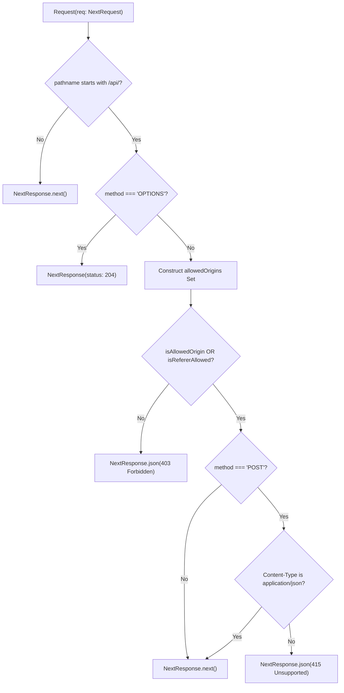
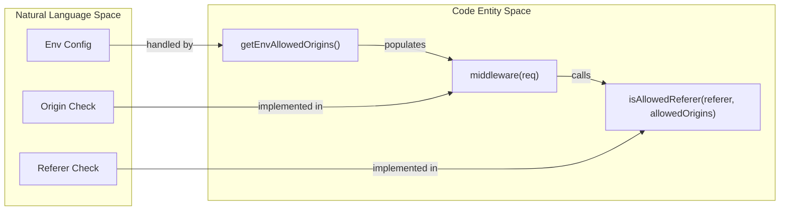

<!-- source: DeepWiki mcp.deepwiki.com · repo openai/openai-imagegen-demo · page 3.3 Middleware & Security · fetched 2026-10-26 -->

# Middleware & Security

Relevant source files

The following files were used as context for generating this wiki page:

- [.env.example](.env.example)
- [middleware.ts](middleware.ts)

The application utilizes a Next.js Middleware layer to enforce security constraints on all API interactions. This layer acts as a gatekeeper for routes under `/api/*`, ensuring that requests originate from authorized domains and adhere to expected content standards. The primary security model relies on Origin and Referer validation to prevent unauthorized cross-site requests and CSRF-like patterns.

## Middleware Execution Flow

The `middleware` function is configured to intercept all requests matching the `/api/:path*` pattern [middleware.ts:70-72](). It performs a series of sequential checks: handling CORS preflight, validating request origins against an allowlist, and enforcing `Content-Type` headers for write operations.

### Security Validation Sequence

1.  **Path Filtering**: The middleware immediately passes through any request that does not start with `/api/` [middleware.ts:31-33]().
2.  **CORS Preflight**: Responds to `OPTIONS` requests with a `204 No Content` status to support browser preflight checks [middleware.ts:35-37]().
3.  **Origin/Referer Validation**: Compares the `origin` and `referer` headers against a dynamically generated allowlist [middleware.ts:42-48]().
4.  **Content-Type Enforcement**: For `POST` requests, ensures the body is `application/json` [middleware.ts:57-65]().

### Request Processing Logic

The following diagram illustrates the decision tree within `middleware.ts`:

**Middleware Logic Flow**

Sources: [middleware.ts:30-68]()

---

## Origin Allowlist Configuration

The security layer determines authorized origins by combining environment variables with runtime request metadata. This ensures the application remains secure across local development, Vercel preview deployments, and production environments.

### Environment Variables
The `getEnvAllowedOrigins` function [middleware.ts:3-15]() populates the `ALLOWED_FROM_ENV` set using:
*   `NEXT_PUBLIC_APP_URL`: The primary production URL of the application [middleware.ts:6-8]().
*   `VERCEL_URL`: The dynamic deployment URL provided by the Vercel platform, automatically prefixed with `https://` [middleware.ts:10-12]().

### Runtime Resolution
At runtime, the middleware also adds `req.nextUrl.origin` to the `allowedOrigins` set [middleware.ts:39-40](). This allows the application to communicate with its own API routes regardless of the specific domain it is currently hosted on, facilitating seamless local development and branch previews.

| Variable | Description | Usage in Code |
| :--- | :--- | :--- |
| `NEXT_PUBLIC_APP_URL` | Hardcoded production domain | `allowed.add(process.env.NEXT_PUBLIC_APP_URL)` [middleware.ts:7]() |
| `VERCEL_URL` | Vercel-generated deployment URL | `allowed.add("https://" + process.env.VERCEL_URL)` [middleware.ts:11]() |
| `req.nextUrl.origin` | The current request's destination origin | `allowedOrigins.add(req.nextUrl.origin)` [middleware.ts:40]() |

Sources: [middleware.ts:3-17](), [middleware.ts:39-40]()

---

## Validation Mechanisms

### Origin and Referer Check
The middleware implements a "dual-check" strategy for domain validation. A request is considered authorized if either the `origin` header matches or the `referer` header is valid [middleware.ts:50]().

The `isAllowedReferer` helper [middleware.ts:19-28]() performs the following:
1.  Extracts the `referer` header [middleware.ts:20]().
2.  Parses it into a `URL` object to isolate the protocol and host [middleware.ts:23]().
3.  Checks if the reconstructed origin (`protocol//host`) exists in the `allowedOrigins` set [middleware.ts:24]().

### Content-Type Enforcement
To prevent unexpected payload processing and ensure compatibility with the `Photobooth API Route`, all `POST` requests must specify `application/json` in their `Content-Type` header [middleware.ts:57-59](). If the header is missing or incorrect, the middleware returns a `415 Unsupported Media Type` error [middleware.ts:60-64]().

**Entity Association: Validation Logic**

Sources: [middleware.ts:3-28](), [middleware.ts:30-68]()

---

## Error Responses

The middleware returns standardized JSON error responses when security constraints are violated:

| Status Code | Message | Trigger Condition |
| :--- | :--- | :--- |
| `403 Forbidden` | `Forbidden - invalid Origin/Referer` | Neither `origin` nor `referer` headers match the authorized list [middleware.ts:50-55](). |
| `415 Unsupported Media Type` | `Unsupported Media Type` | A `POST` request was made with a `Content-Type` other than `application/json` [middleware.ts:60-64](). |

Sources: [middleware.ts:50-65]()

---

