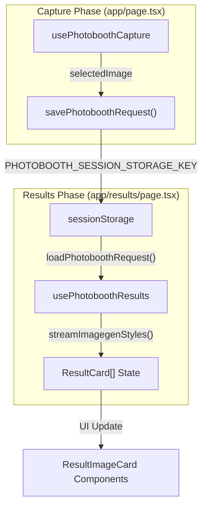
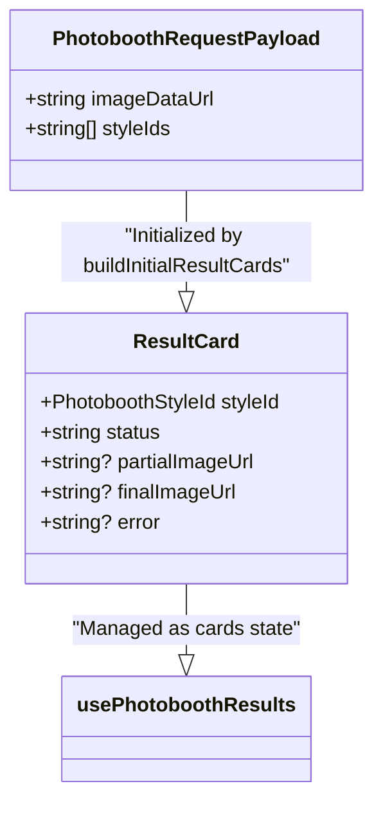

<!-- source: DeepWiki mcp.deepwiki.com · repo openai/openai-imagegen-demo · page 4 State Management & Hooks · fetched 2026-10-26 -->

# State Management & Hooks

Relevant source files

The following files were used as context for generating this wiki page:

- [hooks/use-photobooth-capture.ts](hooks/use-photobooth-capture.ts)
- [hooks/use-photobooth-results.ts](hooks/use-photobooth-results.ts)
- [lib/photobooth-session.ts](lib/photobooth-session.ts)

The OpenAI ImageGen Photobooth application relies on a decoupled state management strategy that bridges the transition between the **Capture** phase and the **Results** phase. State is encapsulated within two primary custom hooks, while a session persistence layer ensures that large image payloads (Base64) are transferred reliably across page navigations without overloading URL parameters.

### Application State Architecture

The application transitions through two main states: the acquisition of a source image and the streaming of AI-generated variants. These states are bridged by `sessionStorage`.

#### State Flow Diagram

**Sources:** [hooks/use-photobooth-capture.ts:6-176](), [hooks/use-photobooth-results.ts:16-141](), [lib/photobooth-session.ts:7-54]()

---

### usePhotoboothCapture Hook
The `usePhotoboothCapture` hook manages the complexity of the MediaDevices API and file system interactions. It provides a unified interface for acquiring an image, whether through a live camera stream or a local file upload.

*   **Camera Lifecycle**: Handles `getUserMedia` streams, ensuring tracks are stopped via `stopCamera` to release hardware resources when the component unmounts or an image is selected [hooks/use-photobooth-capture.ts:16-21](), [hooks/use-photobooth-capture.ts:39-44]().
*   **Image Processing**: Uses a hidden canvas (`canvasRef`) to capture video frames. It applies a horizontal flip (`context.scale(-1, 1)`) during capture to ensure the output matches the mirrored preview shown to the user [hooks/use-photobooth-capture.ts:91-95]().
*   **File Handling**: Manages drag-and-drop states (`isDragActive`) and file input changes, utilizing `resizeImageFileAsDataUrl` to ensure images are optimized before being stored in state [hooks/use-photobooth-capture.ts:105-122](), [hooks/use-photobooth-capture.ts:148-157]().

For details, see [usePhotoboothCapture Hook](#4.1).

**Sources:** [hooks/use-photobooth-capture.ts:6-176]()

---

### usePhotoboothResults Hook
The `usePhotoboothResults` hook orchestrates the asynchronous streaming of AI images from the backend. It transforms the flat session data into a reactive array of `ResultCard` objects.

*   **Initialization**: On mount, it retrieves the session using `loadPhotoboothRequest` and initializes the UI state using `buildInitialResultCards` [hooks/use-photobooth-results.ts:22-32]().
*   **SSE Subscription**: It invokes `streamImagegenStyles` and maps incoming Server-Sent Events (SSE) to specific card updates [hooks/use-photobooth-results.ts:113-118]().
*   **Incremental Updates**: The hook handles various event types—`style-start`, `style-partial`, and `style-final`—to update individual card statuses from `streaming` to `done`, allowing the UI to show partial DALL-E 3 previews as they arrive [hooks/use-photobooth-results.ts:62-94]().

For details, see [usePhotoboothResults Hook](#4.2).

**Sources:** [hooks/use-photobooth-results.ts:16-141]()

---

### Session Persistence
Because the application generates high-resolution Base64 strings, standard URL query parameters are insufficient for passing state between the `/` and `/results` routes. The `lib/photobooth-session.ts` utility provides a persistence layer using the browser's `sessionStorage`.

| Function | Responsibility |
| :--- | :--- |
| `savePhotoboothRequest` | Serializes the `PhotoboothRequestPayload` to JSON and stores it [lib/photobooth-session.ts:7-16](). |
| `loadPhotoboothRequest` | Retrieves the session, validates the `imageDataUrl` format, and normalizes style IDs [lib/photobooth-session.ts:18-49](). |
| `clearPhotoboothRequest` | Removes the session key to reset the application state [lib/photobooth-session.ts:51-54](). |

#### Data Entity Mapping

**Sources:** [lib/photobooth-session.ts:1-55](), [hooks/use-photobooth-results.ts:3-5]()

For details, see [Session Persistence](#4.3).

---

