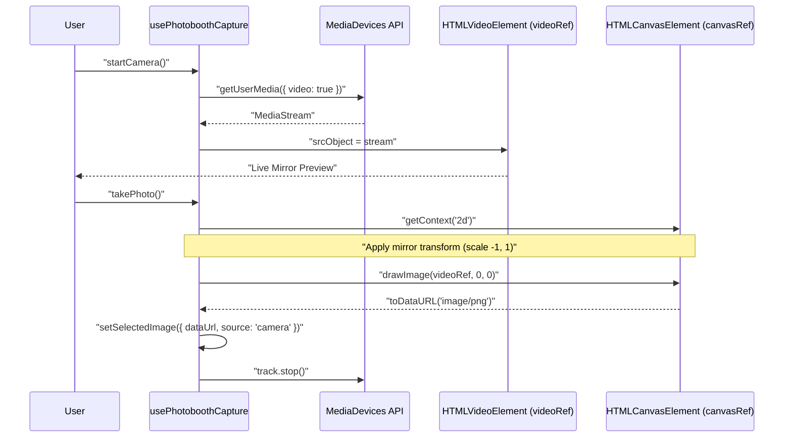
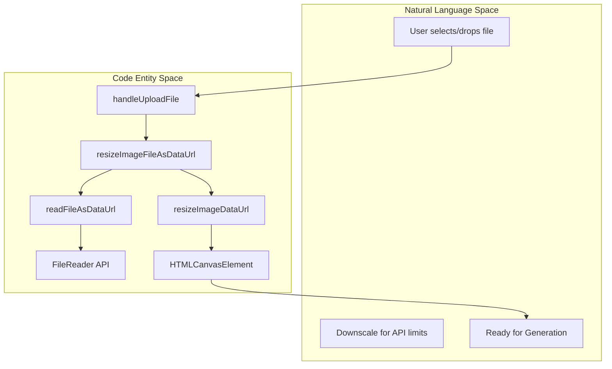

<!-- source: DeepWiki mcp.deepwiki.com · repo openai/openai-imagegen-demo · page 4.1 usePhotoboothCapture Hook · fetched 2026-10-26 -->

# usePhotoboothCapture Hook

Relevant source files

The following files were used as context for generating this wiki page:

- [hooks/use-photobooth-capture.ts](hooks/use-photobooth-capture.ts)
- [lib/browser/file-utils.ts](lib/browser/file-utils.ts)
- [types/photobooth.ts](types/photobooth.ts)

The `usePhotoboothCapture` hook is the central logic controller for the image acquisition phase of the application. It encapsulates the complexities of the browser's MediaDevices API, handles the lifecycle of the webcam stream, manages file uploads via drag-and-drop or file pickers, and performs client-side image processing.

## Core State and References

The hook manages several pieces of state and refs to interact with DOM elements required for media handling.

| State/Ref | Type | Purpose |
| :--- | :--- | :--- |
| `videoRef` | `useRef<HTMLVideoElement>` | Reference to the video element for the live camera preview [hooks/use-photobooth-capture.ts:7](). |
| `canvasRef` | `useRef<HTMLCanvasElement>` | Reference to a hidden canvas used for capturing and mirroring the photo [hooks/use-photobooth-capture.ts:8](). |
| `cameraStream` | `MediaStream \| null` | The active media stream from `navigator.mediaDevices.getUserMedia` [hooks/use-photobooth-capture.ts:11](). |
| `selectedImage` | `SelectedImage \| null` | The final processed image (Base64) and its origin [hooks/use-photobooth-capture.ts:12](). |
| `isDragActive` | `boolean` | UI state for drag-and-drop overlays [hooks/use-photobooth-capture.ts:14](). |

### SelectedImage State Shape
The hook produces a `SelectedImage` object, defined as:
- `dataUrl`: A string containing the Base64 encoded image data [types/photobooth.ts:4]().
- `source`: A literal type `"camera" | "upload"` indicating how the image was acquired [types/photobooth.ts:5]().

Sources: [hooks/use-photobooth-capture.ts:6-15](), [types/photobooth.ts:3-6]()

## Camera Lifecycle Management

The hook manages the camera stream lifecycle through `useEffect` and `useCallback` to prevent memory leaks and ensure hardware resources (webcam) are released when not in use.

### Stream Initialization and Cleanup
- **`startCamera`**: Requests user permission via `getUserMedia` with `video: { facingMode: "user" }` and sets the `cameraStream` [hooks/use-photobooth-capture.ts:52-66]().
- **`stopCamera`**: Iterates through all tracks in the current stream and calls `.stop()` before nullifying the state [hooks/use-photobooth-capture.ts:39-44]().
- **Automatic Cleanup**: A `useEffect` hook ensures that if the component unmounts while the camera is active, all tracks are stopped [hooks/use-photobooth-capture.ts:16-21]().

### Preview Synchronization
A second `useEffect` monitors the `cameraStream`. When a stream is active, it attaches the stream to the `videoRef.current.srcObject` and invokes `.play()` [hooks/use-photobooth-capture.ts:23-37]().

### Photo Capture with Mirror Correction
When `takePhoto` is called, the hook performs a canvas-based capture that mirrors the image to match the user's "mirror" preview:
1. Validates that the video stream has current data and valid dimensions [hooks/use-photobooth-capture.ts:73-80]().
2. Sets the `canvasRef` dimensions to match the `videoWidth` and `videoHeight` [hooks/use-photobooth-capture.ts:82-85]().
3. Uses `context.scale(-1, 1)` and `context.translate(width, 0)` to flip the image horizontally before drawing the video frame [hooks/use-photobooth-capture.ts:91-95]().
4. Exports the result via `canvas.toDataURL("image/png")` [hooks/use-photobooth-capture.ts:97]().

Sources: [hooks/use-photobooth-capture.ts:39-99]()

## Image Upload and Processing

The hook supports both manual file selection and drag-and-drop interactions. Both flows converge on the `handleUploadFile` function.

### File Handling Logic
- **`handleUploadFile`**: Validates the MIME type to ensure it starts with `image/` [hooks/use-photobooth-capture.ts:107-110]().
- **Resizing**: It utilizes `resizeImageFileAsDataUrl` from the browser utilities to ensure the image does not exceed the maximum allowed dimension (1536px) before being stored in state [hooks/use-photobooth-capture.ts:113]().
- **`onFileChange`**: Triggered by the hidden `fileInputRef`. It extracts the first file and resets the input value to allow re-uploading the same file [hooks/use-photobooth-capture.ts:124-133]().

### Drag-and-Drop Event Handlers
The hook provides standard event handlers to manage the drag-and-drop UX:
- **`onDragOver`**: Prevents default browser behavior and sets `isDragActive` to true [hooks/use-photobooth-capture.ts:135-139]().
- **`onDragLeave`**: Resets `isDragActive` if the cursor leaves the drop zone [hooks/use-photobooth-capture.ts:141-146]().
- **`onDrop`**: Extracts the file from `event.dataTransfer.files` and passes it to the upload handler [hooks/use-photobooth-capture.ts:148-157]().

Sources: [hooks/use-photobooth-capture.ts:101-157](), [lib/browser/file-utils.ts:61-70]()

## Implementation Diagrams

### Camera Stream and Capture Flow
This diagram illustrates the relationship between the MediaDevices API, the HTML5 Video element, and the Canvas capture mechanism.

Sources: [hooks/use-photobooth-capture.ts:52-99]()

### Image Processing Pipeline
This diagram bridges the Natural Language concept of "Image Upload" to the specific utility functions and browser APIs used.

Sources: [hooks/use-photobooth-capture.ts:105-122](), [lib/browser/file-utils.ts:1-70]()

## Utility Integration

The hook relies on `lib/browser/file-utils.ts` for heavy lifting:

1.  **`readFileAsDataUrl`**: Wraps `FileReader.readAsDataURL` in a Promise to convert a `File` object to a Base64 string [lib/browser/file-utils.ts:1-15]().
2.  **`resizeImageDataUrl`**: Creates an off-screen canvas to scale images down if their longest side exceeds 1536px, preserving the aspect ratio and original MIME type [lib/browser/file-utils.ts:36-59]().

Sources: [lib/browser/file-utils.ts:1-70]()

---

