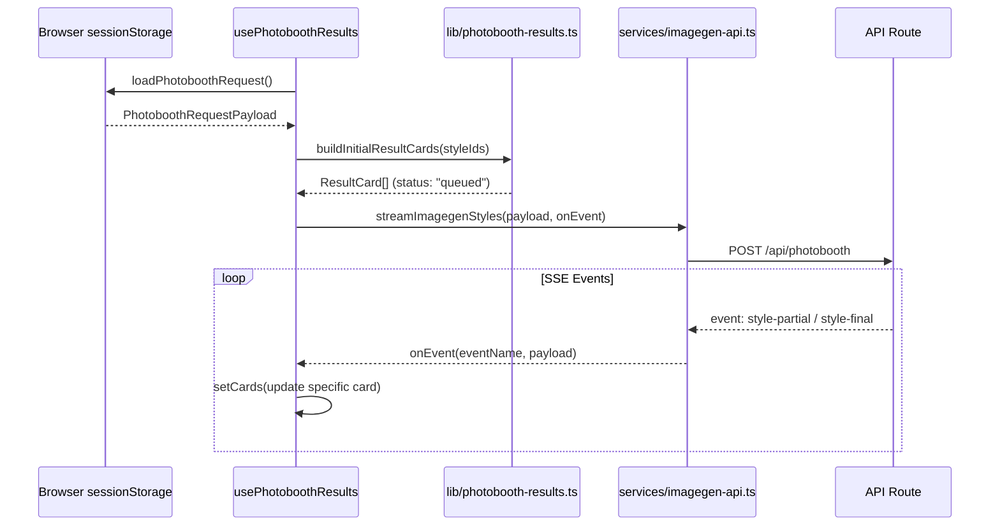
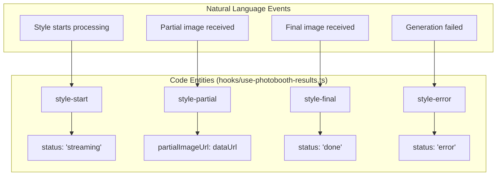

<!-- source: DeepWiki mcp.deepwiki.com · repo openai/openai-imagegen-demo · page 4.2 usePhotoboothResults Hook · fetched 2026-10-26 -->

# usePhotoboothResults Hook

Relevant source files

The following files were used as context for generating this wiki page:

- [hooks/use-photobooth-results.ts](hooks/use-photobooth-results.ts)
- [lib/photobooth-results.ts](lib/photobooth-results.ts)
- [lib/photobooth-session.ts](lib/photobooth-session.ts)
- [types/photobooth.ts](types/photobooth.ts)

The `usePhotoboothResults` hook is the primary state manager for the Results page. It orchestrates the retrieval of session data from local storage, initializes the UI state for image generation cards, and manages the lifecycle of the Server-Sent Events (SSE) stream that delivers generated images from the OpenAI API.

## Core Responsibilities

The hook manages a complex state machine where multiple images are generated in parallel, each transitioning through various statuses (`queued`, `streaming`, `done`, or `error`) based on real-time updates from the backend.

1.  **Session Retrieval**: Loads the base64 image and selected style IDs from `sessionStorage` [hooks/use-photobooth-results.ts:23-30]().
2.  **State Initialization**: Pre-populates the `cards` array with placeholder objects for each selected style using `buildInitialResultCards` [hooks/use-photobooth-results.ts:31]().
3.  **Stream Management**: Initiates the SSE connection via `streamImagegenStyles` and handles the incremental updates [hooks/use-photobooth-results.ts:113-118]().
4.  **Cleanup**: Utilizes `AbortController` to cancel pending network requests if the user navigates away from the page [hooks/use-photobooth-results.ts:37, 133]().

### Data Flow: From Storage to Stream

The following diagram illustrates how `usePhotoboothResults` bridges the persistent session data with the live streaming service.

**Hook Initialization and Streaming Flow**

**Sources:** [hooks/use-photobooth-results.ts:22-40](), [hooks/use-photobooth-results.ts:113-118](), [lib/photobooth-session.ts:18-49](), [lib/photobooth-results.ts:5-19]()

## State Implementation

The hook maintains four primary state variables to drive the UI:

| State Variable | Type | Purpose |
| :--- | :--- | :--- |
| `requestData` | `PhotoboothRequestPayload \| null` | The validated image data and style IDs from the session [hooks/use-photobooth-results.ts:17](). |
| `cards` | `ResultCard[]` | Array of objects tracking the generation progress for every style [hooks/use-photobooth-results.ts:18](). |
| `error` | `string` | Global error message (e.g., session load failure or stream interruption) [hooks/use-photobooth-results.ts:19](). |
| `loading` | `boolean` | Indicates if the overall session is still active [hooks/use-photobooth-results.ts:20](). |

### Incremental Card Updates

When `streamImagegenStyles` receives an event, the `applyEvent` function [hooks/use-photobooth-results.ts:42-111]() performs a functional update on the `cards` state. It identifies the target card by its `styleId` and modifies its properties based on the `ImagegenStreamEventName`.

**Event Mapping to ResultCard State**

**Sources:** [hooks/use-photobooth-results.ts:62-106](), [types/photobooth.ts:13-22]()

## Key Functions

### `loadPhotoboothRequest`
Defined in `lib/photobooth-session.ts` [lib/photobooth-session.ts:18](), this function retrieves the session JSON from `sessionStorage`. It performs critical validation:
*   Ensures `imageDataUrl` is a valid base64 image string [lib/photobooth-session.ts:32-35]().
*   Normalizes style IDs to ensure they exist in the application's style catalog [lib/photobooth-session.ts:39]().

### `buildInitialResultCards`
Defined in `lib/photobooth-results.ts` [lib/photobooth-results.ts:5](), this utility maps the array of `styleIds` to the initial `ResultCard` objects. Every card starts with a `status` of `"queued"` and `null` image URLs [lib/photobooth-results.ts:14-17]().

### `applyEvent`
An internal helper within the hook [hooks/use-photobooth-results.ts:42]() that acts as a reducer for incoming SSE events.
*   **session-error**: Sets the global `error` state [hooks/use-photobooth-results.ts:46-53]().
*   **style-partial**: Updates `partialImageUrl` to show the low-resolution preview as it arrives [hooks/use-photobooth-results.ts:70-80]().
*   **style-final**: Updates `finalImageUrl` and sets `status` to `"done"` [hooks/use-photobooth-results.ts:82-94]().

## Lifecycle & Cleanup

The hook utilizes two `useEffect` blocks:
1.  **Mount**: Loads the session data once when the component mounts [hooks/use-photobooth-results.ts:22-32]().
2.  **Request Change**: Triggered once `requestData` is populated. It initializes an `AbortController` and starts the SSE stream [hooks/use-photobooth-results.ts:34-134]().

If the user leaves the results page before generation finishes, the cleanup function calls `controller.abort()` [hooks/use-photobooth-results.ts:133](). This signal is passed to `streamImagegenStyles`, which ensures the underlying `fetch` request is terminated immediately [hooks/use-photobooth-results.ts:116]().

**Sources:** [hooks/use-photobooth-results.ts:16-141](), [lib/photobooth-session.ts:18-49](), [lib/photobooth-results.ts:5-19](), [types/photobooth.ts:1-29]()

---

