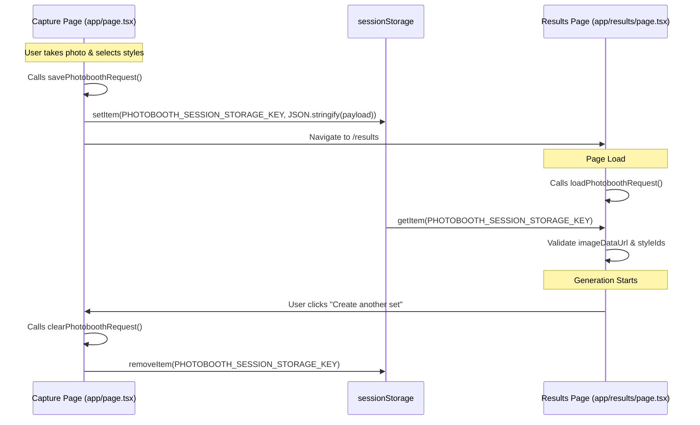
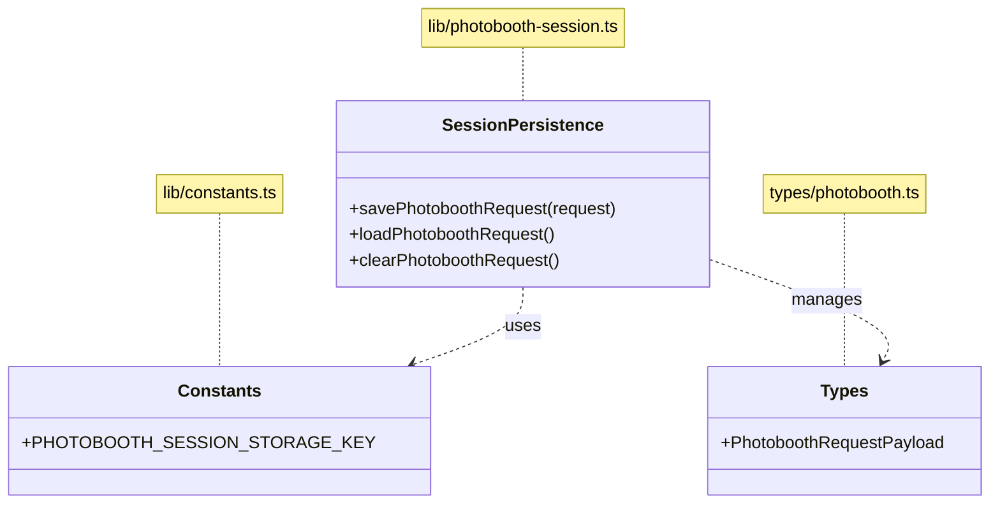

<!-- source: DeepWiki mcp.deepwiki.com · repo openai/openai-imagegen-demo · page 4.3 Session Persistence · fetched 2026-10-26 -->

# Session Persistence

Relevant source files

The following files were used as context for generating this wiki page:

- [lib/constants.ts](lib/constants.ts)
- [lib/photobooth-session.ts](lib/photobooth-session.ts)

The Photobooth application utilizes a client-side session persistence layer to transition data between the capture phase and the results generation phase. This mechanism ensures that the source image and selected styles are preserved across page navigations without requiring a backend database or passing large payloads through URL parameters.

## Overview

Session persistence is handled by `lib/photobooth-session.ts` [lib/photobooth-session.ts:1-55](). It provides a wrapper around the browser's `sessionStorage` API to store, retrieve, and validate `PhotoboothRequestPayload` objects.

### Why sessionStorage?
The application avoids using URL parameters for session state because the `imageDataUrl` contains a base64-encoded representation of the user's photo. These strings frequently exceed the character limits of browser URLs. `sessionStorage` provides a per-tab storage area that persists through page reloads and navigations, making it ideal for large temporary payloads that should not persist once the tab is closed.

## Key Functions

The persistence layer exposes three primary functions to manage the lifecycle of a photobooth request.

### `savePhotoboothRequest`
This function serializes the request payload into a JSON string and persists it to the browser's storage [lib/photobooth-session.ts:7-16]().

*   **Logic**: It checks for environment compatibility using `hasSessionStorage()` [lib/photobooth-session.ts:5-5]().
*   **Storage Key**: Uses the constant `PHOTOBOOTH_SESSION_STORAGE_KEY` [lib/constants.ts:5-5]().
*   **Error Handling**: Wraps the `setItem` call in a try-catch block to handle potential `QuotaExceededError` exceptions if the base64 image is too large for the browser's storage limits [lib/photobooth-session.ts:10-15]().

### `loadPhotoboothRequest`
This function retrieves and validates the stored session data [lib/photobooth-session.ts:18-49]().

*   **Validation**: It performs strict checks on the `imageDataUrl` to ensure it is a valid base64 image string starting with `data:image/` and containing `;base64,` [lib/photobooth-session.ts:30-37]().
*   **Normalization**: It uses `normalizePhotoboothStyleIds` to ensure the retrieved style IDs are valid and formatted correctly before returning the payload [lib/photobooth-session.ts:39-40]().

### `clearPhotoboothRequest`
This function removes the session data from storage [lib/photobooth-session.ts:51-54](). It is typically called when a user chooses to "Start Over" or after a session has been successfully processed and the user returns to the home page.

## Data Flow

The following diagram illustrates how session data moves from the Capture page to the Results page through the persistence layer.

### Session Lifecycle Diagram

**Sources:** [lib/photobooth-session.ts:7-54](), [lib/constants.ts:5-5]()

## Implementation Details

### Constants and Storage Key
The persistence layer relies on a centralized constant to ensure consistency across the codebase.

| Constant | Value | Description |
| :--- | :--- | :--- |
| `PHOTOBOOTH_SESSION_STORAGE_KEY` | `"photobooth.request"` | The key used for `sessionStorage` operations. |

**Sources:** [lib/constants.ts:5-5]()

### Code Entity Mapping
The following diagram maps the natural language concepts of the session lifecycle to the specific functions and constants in the code.

### Entity Relationship Diagram

**Sources:** [lib/photobooth-session.ts:1-55](), [lib/constants.ts:5-5]()

## Data Validation Logic

When `loadPhotoboothRequest` is invoked, it does not blindly trust the contents of `sessionStorage`. It performs the following checks:

1.  **Type Check**: Verifies the parsed object exists and `imageDataUrl` is a string [lib/photobooth-session.ts:30-32]().
2.  **Format Check**: Ensures the string is a valid Data URL for an image [lib/photobooth-session.ts:33-33]().
3.  **Encoding Check**: Verifies the presence of the base64 marker [lib/photobooth-session.ts:34-34]().
4.  **Style Validation**: Normalizes the style IDs and ensures the resulting array is not empty [lib/photobooth-session.ts:39-40]().

If any of these checks fail, the function returns `null`, signaling to the calling component (typically the `usePhotoboothResults` hook) that the session is invalid and the user should be redirected [lib/photobooth-session.ts:36-47]().

**Sources:** [lib/photobooth-session.ts:30-49]()

---

