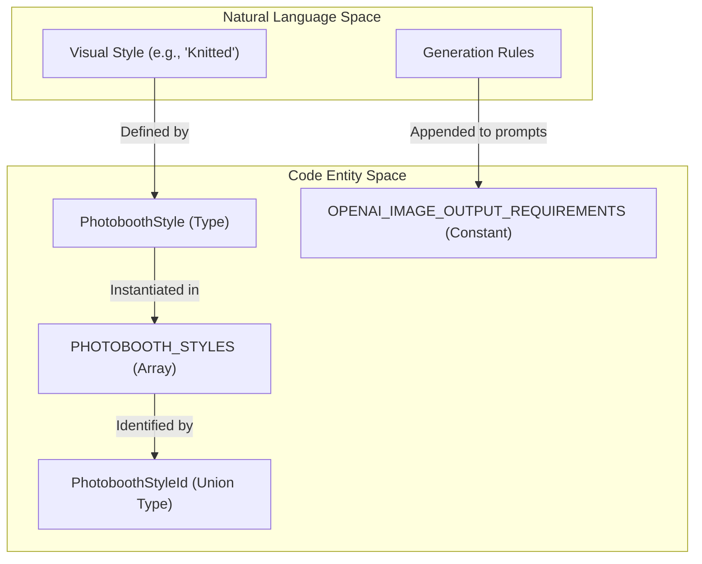
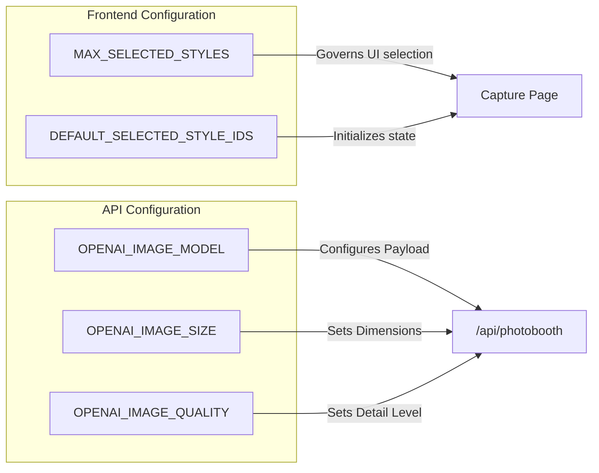

<!-- source: DeepWiki mcp.deepwiki.com · repo openai/openai-imagegen-demo · page 5 Styles & Configuration · fetched 2026-10-26 -->

# Styles & Configuration

Relevant source files

The following files were used as context for generating this wiki page:

- [lib/constants.ts](lib/constants.ts)
- [lib/photobooth-styles.ts](lib/photobooth-styles.ts)

The **Styles & Configuration** layer defines the visual identity and operational parameters of the ImageGen Photobooth. It centralizes the aesthetic definitions (the style catalog) and the technical constraints (OpenAI API parameters) used to transform user photos into stylized artwork.

This configuration is consumed by both the frontend UI for rendering selection cards and the backend API for constructing generation prompts and governing model behavior.

### System Configuration Overview

The application relies on two primary configuration files to manage the generation pipeline:

1.  **`lib/photobooth-styles.ts`**: Contains the visual definitions for the photobooth, including the natural language prompts that guide the AI.
2.  **`lib/constants.ts`**: Defines application-wide limits, default states, and the specific parameters sent to the OpenAI Image Generation API.

#### Natural Language to Code Mapping

The following diagram illustrates how the abstract concept of a "Style" is represented in the codebase and how it interacts with the system constants.

**Style Entity Association**

**Sources:** [lib/photobooth-styles.ts:1-14](), [lib/constants.ts:24-26]()

### Photobooth Style Catalog

The photobooth offers six distinct visual styles. Each style is defined as a `PhotoboothStyle` object containing a unique `id`, a user-facing `label`, a short `description` for the UI, and a detailed `prompt` for the AI.

The catalog is designed to ensure that while the aesthetic changes (e.g., from "Watercolor" to "Futuristic"), the subject's identity, pose, and expression remain faithful to the original image. This is achieved by embedding specific preservation instructions within each style's prompt string.

For details on the specific prompts and the style helper functions, see **[Photobooth Style Catalog](#5.1)**.

**Sources:** [lib/photobooth-styles.ts:9-60]()

### Constants & OpenAI Parameters

The operational behavior of the photobooth is governed by a set of constants. These constants define everything from the UI limits (e.g., maximum number of styles a user can select) to the specific model and dimensions used during image generation.

**Configuration Data Flow**

**Sources:** [lib/constants.ts:7-22]()

Key parameters such as `OPENAI_IMAGE_MODEL` (set to `gpt-image-2`) and `OPENAI_IMAGE_SIZE` (set to `1024x1536`) ensure that the generated output meets the portrait orientation requirements of the application.

For details on the full list of constants and how they flow into the API route, see **[Constants & OpenAI Parameters](#5.2)**.

**Sources:** [lib/constants.ts:18-22]()

***

## Child Pages

*   **[Photobooth Style Catalog](#5.1)**
    Documents the six built-in styles, the `PhotoboothStyle` type, the `PHOTOBOOTH_STYLES` array, and the `findPhotoboothStyle` helper.
*   **[Constants & OpenAI Parameters](#5.2)**
    Documents application constants, including `MAX_SELECTED_STYLES`, `IMAGEGEN_API_ROUTE`, and all `OPENAI_IMAGE_*` parameters used for the generation pipeline.

---

