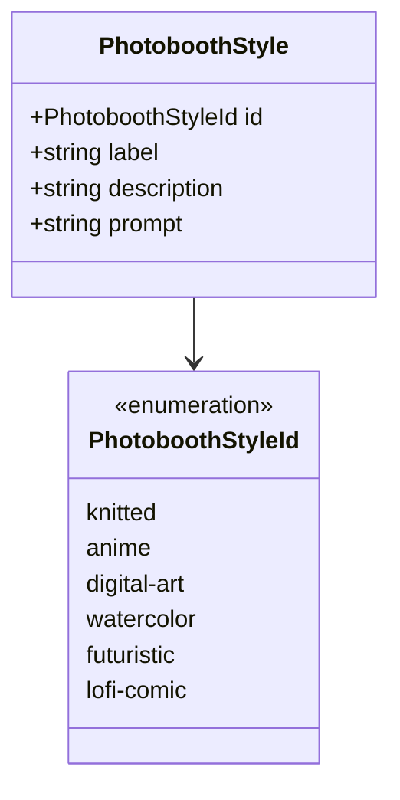
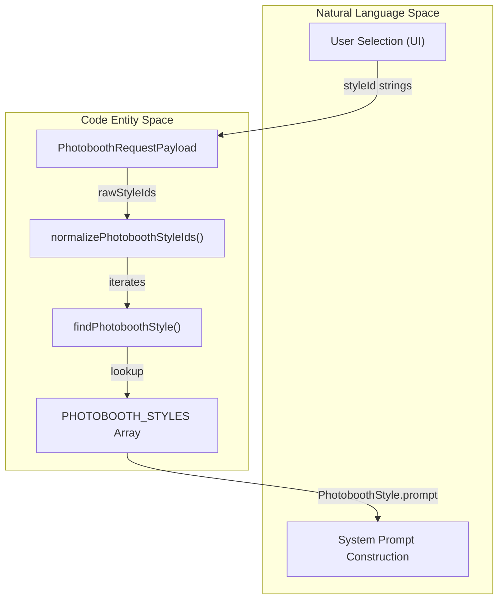

<!-- source: DeepWiki mcp.deepwiki.com · repo openai/openai-imagegen-demo · page 5.1 Photobooth Style Catalog · fetched 2026-10-26 -->

# Photobooth Style Catalog

Relevant source files

The following files were used as context for generating this wiki page:

- [lib/photobooth-style-utils.ts](lib/photobooth-style-utils.ts)
- [lib/photobooth-styles.ts](lib/photobooth-styles.ts)
- [types/photobooth.ts](types/photobooth.ts)

The Photobooth Style Catalog defines the creative visual transformations available to users. It acts as the source of truth for the application's aesthetic options, providing the necessary metadata and prompt engineering instructions required to interface with the OpenAI DALL-E 2 Image Edits API.

## Core Data Structures

The catalog is built around a strongly typed definition that ensures consistency between the frontend selection UI and the backend generation pipeline.

### Type Definitions
The system utilizes two primary types to manage styles:
*   `PhotoboothStyleId`: A union of literal strings representing the unique identifiers for each style [lib/photobooth-styles.ts:1-7]().
*   `PhotoboothStyle`: An object containing the display label, user-facing description, and the internal AI prompt [lib/photobooth-styles.ts:9-14]().

**Sources:** [lib/photobooth-styles.ts:1-14](), [types/photobooth.ts:1-29]()

## Built-in Styles

The `PHOTOBOOTH_STYLES` array contains six predefined configurations. Each style is engineered to leverage DALL-E's image editing capabilities while maintaining the user's original identity.

| ID | Label | Description | Prompt Strategy |
|:---|:---|:---|:---|
| `knitted` | Knitted | Cozy yarn textures and stitched details. | Focuses on "soft, cute knitted dolls" and "wool textures" [lib/photobooth-styles.ts:18-23](). |
| `digital-art` | Digital Art | Bold modern illustration with crisp shapes. | Emphasizes "clean modern digital art" and "smooth vector-like forms" [lib/photobooth-styles.ts:25-30](). |
| `watercolor` | Watercolor | Airy brushwork and delicate pastel atmosphere. | Requests "fluid brush strokes" and "soft pigment bleeding" [lib/photobooth-styles.ts:32-37](). |
| `anime` | Anime | Soft cinematic anime look with painterly light. | Specifies "delicate linework" and "atmospheric lighting" [lib/photobooth-styles.ts:39-44](). |
| `futuristic` | Futuristic | Ethereal sci-fi glow with blue tones. | Combines "holographic lighting" with a "glowing cityscape" background [lib/photobooth-styles.ts:47-52](). |
| `lofi-comic` | Lo-Fi Comic | Graphic style with bold lines and retro colors. | Uses "halftone textures" and "clean bold outlines" [lib/photobooth-styles.ts:54-59](). |

**Sources:** [lib/photobooth-styles.ts:16-60]()

## Identity Preservation in Prompts

A critical aspect of the `PhotoboothStyle.prompt` field is the inclusion of instructions to preserve the subject's identity. Because the application uses the OpenAI Edits endpoint, the prompt must explicitly guide the model to maintain consistency with the source image.

Every prompt in the catalog includes variations of the following constraints:
*   **Identity:** "preserving the same identity" or "Keep the same people" [lib/photobooth-styles.ts:22,43]().
*   **Composition:** "preserving the same... pose, expression, framing, and scene layout" [lib/photobooth-styles.ts:22,29,36]().
*   **Proportions:** "preserving the same subjects, proportions, composition" [lib/photobooth-styles.ts:36]().

**Sources:** [lib/photobooth-styles.ts:21-59]()

## Helper Functions

### findPhotoboothStyle
A utility used to retrieve a full style object by its string ID. It returns `undefined` if the ID does not match any entry in `PHOTOBOOTH_STYLES` [lib/photobooth-styles.ts:62-63]().

### normalizePhotoboothStyleIds
Located in `lib/photobooth-style-utils.ts`, this function sanitizes input from API requests or session storage. It performs the following steps:
1.  **Validation:** Ensures the input is an array [lib/photobooth-style-utils.ts:11]().
2.  **Sanitization:** Filters for strings, trims whitespace, and removes empty values [lib/photobooth-style-utils.ts:16-18]().
3.  **Deduplication:** Uses a `Set` to ensure unique IDs and applies the `MAX_SELECTED_STYLES` limit [lib/photobooth-style-utils.ts:20]().
4.  **Verification:** Cross-references the IDs against `findPhotoboothStyle` to ensure only supported styles are processed [lib/photobooth-style-utils.ts:22-25]().

**Sources:** [lib/photobooth-styles.ts:62-63](), [lib/photobooth-style-utils.ts:7-26]()

## Data Flow: Style Resolution

The following diagram illustrates how a raw style ID from a request is resolved into a functional prompt for the OpenAI API.

**Sources:** [lib/photobooth-styles.ts:16-63](), [lib/photobooth-style-utils.ts:7-26](), [types/photobooth.ts:8-11]()

---

