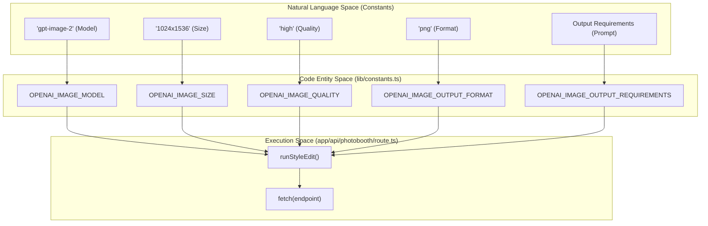
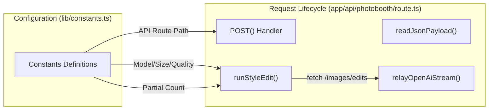

<!-- source: DeepWiki mcp.deepwiki.com · repo openai/openai-imagegen-demo · page 5.2 Constants & OpenAI Parameters · fetched 2026-10-26 -->

# Constants & OpenAI Parameters

<details>
<summary>Relevant source files</summary>

The following files were used as context for generating this wiki page:

- [app/api/photobooth/route.ts](app/api/photobooth/route.ts)
- [lib/constants.ts](lib/constants.ts)

</details>


This page documents the static configuration and AI generation parameters that drive the Photobooth ImageGen Demo. These constants, primarily defined in `lib/constants.ts`, govern UI limits, API routing, and the specific configurations sent to the OpenAI `images/edits` endpoint.

## Application Constants

The core application behavior, such as naming and style selection limits, is defined at the top level of the constants file.

| Constant | Value | Description |
| :--- | :--- | :--- |
| `APP_NAME` | `"Photobooth ImageGen Demo"` | The global application title used in the UI. |
| `MAX_SELECTED_STYLES` | `4` | The maximum number of styles a user can select for a single generation run. |
| `DEFAULT_SELECTED_STYLE_IDS` | `["knitted", "digital-art"]` | The initial styles selected when the application first loads. |
| `IMAGEGEN_API_ROUTE` | `"/api/photobooth"` | The relative URL path for the Next.js Route Handler. |

**Sources:**
- [lib/constants.ts:3-16]()

## OpenAI Generation Parameters

The application uses specific constants to ensure consistent output from the OpenAI API. These values are mapped directly into the request body within the backend route handler.

| Constant | Value | Purpose |
| :--- | :--- | :--- |
| `OPENAI_IMAGE_MODEL` | `"gpt-image-2"` | Specifies the model version for image editing. |
| `OPENAI_IMAGE_SIZE` | `"1024x1536"` | Sets the output resolution (Portrait 2:3 aspect ratio). |
| `OPENAI_IMAGE_QUALITY` | `"high"` | Controls the generation quality setting. |
| `OPENAI_IMAGE_OUTPUT_FORMAT`| `"png"` | The file format returned by the API. |
| `OPENAI_IMAGE_PARTIAL_IMAGES`| `2` | Number of intermediate steps to stream before the final image. |
| `OPENAI_IMAGE_OUTPUT_REQUIREMENTS` | (See below) | System instructions appended to every style prompt. |

### Prompt Engineering
The `OPENAI_IMAGE_OUTPUT_REQUIREMENTS` constant is a critical instruction string: *"Output requirements: portrait orientation (2:3 aspect ratio), preserve the exact people, poses, facial expressions, and scene composition as faithfully as possible."* [lib/constants.ts:24-25](). This is appended to the user-selected style prompt in the API route to ensure the AI maintains subject identity during the transformation.

**Sources:**
- [lib/constants.ts:18-26]()

## Data Flow: Constants to API

The following diagram illustrates how natural language configuration (constants) flows into the technical code entities that perform the API request.

### Natural Language to Code Entity Mapping: API Configuration
"This diagram shows how static constants are consumed by the backend logic to form the OpenAI request."



**Sources:**
- [lib/constants.ts:18-26]()
- [app/api/photobooth/route.ts:158-204]()

## Implementation Details

### API Request Construction
In `app/api/photobooth/route.ts`, the `runStyleEdit` function imports these constants to build the `body` of the `fetch` request to the OpenAI endpoint. The `prompt` is constructed by concatenating the style-specific prompt with the global requirements constant.

```typescript
// Example of how constants are used in the request body
// [app/api/photobooth/route.ts:194-203]
body: JSON.stringify({
  model: OPENAI_IMAGE_MODEL,
  prompt: `${style.prompt}\n\n${OPENAI_IMAGE_OUTPUT_REQUIREMENTS}`,
  images: [{ image_url: imageDataUrl }],
  size: OPENAI_IMAGE_SIZE,
  quality: OPENAI_IMAGE_QUALITY,
  output_format: OPENAI_IMAGE_OUTPUT_FORMAT,
  stream: true,
  partial_images: OPENAI_IMAGE_PARTIAL_IMAGES,
})
```

### Response Normalization
The `OPENAI_IMAGE_OUTPUT_FORMAT` constant also informs the `toDataUrl` helper function [app/api/photobooth/route.ts:60-67](), which ensures that the base64 strings returned by OpenAI are correctly prefixed with the appropriate MIME type (e.g., `data:image/png;base64,...`) before being streamed to the client.

### Client-Side Integration
The `IMAGEGEN_API_ROUTE` constant is used by the frontend services to identify the correct endpoint for POSTing the image data and style selections, ensuring that if the API path changes, it only needs to be updated in one location.

### Configuration Lifecycle
"This diagram bridges the System Constants to the Runtime Request lifecycle."



**Sources:**
- [lib/constants.ts:1-26]()
- [app/api/photobooth/route.ts:1-237]()

---

