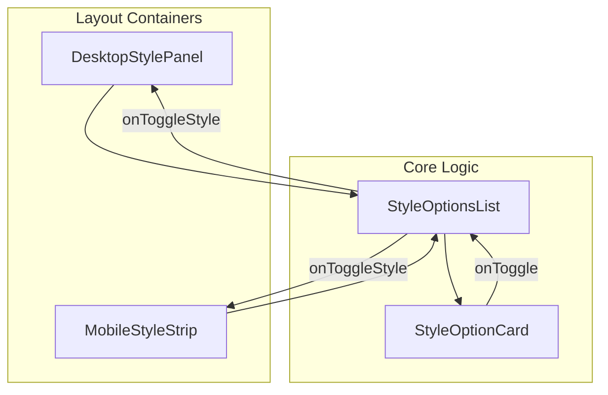
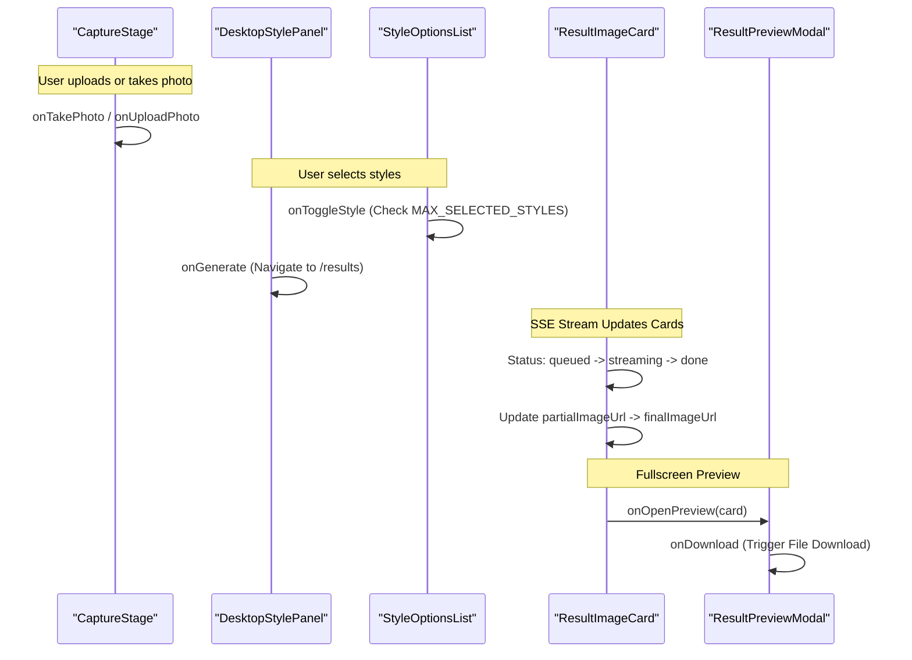

<!-- source: DeepWiki mcp.deepwiki.com · repo openai/openai-imagegen-demo · page 6.1 Photobooth Components · fetched 2026-10-26 -->

# Photobooth Components

Relevant source files

The following files were used as context for generating this wiki page:

- [components/photobooth/capture-stage.tsx](components/photobooth/capture-stage.tsx)
- [components/photobooth/desktop-style-panel.tsx](components/photobooth/desktop-style-panel.tsx)
- [components/photobooth/mobile-style-strip.tsx](components/photobooth/mobile-style-strip.tsx)
- [components/photobooth/result-image-card.tsx](components/photobooth/result-image-card.tsx)
- [components/photobooth/result-preview-modal.tsx](components/photobooth/result-preview-modal.tsx)
- [components/photobooth/style-option-card.tsx](components/photobooth/style-option-card.tsx)
- [components/photobooth/style-options-list.tsx](components/photobooth/style-options-list.tsx)

This section documents the React components located in `components/photobooth/`. These components form the specialized UI layer of the application, handling image acquisition, style selection, and the visualization of AI-generated results.

## Capture and Acquisition

The acquisition phase is managed by the `CaptureStage` component, which provides a unified interface for three distinct input methods: live camera feed, manual file upload, and drag-and-drop.

### CaptureStage Implementation
The `CaptureStage` [components/photobooth/capture-stage.tsx:21-34]() uses a conditional rendering strategy based on the state of `cameraStream` and `selectedImageDataUrl`.

*   **Camera View**: When `cameraStream` is active, it renders a `<video>` element [components/photobooth/capture-stage.tsx:71-77](). Note the `-scale-x-100` class used to mirror the preview for a natural user experience.
*   **Static Preview**: When an image is captured or uploaded, it renders an `` element [components/photobooth/capture-stage.tsx:62-69](). The `object-fit` property varies based on the source: `object-contain` for uploads and `object-cover` for camera captures to match the video aspect ratio.
*   **Empty State**: Displays the primary action buttons for "Start Camera" and "Upload Photo" [components/photobooth/capture-stage.tsx:86-95]().
*   **Drag and Drop**: Overlays a visual indicator [components/photobooth/capture-stage.tsx:113-117]() when `isDragActive` is true.

**Capture Flow Logic**
| State | Visible UI | Action Button |
| :--- | :--- | :--- |
| `cameraStream === null && !selectedImageDataUrl` | Empty state (Camera/Upload buttons) | N/A |
| `cameraStream !== null` | Live mirrored video | `onTakePhoto` (Camera icon) |
| `selectedImageDataUrl && source === "camera"` | Captured photo preview | `onStartCamera` (Retry icon) |

**Sources:** [components/photobooth/capture-stage.tsx:1-120]()

## Style Selection UI

The application supports a responsive style selection interface that adapts between a sidebar for desktop and a horizontal strip for mobile devices.

### Component Hierarchy
The selection logic is centralized in `StyleOptionsList`, which is then wrapped by responsive containers.

**Selection Component Relationships**

**Sources:** [components/photobooth/desktop-style-panel.tsx:1-38](), [components/photobooth/mobile-style-strip.tsx:1-36](), [components/photobooth/style-options-list.tsx:1-49]()

### Selection Constraints
The `StyleOptionsList` enforces a maximum selection limit defined by `MAX_SELECTED_STYLES` [components/photobooth/style-options-list.tsx:3-5]().
*   **Disabled State**: When the limit is reached, any style not currently selected is set to `isDisabled` [components/photobooth/style-options-list.tsx:33-34]().
*   **Tooltip**: `StyleOptionCard` displays the `STYLE_LIMIT_TOOLTIP` [components/photobooth/style-option-card.tsx:47-51]() when a user hovers over a disabled card.

**Sources:** [components/photobooth/style-options-list.tsx:31-47](), [components/photobooth/style-option-card.tsx:13-53]()

## Results and Visualization

The results phase uses specialized cards to handle the asynchronous, streaming nature of the OpenAI image generation.

### ResultImageCard States
`ResultImageCard` [components/photobooth/result-image-card.tsx:12-16]() manages complex visual states to provide feedback during the SSE (Server-Sent Events) stream.

| State Variable | Definition | UI Representation |
| :--- | :--- | :--- |
| `showPendingIndicator` | `queued` or `streaming` [components/photobooth/result-image-card.tsx:17-18]() | Activates spinners. |
| `activeImage` | `finalImageUrl` ?? `partialImageUrl` [components/photobooth/result-image-card.tsx:19-20]() | Displays the best available image. |
| `showCenteredSpinner` | Pending and no image yet [components/photobooth/result-image-card.tsx:22]() | Large spinner in center of card. |
| `showTopRightSpinner` | Pending but image is visible [components/photobooth/result-image-card.tsx:23]() | Small spinner in corner (indicates refinement). |
| `canDownload` | Status is `done` [components/photobooth/result-image-card.tsx:21]() | Shows Download button. |

**Sources:** [components/photobooth/result-image-card.tsx:1-99]()

### ResultPreviewModal
The `ResultPreviewModal` [components/photobooth/result-preview-modal.tsx:12-17]() provides a fullscreen view of the generated image. It uses `fixed inset-0` and a high z-index to overlay the entire application [components/photobooth/result-preview-modal.tsx:21-22]().

*   **Interaction**: Closes on background click via `onClose` [components/photobooth/result-preview-modal.tsx:27](), while stopping propagation on the content container to prevent accidental closures [components/photobooth/result-preview-modal.tsx:30]().
*   **Responsive Image**: Uses `max-h-[calc(100svh-8rem)]` to ensure the image fits within the viewport regardless of device height [components/photobooth/result-preview-modal.tsx:68]().

**Sources:** [components/photobooth/result-preview-modal.tsx:1-74]()

## Data Flow Diagram

The following diagram illustrates how user interactions in the components trigger state changes and navigation.

**Photobooth Component Interaction Flow**

**Sources:** [components/photobooth/capture-stage.tsx:105-109](), [components/photobooth/style-options-list.tsx:33-34](), [components/photobooth/result-image-card.tsx:17-24](), [components/photobooth/result-preview-modal.tsx:36-46]()

---

