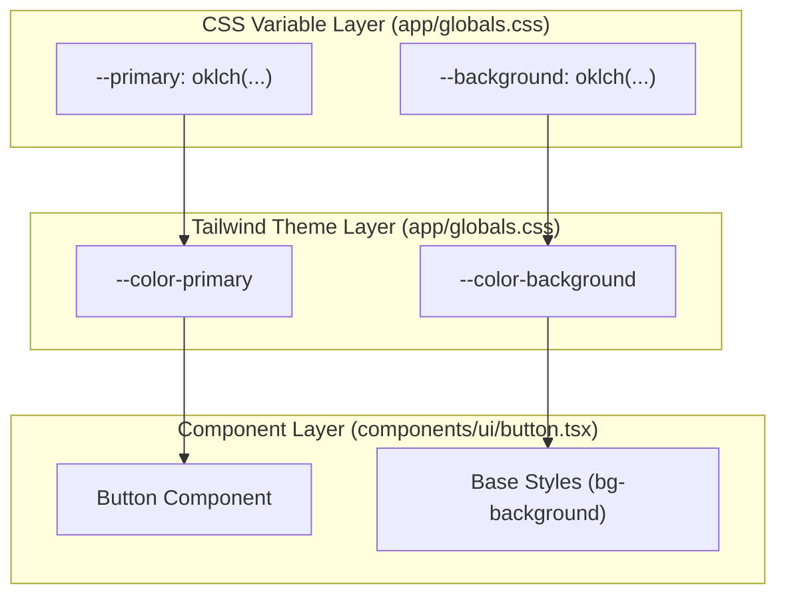
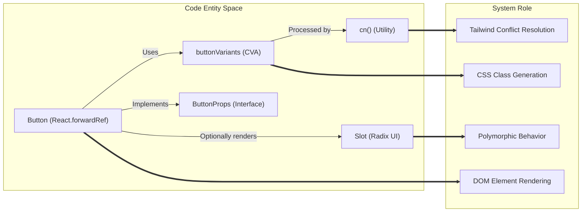

<!-- source: DeepWiki mcp.deepwiki.com · repo openai/openai-imagegen-demo · page 6.2 Design System & Global Styles · fetched 2026-10-26 -->

# Design System & Global Styles

Relevant source files

The following files were used as context for generating this wiki page:

- [THIRD_PARTY_NOTICES.md](THIRD_PARTY_NOTICES.md)
- [app/globals.css](app/globals.css)
- [components/ui/button.tsx](components/ui/button.tsx)
- [lib/utils.ts](lib/utils.ts)

This section documents the foundational styling architecture of the ImageGen Photobooth demo. The application utilizes **Tailwind CSS v4** with a CSS-variable-first approach, employing **OKLCH** color spaces for high-fidelity color reproduction and consistent perceived lightness across themes.

## CSS Architecture & Tailwind v4 Integration

The application's global styles are defined in `app/globals.css`. It uses the `@theme` block to map CSS variables to Tailwind utility classes, enabling a strict design system where colors and spacing are controlled via a central set of tokens.

### Global Configuration
The system imports Tailwind and the `tailwindcss-animate` plugin to handle UI transitions [app/globals.css:1-4](). It also defines a custom variant for dark mode detection via the `.dark` class selector [app/globals.css:6]().

### Theme Token Mapping
The `@theme inline` block maps standard Tailwind utility names (e.g., `primary`, `muted`, `radius-md`) to internal CSS variables [app/globals.css:8-44]().

| Tailwind Token | CSS Variable | Purpose |
| :--- | :--- | :--- |
| `--color-background` | `var(--background)` | Main application background |
| `--color-primary` | `var(--primary)` | Primary actions and branding |
| `--color-destructive` | `var(--destructive)` | Error states and destructive actions |
| `--radius-lg` | `var(--radius)` | Base border radius (0.625rem) |
| `--color-sidebar-*` | `var(--sidebar-*)` | Specific tokens for navigation/sidebar elements |

**Sources:** [app/globals.css:1-44]()

## Color System (OKLCH)

The application uses the **OKLCH** color model for its palette. Unlike HSL or RGB, OKLCH is perceptually uniform, ensuring that colors with the same lightness value appear equally bright to the human eye.

### Theme Definitions
Tokens are defined for both `:root` (Light Mode) and `.dark` (Dark Mode) [app/globals.css:46-115]().

*   **Light Mode:** Uses high lightness values (e.g., `oklch(1 0 0)` for background) and low lightness for foregrounds [app/globals.css:49-50]().
*   **Dark Mode:** Inverts the lightness scale (e.g., `oklch(0.145 0 0)` for background) while maintaining the same chroma and hue logic [app/globals.css:84-85]().
*   **Border & Input:** Utilize alpha transparency in dark mode for softer UI separation (e.g., `oklch(1 0 0 / 10%)`) [app/globals.css:99-100]().

### Data Flow: Color Tokens to UI
The following diagram illustrates how raw OKLCH values flow through the theme system into React components.

**Color Token Pipeline**

**Sources:** [app/globals.css:46-115](), [components/ui/button.tsx:12-13]()

## Typography & Fonts

The project utilizes **Geist** and **Geist Mono** fonts, provided via `next/font/google` [THIRD_PARTY_NOTICES.md:3-5](). These are standard Vercel-designed fonts optimized for legibility in technical interfaces.

**Sources:** [THIRD_PARTY_NOTICES.md:3-10]()

## Utility: The `cn()` Helper

To manage complex conditional class names and ensure Tailwind class merging (resolving conflicts like `px-2 px-4`), the project uses a utility function in `lib/utils.ts`.

*   **Implementation:** It wraps `clsx` for conditional logic and `twMerge` for conflict resolution [lib/utils.ts:4-6]().
*   **Usage:** Extensively used in components to merge default variant styles with user-provided `className` props [components/ui/button.tsx:48]().

**Sources:** [lib/utils.ts:1-7](), [components/ui/button.tsx:5]()

## Base Component: Button

The `Button` component is the primary interactive primitive, built using `class-variance-authority` (CVA) for variant management and `@radix-ui/react-slot` for polymorphic rendering.

### Implementation Details
*   **Polymorphism:** Uses the `asChild` prop and Radix `Slot` to allow the Button to behave like another element (e.g., an `<a>` tag) while keeping its styles [components/ui/button.tsx:45]().
*   **Variants:** Defined via `buttonVariants` [components/ui/button.tsx:7-35]().
    *   **Variants:** `default`, `destructive`, `outline`, `secondary`, `ghost`, `link`.
    *   **Sizes:** `default` (h-9), `sm` (h-8), `lg` (h-10), `icon` (square).
*   **Default Styles:** Includes `inline-flex`, `transition-colors`, and focus-ring logic [components/ui/button.tsx:8]().

### Component Structure
**Button Logic Entity Map**

**Sources:** [components/ui/button.tsx:1-58](), [lib/utils.ts:4-6]()

---

