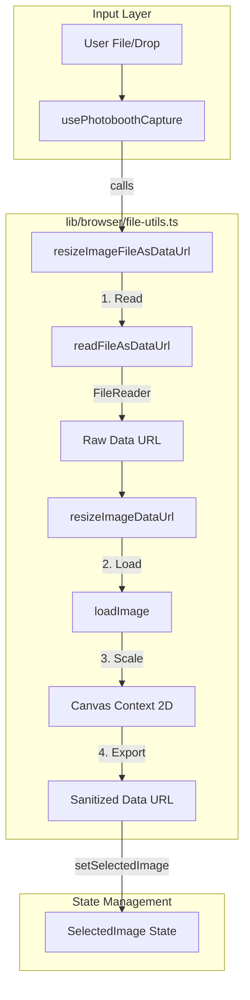
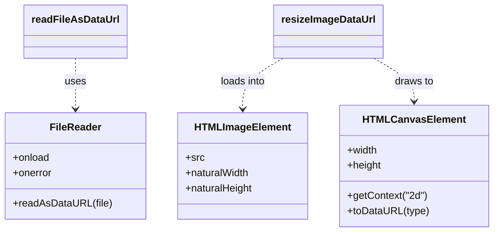

<!-- source: DeepWiki mcp.deepwiki.com · repo openai/openai-imagegen-demo · page 7 Browser Utilities · fetched 2026-10-26 -->

# Browser Utilities

Relevant source files

The following files were used as context for generating this wiki page:

- [hooks/use-photobooth-capture.ts](hooks/use-photobooth-capture.ts)
- [lib/browser/file-utils.ts](lib/browser/file-utils.ts)

The `lib/browser/file-utils.ts` module provides a set of utility functions for handling client-side image processing. These utilities manage the conversion of local files to Data URLs, enforce resolution constraints before API transmission, and facilitate programmatic file downloads.

Client-side resizing is a critical step in the photobooth pipeline. By downscaling images to a maximum dimension of 1536px before they are sent to the backend, the application reduces payload size for the `POST` request to the `/api/photobooth` route and ensures compatibility with OpenAI API limits.

### Image Processing Flow

The following diagram illustrates how raw user input (via file upload or drag-and-drop) is transformed into a sanitized Data URL suitable for the application state.

**User Image Acquisition Flow**

Sources: [lib/browser/file-utils.ts:1-70](), [hooks/use-photobooth-capture.ts:105-122]()

---

### Core Functions

#### readFileAsDataUrl
This function wraps the asynchronous `FileReader` API in a Promise. It converts a `File` object into a base64 encoded string (Data URL).
*   **Implementation**: Uses `reader.readAsDataURL(file)` [lib/browser/file-utils.ts:14]().
*   **Error Handling**: Rejects if the result is not a string or if the `FileReader` encounters an error [lib/browser/file-utils.ts:10-13]().

#### resizeImageDataUrl
The primary engine for client-side downscaling. It uses an off-screen `HTMLCanvasElement` to resize images while maintaining aspect ratio.
*   **Logic**: 
    1.  Loads the Data URL into an `HTMLImageElement` via the internal `loadImage` helper [lib/browser/file-utils.ts:40]().
    2.  Calculates the `longestSide` of the image [lib/browser/file-utils.ts:41]().
    3.  If the side exceeds `maxDimension` (default 1536px), it calculates a scale factor [lib/browser/file-utils.ts:47]().
    4.  Draws the image onto a canvas with the new dimensions [lib/browser/file-utils.ts:57]().
    5.  Exports the canvas content back to a Data URL using the original MIME type [lib/browser/file-utils.ts:58]().

#### resizeImageFileAsDataUrl
A convenience wrapper that orchestrates the full transformation from a raw `File` to a resized Data URL.
*   **Flow**: It first calls `readFileAsDataUrl` and then passes the result to `resizeImageDataUrl` [lib/browser/file-utils.ts:65-69]().
*   **Usage**: This is the primary entry point used by `usePhotoboothCapture` when a user selects a file [hooks/use-photobooth-capture.ts:113]().

#### downloadUrl
Facilitates programmatic file downloads by simulating a user click on a hidden anchor element.
*   **Implementation**: Creates an `<a>` element, sets the `href` to the provided URL (typically a Data URL or Blob URL), sets the `download` attribute for the filename, appends it to the DOM, triggers `click()`, and immediately removes it [lib/browser/file-utils.ts:73-79]().

Sources: [lib/browser/file-utils.ts:1-80](), [hooks/use-photobooth-capture.ts:3]()

---

### Implementation Details

| Function | Input | Output | Key Dependency |
| :--- | :--- | :--- | :--- |
| `readFileAsDataUrl` | `File` | `Promise<string>` | `FileReader` |
| `loadImage` | `string` (src) | `Promise<HTMLImageElement>` | `new Image()` |
| `resizeImageDataUrl` | `string`, `ResizeImageOptions` | `Promise<string>` | `HTMLCanvasElement` |
| `downloadUrl` | `string` (url), `string` (name) | `void` | `HTMLAnchorElement` |

#### MIME Type Detection
The utility includes a helper `getDataUrlMimeType` to ensure that resized images retain their original format (e.g., `image/jpeg` vs `image/png`). It parses the prefix of the Data URL string to extract the type [lib/browser/file-utils.ts:25-29]().

**Entity Relationship: Browser API Integration**

Sources: [lib/browser/file-utils.ts:3-14](), [lib/browser/file-utils.ts:19-22](), [lib/browser/file-utils.ts:48-58]()

---

