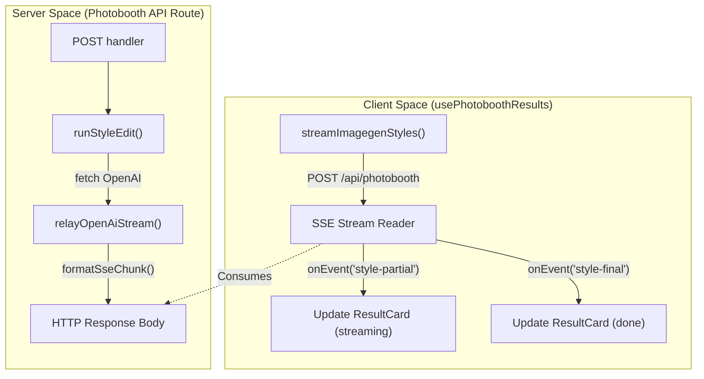
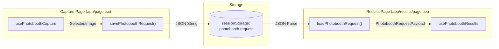

<!-- source: DeepWiki mcp.deepwiki.com · repo openai/openai-imagegen-demo · page 8 Glossary · fetched 2026-10-26 -->

# Glossary

Relevant source files

The following files were used as context for generating this wiki page:

- [README.md](README.md)
- [app/api/photobooth/route.ts](app/api/photobooth/route.ts)
- [app/globals.css](app/globals.css)
- [lib/constants.ts](lib/constants.ts)
- [lib/photobooth-session.ts](lib/photobooth-session.ts)
- [lib/photobooth-styles.ts](lib/photobooth-styles.ts)
- [lib/sse.ts](lib/sse.ts)
- [middleware.ts](middleware.ts)
- [services/imagegen-api.ts](services/imagegen-api.ts)
- [types/photobooth.ts](types/photobooth.ts)

This glossary defines the technical terms, abbreviations, and domain concepts specific to the ImageGen Photobooth codebase. It provides a mapping between the high-level application logic and the underlying implementation details.

## Domain Concepts & Terms

### Image Edit Mode
The application utilizes the OpenAI Image API in "edit" mode. Unlike standard text-to-image generation, this mode requires an input image and a prompt to guide the transformation. The system specifically uses the `gpt-image-2` model to perform these edits.
- **Implementation**: Controlled via `OPENAI_IMAGE_MODEL` in [lib/constants.ts:18-18]().
- **Data Flow**: The user's base64 image is wrapped in a JSON payload and sent to the `/images/edits` endpoint [app/api/photobooth/route.ts:175-203]().

### Partial Images (Streaming)
A feature of the `gpt-image-2` model that allows the client to receive intermediate "draft" versions of the image before the final high-quality version is ready.
- **Implementation**: Enabled by setting `partial_images` in the API request [app/api/photobooth/route.ts:202-202]().
- **Configuration**: The number of partials is defined by `OPENAI_IMAGE_PARTIAL_IMAGES` [lib/constants.ts:22-22]().
- **Code Entity**: Handled by the `style-partial` event in the SSE stream [app/api/photobooth/route.ts:91-98]().

### Photobooth Style
A predefined configuration object that maps a user-friendly label to a specific AI prompt designed to transform the subject's appearance while maintaining identity.
- **Implementation**: Defined as the `PhotoboothStyle` type in [lib/photobooth-styles.ts:9-14]().
- **Catalog**: The full list of available styles (e.g., `knitted`, `anime`) is stored in the `PHOTOBOOTH_STYLES` array [lib/photobooth-styles.ts:16-60]().

### SSE (Server-Sent Events)
The communication protocol used to stream generation progress from the Next.js Route Handler to the browser. It allows the UI to update cards as soon as partial images or status changes occur without polling.
- **Utility**: `parseSseChunk` and `formatSseChunk` in [lib/sse.ts:6-33]().
- **Consumption**: The client-side `streamImagegenStyles` function reads the `ReadableStream` and dispatches events [services/imagegen-api.ts:50-146]().

---

## Technical Mapping: Natural Language to Code

The following diagrams bridge high-level user actions and domain concepts to specific code entities and data structures.

### Image Generation Lifecycle
This diagram maps the conceptual "Generation Phase" to the specific functions and event types used in the code.

**Sources**: [app/api/photobooth/route.ts:158-237](), [services/imagegen-api.ts:50-146](), [lib/sse.ts:30-33]()

### State & Persistence Mapping
This diagram shows how user selections are transitioned from the "Capture" state to the "Results" state via browser storage.

**Sources**: [lib/photobooth-session.ts:7-49](), [types/photobooth.ts:8-11](), [lib/constants.ts:5-5]()

---

## Abbreviations & Symbols Reference

| Symbol | Definition | Context / File |
| :--- | :--- | :--- |
| `imageDataUrl` | A Base64 encoded string representing the user's captured or uploaded image. | [types/photobooth.ts:9-9]() |
| `styleId` | A unique identifier (e.g., `"lofi-comic"`) for a style preset. | [lib/photobooth-styles.ts:1-7]() |
| `ResultCard` | The UI state object representing one style's generation status and image URLs. | [types/photobooth.ts:15-22]() |
| `SSE` | Server-Sent Events; the protocol for the streaming API. | [lib/sse.ts:1-35]() |
| `cn()` | Utility for merging Tailwind CSS classes. | [lib/utils.ts]() |
| `OPENAI_IMAGE_SIZE` | The fixed resolution (`1024x1536`) used for all generations. | [lib/constants.ts:19-19]() |
| `ResultStatus` | Union type: `"queued" \| "streaming" \| "done" \| "error"`. | [types/photobooth.ts:13-13]() |

---

## Data Structures

### PhotoboothRequestPayload
The core object used to initiate a generation session. It is saved to `sessionStorage` to persist state across the navigation from `/` to `/results`.
- **Fields**:
  - `imageDataUrl`: The source image (base64).
  - `styleIds`: An array of `PhotoboothStyleId` values selected by the user.
- **Definition**: [types/photobooth.ts:8-11]()

### ResultCard
Represents the state of a single style being processed. The `usePhotoboothResults` hook manages an array of these.
- **Fields**:
  - `status`: Current lifecycle state (`streaming`, `done`, etc.).
  - `partialImageUrl`: The latest draft image received via SSE.
  - `finalImageUrl`: The final high-resolution image.
- **Definition**: [types/photobooth.ts:15-22]()

**Sources**: [types/photobooth.ts:1-29](), [lib/photobooth-styles.ts:1-14](), [lib/constants.ts:1-26]()