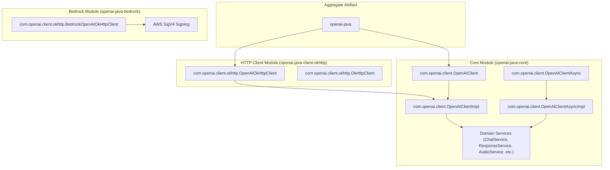

<!-- source: DeepWiki mcp.deepwiki.com · repo openai/openai-java · page 1 Overview · fetched 2026-10-26 -->

# Overview

Relevant source files

The following files were used as context for generating this wiki page:

- [.release-please-manifest.json](.release-please-manifest.json)
- [CHANGELOG.md](CHANGELOG.md)
- [CONTRIBUTING.md](CONTRIBUTING.md)
- [README.md](README.md)
- [bedrock.md](bedrock.md)
- [build.gradle.kts](build.gradle.kts)
- [settings.gradle.kts](settings.gradle.kts)

The OpenAI Java SDK provides convenient, type-safe access to the OpenAI REST API from Java and Kotlin applications `[README.md:1-7]`. It abstracts direct HTTP communication, offering both synchronous and asynchronous execution models, robust stream handling, structured outputs, and multi-provider support.

## Module Layout

The codebase is organized into a modular project structure separating core framework-neutral logic, HTTP transport implementations, optional cloud integrations, and aggregate wrapper artifacts `[CONTRIBUTING.md:65-90]`.

- `openai-java-core`: Contains core SDK logic, service interfaces (`OpenAIClient`, `OpenAIClientAsync`), immutable parameter builders, and JSON mapping infrastructure without a direct dependency on OkHttp `[CONTRIBUTING.md:69-72]`.
- `openai-java-client-okhttp`: Provides OkHttp-backed client factories (`OpenAIOkHttpClient`, `OpenAIOkHttpClientAsync`) to execute network requests `[CONTRIBUTING.md:73-75]`.
- `openai-java`: An aggregate artifact that depends on and exposes both `openai-java-core` and `openai-java-client-okhttp` without containing standalone source code `[CONTRIBUTING.md:76-78]`.
- `openai-java-bedrock`: An optional module adding Amazon Bedrock credential chains and SigV4 request signing to call OpenAI-compatible models on AWS `[README.md:94-122]`, `[CONTRIBUTING.md:79-81]`.

Sources: `[README.md:1-122]`, `[CONTRIBUTING.md:65-90]`

## High-Level Architecture

The SDK follows a layered architecture separating client entry points (`OpenAIClient`, `OpenAIClientAsync`) `[openai-java-core/src/main/kotlin/com/openai/client/OpenAIClient.kt:29-172]`, `[openai-java-core/src/main/kotlin/com/openai/client/OpenAIClientAsync.kt:29-174]`, client implementations (`OpenAIClientImpl`, `OpenAIClientAsyncImpl`) `[openai-java-core/src/main/kotlin/com/openai/client/OpenAIClientImpl.kt:51-315]`, `[openai-java-core/src/main/kotlin/com/openai/client/OpenAIClientAsyncImpl.kt:51-331]`, domain-specific service groupings, and underlying HTTP transport adapters `[openai-java-client-okhttp/src/main/kotlin/com/openai/client/okhttp/OkHttpClient.kt:33-252]`.

Diagram: SDK Modular and Layered Architecture

For details on the layered architecture, client layer, service layer, HTTP layer, and infrastructure components, see [Architecture](#1.1).

Sources: `[CONTRIBUTING.md:65-90]`, `[openai-java-core/src/main/kotlin/com/openai/client/OpenAIClient.kt:29-172]`, `[openai-java-core/src/main/kotlin/com/openai/client/OpenAIClientAsync.kt:29-174]`, `[openai-java-core/src/main/kotlin/com/openai/client/OpenAIClientImpl.kt:51-315]`, `[openai-java-client-okhttp/src/main/kotlin/com/openai/client/okhttp/OkHttpClient.kt:33-252]`

## Key Features

The SDK provides robust support for all major OpenAI capabilities, including the recommended Responses API, legacy Chat Completions, structured outputs via automatic JSON schema generation, function calling, real-time streaming with accumulator classes, multimodal content, Realtime API, evaluations, webhooks, and video/audio services.

For a high-level overview of major features including Chat Completions, Responses API, structured outputs, function calling, streaming, realtime, evaluations, webhooks, video, and safety, see [Features](#1.2).

Sources: `[README.md:50-92]`, `[CHANGELOG.md:1-108]`

---

