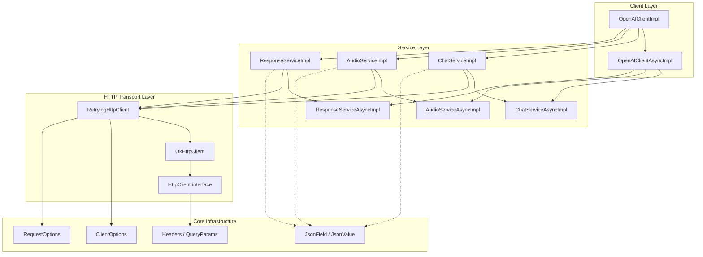
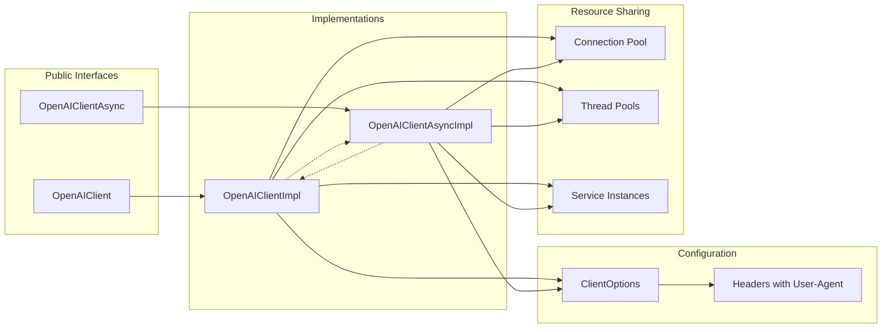
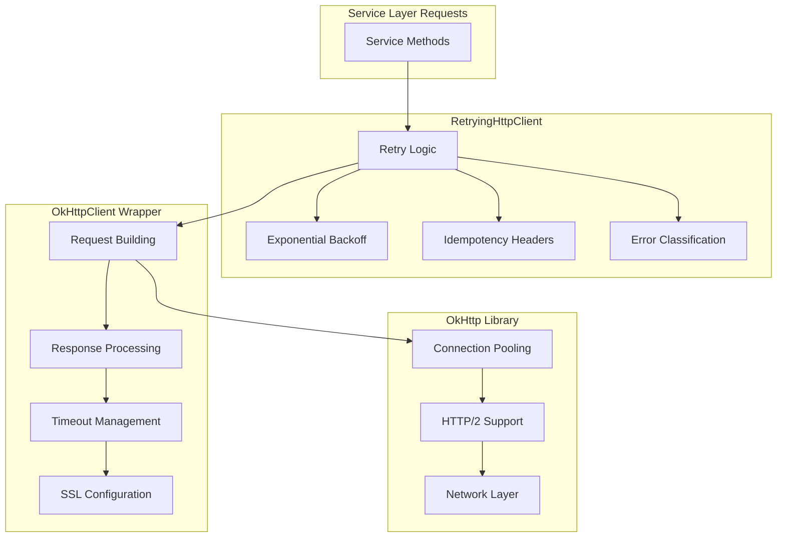
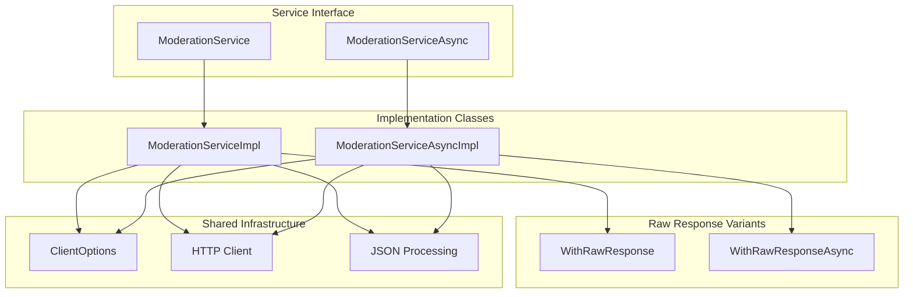
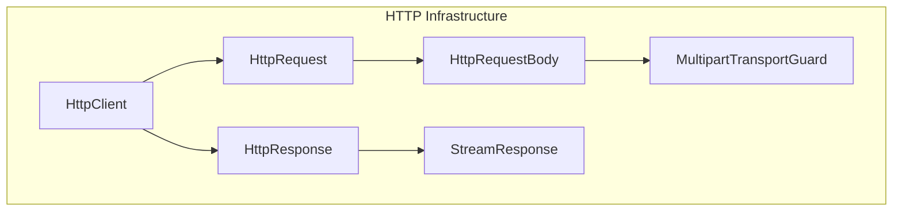

<!-- source: DeepWiki mcp.deepwiki.com · repo openai/openai-java · page 1.1 Architecture · fetched 2026-10-26 -->

# Architecture

<details>
<summary>Relevant source files</summary>

The following files were used as context for generating this wiki page:

- [openai-java-core/src/main/kotlin/com/openai/client/OpenAIClient.kt](openai-java-core/src/main/kotlin/com/openai/client/OpenAIClient.kt)
- [openai-java-core/src/main/kotlin/com/openai/client/OpenAIClientAsync.kt](openai-java-core/src/main/kotlin/com/openai/client/OpenAIClientAsync.kt)
- [openai-java-core/src/main/kotlin/com/openai/client/OpenAIClientAsyncImpl.kt](openai-java-core/src/main/kotlin/com/openai/client/OpenAIClientAsyncImpl.kt)
- [openai-java-core/src/main/kotlin/com/openai/client/OpenAIClientImpl.kt](openai-java-core/src/main/kotlin/com/openai/client/OpenAIClientImpl.kt)
- [openai-java-core/src/main/kotlin/com/openai/core/http/HttpClient.kt](openai-java-core/src/main/kotlin/com/openai/core/http/HttpClient.kt)
- [openai-java-core/src/main/kotlin/com/openai/core/http/HttpRequestBody.kt](openai-java-core/src/main/kotlin/com/openai/core/http/HttpRequestBody.kt)
- [openai-java-core/src/main/kotlin/com/openai/core/http/StreamResponse.kt](openai-java-core/src/main/kotlin/com/openai/core/http/StreamResponse.kt)
- [openai-java-core/src/main/kotlin/com/openai/services/async/ModerationServiceAsync.kt](openai-java-core/src/main/kotlin/com/openai/services/async/ModerationServiceAsync.kt)
- [openai-java-core/src/main/kotlin/com/openai/services/blocking/ModerationService.kt](openai-java-core/src/main/kotlin/com/openai/services/blocking/ModerationService.kt)

</details>


This document provides a detailed technical overview of the OpenAI Java SDK architecture, covering the core components, design patterns, and how they work together to provide both synchronous and asynchronous API access. 

For information about specific features like structured outputs and function calling, see [Features](#1.2). For getting started with basic usage, see [Getting Started](#2).

## Overview

The OpenAI Java SDK follows a layered architecture with clear separation of concerns. The main architectural layers are:

- **Client Layer**: Entry point interfaces (`OpenAIClient`, `OpenAIClientAsync`) [openai-java-core/src/main/kotlin/com/openai/client/OpenAIClient.kt:48-48](), [openai-java-core/src/main/kotlin/com/openai/client/OpenAIClientAsync.kt:48-48]()
- **Service Layer**: API-specific service implementations (Chat, Audio, Images, etc.) [openai-java-core/src/main/kotlin/com/openai/client/OpenAIClientImpl.kt:78-148](), [openai-java-core/src/main/kotlin/com/openai/client/OpenAIClientAsyncImpl.kt:78-166]()
- **HTTP Transport Layer**: Abstract HTTP handling with retry logic and connection management [openai-java-core/src/main/kotlin/com/openai/core/http/HttpClient.kt:7-26]()
- **Core Infrastructure**: JSON processing, configuration, and utility components



Sources: [openai-java-core/src/main/kotlin/com/openai/client/OpenAIClientImpl.kt:1-149](), [openai-java-core/src/main/kotlin/com/openai/client/OpenAIClientAsyncImpl.kt:1-166](), [openai-java-core/src/main/kotlin/com/openai/core/http/HttpClient.kt:1-26]()

## Client Architecture

The SDK provides dual client implementations supporting both synchronous and asynchronous execution patterns. Both clients share the same underlying resources and service implementations.

### Client Implementation Structure



The client implementations use lazy initialization for service instances and automatically inject a `User-Agent` header if not already present [openai-java-core/src/main/kotlin/com/openai/client/OpenAIClientImpl.kt:61-149](), [openai-java-core/src/main/kotlin/com/openai/client/OpenAIClientAsyncImpl.kt:61-166](). Cross-references between sync and async clients enable seamless switching between execution modes.

Sources: [openai-java-core/src/main/kotlin/com/openai/client/OpenAIClientImpl.kt:61-149](), [openai-java-core/src/main/kotlin/com/openai/client/OpenAIClientAsyncImpl.kt:61-166]()

### Service Organization

Both client implementations expose the same set of services through lazy-initialized properties:

| Service Category | Core Services | Advanced Services |
|------------------|---------------|-------------------|
| Text Generation | `chat()`, `completions()`, `responses()` [openai-java-core/src/main/kotlin/com/openai/client/OpenAIClient.kt:74-76](), [openai-java-core/src/main/kotlin/com/openai/client/OpenAIClient.kt:124-124]() | `beta()` [openai-java-core/src/main/kotlin/com/openai/client/OpenAIClient.kt:113-113]() |
| Media Processing | `audio()`, `images()` [openai-java-core/src/main/kotlin/com/openai/client/OpenAIClient.kt:91-95]() | - |
| Data Management | `files()`, `uploads()` [openai-java-core/src/main/kotlin/com/openai/client/OpenAIClient.kt:88-88](), [openai-java-core/src/main/kotlin/com/openai/client/OpenAIClient.kt:119-119]() | `vectorStores()` [openai-java-core/src/main/kotlin/com/openai/client/OpenAIClient.kt:107-107]() |
| Model Operations | `models()`, `fineTuning()` [openai-java-core/src/main/kotlin/com/openai/client/OpenAIClient.kt:101-103]() | `batches()` [openai-java-core/src/main/kotlin/com/openai/client/OpenAIClient.kt:116-116]() |
| Evaluation | `moderations()` [openai-java-core/src/main/kotlin/com/openai/client/OpenAIClient.kt:98-98]() | `evals()`, `graders()` [openai-java-core/src/main/kotlin/com/openai/client/OpenAIClient.kt:105-105](), [openai-java-core/src/main/kotlin/com/openai/client/OpenAIClient.kt:134-134]() |
| Real-time | `realtime()`, `conversations()` [openai-java-core/src/main/kotlin/com/openai/client/OpenAIClient.kt:128-131]() | `webhooks()` [openai-java-core/src/main/kotlin/com/openai/client/OpenAIClient.kt:111-111]() |
| Utilities | `embeddings()` [openai-java-core/src/main/kotlin/com/openai/client/OpenAIClient.kt:82-82]() | `containers()` [openai-java-core/src/main/kotlin/com/openai/client/OpenAIClient.kt:136-136]() |

Each service has three variants:
- **Standard**: Normal response processing
- **WithRawResponse**: Access to raw HTTP responses and headers [openai-java-core/src/main/kotlin/com/openai/client/OpenAIClient.kt:61-61]()  
- **Async**: `CompletableFuture`-based non-blocking execution [openai-java-core/src/main/kotlin/com/openai/client/OpenAIClientAsync.kt:48-48]()

Sources: [openai-java-core/src/main/kotlin/com/openai/client/OpenAIClient.kt:74-141](), [openai-java-core/src/main/kotlin/com/openai/client/OpenAIClientAsync.kt:74-141]()

## HTTP Transport Layer

The HTTP transport layer provides an abstraction over the underlying HTTP client with retry logic, connection management, and request/response processing via the `HttpClient` interface [openai-java-core/src/main/kotlin/com/openai/core/http/HttpClient.kt:7-26]().

### HTTP Client Stack



Sources: [openai-java-core/src/main/kotlin/com/openai/core/http/HttpClient.kt:7-26]()

## Service Layer Organization

The service layer follows a consistent pattern across all API endpoints with interface-implementation separation and support for both execution modes.

### Service Implementation Pattern



Sources: [openai-java-core/src/main/kotlin/com/openai/services/blocking/ModerationService.kt:14-68](), [openai-java-core/src/main/kotlin/com/openai/services/async/ModerationServiceAsync.kt:14-71]()

Each service implementation provides:
- **Standard Methods**: Return deserialized model objects [openai-java-core/src/main/kotlin/com/openai/services/blocking/ModerationService.kt:32-39]()
- **WithRawResponse Methods**: Return `HttpResponseFor<T>` with access to headers and status [openai-java-core/src/main/kotlin/com/openai/services/blocking/ModerationService.kt:58-66]()
- **Option Modification**: `withOptions()` methods for per-request configuration [openai-java-core/src/main/kotlin/com/openai/services/blocking/ModerationService.kt:26-26]()

### Service Method Signatures

Standard service methods follow consistent patterns:

```kotlin
// Synchronous version
fun create(params: ModerationCreateParams): ModerationCreateResponse
fun create(params: ModerationCreateParams, requestOptions: RequestOptions): ModerationCreateResponse

// Asynchronous version  
fun create(params: ModerationCreateParams): CompletableFuture<ModerationCreateResponse>
fun create(params: ModerationCreateParams, requestOptions: RequestOptions): CompletableFuture<ModerationCreateResponse>
```

Sources: [openai-java-core/src/main/kotlin/com/openai/services/blocking/ModerationService.kt:32-39](), [openai-java-core/src/main/kotlin/com/openai/services/async/ModerationServiceAsync.kt:32-39]()

## Core Infrastructure

### HTTP Body and Stream Transport Interfaces

The infrastructure provides foundational abstractions for request bodies and streaming responses that underpin all service operations [openai-java-core/src/main/kotlin/com/openai/core/http/HttpRequestBody.kt:6-25](), [openai-java-core/src/main/kotlin/com/openai/core/http/StreamResponse.kt:5-11]().



Sources: [openai-java-core/src/main/kotlin/com/openai/core/http/HttpClient.kt:7-26](), [openai-java-core/src/main/kotlin/com/openai/core/http/HttpRequestBody.kt:6-30](), [openai-java-core/src/main/kotlin/com/openai/core/http/StreamResponse.kt:5-11]()

---

