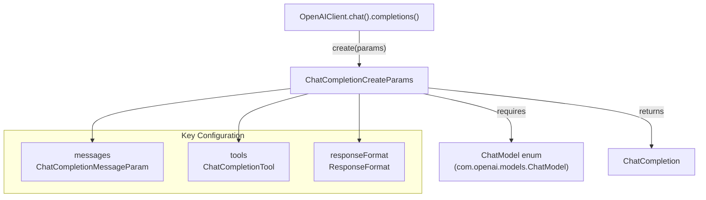
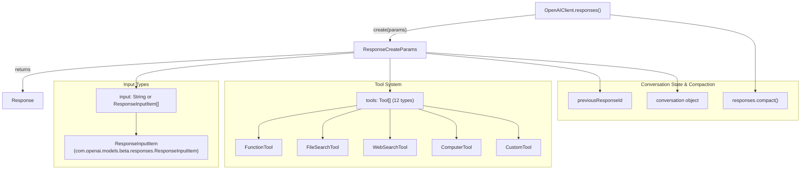
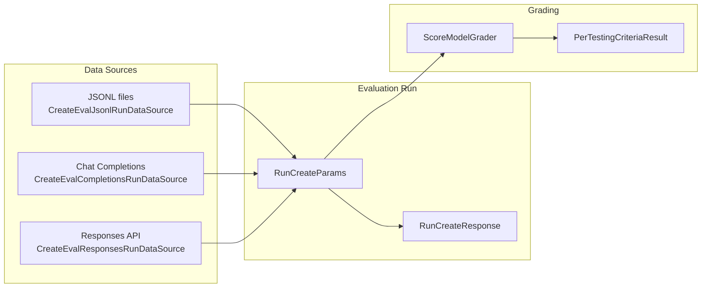
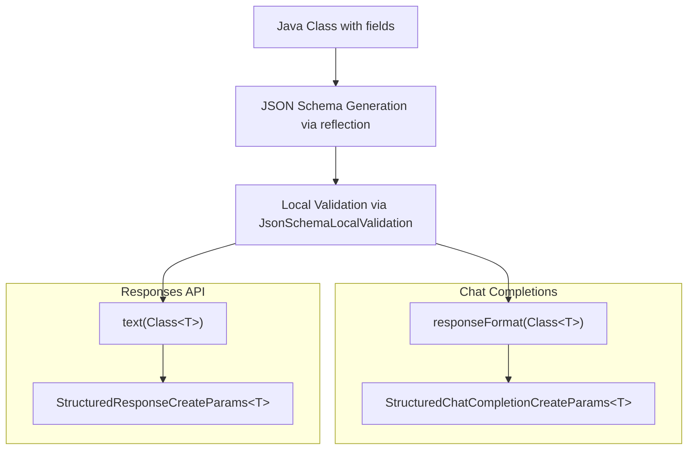
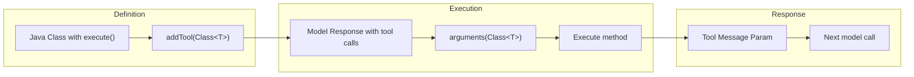

<!-- source: DeepWiki mcp.deepwiki.com · repo openai/openai-java · page 1.2 Features · fetched 2026-10-26 -->

# Features

Relevant source files

The following files were used as context for generating this wiki page:

- [.castiron.stats.yml](.castiron.stats.yml)
- [.release-please-manifest.json](.release-please-manifest.json)
- [CHANGELOG.md](CHANGELOG.md)
- [CONTRIBUTING.md](CONTRIBUTING.md)
- [README.md](README.md)
- [api_reference/openapi.transformed.yml](api_reference/openapi.transformed.yml)
- [bedrock.md](bedrock.md)
- [build.gradle.kts](build.gradle.kts)
- [openai-java-core/src/main/kotlin/com/openai/models/AllModels.kt](openai-java-core/src/main/kotlin/com/openai/models/AllModels.kt)
- [openai-java-core/src/main/kotlin/com/openai/models/ChatModel.kt](openai-java-core/src/main/kotlin/com/openai/models/ChatModel.kt)
- [openai-java-core/src/main/kotlin/com/openai/models/ResponsesModel.kt](openai-java-core/src/main/kotlin/com/openai/models/ResponsesModel.kt)
- [openai-java-core/src/main/kotlin/com/openai/models/beta/responses/BetaResponse.kt](openai-java-core/src/main/kotlin/com/openai/models/beta/responses/BetaResponse.kt)
- [openai-java-core/src/main/kotlin/com/openai/models/beta/responses/BetaResponsesClientEvent.kt](openai-java-core/src/main/kotlin/com/openai/models/beta/responses/BetaResponsesClientEvent.kt)
- [openai-java-core/src/main/kotlin/com/openai/models/beta/responses/ResponseCompactParams.kt](openai-java-core/src/main/kotlin/com/openai/models/beta/responses/ResponseCompactParams.kt)
- [openai-java-core/src/main/kotlin/com/openai/models/beta/responses/ResponseCreateParams.kt](openai-java-core/src/main/kotlin/com/openai/models/beta/responses/ResponseCreateParams.kt)
- [openai-java-core/src/main/kotlin/com/openai/models/responses/ResponseCompactParams.kt](openai-java-core/src/main/kotlin/com/openai/models/responses/ResponseCompactParams.kt)

This document provides a comprehensive technical overview of the major features available in the OpenAI Java SDK (`openai-java`). It details the core API capabilities, type-safety mechanisms, dual-mode execution models, realtime WebSocket communication, and supporting infrastructure. For architecture details, see [1.1](), and for artifact-specific configurations, see [8]() and [9]().

Sources: [README.md:1-72](), [CONTRIBUTING.md:65-81]()

## Core API Features

The SDK provides access to major OpenAI API endpoints through dedicated service interfaces and strongly typed parameter builders.

### Chat Completions API

The Chat Completions API is the established standard interface for generating text from conversational inputs, configured via `ChatCompletionCreateParams`.

**Feature capabilities:**
- **Message types**: Supports system, user, assistant, tool, and function messages via `ChatCompletionMessageParam`
- **Model selection**: Extensive model enumeration through `ChatModel` including GPT-6, GPT-5, and O-series variants [openai-java-core/src/main/kotlin/com/openai/models/ChatModel.kt:23-115]()
- **Tool calling**: Function calling and custom tools via `ChatCompletionTool`
- **Response formatting**: Text, JSON object, or structured JSON schema via `ResponseFormat`
- **Reasoning control**: Configurable reasoning effort levels via `ReasoningEffort` enum
- **Token limits**: `maxCompletionTokens` for controlling output length and costs

Sources: [README.md:74-92](), [openai-java-core/src/main/kotlin/com/openai/models/ChatModel.kt:23-115]()

### Responses API

The Responses API is the recommended modern interface, offering advanced features for multi-turn conversations, background processing, compaction, and multi-modal content.

**Feature capabilities:**
- **Multi-modal inputs**: Text, images, files, and audio via `ResponseInputItem` union variants [openai-java-core/src/main/kotlin/com/openai/models/beta/responses/ResponseCreateParams.kt:113-127]()
- **Tool ecosystem**: 12 tool types including function calls, file search, web search, computer use, and MCP tools [openai-java-core/src/main/kotlin/com/openai/models/beta/responses/ResponseCreateParams.kt:37-47]()
- **Conversation management**: State tracking via `previousResponseId` or full `conversation` objects, alongside `ResponseCompactParams` for conversation compaction [openai-java-core/src/main/kotlin/com/openai/models/responses/ResponseCompactParams.kt:36-92]()
- **Background processing**: Asynchronous execution via `background(Boolean)` [openai-java-core/src/main/kotlin/com/openai/models/beta/responses/ResponseCreateParams.kt:66-74]()

Sources: [README.md:50-73](), [openai-java-core/src/main/kotlin/com/openai/models/responses/ResponseCompactParams.kt:36-92](), [openai-java-core/src/main/kotlin/com/openai/models/beta/responses/ResponseCreateParams.kt:37-127]()

### Assistants API (Deprecated)

The Assistants API is deprecated in favor of the Responses API but remains supported indefinitely for legacy thread-based workflows.

**Feature capabilities:**
- Assistant creation via `AssistantCreateParams` with model, instructions, and tool configurations [api_reference/openapi.transformed.yml:53-60]()
- Persistent conversation threads and run execution via `RunCreateParams`

Sources: [api_reference/openapi.transformed.yml:53-60]()

### Evaluations and Graders

The Evaluations API provides systematic testing of model performance across datasets.

**Feature capabilities:**
- **Data source types**: JSONL files, chat completions, or responses API data via union types
- **Grading system**: Automated scoring via `ScoreModelGrader` with customizable input templates
- **Run management**: Create, retrieve, cancel, and list evaluation runs

Sources: [api_reference/openapi.transformed.yml:30-35]()

### Realtime and WebSocket API

The SDK supports persistent WebSocket connections for real-time bi-directional interactions, audio configuration, and streaming events via `BetaResponsesClientEvent` and client/server event wrappers [openai-java-core/src/main/kotlin/com/openai/models/beta/responses/BetaResponsesClientEvent.kt:34-92]().

**Feature capabilities:**
- **Response Creation**: Over persistent WebSocket connections using implicit streaming and `ResponseCreate` payloads [openai-java-core/src/main/kotlin/com/openai/models/beta/responses/BetaResponsesClientEvent.kt:45-55]()
- **Steering**: Queueing user input to steer active responses via `BetaResponseSteerEvent` [openai-java-core/src/main/kotlin/com/openai/models/beta/responses/BetaResponsesClientEvent.kt:57-84]()
- **Injection**: Atomic injection of input items (such as client-owned tool outputs) into active responses via `BetaResponseInjectEvent` [openai-java-core/src/main/kotlin/com/openai/models/beta/responses/BetaResponsesClientEvent.kt:86-92]()

Sources: [openai-java-core/src/main/kotlin/com/openai/models/beta/responses/BetaResponsesClientEvent.kt:34-92]()

### Webhooks, Video, and Safety Services

- **Webhooks**: Event unwrapping and signature verification helpers for webhook security.
- **Video Services**: APIs to create, edit, extend, and manage video generation assets.
- **Safety Services**: Moderation endpoints and safety cases management to screen inputs/outputs for potentially harmful content [api_reference/openapi.transformed.yml:46-48]().

Sources: [api_reference/openapi.transformed.yml:46-48]()

## Type-Safety Features

### Structured Outputs

Structured Outputs enable automatic JSON schema generation from Java classes and type-safe deserialization of model responses.

**Feature capabilities:**
- **Schema generation**: Automatic JSON schema derived from Java classes using reflection and Jackson annotations
- **Local validation**: Pre-request schema validation via `JsonSchemaLocalValidation`
- **Type-safe deserialization**: Automatic JSON-to-Java conversion with compile-time type safety

Sources: [README.md:50-92]()

### Function Calling

Function calling enables the model to invoke external functions by generating JSON arguments conforming to defined schemas.

**Feature capabilities:**
- **Schema derivation**: Automatic function schema from Java class structure via `addTool(Class<T>)`
- **Parameter parsing**: Type-safe argument extraction via `arguments(Class<T>)` method on function objects
- **Result serialization**: Automatic JSON conversion via `contentAsJson(Object)`

Sources: [README.md:74-92]()

## Execution Modes

The SDK supports synchronous, asynchronous, and streaming execution modes across client implementations.

### Synchronous and Asynchronous Clients

- **Synchronous client**: `OpenAIClient` interface for blocking operations returning results directly [CONTRIBUTING.md:69-72]()
- **Asynchronous client**: `OpenAIClientAsync` interface returning `CompletableFuture<T>` for non-blocking execution [CONTRIBUTING.md:69-72]()

Sources: [CONTRIBUTING.md:69-72]()

### Streaming

Streaming processes response chunks as they arrive using `StreamResponse<T>` (synchronous) or `AsyncStreamResponse<T>` (asynchronous) paired with accumulators like `ChatCompletionAccumulator` and `ResponseAccumulator`.

Sources: [README.md:74-92]()

## Supporting Infrastructure

### Retry Logic and Error Handling

Automatic retry logic via `RetryingHttpClient` handles HTTP 408, 429, and 5xx status codes using exponential backoff with jitter and `Retry-After` header inspection.

Sources: [README.md:144-158]()

### Authentication and Configuration

Supports API key authentication, Azure credentials via `AzureApiKeyCredential`, and Amazon Bedrock SigV4 signing via `openai-java-bedrock` [bedrock.md:3-6](). Configuration is accepted via system properties, environment variables (`OPENAI_API_KEY`), or programmatic builders [README.md:83-146]().

Sources: [README.md:83-146](), [bedrock.md:3-6]()

### Resource Management

Manages connection pools, thread dispatchers, and automatic resource cleanup via the `PhantomReachable` pattern alongside explicit `close()` methods.

Sources: [CONTRIBUTING.md:69-81]()

## Model Support and Configuration

### Available Models

The SDK includes enums such as `ChatModel` providing constants for GPT-6 (`GPT_6_ASTRA`, `GPT_6_SOL`, `GPT_6_LUNA`), GPT-5 series (`GPT_5_6_SOL`), and O-series reasoning models [openai-java-core/src/main/kotlin/com/openai/models/ChatModel.kt:23-35]().

Sources: [openai-java-core/src/main/kotlin/com/openai/models/ChatModel.kt:23-35]()

### Reasoning Configuration

Models support configurable reasoning effort levels (`NONE`, `MINIMAL`, `LOW`, `MEDIUM`, `HIGH`, `XHIGH`) to balance execution speed, token cost, and output quality.

Sources: [openai-java-core/src/main/kotlin/com/openai/models/ChatModel.kt:23-35]()

---

