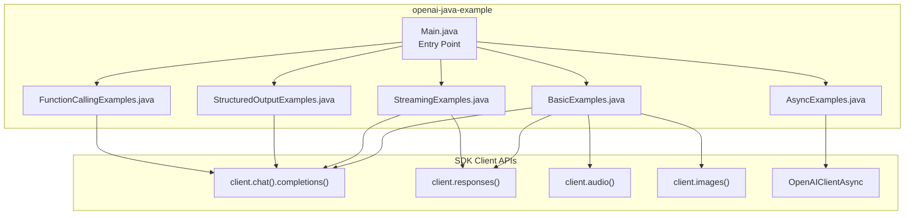
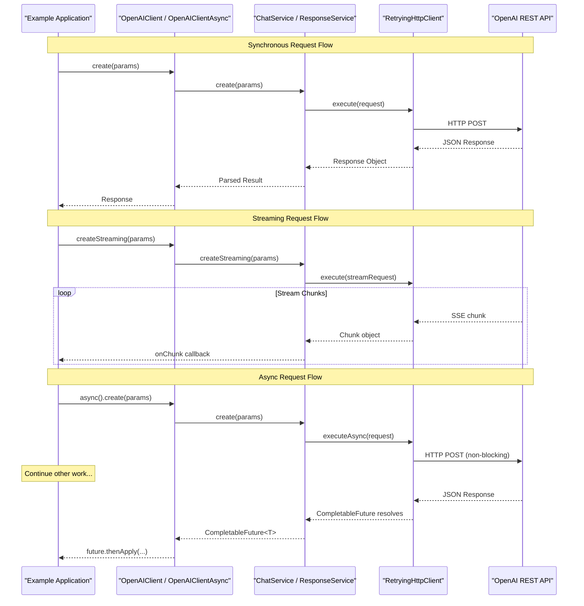
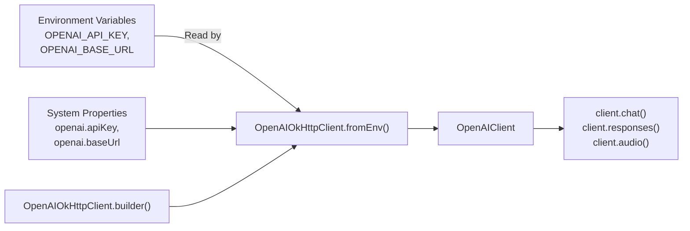
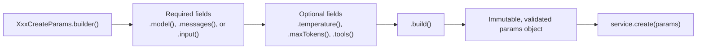

<!-- source: DeepWiki mcp.deepwiki.com · repo openai/openai-java · page 10 Examples · fetched 2026-10-26 -->

# Examples

<details>
<summary>Relevant source files</summary>

The following files were used as context for generating this wiki page:

- [buildSrc/src/main/kotlin/openai.wiremock-test.gradle.kts](buildSrc/src/main/kotlin/openai.wiremock-test.gradle.kts)
- [openai-java-bedrock/build.gradle.kts](openai-java-bedrock/build.gradle.kts)
- [openai-java-core/src/main/kotlin/com/openai/core/ObjectMappers.kt](openai-java-core/src/main/kotlin/com/openai/core/ObjectMappers.kt)
- [openai-java-core/src/main/kotlin/com/openai/core/handlers/JsonHandler.kt](openai-java-core/src/main/kotlin/com/openai/core/handlers/JsonHandler.kt)
- [openai-java-core/src/test/kotlin/com/openai/core/ObjectMappersTest.kt](openai-java-core/src/test/kotlin/com/openai/core/ObjectMappersTest.kt)
- [openai-java-example/build.gradle.kts](openai-java-example/build.gradle.kts)
- [openai-java-example/src/main/java/com/openai/example/Main.java](openai-java-example/src/main/java/com/openai/example/Main.java)

</details>


This page provides practical code examples demonstrating common use cases for the OpenAI Java SDK. These examples illustrate how to perform synchronous and asynchronous API calls, handle streaming responses, use structured outputs with JSON schemas, and implement function calling patterns.

The examples are organized into five main categories, each described briefly below with links to dedicated child pages containing detailed examples and explanations. All examples assume basic client setup as described in [Getting Started](#2), and comprehensive API documentation is found in the relevant service sections ([Chat Completions](#4), [Responses API](#5), [Structured Outputs](#6)).

---

## Runnable Examples Overview

The SDK includes a dedicated example module: `openai-java-example/`. This module contains complete, runnable Java example classes illustrating typical usage patterns. Each example is self-contained in a class with a `main()` method and can be executed independently.

### Example Module Structure



You can run all examples with:
```bash
./gradlew :openai-java-example:run
```
Or run a specific example by specifying the example name:
```bash
./gradlew :openai-java-example:run -Pexample=CompletionsExample
```

**Sources:** [openai-java-example/build.gradle.kts:18-31](), [openai-java-example/src/main/java/com/openai/example/Main.java:3-11]()

---

## Example Categories Overview

The example set covers five major usage patterns. Each category provides illustrative entries demonstrating the corresponding API usage style. For detailed code samples, visit the child pages listed.

| Category | Description | Child Page |
|----------|-------------|------------|
| **Basic Examples** | Synchronous, blocking API calls showcasing simple chat completions, Responses API usage, model listing, audio transcription, and image generation | [Basic Examples](#10.1) |
| **Streaming Examples** | Demonstrations of streaming usage for chat completions and responses with accumulator handling for incremental output | [Streaming Examples](#10.2) |
| **Asynchronous Examples** | Use of the async client interface with CompletableFuture patterns for non-blocking calls and future chaining | [Asynchronous Examples](#10.3) |
| **Structured Output Examples** | Usage of Java-generated JSON schemas for type-safe structured output parsing from chat completions | [Structured Output Examples](#10.4) |
| **Function Calling and Multi-modal Examples** | Practical examples including function calling integration, image editing, audio transcription input, file-based input, and X.509 workload identity authentication | [Function Calling and Multi-modal Examples](#10.5) |

---

## High-Level Example Flow Architecture

The diagram below illustrates how example code interacts with the SDK layers and the OpenAI API. It highlights synchronous, streaming, and asynchronous request patterns.



**Sources:** [openai-java-example/src/main/java/com/openai/example/Main.java:3-11]()

---

## Common Example Usage Patterns

### Client Initialization and Configuration

All examples instantiate the client using common initialization patterns that support:

- Environment variables
- System properties
- Programmatic builder patterns



### Request Building

Requests are constructed via immutable builder patterns enforcing required parameters such as model identifiers, messages, or inputs.



This ensures compile-time safety and reduces runtime errors.

**Sources:** [openai-java-example/build.gradle.kts:18-31](), [openai-java-core/src/main/kotlin/com/openai/models/chat/completions/ChatCompletionCreateParams.kt:60-75]()

---

## Quick Reference: Common API Operations in Examples

| Operation          | Sync (Blocking)                                       | Async                                         | Streaming                                       | Relevant Section |
|--------------------|------------------------------------------------------|-----------------------------------------------|------------------------------------------------|------------------|
| Chat Completion    | `client.chat().completions().create(params)`         | `client.async().chat().completions().create(params)` | `client.chat().completions().createStreaming(params)` | [Basic Examples](#10.1), [Streaming Examples](#10.2), [Asynchronous Examples](#10.3) |
| Responses API      | `client.responses().create(params)`                   | `client.async().responses().create(params)`  | `client.responses().createStreaming(params)`   | [Basic Examples](#10.1), [Streaming Examples](#10.2)              |
| Structured Output  | `client.chat().completions().create(structuredParams)` | `client.async().chat().completions().create(structuredParams)` | `client.chat().completions().createStreaming(structuredParams)` | [Structured Output Examples](#10.4)                      |
| Function Calling   | `params.addTool(MyFunction.class)`                    | (Same with async client)                      | (Same with streaming)                         | [Function Calling and Multi-modal Examples](#10.5)                      |
| Audio Transcription| `client.audio().transcriptions().create(params)`     | `client.async().audio().transcriptions().create(params)` | N/A                                            | [Basic Examples](#10.1)                      |
| Image Generation   | `client.images().generate(params)`                    | `client.async().images().generate(params)`   | N/A                                            | [Basic Examples](#10.1)                      |
| Embeddings        | `client.embeddings().create(params)`                   | `client.async().embeddings().create(params)` | N/A                                            | [Basic Examples](#10.1)                      |

**Sources:** [openai-java-example/build.gradle.kts:18-31](), [openai-java-example/src/main/java/com/openai/example/Main.java:3-11]()

---

## Example Patterns Compared

The diagram below compares synchronous, asynchronous, and streaming example patterns:

```mermaid
graph TB
    subgraph Synchronous
        SyncParams["ChatCompletionCreateParams"] --> SyncCreate["client.chat().completions().create()"]
        SyncCreate --> SyncResult["ChatCompletion (blocks until full result)"]
    end
    
    subgraph Asynchronous
        AsyncParams["ChatCompletionCreateParams"] --> AsyncCreate["client.async().chat().completions().create()"]
        AsyncCreate --> FutureResult["CompletableFuture<ChatCompletion>"]
        FutureResult --> FutureChain[".thenApply(...), .exceptionally(...)"]
    end
    
    subgraph Streaming
        StreamParams["ChatCompletionCreateParams"] --> StreamCreate["client.chat().completions().createStreaming()"]
        StreamCreate --> StreamResponse["StreamResponse<ChatCompletionChunk>"]
        StreamResponse --> StreamConsume["stream().forEach(chunk -> ...)"]
    end
```



This helps identify the right example pattern for your use case.

---

## Integration and Dependencies for Examples

### Key Dependencies

| Dependency                  | Version      | Purpose                                  |
|-----------------------------|--------------|------------------------------------------|
| `project(":openai-java")`   | Local module | Core SDK functionality                    |
| `project(":openai-java-bedrock")` | Local module | Amazon Bedrock examples and integration |
| `com.azure:azure-identity`  | 1.18.4       | Azure authentication and identity examples |

The Azure Identity dependency demonstrates how to integrate the SDK with Azure OpenAI services using alternative authentication mechanisms.

### Java Version Target

The example module targets Java 11 features (e.g., `List.of()`, `Map.of()`) via the Gradle compiler release configuration:

```kotlin
tasks.withType<JavaCompile>().configureEach {
    options.release.set(11)
}
```

This allows use of modern Java APIs while maintaining compatibility.

**Sources:** [openai-java-example/build.gradle.kts:10-21]()

---

## Summary

This parent Examples page guides users through the five main types of example use cases available in the official SDK example module. For detailed and runnable code excerpts, please visit the child pages below:

- [Basic Examples](#10.1) — Synchronous API usage examples including chat completions, responses, and multimedia.
- [Streaming Examples](#10.2) — How to incrementally consume streaming data for chat and responses.
- [Asynchronous Examples](#10.3) — Non-blocking usage with `CompletableFuture` and async client.
- [Structured Output Examples](#10.4) — Strongly-typed structured output using JSON schema from Java classes.
- [Function Calling and Multi-modal Examples](#10.5) — Function call integration examples plus advanced input/output types like image editing and audio.

These child pages contain the concrete example classes, usage patterns, and details necessary to quickly get started or implement advanced features using the OpenAI Java SDK.

---

**Sources:**

- [openai-java-example/build.gradle.kts:18-31]()
- [openai-java-example/src/main/java/com/openai/example/Main.java:3-11]()

---

