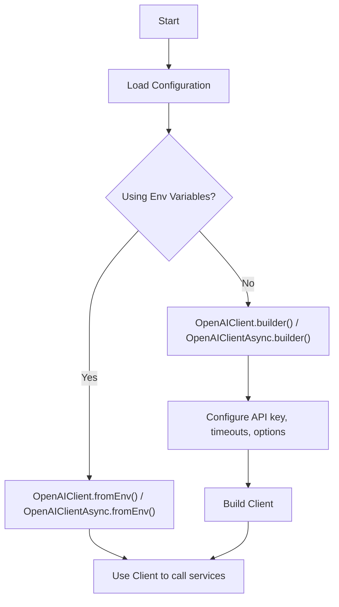
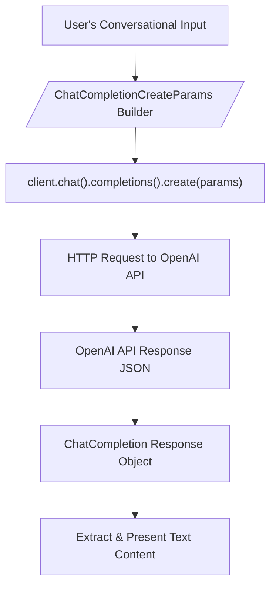
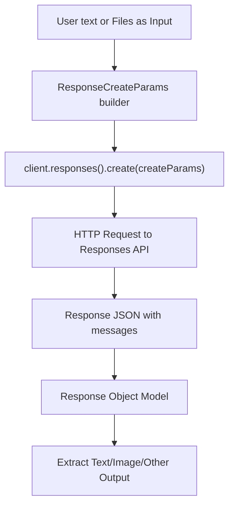

<!-- source: DeepWiki mcp.deepwiki.com · repo openai/openai-java · page 10.1 Basic Examples · fetched 2026-10-26 -->

# Basic Examples

<details>
<summary>Relevant source files</summary>

The following files were used as context for generating this wiki page:

- [openai-java-core/src/main/kotlin/com/openai/services/async/chat/ChatCompletionServiceAsync.kt](openai-java-core/src/main/kotlin/com/openai/services/async/chat/ChatCompletionServiceAsync.kt)
- [openai-java-example/src/main/java/com/openai/example/CompletionsAsyncExample.java](openai-java-example/src/main/java/com/openai/example/CompletionsAsyncExample.java)
- [openai-java-example/src/main/java/com/openai/example/CompletionsConversationAsyncExample.java](openai-java-example/src/main/java/com/openai/example/CompletionsConversationAsyncExample.java)
- [openai-java-example/src/main/java/com/openai/example/CompletionsConversationExample.java](openai-java-example/src/main/java/com/openai/example/CompletionsConversationExample.java)
- [openai-java-example/src/main/java/com/openai/example/CompletionsExample.java](openai-java-example/src/main/java/com/openai/example/CompletionsExample.java)
- [openai-java-example/src/main/java/com/openai/example/CompletionsFileExample.java](openai-java-example/src/main/java/com/openai/example/CompletionsFileExample.java)
- [openai-java-example/src/main/java/com/openai/example/CompletionsImageUrlExample.java](openai-java-example/src/main/java/com/openai/example/CompletionsImageUrlExample.java)
- [openai-java-example/src/main/java/com/openai/example/CompletionsStreamingAsyncExample.java](openai-java-example/src/main/java/com/openai/example/CompletionsStreamingAsyncExample.java)
- [openai-java-example/src/main/java/com/openai/example/CompletionsStreamingExample.java](openai-java-example/src/main/java/com/openai/example/CompletionsStreamingExample.java)
- [openai-java-example/src/main/java/com/openai/example/ModelListAsyncExample.java](openai-java-example/src/main/java/com/openai/example/ModelListAsyncExample.java)
- [openai-java-example/src/main/java/com/openai/example/ModelListExample.java](openai-java-example/src/main/java/com/openai/example/ModelListExample.java)
- [openai-java-example/src/main/java/com/openai/example/ResponsesImageUrlExample.java](openai-java-example/src/main/java/com/openai/example/ResponsesImageUrlExample.java)
- [openai-java-example/src/main/java/com/openai/example/ResponsesInputFileExample.java](openai-java-example/src/main/java/com/openai/example/ResponsesInputFileExample.java)
- [openai-java-example/src/main/java/com/openai/example/ResponsesStructuredOutputsStreamingAsyncExample.java](openai-java-example/src/main/java/com/openai/example/ResponsesStructuredOutputsStreamingAsyncExample.java)
- [openai-java-example/src/main/java/com/openai/example/StructuredOutputsAsyncExample.java](openai-java-example/src/main/java/com/openai/example/StructuredOutputsAsyncExample.java)

</details>


This page presents simple and practical examples to get started with the OpenAI Java SDK. It covers fundamental usage scenarios including chat completions, the Responses API, listing available models, and basic interaction patterns with the API. These examples demonstrate instantiation of clients, crafting requests, and consuming responses, both synchronously and asynchronously, illustrating the core SDK usage.

---

## Client Initialization and Setup

The OpenAI Java SDK supports dual client interfaces for interacting with the API:

- **`OpenAIClient`**: Synchronous client for blocking calls.
- **`OpenAIClientAsync`**: Asynchronous client returning `CompletableFuture`s for non-blocking operations.

Clients are typically configured using environment variables (e.g. `OPENAI_API_KEY`) or explicitly via builders.

### Client Initialization Flow



The client exposes services such as Chat Completions, Responses, Models, Files, Audio, and more.

Sources:  
- [openai-java-example/src/main/java/com/openai/example/CompletionsStreamingExample.java:13-33]()  
- [openai-java-example/src/main/java/com/openai/example/CompletionsStreamingAsyncExample.java:11-33]()  
- [openai-java-example/src/main/java/com/openai/example/ModelListAsyncExample.java:11-23]()  
- [openai-java-example/src/main/java/com/openai/example/ResponsesInputFileExample.java:13-49]()  

---

## Example 1: Listing Models (Asynchronous)

You can list all available models asynchronously using the `OpenAIClientAsync` interface.

```java
OpenAIClientAsync client = OpenAIOkHttpClientAsync.fromEnv();

CompletableFuture<ModelListPageAsync> pageFuture = client.models().list();

pageFuture
    .thenComposeAsync(page -> page.autoPager()
        .subscribe(model -> System.out.println(model.id()))
        .onCompleteFuture())
    .join();
```

**Explanation:**

- The client is initialized with environment variables (`OPENAI_API_KEY` etc.).
- `client.models().list()` asynchronously fetches a page of models.
- `autoPager()` returns an async iterable over all models.
- `subscribe()` consumes each model in the stream.
- `join()` blocks to wait for the entire operation to complete.

This demonstrates the use of asynchronous paging with a reactive style.

Sources:  
- [openai-java-example/src/main/java/com/openai/example/ModelListAsyncExample.java:3-24]()  

---

## Example 2: Basic Chat Completion (Synchronous)

The most common API call is creating chat completions for conversational prompts.

```java
OpenAIClient client = OpenAIOkHttpClient.fromEnv();

ChatCompletionCreateParams params = ChatCompletionCreateParams.builder()
        .model(ChatModel.GPT_3_5_TURBO)
        .maxCompletionTokens(2048)
        .addDeveloperMessage("You are a helpful assistant.")
        .addUserMessage("Tell me a story about building the best SDK!")
        .build();

ChatCompletion completion = client.chat().completions().create(params);

completion.choices().stream()
    .map(ChatCompletion.Choice::message)
    .flatMap(message -> message.content().stream())
    .forEach(System.out::println);
```

**Explanation:**

- Client is configured from environment.
- `ChatCompletionCreateParams` is built with model, token limit, and messages.
- Developer/system and user messages create conversational context.
- The synchronous call `create()` sends the request and waits.
- The response contains choices, each with message content streamed and printed.

This simple example illustrates synchronous calls and response traversal.

Sources:  
- [openai-java-example/src/main/java/com/openai/example/CompletionsExample.java: (implied)]  
- [openai-java-example/src/main/java/com/openai/example/CompletionsConversationExample.java:13-46]() (similar detailed usage)  

---

## Example 3: Streaming Chat Completion (Synchronous)

The SDK supports streaming chat completions, where chunks are received as they arrive.

```java
OpenAIClient client = OpenAIOkHttpClient.fromEnv();

ChatCompletionCreateParams params = ChatCompletionCreateParams.builder()
        .model(ChatModel.GPT_3_5_TURBO)
        .maxCompletionTokens(2048)
        .addDeveloperMessage("You are a helpful assistant.")
        .addUserMessage("Tell me a story about building the best SDK!")
        .build();

try (StreamResponse<ChatCompletionChunk> stream = client.chat().completions().createStreaming(params)) {
    stream.stream()
        .flatMap(c -> c.choices().stream())
        .flatMap(choice -> choice.delta().content().stream())
        .forEach(System.out::print);
}
```

**Explanation:**

- Uses `createStreaming()` to open a real-time stream.
- Iterates chunk by chunk over the stream within a try-with-resources block.
- Each chunk contains delta content fragments printed immediately.

This pattern enables real-time UI updates or progressive processing.

Sources:  
- [openai-java-example/src/main/java/com/openai/example/CompletionsStreamingExample.java:10-34]()  

---

## Example 4: Streaming Chat Completion (Asynchronous)

The async version leverages reactive streams and `CompletableFuture`.

```java
OpenAIClientAsync client = OpenAIOkHttpClientAsync.fromEnv();

ChatCompletionCreateParams params = ChatCompletionCreateParams.builder()
        .model(ChatModel.GPT_3_5_TURBO)
        .maxCompletionTokens(2048)
        .addDeveloperMessage("You are a helpful assistant.")
        .addUserMessage("Tell me a story about building the best SDK!")
        .build();

client.chat()
    .completions()
    .createStreaming(params)
    .subscribe(chunk -> chunk.choices().stream()
        .flatMap(choice -> choice.delta().content().stream())
        .forEach(System.out::print))
    .onCompleteFuture()
    .join();
```

**Explanation:**

- Similar to synchronous streaming but fully asynchronous.
- `subscribe()` consumes stream asynchronously.
- `onCompleteFuture()` returns a future that completes on stream end.
- `join()` synchronously waits for completion in main thread.

Useful for reactive event-driven applications.

Sources:  
- [openai-java-example/src/main/java/com/openai/example/CompletionsStreamingAsyncExample.java:3-33]()  

---

## Example 5: Responses API with File Input

The Responses API is the newer recommended method for chat-based interactions offering richer inputs and outputs.

Below is an example that submits a PDF file as input and requests a description:

```java
OpenAIClient client = OpenAIOkHttpClient.fromEnv();

ClassLoader classloader = Thread.currentThread().getContextClassLoader();
String filename = "pdflatex-image.pdf";
byte[] pdfBytes = classloader.getResourceAsStream(filename).readAllBytes();
String pdfBase64Url = "data:application/pdf;base64," + Base64.getEncoder().encodeToString(pdfBytes);

ResponseInputFile inputFile = ResponseInputFile.builder()
        .filename(filename)
        .fileData(pdfBase64Url)
        .build();

ResponseInputItem messageInputItem = ResponseInputItem.ofMessage(ResponseInputItem.Message.builder()
        .role(ResponseInputItem.Message.Role.USER)
        .addInputTextContent("Describe this file.")
        .addContent(inputFile)
        .build());

ResponseCreateParams createParams = ResponseCreateParams.builder()
        .inputOfResponse(List.of(messageInputItem))
        .model(ChatModel.GPT_4O)
        .build();

client.responses().create(createParams).output().stream()
    .flatMap(item -> item.message().stream())
    .flatMap(message -> message.content().stream())
    .flatMap(content -> content.outputText().stream())
    .forEach(outputText -> System.out.println(outputText.text()));
```

**Explanation:**

- Reads a PDF from classpath, encodes it as a `data:application/pdf;base64,...` URI.
- Constructs a `ResponseInputFile` and wraps it in a message with user role.
- Sends the request using `client.responses().create()`.
- Extracts textual output from response messages and prints them.

This example shows rich multi-modal input support.

Sources:  
- [openai-java-example/src/main/java/com/openai/example/ResponsesInputFileExample.java:13-49]()  

---

## Bridging Concepts: Natural Language to Code Entities

### Chat Completion Workflow Mapping



Mapping to code entities:

- `ChatCompletionCreateParams` (model + messages) - builds request payload  
- `client.chat().completions().create()` - triggers synchronous call (see `ChatCompletionServiceAsync.create` interface)  
- HTTP layer (`OkHttp`) underpins the transport (hidden in client)  
- `ChatCompletion` holds model output, choices, messages  
- Extract content via `choices().message().content()`  

Sources:  
- [openai-java-example/src/main/java/com/openai/example/CompletionsConversationExample.java:13-46]()  
- [openai-java-core/src/main/kotlin/com/openai/services/async/chat/ChatCompletionServiceAsync.kt:27-142]()  

---

### Responses API Flow Mapping



Mapping to code:

- `ResponseCreateParams` encapsulate inputs, including files/images  
- `client.responses().create()` sends the request  
- Response is parsed into model classes under `com.openai.models.responses` package  
- Output extracted from response messages content  

Sources:  
- [openai-java-example/src/main/java/com/openai/example/ResponsesInputFileExample.java:13-49]()  
- [openai-java-example/src/main/java/com/openai/example/ResponsesImageUrlExample.java:13-46]()  

---

## Summary Table of Basic Examples

| Example Name                     | Client Type          | Key Classes/Methods                 | Description                            |
|---------------------------------|----------------------|-----------------------------------|--------------------------------------|
| ModelListExample                | Async                | `OpenAIClientAsync`, `.models().list()` | Lists available models asynchronously |
| CompletionsConversationExample | Sync                 | `OpenAIClient`, `ChatCompletionCreateParams`  | Chat completion with multi-turn conversation |
| CompletionsStreamingExample    | Sync Streaming       | `createStreaming()`, `StreamResponse` | Streaming chat completion in real-time |
| CompletionsStreamingAsyncExample | Async Streaming     | `OpenAIClientAsync`, `.createStreaming()` | Async streaming chat completion |
| ResponsesInputFileExample       | Sync                 | `ResponseCreateParams`, `ResponseInputFile` | Submitting files as input in Responses API |
| ResponsesImageUrlExample        | Sync                 | `ResponseInputImage`, `ResponseCreateParams` | Using images with the Responses API |

---

## Conclusion

This page covers initial sample usages for common OpenAI API interactions via the Java SDK. These basic examples illustrate client setup, API request construction, and response consumption in both synchronous and asynchronous paradigms, with and without streaming. Using these foundations, developers can build conversational agents, multi-modal applications, and explore advanced SDK features shown in subsequent pages.

---

Sources:  
- [openai-java-example/src/main/java/com/openai/example/CompletionsStreamingExample.java:10-34]()  
- [openai-java-example/src/main/java/com/openai/example/CompletionsStreamingAsyncExample.java:11-33]()  
- [openai-java-example/src/main/java/com/openai/example/ModelListAsyncExample.java:11-23]()  
- [openai-java-example/src/main/java/com/openai/example/ResponsesInputFileExample.java:13-49]()  
- [openai-java-example/src/main/java/com/openai/example/ResponsesImageUrlExample.java:13-46]()  
- [openai-java-example/src/main/java/com/openai/example/CompletionsConversationExample.java:13-46]()  
- [openai-java-core/src/main/kotlin/com/openai/services/async/chat/ChatCompletionServiceAsync.kt:27-142]()

---

