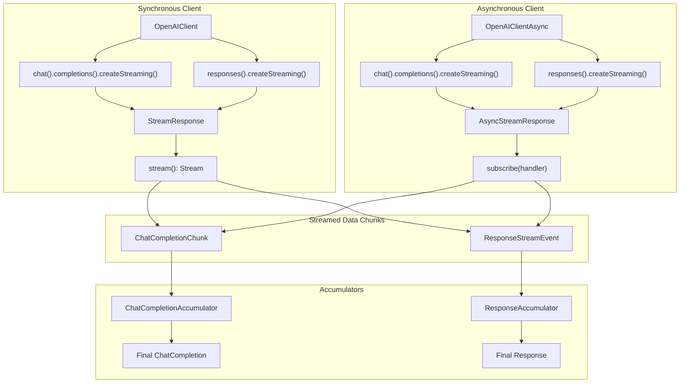
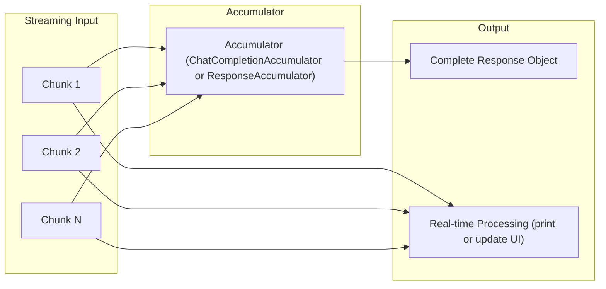
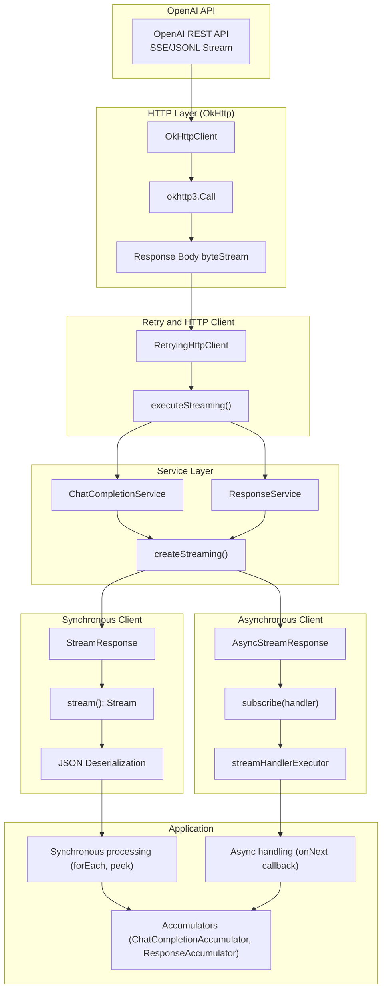

<!-- source: DeepWiki mcp.deepwiki.com · repo openai/openai-java · page 10.2 Streaming Examples · fetched 2026-10-26 -->

# Streaming Examples

<details>
<summary>Relevant source files</summary>

The following files were used as context for generating this wiki page:

- [openai-java-core/src/main/kotlin/com/openai/helpers/ChatCompletionAccumulator.kt](openai-java-core/src/main/kotlin/com/openai/helpers/ChatCompletionAccumulator.kt)
- [openai-java-core/src/main/kotlin/com/openai/services/async/chat/ChatCompletionServiceAsync.kt](openai-java-core/src/main/kotlin/com/openai/services/async/chat/ChatCompletionServiceAsync.kt)
- [openai-java-core/src/main/kotlin/com/openai/services/blocking/chat/ChatCompletionService.kt](openai-java-core/src/main/kotlin/com/openai/services/blocking/chat/ChatCompletionService.kt)
- [openai-java-core/src/test/kotlin/com/openai/helpers/ChatCompletionAccumulatorTest.kt](openai-java-core/src/test/kotlin/com/openai/helpers/ChatCompletionAccumulatorTest.kt)
- [openai-java-core/src/test/kotlin/com/openai/helpers/FragmentedCompletionTextTest.kt](openai-java-core/src/test/kotlin/com/openai/helpers/FragmentedCompletionTextTest.kt)
- [openai-java-example/src/main/java/com/openai/example/CompletionsAsyncExample.java](openai-java-example/src/main/java/com/openai/example/CompletionsAsyncExample.java)
- [openai-java-example/src/main/java/com/openai/example/CompletionsConversationAsyncExample.java](openai-java-example/src/main/java/com/openai/example/CompletionsConversationAsyncExample.java)
- [openai-java-example/src/main/java/com/openai/example/CompletionsConversationExample.java](openai-java-example/src/main/java/com/openai/example/CompletionsConversationExample.java)
- [openai-java-example/src/main/java/com/openai/example/CompletionsExample.java](openai-java-example/src/main/java/com/openai/example/CompletionsExample.java)
- [openai-java-example/src/main/java/com/openai/example/CompletionsStreamingAsyncExample.java](openai-java-example/src/main/java/com/openai/example/CompletionsStreamingAsyncExample.java)
- [openai-java-example/src/main/java/com/openai/example/CompletionsStreamingExample.java](openai-java-example/src/main/java/com/openai/example/CompletionsStreamingExample.java)
- [openai-java-example/src/main/java/com/openai/example/ModelListAsyncExample.java](openai-java-example/src/main/java/com/openai/example/ModelListAsyncExample.java)
- [openai-java-example/src/main/java/com/openai/example/ModelListExample.java](openai-java-example/src/main/java/com/openai/example/ModelListExample.java)
- [openai-java-example/src/main/java/com/openai/example/ResponsesStructuredOutputsStreamingAsyncExample.java](openai-java-example/src/main/java/com/openai/example/ResponsesStructuredOutputsStreamingAsyncExample.java)
- [openai-java-example/src/main/java/com/openai/example/StructuredOutputsAsyncExample.java](openai-java-example/src/main/java/com/openai/example/StructuredOutputsAsyncExample.java)
- [openai-java-example/src/main/java/com/openai/example/StructuredOutputsStreamingExample.java](openai-java-example/src/main/java/com/openai/example/StructuredOutputsStreamingExample.java)

</details>


This page provides detailed, practical examples demonstrating streaming capabilities in the OpenAI Java SDK for both Chat Completions and the Responses API. Streaming results are delivered chunk-by-chunk, allowing applications to process outputs in real time while also constructing a final, complete response object for further use.

Streaming is supported in both synchronous (blocking) and asynchronous (non-blocking) client APIs, with helper accumulator classes available to reconstruct the full non-streamed response from streamed partial chunks.

---
## Overview of Streaming in the SDK

The SDK supports two client interface models for streaming:

- **Synchronous Streaming** (`StreamResponse<T>`): The client returns a `Stream<T>`, processed by the caller's thread. Suitable for blocking workflows.  
- **Asynchronous Streaming** (`AsyncStreamResponse<T>`): The client uses a reactive subscription model with callbacks executed by an internal executor thread pool. Suitable for non-blocking, event-driven workflows.

Both models support streaming of chat completion chunks (`ChatCompletionChunk`) and response events (`ResponseStreamEvent`).



Sources: [openai-java-example/src/main/java/com/openai/example/CompletionsStreamingExample.java:13-32](),  
[openai-java-core/src/main/kotlin/com/openai/helpers/ChatCompletionAccumulator.kt:10-145](),  
[openai-java-core/src/test/kotlin/com/openai/helpers/ChatCompletionAccumulatorTest.kt:13-165](),  
[openai-java-example/src/main/java/com/openai/example/ResponsesStructuredOutputsStreamingAsyncExample.java:13-86]()

---
## Synchronous Chat Completions Streaming

Synchronous streaming returns a blocking `StreamResponse<ChatCompletionChunk>` where the Java `Stream` is processed in the caller’s thread. Use try-with-resources to ensure the stream is closed.

### Basic Example: Stream and Print Chunks

```java
OpenAIClient client = OpenAIOkHttpClient.fromEnv();

ChatCompletionCreateParams params = ChatCompletionCreateParams.builder()
    .model(ChatModel.GPT_3_5_TURBO)
    .addDeveloperMessage("You are a helpful assistant.")
    .addUserMessage("Tell me a story about building the best SDK!")
    .maxCompletionTokens(2048)
    .build();

try (StreamResponse<ChatCompletionChunk> streamResponse = client.chat().completions().createStreaming(params)) {
    streamResponse.stream().forEach(chunk -> System.out.println(chunk));
}
```

### Extracting the Streaming Text Content

To extract and print only the actual text being generated by the model in real time:

```java
try (StreamResponse<ChatCompletionChunk> streamResponse = client.chat().completions().createStreaming(params)) {
    streamResponse.stream()
        .flatMap(chunk -> chunk.choices().stream())
        .flatMap(choice -> choice.delta().content().stream())
        .forEach(System.out::print);
}
```

This flattens chunk boundaries and prints the incremental textual content as it arrives.

Sources: [openai-java-example/src/main/java/com/openai/example/CompletionsStreamingExample.java:13-32]()

---
## Asynchronous Chat Completions Streaming

Asynchronous streaming returns an `AsyncStreamResponse<ChatCompletionChunk>`, supporting a callback-based subscription that runs asynchronously on a thread pool.

### Basic Subscription Example

```java
OpenAIClientAsync client = OpenAIOkHttpClientAsync.fromEnv();

ChatCompletionCreateParams params = ChatCompletionCreateParams.builder()
    .model(ChatModel.GPT_3_5_TURBO)
    .addDeveloperMessage("You are a helpful assistant.")
    .addUserMessage("Tell me a story about building the best SDK!")
    .maxCompletionTokens(2048)
    .build();

client.chat().completions().createStreaming(params)
    .subscribe(chunk -> {
        System.out.println(chunk);
    });
```

### Handling Stream Completion and Errors

You can handle the stream’s completion or errors with a full handler implementation:

```java
client.chat().completions().createStreaming(params).subscribe(
    new AsyncStreamResponse.Handler<ChatCompletionChunk>() {
        @Override
        public void onNext(ChatCompletionChunk chunk) {
            System.out.println(chunk);
        }

        @Override
        public void onComplete(Optional<Throwable> error) {
            if (error.isPresent()) {
                System.err.println("Stream error: " + error.get().getMessage());
            } else {
                System.out.println("Stream completed successfully.");
            }
        }
    }
);
```

### CompletableFuture Integration

To integrate streaming with `CompletableFuture`:

```java
client.chat().completions().createStreaming(params)
    .subscribe(chunk -> System.out.println(chunk))
    .onCompleteFuture()
    .whenComplete((unused, error) -> {
        if (error != null) {
            System.err.println("Error: " + error.getMessage());
        } else {
            System.out.println("Streaming finished.");
        }
    });
```

Sources: [openai-java-example/src/main/java/com/openai/example/CompletionsStreamingAsyncExample.java:11-32]()

---
## Synchronous Responses API Streaming

The Responses API uses streamed `ResponseStreamEvent` objects rather than chat completion chunks, but the streaming pattern is similar.

### Basic Synchronous Streaming of Responses

```java
ResponseCreateParams params = ResponseCreateParams.builder()
    .model(ChatModel.GPT_4_1)
    .input("Say this is a test")
    .build();

try (StreamResponse<ResponseStreamEvent> streamResponse = client.responses().createStreaming(params)) {
    streamResponse.stream().forEach(event -> System.out.println(event));
}
```

### Extracting Incremental Text Output

Extract and print only text deltas from the response stream:

```java
try (StreamResponse<ResponseStreamEvent> streamResponse = client.responses().createStreaming(params)) {
    streamResponse.stream()
        .flatMap(event -> event.outputTextDelta().stream())
        .forEach(textEvent -> System.out.print(textEvent.delta()));
}
```

Sources: [openai-java-example/src/main/java/com/openai/example/ResponsesStructuredOutputsStreamingAsyncExample.java:55-86]()

---
## Asynchronous Responses API Streaming

Asynchronous subscription of streamed `ResponseStreamEvent` with onNext and onComplete handling follows the same callback mechanism.

```java
client.responses().createStreaming(params).subscribe(
    new AsyncStreamResponse.Handler<ResponseStreamEvent>() {
        @Override
        public void onNext(ResponseStreamEvent event) {
            event.outputTextDelta().ifPresent(textEvent -> System.out.print(textEvent.delta()));
        }

        @Override
        public void onComplete(Optional<Throwable> error) {
            if (error.isPresent()) {
                System.err.println("Streaming error: " + error.get().getMessage());
            } else {
                System.out.println("Streaming complete!");
            }
        }
    }
);
```

Sources: [openai-java-example/src/main/java/com/openai/example/ResponsesStructuredOutputsStreamingAsyncExample.java:55-86]()

---
## Using Accumulators with Streaming

To reconstruct the final full non-streamed response object from streamed partial data, use accumulators provided by the SDK:

- `ChatCompletionAccumulator` for chat completions
- `ResponseAccumulator` for responses API

They accumulate chunk data incrementally and produce the final complete object.



### Example: ChatCompletionAccumulator with Synchronous Streaming

```java
ChatCompletionAccumulator accumulator = ChatCompletionAccumulator.create();

try (StreamResponse<ChatCompletionChunk> streamResponse = client.chat().completions().createStreaming(createParams)) {
    streamResponse.stream()
        .peek(accumulator::accumulate)
        .flatMap(completion -> completion.choices().stream())
        .flatMap(choice -> choice.delta().content().stream())
        .forEach(System.out::print);
}

ChatCompletion fullCompletion = accumulator.chatCompletion();
System.out.println("\nTokens used: " + fullCompletion.usage().map(u -> u.totalTokens()).orElse(-1));
```

### Example: ChatCompletionAccumulator with Async Streaming

```java
ChatCompletionAccumulator accumulator = ChatCompletionAccumulator.create();

client.chat().completions().createStreaming(createParams)
    .subscribe(chunk -> {
        accumulator.accumulate(chunk);
        chunk.choices().stream()
            .flatMap(choice -> choice.delta().content().stream())
            .forEach(System.out::print);
    })
    .onCompleteFuture()
    .join();

ChatCompletion fullCompletion = accumulator.chatCompletion();
System.out.println("\nTokens used: " + fullCompletion.usage().map(u -> u.totalTokens()).orElse(-1));
```

### Example: ResponseAccumulator with Streaming

```java
ResponseAccumulator accumulator = ResponseAccumulator.create();

try (StreamResponse<ResponseStreamEvent> streamResponse = client.responses().createStreaming(createParams)) {
    streamResponse.stream()
        .peek(accumulator::accumulate)
        .flatMap(event -> event.outputTextDelta().stream())
        .forEach(textEvent -> System.out.print(textEvent.delta()));
}

Response fullResponse = accumulator.response();
System.out.println("\nResponse ID: " + fullResponse.id());
```

Sources: [openai-java-core/src/main/kotlin/com/openai/helpers/ChatCompletionAccumulator.kt:10-145](),  
[openai-java-example/src/main/java/com/openai/example/StructuredOutputsStreamingExample.java:17-91](),  
[openai-java-example/src/main/java/com/openai/example/ResponsesStructuredOutputsStreamingAsyncExample.java:13-86]()

---
## Streaming Structured Outputs

Structured output responses are JSON objects adhering to user-defined Java class schemas. Because streams deliver partial JSON fragments, deserialization is deferred until all chunks have been accumulated.

### Structured Streaming with ChatCompletionAccumulator (Synchronous)

```java
StructuredChatCompletionCreateParams<BookList> params =
    ChatCompletionCreateParams.builder()
        .model(ChatModel.GPT_4O_MINI)
        .maxCompletionTokens(2048)
        .responseFormat(BookList.class)
        .addUserMessage("List some famous late twentieth century novels.")
        .build();

ChatCompletionAccumulator accumulator = ChatCompletionAccumulator.create();

try (StreamResponse<ChatCompletionChunk> streamResponse = client.chat().completions().createStreaming(params)) {
    streamResponse.stream()
        .peek(accumulator::accumulate)
        .flatMap(chunk -> chunk.choices().stream())
        .flatMap(choice -> choice.delta().content().stream())
        .forEach(System.out::print);
}

StructuredChatCompletion<BookList> structured =
    accumulator.chatCompletion(BookList.class);

structured.choices().stream()
    .flatMap(choice -> choice.message().content().stream())
    .flatMap(bookList -> bookList.books.stream())
    .forEach(book -> System.out.println(" - " + book));
```

### Structured Streaming with ResponseAccumulator (Asynchronous)

```java
StructuredResponseCreateParams<BookList> params = ResponseCreateParams.builder()
    .input("List some famous late twentieth century novels.")
    .model(ChatModel.GPT_4O)
    .text(BookList.class)
    .build();

ResponseAccumulator accumulator = ResponseAccumulator.create();

client.responses().createStreaming(params)
    .subscribe(event -> {
        accumulator.accumulate(event)
            .outputTextDelta()
            .ifPresent(textEvent -> System.out.print(textEvent.delta()));
    })
    .onCompleteFuture()
    .join();

StructuredResponse<BookList> structuredResponse = accumulator.response(BookList.class);

structuredResponse.output().stream()
    .flatMap(item -> item.message().stream())
    .flatMap(message -> message.content().stream())
    .flatMap(bookList -> bookList.books.stream())
    .forEach(book -> System.out.println(" - " + book));
```

Sources: [openai-java-example/src/main/java/com/openai/example/StructuredOutputsStreamingExample.java:17-91](),  
[openai-java-example/src/main/java/com/openai/example/ResponsesStructuredOutputsStreamingAsyncExample.java:13-86]()

---
## Data Flow Architecture for Streaming

The following diagram details how streaming data passes through the SDK layers from API to user code. It also highlights key classes and flows for both synchronous and asynchronous clients.



Sources: [openai-java-core/src/main/kotlin/com/openai/services/blocking/chat/ChatCompletionService.kt:1-146](),  
[openai-java-core/src/main/kotlin/com/openai/services/async/chat/ChatCompletionServiceAsync.kt:1-142](),  
[openai-java-client-okhttp/src/main/kotlin/com/openai/client/okhttp/OkHttpClient.kt:1-252]()

---
## Error Handling in Streaming

Streaming may fail due to network issues or deserialization errors. Handling differs by interface:

### Synchronous Error Handling

Blocking streams throw exceptions directly. Catch exceptions for network or processing errors:

```java
try (StreamResponse<ChatCompletionChunk> streamResponse = client.chat().completions().createStreaming(params)) {
    streamResponse.stream()
        .forEach(chunk -> {
            try {
                processChunk(chunk);
            } catch (Exception e) {
                System.err.println("Chunk processing error: " + e.getMessage());
            }
        });
} catch (Exception e) {
    System.err.println("Streaming error: " + e.getMessage());
}
```

### Asynchronous Error Handling

Errors are passed to `onComplete()` handler in `AsyncStreamResponse.Handler`:

```java
client.async().chat().completions().createStreaming(params).subscribe(
    new AsyncStreamResponse.Handler<ChatCompletionChunk>() {
        @Override
        public void onNext(ChatCompletionChunk chunk) {
            try {
                processChunk(chunk);
            } catch (Exception e) {
                System.err.println("Chunk processing error: " + e.getMessage());
            }
        }

        @Override
        public void onComplete(Optional<Throwable> error) {
            error.ifPresentOrElse(
                e -> System.err.println("Stream error: " + e.getMessage()),
                () -> System.out.println("Stream completed successfully")
            );
        }
    }
);
```

### Early Stream Cancellation

- Synchronous streaming can be stopped by exiting the stream processing loop early or closing the response.
- Asynchronous streaming can be cancelled by calling `close()` on the subscription object returned from `subscribe()`.

Sources: [openai-java-core/src/main/kotlin/com/openai/helpers/ChatCompletionAccumulator.kt:10-145](),  
[openai-java-example/src/main/java/com/openai/example/CompletionsStreamingExample.java:13-32]()

---
## Streaming Class Reference

| Class | Description | Client Type | Returned/Used In |
|-------|-------------|-------------|------------------|
| `StreamResponse<T>` | Wrapper for synchronous streaming responses | Synchronous | `OpenAIClient` methods returning streams |
| `AsyncStreamResponse<T>` | Wrapper for asynchronous streaming responses; supports subscription | Asynchronous | `OpenAIClientAsync` methods returning async streams |
| `ChatCompletionChunk` | Streamed chunk representing partial chat completion | Both | Chat streaming endpoints |
| `ResponseStreamEvent` | Streamed event for Responses API | Both | Responses streaming endpoints |
| `ChatCompletionAccumulator` | Helper to accumulate chunks into full `ChatCompletion` | Both | Used on streaming chat responses |
| `ResponseAccumulator` | Helper to accumulate events into full `Response` | Both | Used on streaming responses |
| `StructuredChatCompletion<T>` | Type-safe wrapper for deserialized structured chat completion output | Both | When deserializing structured responses |
| `StructuredResponse<T>` | Type-safe wrapper for deserialized structured response output | Both | When deserializing structured responses |

Sources: [openai-java-core/src/main/kotlin/com/openai/helpers/ChatCompletionAccumulator.kt:10-145](),  
[openai-java-example/src/main/java/com/openai/example/StructuredOutputsStreamingExample.java:17-91](),  
[openai-java-example/src/main/java/com/openai/example/ResponsesStructuredOutputsStreamingAsyncExample.java:13-86]()

---

This page has showcased the detailed usage of streaming APIs in the OpenAI Java SDK, illustrating both synchronous and asynchronous models together with accumulators that enable seamless reconstruction of final responses while allowing responsive incremental handling of streamed data. For more advanced usage including structured outputs, please refer to the corresponding example classes and SDK documentation.

---

