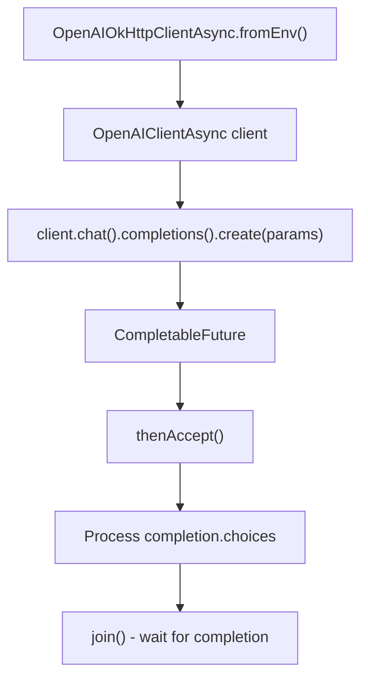
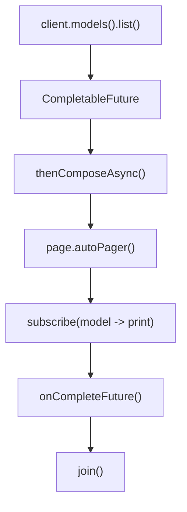
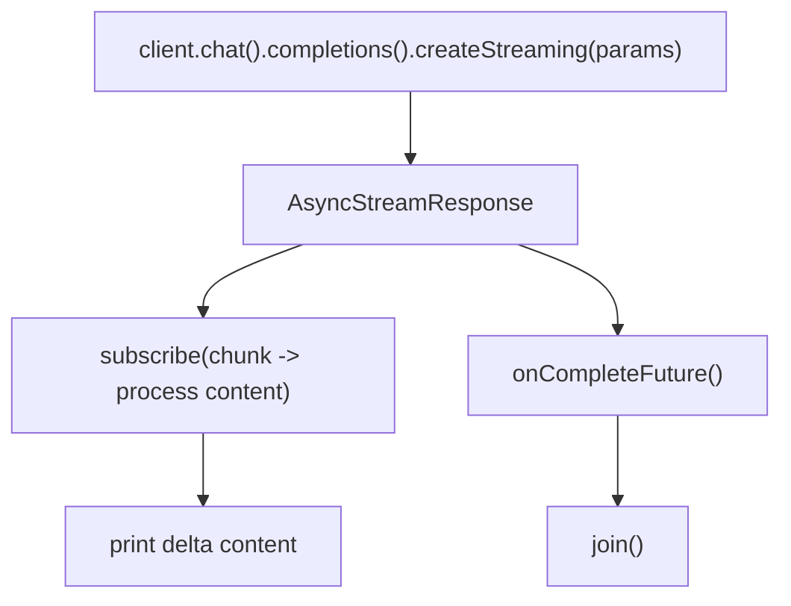
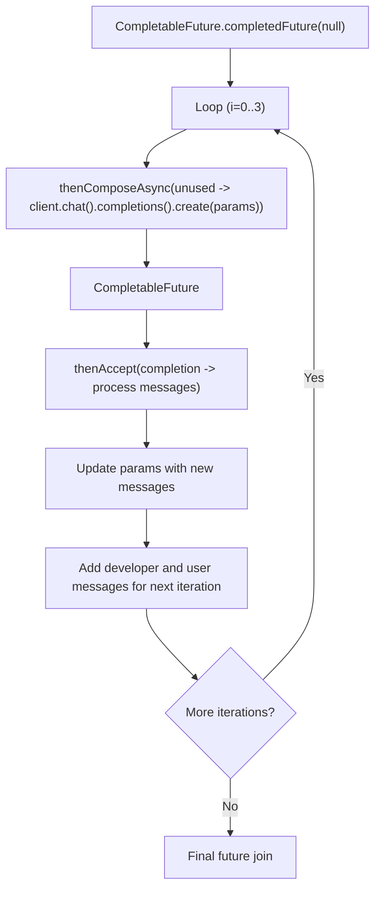
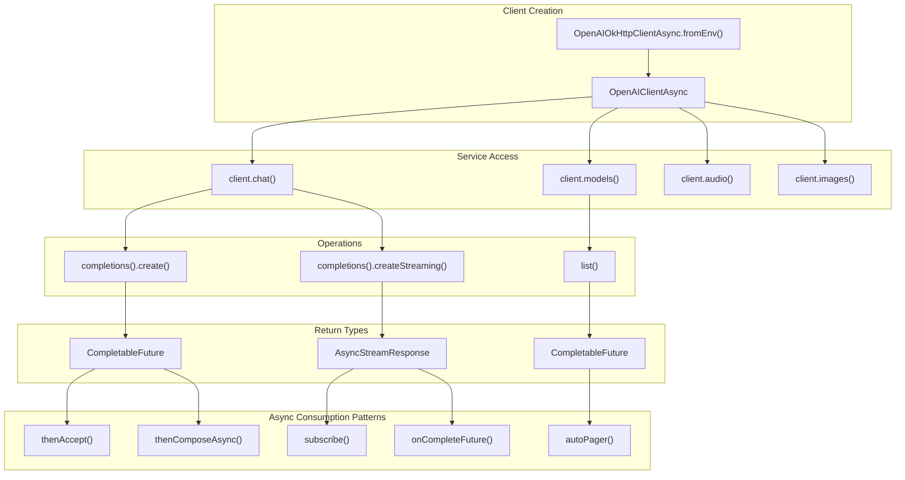
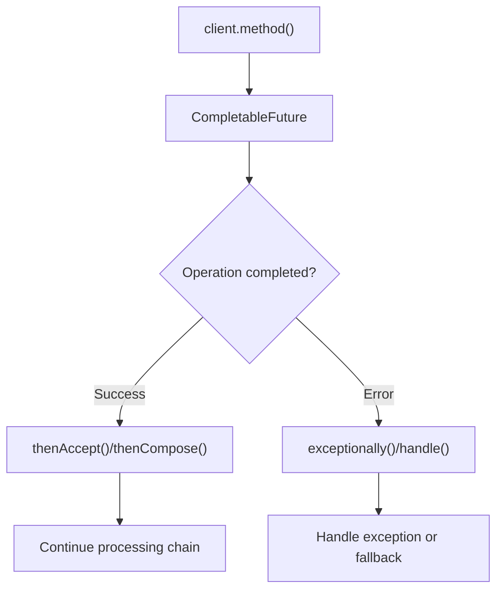

<!-- source: DeepWiki mcp.deepwiki.com · repo openai/openai-java · page 10.3 Asynchronous Examples · fetched 2026-10-26 -->

# Asynchronous Examples

Relevant source files

The following files were used as context for generating this wiki page:

- [openai-java-core/src/main/kotlin/com/openai/services/async/chat/ChatCompletionServiceAsync.kt](openai-java-core/src/main/kotlin/com/openai/services/async/chat/ChatCompletionServiceAsync.kt)
- [openai-java-example/src/main/java/com/openai/example/CompletionsAsyncExample.java](openai-java-example/src/main/java/com/openai/example/CompletionsAsyncExample.java)
- [openai-java-example/src/main/java/com/openai/example/CompletionsConversationAsyncExample.java](openai-java-example/src/main/java/com/openai/example/CompletionsConversationAsyncExample.java)
- [openai-java-example/src/main/java/com/openai/example/CompletionsConversationExample.java](openai-java-example/src/main/java/com/openai/example/CompletionsConversationExample.java)
- [openai-java-example/src/main/java/com/openai/example/CompletionsExample.java](openai-java-example/src/main/java/com/openai/example/CompletionsExample.java)
- [openai-java-example/src/main/java/com/openai/example/CompletionsStreamingAsyncExample.java](openai-java-example/src/main/java/com/openai/example/CompletionsStreamingAsyncExample.java)
- [openai-java-example/src/main/java/com/openai/example/CompletionsStreamingExample.java](openai-java-example/src/main/java/com/openai/example/CompletionsStreamingExample.java)
- [openai-java-example/src/main/java/com/openai/example/ModelListAsyncExample.java](openai-java-example/src/main/java/com/openai/example/ModelListAsyncExample.java)
- [openai-java-example/src/main/java/com/openai/example/ModelListExample.java](openai-java-example/src/main/java/com/openai/example/ModelListExample.java)
- [openai-java-example/src/main/java/com/openai/example/ResponsesStructuredOutputsStreamingAsyncExample.java](openai-java-example/src/main/java/com/openai/example/ResponsesStructuredOutputsStreamingAsyncExample.java)
- [openai-java-example/src/main/java/com/openai/example/StructuredOutputsAsyncExample.java](openai-java-example/src/main/java/com/openai/example/StructuredOutputsAsyncExample.java)

This document provides practical examples demonstrating how to use the asynchronous `OpenAIClientAsync` interface for non-blocking operations in the OpenAI Java SDK. The examples illustrate common patterns for handling `CompletableFuture` return types, async streaming, pagination, and complex workflows using Java’s CompletableFuture API.

For information about the synchronous API, see [Client Interfaces - Synchronous API (#3.1)](../3.1). For background on the async interfaces and concepts, see [Client Interfaces - Asynchronous API (#3.2)](../3.2). For streaming-specific usage, see [Streaming Examples (#10.2)](../10.2).

---

## Basic Async Operations

The foundational pattern for async operations in the SDK involves creating an `OpenAIClientAsync` client and working with `CompletableFuture` return types. All service methods return `CompletableFuture<T>` objects that can be manipulated with standard future composition and chaining.

### Simple Chat Completion Async

This example creates a simple chat completion asynchronously and processes the result once available.

- **Client Creation:** The asynchronous client is created via `OpenAIOkHttpClientAsync.fromEnv()` which configures keys and URLs from environment variables.
- **API Call:** The `chat().completions().create()` method returns a `CompletableFuture` with the chat completion response.
- **Result Handling:** `.thenAccept()` is used to consume the result asynchronously.
- **Synchronization:** `.join()` blocks until the future completes, used here for example simplicity.

**Code Reference:** [openai-java-example/src/main/java/com/openai/example/CompletionsAsyncExample.java:11-31]()

---

### Async Model Listing With Pagination

Listing models asynchronously demonstrates handling paginated results using `autoPager()` with a subscription model.

- `client.models().list()` returns a future for the first page.
- `thenComposeAsync()` is used to continue asynchronously once the first page arrives.
- `autoPager().subscribe()` handles streaming all models from paginated pages.
- `onCompleteFuture()` returns a future completing once pagination and processing finish.

**Code Reference:** [openai-java-example/src/main/java/com/openai/example/ModelListAsyncExample.java:17-22]()

---

## Async Streaming Operations

Streaming methods with the async client use a subscription model to process events as they arrive, enabling non-blocking real-time responses.

### Chat Completion Streaming Async

- The `createStreaming()` method returns an `AsyncStreamResponse<T>` representing the event stream.
- `.subscribe()` allows registering a callback for each streamed chunk (`ChatCompletionChunk`).
- `.onCompleteFuture()` returns a `CompletableFuture<Void>` that completes when the stream finishes.
- This setup allows non-blocking streaming processing while main thread can perform other tasks.

**Code Reference:** [openai-java-example/src/main/java/com/openai/example/CompletionsStreamingAsyncExample.java:24-31]()

---

## Complex Async Workflows

For workflows requiring multiple sequential API calls where each depends on the previous result, completeness is handled by chaining futures.

### Conversational Flow Using Future Chaining

- The chain starts with a completed future to bootstrap chaining.
- Each iteration asynchronously calls `client.chat().completions().create()`.
- Upon completion, the returned messages are processed and appended to the builder for subsequent calls.
- The loop composes sequential futures ensuring ordering.
- The final `.join()` waits for the full sequence to finish.

**Code Reference:** [openai-java-example/src/main/java/com/openai/example/CompletionsConversationAsyncExample.java:31-54]()

---

## Async Client Architecture and Data Flow

- The client is instantiated from environment configuration.
- Access to services like Chat and Models is provided via `client.<service>()`.
- Single operations return `CompletableFuture<T>` for async results.
- Streaming operations return `AsyncStreamResponse<T>` for event streaming.
- Pagination and auto-paging are also asynchronous with subscription support.

**Sources:** [openai-java-example/src/main/java/com/openai/example/CompletionsAsyncExample.java:11-31](), [openai-java-example/src/main/java/com/openai/example/ModelListAsyncExample.java:11-22](), [openai-java-example/src/main/java/com/openai/example/CompletionsStreamingAsyncExample.java:15-31]()

---

## Error Handling Patterns in Async APIs

Handling errors in asynchronous code differs from synchronous exceptions. The SDK’s async `CompletableFuture` based APIs enable flexible error handling.

### CompletableFuture Error Pipeline

- Use `.exceptionally()` or `.handle()` to intercept exceptions and implement recovery or logging.
- `.whenComplete()` can add callbacks regardless of success or failure.
- For streaming subscriptions, error handlers can be provided to `.subscribe()` to manage stream errors.
- The `onCompleteFuture()` of streams will complete exceptionally if the stream fails.

These mechanisms allow structured and resilient error handling in async workflows.

---

## Summary of Best Practices

| Pattern            | Use Case                         | Key Methods                     |
|--------------------|---------------------------------|--------------------------------|
| Simple Async        | Single API call                 | `thenAccept()`, `join()`       |
| Future Chaining     | Sequential dependent operations | `thenComposeAsync()`            |
| Async Streaming     | Real-time streaming responses   | `subscribe()`, `onCompleteFuture()` |
| Async Pagination    | Handling large lists             | `autoPager().subscribe()`       |
| Error Handling      | Robust async application        | `exceptionally()`, `handle()`   |

The asynchronous client interface offers non-blocking variants of all synchronous SDK operations, returning futures for single results and async stream responses with callbacks for streaming. This approach enables concurrent and reactive programming patterns consistent with modern Java usage.

---

# Appendix: Relevant Classes and Methods in Codebase

```mermaid
classDiagram
    class OpenAIOkHttpClientAsync {
        +static fromEnv() : OpenAIClientAsync
    }
    class OpenAIClientAsync {
        +chat() : ChatServiceAsync
        +models() : ModelServiceAsync
        +audio() : AudioServiceAsync
        +images() : ImageServiceAsync
    }
    class ChatServiceAsync {
        +completions() : ChatCompletionServiceAsync
    }
    class ChatCompletionServiceAsync {
        +create(params: ChatCompletionCreateParams) : CompletableFuture<ChatCompletion>
        +createStreaming(params: ChatCompletionCreateParams) : AsyncStreamResponse<ChatCompletionChunk>
    }
    class ModelServiceAsync {
        +list() : CompletableFuture<ModelListPageAsync>
    }
    class ModelListPageAsync {
        +autoPager() : AutoPager<Model>
        +subscribe(Consumer<Model>)
    }
```

- `OpenAIOkHttpClientAsync.fromEnv()` creates the async client configured from environment.
- `OpenAIClientAsync` provides accessors for services implementing async methods.
- `ChatCompletionServiceAsync` defines methods to create completions either as futures or streams.
- Pagination types like `ModelListPageAsync` support async auto-pagination with subscription.

**Sources:** [openai-java-example/src/main/java/com/openai/example/CompletionsAsyncExample.java](), [openai-java-example/src/main/java/com/openai/example/CompletionsStreamingAsyncExample.java](), [openai-java-example/src/main/java/com/openai/example/ModelListAsyncExample.java](), [openai-java-core/src/main/kotlin/com/openai/services/async/chat/ChatCompletionServiceAsync.kt:26-142]()

---

# References

- Basic Async Chat Completion: [openai-java-example/src/main/java/com/openai/example/CompletionsAsyncExample.java:11-31]()
- Async Model Listing with Pagination: [openai-java-example/src/main/java/com/openai/example/ModelListAsyncExample.java:17-22]()
- Async Chat Completion Streaming: [openai-java-example/src/main/java/com/openai/example/CompletionsStreamingAsyncExample.java:24-31]()
- Async Conversational Flow with Future Chaining: [openai-java-example/src/main/java/com/openai/example/CompletionsConversationAsyncExample.java:31-54]()
- ChatCompletionServiceAsync interface details: [openai-java-core/src/main/kotlin/com/openai/services/async/chat/ChatCompletionServiceAsync.kt:26-142]()

This completes the detailed guide for using the OpenAI Java SDK asynchronously with `CompletableFuture` patterns.

---

