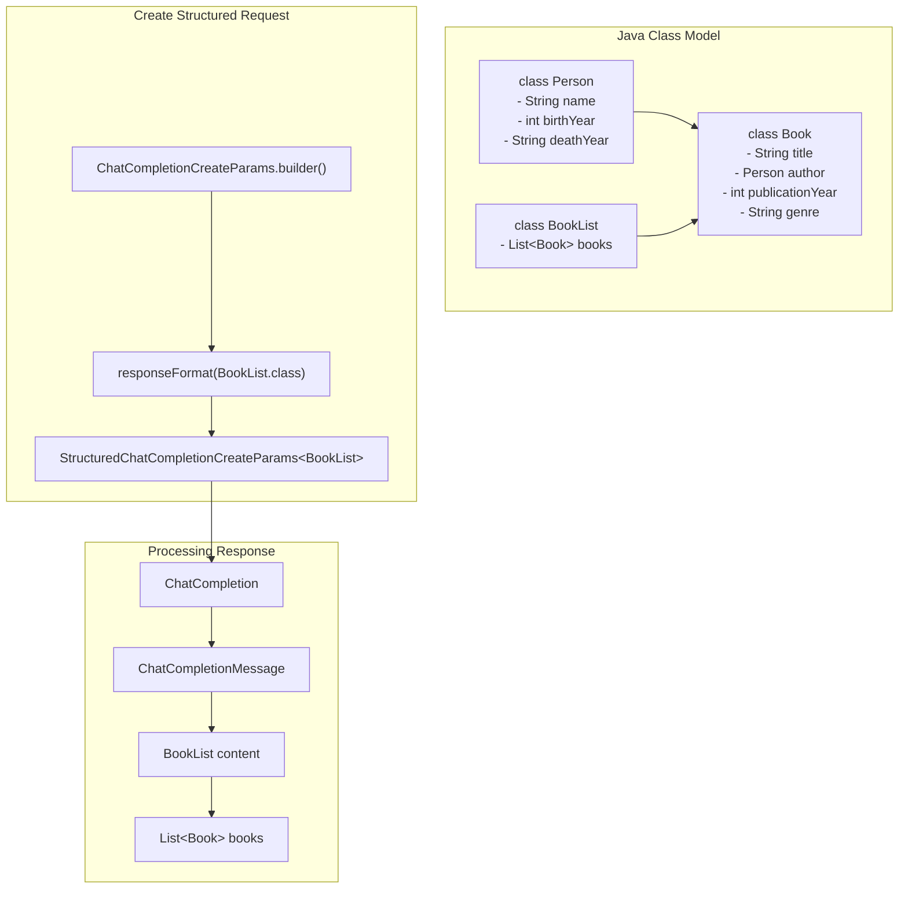
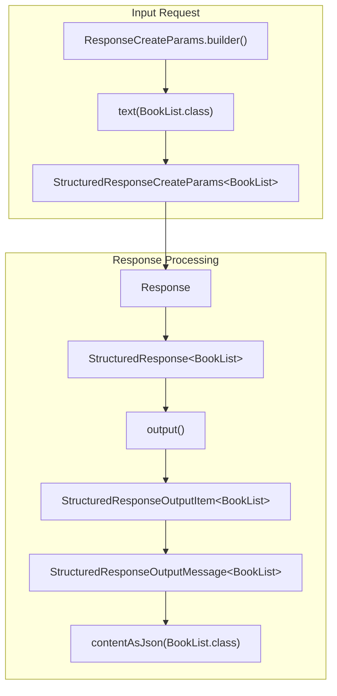
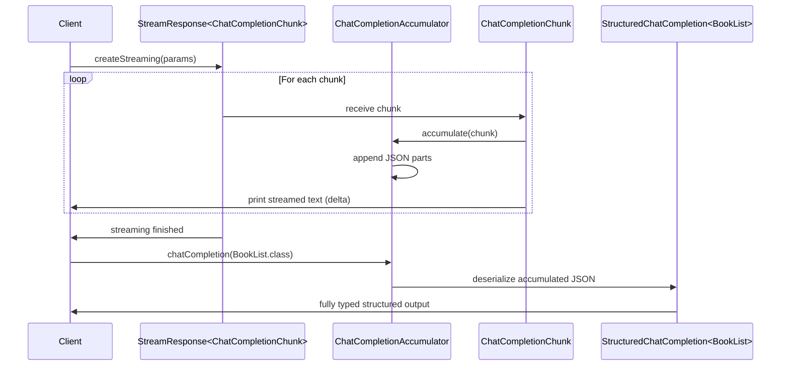
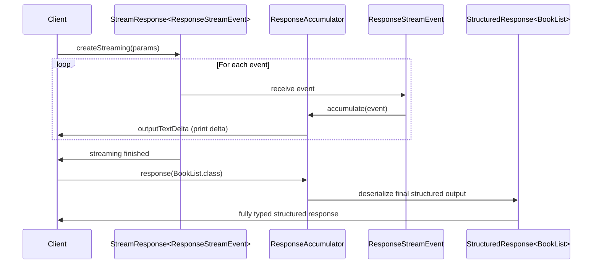
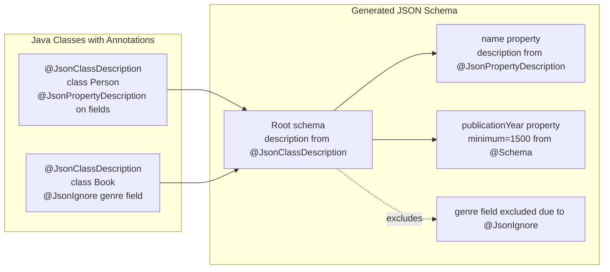
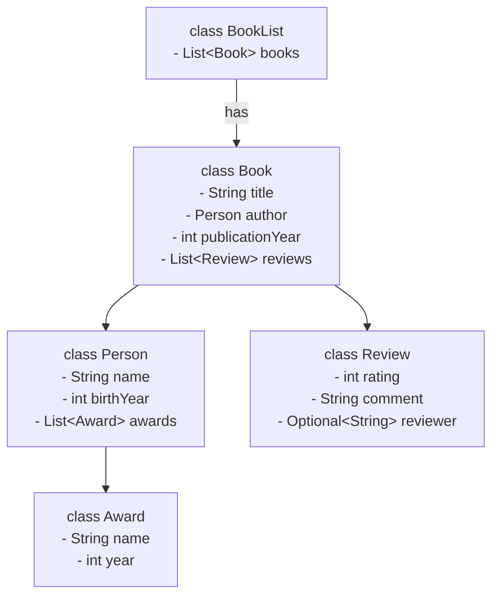
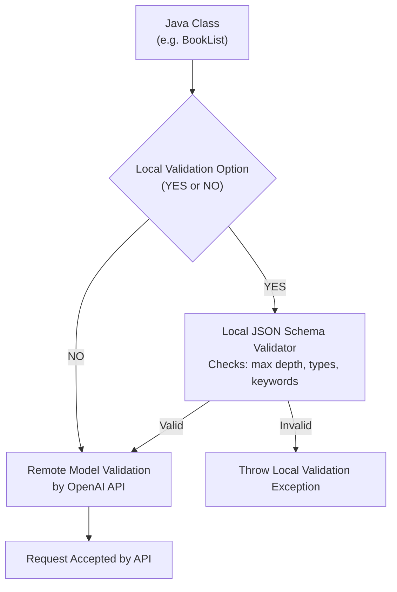

<!-- source: DeepWiki mcp.deepwiki.com · repo openai/openai-java · page 10.4 Structured Output Examples · fetched 2026-10-26 -->

# Structured Output Examples

<details>
<summary>Relevant source files</summary>

The following files were used as context for generating this wiki page:

- [openai-java-core/src/main/kotlin/com/openai/core/JsonSchemaValidator.kt](openai-java-core/src/main/kotlin/com/openai/core/JsonSchemaValidator.kt)
- [openai-java-core/src/main/kotlin/com/openai/core/StructuredOutputs.kt](openai-java-core/src/main/kotlin/com/openai/core/StructuredOutputs.kt)
- [openai-java-core/src/main/kotlin/com/openai/services/async/chat/ChatCompletionServiceAsync.kt](openai-java-core/src/main/kotlin/com/openai/services/async/chat/ChatCompletionServiceAsync.kt)
- [openai-java-core/src/test/kotlin/com/openai/core/StructuredOutputsTest.kt](openai-java-core/src/test/kotlin/com/openai/core/StructuredOutputsTest.kt)
- [openai-java-core/src/test/kotlin/com/openai/core/StructuredOutputsTestUtils.kt](openai-java-core/src/test/kotlin/com/openai/core/StructuredOutputsTestUtils.kt)
- [openai-java-example/src/main/java/com/openai/example/CompletionsAsyncExample.java](openai-java-example/src/main/java/com/openai/example/CompletionsAsyncExample.java)
- [openai-java-example/src/main/java/com/openai/example/CompletionsConversationAsyncExample.java](openai-java-example/src/main/java/com/openai/example/CompletionsConversationAsyncExample.java)
- [openai-java-example/src/main/java/com/openai/example/CompletionsConversationExample.java](openai-java-example/src/main/java/com/openai/example/CompletionsConversationExample.java)
- [openai-java-example/src/main/java/com/openai/example/CompletionsExample.java](openai-java-example/src/main/java/com/openai/example/CompletionsExample.java)
- [openai-java-example/src/main/java/com/openai/example/CompletionsStreamingAsyncExample.java](openai-java-example/src/main/java/com/openai/example/CompletionsStreamingAsyncExample.java)
- [openai-java-example/src/main/java/com/openai/example/CompletionsStreamingExample.java](openai-java-example/src/main/java/com/openai/example/CompletionsStreamingExample.java)
- [openai-java-example/src/main/java/com/openai/example/ModelListAsyncExample.java](openai-java-example/src/main/java/com/openai/example/ModelListAsyncExample.java)
- [openai-java-example/src/main/java/com/openai/example/ModelListExample.java](openai-java-example/src/main/java/com/openai/example/ModelListExample.java)
- [openai-java-example/src/main/java/com/openai/example/ResponsesStructuredOutputsStreamingAsyncExample.java](openai-java-example/src/main/java/com/openai/example/ResponsesStructuredOutputsStreamingAsyncExample.java)
- [openai-java-example/src/main/java/com/openai/example/StructuredOutputsAsyncExample.java](openai-java-example/src/main/java/com/openai/example/StructuredOutputsAsyncExample.java)
- [openai-java-example/src/main/java/com/openai/example/StructuredOutputsExample.java](openai-java-example/src/main/java/com/openai/example/StructuredOutputsExample.java)

</details>


## Purpose and Scope

This page provides practical, detailed examples of using the _Structured Outputs_ feature for both the Chat Completions API and the Responses API. Structured Outputs enable requesting model responses that strictly adhere to a defined JSON schema. The schema is automatically generated from Java class definitions, allowing type-safe deserialization of AI responses back into Java objects.

This guide covers:

- How to define Java classes that map to structured JSON outputs  
- How schema generation and local validation occur before sending requests  
- How to use the SDK builder methods to specify structured response formats  
- Using structured outputs with Chat Completions and Responses APIs  
- Streaming support with accumulation for gradual content assembly  
- Enhancing schemas with Jackson and Swagger annotations  
- Handling optional fields and nested complex types  
- Controlling local JSON schema validation behavior  
- Overview of the internal type-safe architecture for structured outputs  

For a conceptual introduction, see [Structured Outputs](#6). For function calling examples, see [Function Calling and Multi-modal Examples](#10.5).

**Sources:**  
[openai-java-core/src/main/kotlin/com/openai/core/StructuredOutputs.kt:1-159]()  
[openai-java-example/src/main/java/com/openai/example/StructuredOutputsExample.java:1-76]()  
[openai-java-example/src/main/java/com/openai/example/StructuredOutputsAsyncExample.java:1-80]()  
[openai-java-example/src/main/java/com/openai/example/ResponsesStructuredOutputsStreamingAsyncExample.java:1-86]()  
[openai-java-core/src/main/kotlin/com/openai/models/responses/StructuredResponseCreateParams.kt:1-52]()  
[openai-java-core/src/main/kotlin/com/openai/models/responses/StructuredResponse.kt:12-54]()  

---

## Data Flow Architecture

### Structured Outputs Request/Response Flow

```mermaid
flowchart LR
    JavaClass["Java Class Definition<br/>(e.g., BookList.class)"]
    SchemaGen["JSON Schema Generation<br/>(textConfigFromClass, responseFormatFromClass)"]
    Validation["Local JSON Schema Validation<br/>JsonSchemaValidator"]
    Builder["StructuredChatCompletionCreateParams&lt;T&gt;<br/>or<br/>StructuredResponseCreateParams&lt;T&gt;"]
    Request["HTTP Request to OpenAI API<br/>with JSON schema"]
    API["OpenAI API Model"]
    JSONResp["JSON Streamed or Complete Response"]
    Deserialize["Jackson Deserializer"]
    TypedObj["Typed Java Object Instance<br/>(e.g., BookList)"]

    JavaClass --> SchemaGen
    SchemaGen --> Validation
    Validation --> Builder
    Builder --> Request
    Request --> API
    API --> JSONResp
    JSONResp --> Deserialize
    Deserialize --> TypedObj
    JavaClass -.Defines schema/type.-> TypedObj
```



**Key Points:**

- The JSON schema is derived automatically from the structure of a Java class using the SDK's schema generation utilities.

- Local validation checks the schema against OpenAI API restrictions before sending.

- The request includes the JSON schema as part of the `response_format` or `text` parameter.

- The AI response is JSON conforming to the schema and can be deserialized into Java objects safely.

**Sources:**  
[openai-java-core/src/main/kotlin/com/openai/core/StructuredOutputs.kt:37-112]()  
[openai-java-core/src/main/kotlin/com/openai/core/JsonSchemaValidator.kt:1-155]()  

---

## Chat Completions Basic Example

### Java Class Definitions and Structured Request



### Example Java usage

```java
class Person {
    public String name;
    public int birthYear;
    public String deathYear;
}

class Book {
    public String title;
    public Person author;
    public int publicationYear;
    public String genre;
}

class BookList {
    public List<Book> books;
}

StructuredChatCompletionCreateParams<BookList> params = ChatCompletionCreateParams.builder()
    .model(ChatModel.GPT_4O_MINI)
    .maxCompletionTokens(2048)
    .responseFormat(BookList.class)    // Trigger schema extraction and structured output mode
    .addUserMessage("List some famous late twentieth century novels.")
    .build();

StructuredChatCompletion<BookList> completion = client.chat().completions().create(params).join();

completion.choices().stream()
    .flatMap(choice -> choice.message().content().stream())
    .flatMap(bookList -> bookList.books.stream())
    .forEach(book -> System.out.println(" - " + book));
```

- The call to `.responseFormat(BookList.class)` changes the builder type and enables the structured output feature.

- The model's JSON output is automatically deserialized to `BookList` objects, preserving Java type safety.

**Sources:**  
[openai-java-example/src/main/java/com/openai/example/StructuredOutputsExample.java:14-76]()  
[openai-java-core/src/main/kotlin/com/openai/core/StructuredOutputs.kt:40-61]()  
[openai-java-core/src/main/kotlin/com/openai/services/async/chat/ChatCompletionServiceAsync.kt:20-99]()  

---

## Responses API Example

The Responses API supports structured outputs in a similar fashion but uses `text(Class<T>)` instead of `responseFormat(Class<T>)`.

### Diagram of Flow



### Example Java usage

```java
StructuredResponseCreateParams<BookList> params = ResponseCreateParams.builder()
    .input("List some famous late twentieth century novels.")
    .model(ChatModel.GPT_4O_MINI)
    .text(BookList.class)
    .build();

StructuredResponse<BookList> response = client.responses().create(params).join();

response.output().stream()
    .filter(item -> item.isMessage())
    .map(item -> item.asMessage())
    .flatMap(message -> message.content().stream())
    .forEach(content -> {
        if (content.isText()) {
            BookList bookList = content.asText().contentAsJson(BookList.class);
            bookList.books.forEach(book ->
                System.out.println(" - " + book));
        }
    });
```

- `.text(BookList.class)` similarly changes the builder for structured output.

- You access typed content by streaming output items and parsing as the target class.

**Sources:**  
[openai-java-example/src/main/java/com/openai/example/ResponsesStructuredOutputsStreamingAsyncExample.java:13-86]()  
[openai-java-core/src/main/kotlin/com/openai/models/responses/StructuredResponseCreateParams.kt:20-52]()

---

## Verbosity Configuration Example for Responses API

The Responses API supports verbosity control in structured outputs using a configuration type.

```java
StructuredResponseTextConfig<BookList> textConfig = ResponseTextConfig.builder()
    .format(BookList.class)             // Generates and validates JSON schema
    .verbosity(ResponseTextConfig.Verbosity.VERBOSE)
    .build();

StructuredResponseCreateParams<BookList> params = ResponseCreateParams.builder()
    .input("List some famous late twentieth century novels.")
    .model(ChatModel.GPT_4O_MINI)
    .text(textConfig)                   // Supply the config instead of class
    .build();
```

- Calling `.format(Class<T>)` on `ResponseTextConfig.Builder` switches to a `StructuredResponseTextConfig.Builder<T>` allowing strict typing.

- Verbosity adjusts the amount and detail level of the output.

**Sources:**  
[openai-java-core/src/main/kotlin/com/openai/models/responses/StructuredResponseCreateParams.kt:360-380]()

---

## Streaming with Accumulation

### Chat Completions Streaming with Accumulator



**Example (blocking)**

```java
ChatCompletionAccumulator accumulator = ChatCompletionAccumulator.create();

try (StreamResponse<ChatCompletionChunk> stream = client.chat().completions().createStreaming(createParams)) {
    stream.stream()
        .peek(accumulator::accumulate)
        .flatMap(chunk -> chunk.choices().stream())
        .flatMap(choice -> choice.delta().content().stream())
        .forEach(System.out::print);
}

StructuredChatCompletion<BookList> structuredCompletion = accumulator.chatCompletion(BookList.class);
```

**Example (asynchronous)**

```java
ChatCompletionAccumulator accumulator = ChatCompletionAccumulator.create();

client.chat().completions().createStreaming(createParams)
    .subscribe(chunk -> {
        accumulator.accumulate(chunk);
        chunk.choices().stream()
             .flatMap(choice -> choice.delta().content().stream())
             .forEach(System.out::print);
    })
    .onCompleteFuture()
    .join();

StructuredChatCompletion<BookList> structuredCompletion = accumulator.chatCompletion(BookList.class);
```

---

### Responses API Streaming with Accumulator



**Example (blocking)**

```java
ResponseAccumulator accumulator = ResponseAccumulator.create();

try (StreamResponse<ResponseStreamEvent> stream = client.responses().createStreaming(createParams)) {
    stream.stream()
        .peek(accumulator::accumulate)
        .flatMap(event -> event.outputTextDelta().stream())
        .forEach(textEvent -> System.out.print(textEvent.delta()));
}

StructuredResponse<BookList> structuredResponse = accumulator.response(BookList.class);
```

**Example (asynchronous)**

```java
ResponseAccumulator accumulator = ResponseAccumulator.create();

client.responses().createStreaming(createParams)
    .subscribe(event -> accumulator.accumulate(event)
        .outputTextDelta()
        .ifPresent(textEvent -> System.out.print(textEvent.delta())))
    .onCompleteFuture()
    .join();

StructuredResponse<BookList> structuredResponse = accumulator.response(BookList.class);
```

**Sources:**  
[openai-java-example/src/main/java/com/openai/example/ResponsesStructuredOutputsStreamingAsyncExample.java:13-86]()  
[openai-java-core/src/main/kotlin/com/openai/helpers/ResponseAccumulator.kt:1-70]() (implied)  
[openai-java-core/src/main/kotlin/com/openai/helpers/ChatCompletionAccumulator.kt:1-70]() (implied)  

---

## Using Annotations for Schema Enhancement

The SDK JSON schema generator integrates with Jackson and Swagger annotations to enrich the generated schemas:

- `@JsonPropertyDescription` adds descriptions to individual fields  
- `@JsonClassDescription` adds a description for the whole class  
- `@JsonIgnore` excludes fields from the schema  
- Swagger’s `@Schema` and `@ArraySchema` add constraints like min/max, patterns, formats  

### Diagram of Annotation Effects



Example usage:

```java
@JsonClassDescription("The details of one published book")
class Book {
    public String title;
    public Person author;

    @JsonPropertyDescription("The year in which the book was first published.")
    @Schema(minimum = "1500")
    public int publicationYear;

    @JsonIgnore
    public String genre;  // Excluded from schema
}
```

**Sources:**  
[openai-java-example/src/main/java/com/openai/example/StructuredOutputsExample.java:14-76]()  
[openai-java-core/src/main/kotlin/com/openai/core/StructuredOutputs.kt:20-50]()  

---

## Optional Fields

To represent optional or nullable fields in responses, use types like `java.util.Optional<T>` in your Java class fields.

```java
import java.util.Optional;

class Book {
    public String title;
    public Person author;
    public int publicationYear;
    public Optional<String> isbn;  // Optional field - may be absent or null
}
```

- The model controls presence of optional fields; they are not required in JSON.

- The JSON schema generated marks those fields as optional (not required), but the SDK safely wraps values for you.

**Sources:**  
[openai-java-example/src/main/java/com/openai/example/StructuredOutputsExample.java:14-76]() (implied usage)  

---

## Complex Nested Structures

The SDK’s schema generation recognizes nested complex types, including lists and nested classes.

### Example Nested Classes Diagram



Classes can be arbitrarily nested, use lists, optional types, and the schema generation retains generic type parameters for accurate typing.

**Sources:**  
[openai-java-example/src/main/java/com/openai/example/StructuredOutputsExample.java:14-76]() (implied nested usage)  
[openai-java-core/src/main/kotlin/com/openai/core/StructuredOutputs.kt:10-40]()  

---

## Local Validation Control

### JSON Schema Validation Flow



By default, the SDK performs local validation to ensure the schema complies with OpenAI’s specifications before sending the request.

You can disable local validation like this:

```java
StructuredChatCompletionCreateParams<BookList> params = ChatCompletionCreateParams.builder()
    .model(ChatModel.GPT_4O_MINI)
    .addUserMessage("List some books.")
    .responseFormat(BookList.class, JsonSchemaLocalValidation.NO)  // Disable local validation
    .build();
```

Local validation checks include:

- Maximum nesting depth supported  
- Allowed data types and keywords in the schema  
- Constraints on property counts, string lengths, enums  

Remote validation (performed by the OpenAI API) still occurs regardless of the local validation flag.

**Sources:**  
[openai-java-core/src/main/kotlin/com/openai/core/StructuredOutputs.kt:62-86]()  
[openai-java-core/src/main/kotlin/com/openai/core/JsonSchemaValidator.kt:7-155]()  

---

## Complete Example Files for Reference

| Example Class                                   | API           | Streaming Supported | Description                             |
|------------------------------------------------|---------------|---------------------|-----------------------------------------|
| `StructuredOutputsExample.java`                | Chat Completions  | No                  | Basic structured output synchronous usage |
| `StructuredOutputsAsyncExample.java`           | Chat Completions  | No (async client)    | Async API usage with structured output      |
| `ResponsesStructuredOutputsStreamingAsyncExample.java` | Responses       | Yes                 | Responses API with streaming and accumulation |
| `ResponsesStructuredOutputsVerbosityExample.java` | Responses       | No                  | Responses API with verbosity control        |

Use these example classes as starting points and references for implementing your own structured output use cases.

**Sources:**  
[openai-java-example/src/main/java/com/openai/example/StructuredOutputsExample.java]()  
[openai-java-example/src/main/java/com/openai/example/StructuredOutputsAsyncExample.java]()  
[openai-java-example/src/main/java/com/openai/example/ResponsesStructuredOutputsStreamingAsyncExample.java]()  

---

## Type Safety Architecture for Structured Outputs

```mermaid
graph TB
    subgraph "Request Builders"
        BaseBuilder["ChatCompletionCreateParams.Builder<br/>or<br/>ResponseCreateParams.Builder"]
        StructuredBuilder["StructuredChatCompletionCreateParams.Builder&lt;T&gt;<br/>or<br/>StructuredResponseCreateParams.Builder&lt;T&gt;"]
        StructuredParams["StructuredChatCompletionCreateParams&lt;T&gt;<br/>or<br/>StructuredResponseCreateParams&lt;T&gt;"]
    end

    subgraph "Response Types"
        RawResponse["ChatCompletion<br/>or<br/>Response"]
        TypedResponse["StructuredChatCompletion&lt;T&gt;<br/>or<br/>StructuredResponse&lt;T&gt;"]
        OutputItem["StructuredResponseOutputItem&lt;T&gt;"]
        OutputMessage["StructuredResponseOutputMessage&lt;T&gt;"]
    end

    subgraph "User Type"
        UserClass["User-defined Class T<br/>(e.g., BookList)"]
    end

    BaseBuilder -->|Calls `.responseFormat(Class<T>)` or `.text(Class<T>)`| StructuredBuilder
    StructuredBuilder -->|build()| StructuredParams
    StructuredParams -->|API call| RawResponse
    RawResponse -->|Deserializer wraps| TypedResponse
    TypedResponse --> OutputItem
    OutputItem --> OutputMessage
    OutputMessage -->|`.contentAsJson(UserClass)`| UserClass

    UserClass -.Defines type parameter.-> StructuredBuilder
    UserClass -.Defines type parameter.-> StructuredParams
    UserClass -.Defines type parameter.-> TypedResponse
```

### Delegation Pattern

The structured output classes internally delegate to raw API types, preserving all raw API methods while adding type-safe accessors:

- `StructuredChatCompletionCreateParams<T>` delegates to `ChatCompletionCreateParams`  
- `StructuredResponseCreateParams<T>` delegates to `ResponseCreateParams`  
- `StructuredChatCompletion<T>` delegates to `ChatCompletion`  
- `StructuredResponse<T>` delegates to `Response`  
- `StructuredResponseOutputItem<T>` delegates to `ResponseOutputItem`  
- `StructuredResponseOutputMessage<T>` delegates to `ResponseOutputMessage`  

Thus, the SDK transparently supports structured responses with full API functionality and compile-time type safety.

**Sources:**  
[openai-java-core/src/main/kotlin/com/openai/models/responses/StructuredResponseCreateParams.kt:10-32]()  
[openai-java-core/src/main/kotlin/com/openai/models/responses/StructuredResponse.kt:12-54]()  
[openai-java-core/src/main/kotlin/com/openai/models/responses/StructuredResponseOutputItem.kt:10-24]()  

---

# Summary

This page illustrated the use of Structured Outputs in the OpenAI Java SDK through:

- Java class definitions to define expected response structure  
- Automatic JSON schema generation with annotation support  
- Local schema validation enforcing OpenAI API restrictions  
- Building type-safe request parameters with `.responseFormat` or `.text` methods  
- Receiving strongly-typed, deserialized Java objects as responses  
- Streaming support with accumulators for progressively assembling output  
- Use with both Chat Completions API and Responses API  
- Versatile control over verbosity and validation options  
- Internal architecture ensuring full type safety and delegation

These features enable robust, type-safe integration of AI responses in Java applications, reducing runtime errors and improving developer productivity.

**Sources:**  
All sources combined from above sections.

---

