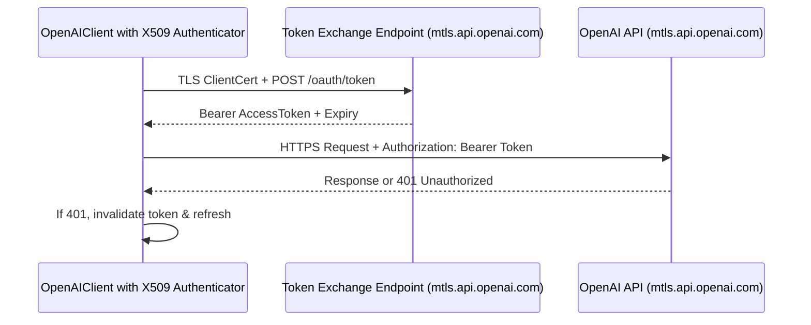
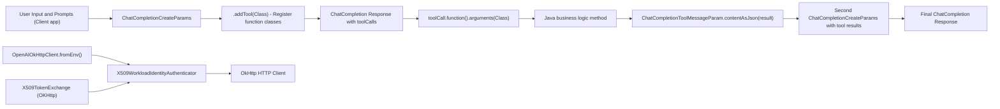

<!-- source: DeepWiki mcp.deepwiki.com · repo openai/openai-java · page 10.5 Function Calling and Multi-modal Examples · fetched 2026-10-26 -->

# Function Calling and Multi-modal Examples

<details>
<summary>Relevant source files</summary>

The following files were used as context for generating this wiki page:

- [openai-java-client-okhttp/src/main/kotlin/com/openai/client/okhttp/X509TokenExchange.kt](openai-java-client-okhttp/src/main/kotlin/com/openai/client/okhttp/X509TokenExchange.kt)
- [openai-java-client-okhttp/src/main/kotlin/com/openai/client/okhttp/X509WorkloadIdentity.kt](openai-java-client-okhttp/src/main/kotlin/com/openai/client/okhttp/X509WorkloadIdentity.kt)
- [openai-java-client-okhttp/src/main/kotlin/com/openai/client/okhttp/X509WorkloadIdentityAuthenticator.kt](openai-java-client-okhttp/src/main/kotlin/com/openai/client/okhttp/X509WorkloadIdentityAuthenticator.kt)
- [openai-java-client-okhttp/src/test/kotlin/com/openai/client/okhttp/OkHttpClientTest.kt](openai-java-client-okhttp/src/test/kotlin/com/openai/client/okhttp/OkHttpClientTest.kt)
- [openai-java-client-okhttp/src/test/kotlin/com/openai/client/okhttp/X509TokenExchangeTest.kt](openai-java-client-okhttp/src/test/kotlin/com/openai/client/okhttp/X509TokenExchangeTest.kt)
- [openai-java-client-okhttp/src/test/kotlin/com/openai/client/okhttp/X509WireTestInfrastructure.kt](openai-java-client-okhttp/src/test/kotlin/com/openai/client/okhttp/X509WireTestInfrastructure.kt)
- [openai-java-client-okhttp/src/test/kotlin/com/openai/client/okhttp/X509WorkloadIdentityIntegrationTest.kt](openai-java-client-okhttp/src/test/kotlin/com/openai/client/okhttp/X509WorkloadIdentityIntegrationTest.kt)
- [openai-java-client-okhttp/src/test/kotlin/com/openai/client/okhttp/X509WorkloadIdentityWireContractTest.kt](openai-java-client-okhttp/src/test/kotlin/com/openai/client/okhttp/X509WorkloadIdentityWireContractTest.kt)
- [openai-java-example/src/main/java/com/openai/example/CompletionsFileExample.java](openai-java-example/src/main/java/com/openai/example/CompletionsFileExample.java)
- [openai-java-example/src/main/java/com/openai/example/CompletionsImageUrlExample.java](openai-java-example/src/main/java/com/openai/example/CompletionsImageUrlExample.java)
- [openai-java-example/src/main/java/com/openai/example/ImageEditingExample.java](openai-java-example/src/main/java/com/openai/example/ImageEditingExample.java)
- [openai-java-example/src/main/java/com/openai/example/ResponsesImageUrlExample.java](openai-java-example/src/main/java/com/openai/example/ResponsesImageUrlExample.java)
- [openai-java-example/src/main/java/com/openai/example/ResponsesInputFileExample.java](openai-java-example/src/main/java/com/openai/example/ResponsesInputFileExample.java)
- [openai-java-example/src/main/java/com/openai/example/X509WorkloadIdentityExample.java](openai-java-example/src/main/java/com/openai/example/X509WorkloadIdentityExample.java)
- [openai-java-example/src/main/resources/aloha-mask.png](openai-java-example/src/main/resources/aloha-mask.png)
- [openai-java-example/src/main/resources/aloha.png](openai-java-example/src/main/resources/aloha.png)

</details>


This page demonstrates practical examples of OpenAI Java SDK usage covering function calling, image editing, audio transcription, file input handling, and X.509 workload identity authentication. It combines mechanical integration details with real code snippets illustrating usage of the SDK’s multi-modal capabilities and secure authentication mechanisms.

The functional calling part builds upon concepts from structured outputs and the Tool system in the Responses API. We also cover handling of files, images, audio, and advanced authentication scenarios. This is a leaf page focused on detailed, technical implementation and usage patterns.

---

## 10.5.1 Function Calling in the Chat Completions API

### Overview

Function calling enables your application to register functions (tools) represented as Java classes with the model. The model dynamically chooses to call these functions by name, with typed parameters, and the SDK helps parse these calls and submit results back to the API, creating an interactive chain of calls.

### Key Implementation Classes and Methods

- `ChatCompletionCreateParams.Builder.addTool(Class<T>)`  
  Register a Java class as a function tool. The SDK uses Jackson annotations on the class to generate a JSON schema describing parameters sent in the API request.

- `ChatCompletionMessageToolCall.function().arguments(Class<T>)`  
  Deserialize the JSON arguments payload from the model into an instance of the registered Java class.

- `ChatCompletionToolMessageParam.builder().contentAsJson(Object)`  
  Serialize a Java object result back to JSON to include in a follow-up API request.

- Execution flow:  
   1. Register tool class in initial request.  
   2. Receive response with tool call and arguments JSON.  
   3. Parse arguments object, execute corresponding Java method.  
   4. Package result in `ChatCompletionToolMessageParam` and send in follow-up request to the model.  

### Data Flow Diagram

```mermaid
flowchart TB
    subgraph NaturalLanguageLayer
        UserMsg["User message (e.g., \"What's the weather?\")"]
        Model["OpenAI Chat Model"]
    end
    subgraph JavaSdkLayer
        DefineFunction["Java class with annotations"]
        addTool["ChatCompletionCreateParams.addTool(Class)"]
        SendRequest["Send chat completion request with tools"]
        ReceiveResponse["Receive response with toolCalls"]
        ParseArgs["toolCall.function().arguments(Class)"]
        ExecuteFunc["Execute business logic in Java"]
        BuildResult["Build ChatCompletionToolMessageParam with contentAsJson()"]
        SendFollowUp["Send follow-up request with tool results"]
        ReceiveFinalResponse["Receive final response from model"]
    end

    UserMsg --> Model
    DefineFunction --> addTool --> SendRequest
    SendRequest --> Model
    Model --> ReceiveResponse
    ReceiveResponse --> ParseArgs --> ExecuteFunc --> BuildResult --> SendFollowUp --> Model
    Model --> ReceiveFinalResponse
```

**Sources:** [README.md:729-826]()

---

## 10.5.2 Image Editing Example

Image editing capability allows sending images and masks in multipart uploads, invoking image edit endpoints, and receiving generated images as URLs or base64 data.

### Implementation Highlights

- Use model enum `ImageModel.DALL_E_2` for image generation/edit.
- Construct `ImageEditParams` with:
  - `image`: the original image as a `MultipartField<InputStream>` with content type and filename set.
  - `mask`: a mask image indicating areas to edit in the same manner.
  - `prompt`: natural language instructions for the edit.
  - `responseFormat`: e.g., URL for returned images.
- Call `client.images().edit(editParams)` which returns an API response wrapping a stream of images.
- Consume URLs from the response for display or download.

### Code Example Excerpt

```java
OpenAIClient client = OpenAIOkHttpClient.fromEnv();

ClassLoader classloader = Thread.currentThread().getContextClassLoader();
InputStream imageStream = classloader.getResourceAsStream("aloha.png");
InputStream maskStream = classloader.getResourceAsStream("aloha-mask.png");

ImageEditParams editParams = ImageEditParams.builder()
    .responseFormat(ImageEditParams.ResponseFormat.URL)
    .image(MultipartField.<Image>builder()
        .value(Image.ofInputStream(imageStream))
        .contentType("image/png")
        .filename("aloha.png")
        .build())
    .mask(MultipartField.<InputStream>builder()
        .value(maskStream)
        .contentType("image/png")
        .filename("aloha-mask.png")
        .build())
    .prompt("Fill the mask area with sand.")
    .model(ImageModel.DALL_E_2)
    .n(1)
    .build();

client.images().edit(editParams).data().orElseThrow().stream()
    .flatMap(image -> image.url().stream())
    .forEach(System.out::println);
```

**Sources:** [openai-java-example/src/main/java/com/openai/example/ImageEditingExample.java:11-49]()

---

## 10.5.3 Audio Transcription Example

The SDK supports audio transcription with streaming and diarization features. Although no explicit example file is shown here, the pattern generally involves:

- Preparing an audio input stream.
- Using the audio API endpoints for transcription or translation.
- Receiving streaming tokens or full text.

The lower-level HTTP and asynchronous clients support robust multipart uploads, cancellations, and error handling.

**Sources:** [openai-java-client-okhttp/src/main/kotlin/com/openai/client/okhttp/OkHttpClientTest.kt:110-167]()

---

## 10.5.4 File Input in the Responses API

You can send files embedded as base64 data in responses input to provide context, documents, or attachments.

### Key Classes and Methods

- `ResponseCreateParams` to build the response request.
- `ResponseInputFile` to wrap a base64-encoded file with metadata including filename.
- `ResponseInputItem` to bundle messages and content including files.

### Example Walkthrough

The example loads a PDF resource, encodes it as a base64 URL, and embeds it as input in a user message.

```java
OpenAIClient client = OpenAIOkHttpClient.fromEnv();

ClassLoader classloader = Thread.currentThread().getContextClassLoader();
byte[] pdfBytes = classloader.getResourceAsStream("pdflatex-image.pdf").readAllBytes();
String pdfBase64Url = "data:application/pdf;base64," + Base64.getEncoder().encodeToString(pdfBytes);

ResponseInputFile inputFile = ResponseInputFile.builder()
    .filename("pdflatex-image.pdf")
    .fileData(pdfBase64Url)
    .build();

ResponseInputItem messageInputItem = ResponseInputItem.ofMessage(
    ResponseInputItem.Message.builder()
        .role(ResponseInputItem.Message.Role.USER)
        .addInputTextContent("Describe this file.")
        .addContent(inputFile)
        .build());

ResponseCreateParams createParams = ResponseCreateParams.builder()
    .inputOfResponse(List.of(messageInputItem))
    .model(ChatModel.GPT_4O)
    .build();

client.responses().create(createParams).output().stream()
    .flatMap(item -> item.message().stream())
    .flatMap(message -> message.content().stream())
    .flatMap(content -> content.outputText().stream())
    .forEach(System.out::println);
```

**Sources:** [openai-java-example/src/main/java/com/openai/example/ResponsesInputFileExample.java:1-49]()

---

## 10.5.5 Embedding Images as Base64 URLs in Chat Completions

You can embed images as base64 URLs within chat content parts to ask models questions about the image.

### Key Concepts

- `ChatCompletionContentPartImage` contains `ImageUrl` with a base64-encoded string.
- `ChatCompletionContentPart.ofImageUrl` wraps this to embed in message content.
- Send along with text content part.

### Code Example

```java
OpenAIClient client = OpenAIOkHttpClient.fromEnv();

ClassLoader classloader = Thread.currentThread().getContextClassLoader();
byte[] logoBytes = classloader.getResourceAsStream("logo.png").readAllBytes();
String logoBase64Url = "data:image/jpeg;base64," + Base64.getEncoder().encodeToString(logoBytes);

ChatCompletionContentPart logoContentPart =
    ChatCompletionContentPart.ofImageUrl(
        ChatCompletionContentPartImage.builder()
            .imageUrl(ChatCompletionContentPartImage.ImageUrl.builder()
                .url(logoBase64Url)
                .build())
            .build());

ChatCompletionContentPart questionContentPart =
    ChatCompletionContentPart.ofText(
        ChatCompletionContentPartText.builder()
            .text("Describe this image.")
            .build());

ChatCompletionCreateParams createParams = ChatCompletionCreateParams.builder()
    .model(ChatModel.GPT_4O_MINI)
    .maxCompletionTokens(2048)
    .addUserMessageOfArrayOfContentParts(List.of(questionContentPart, logoContentPart))
    .build();

client.chat().completions().create(createParams).choices().stream()
    .flatMap(choice -> choice.message().content().stream())
    .forEach(System.out::println);
```

**Sources:** [openai-java-example/src/main/java/com/openai/example/CompletionsImageUrlExample.java:1-48]()

---

## 10.5.6 Image Context Input in Responses API

Similar to chat completions, image inputs can be provided in Responses API messaging.

- Use `ResponseInputImage` builder with properties like `detail` and `imageUrl` (base64 URL).
- Add into `ResponseInputItem.Message` contents.
- Build a `ResponseCreateParams` request and invoke client.

See [ResponsesImageUrlExample](openai-java-example/src/main/java/com/openai/example/ResponsesImageUrlExample.java) for complete usage.

**Sources:** [openai-java-example/src/main/java/com/openai/example/ResponsesImageUrlExample.java:1-46]()

---

## 10.5.7 File Reference in Chat Completions

The SDK supports use of uploaded file references in chat completions for structured contexts.

- Upload files with `FileCreateParams`.
- Create `ChatCompletionContentPart.File` referencing the uploaded file id.
- Include as content part along with normal text.

Example snippet directs to `CompletionsFileExample` illustrating this process.

**Sources:** [openai-java-example/src/main/java/com/openai/example/CompletionsFileExample.java:1-57]()

---

## 10.5.8 X.509 Workload Identity Authentication

### Purpose

This advanced authentication mechanism enables using X.509 mTLS certificates to exchange tokens and securely authenticate requests to OpenAI API endpoints configured for mutual TLS.

### Key Classes

- `X509WorkloadIdentityAuthenticator`: Implements `HttpRequestAuthenticator` and manages token caching, refreshing, and authorization enforcement using a wrapped `X509TokenExchange` instance.

- `X509TokenExchange`: Handles the actual token exchange HTTP request over mTLS.

### Workflow

1. Authenticate request origin is HTTPS with authorized hosts (`mtls.api.openai.com` or `mtls-eu.api.openai.com` on port 443).
2. Obtain and cache bearer token via token exchange using client certificate.
3. Attach `Authorization: Bearer <token>` header on requests.
4. Refresh tokens pre-expiry with configurable buffer.
5. Supports synchronous and asynchronous request authentication.
6. Invalidate cached token when server rejects.

### Authentication Data Flow Diagram



### Integration Example

See `X509WorkloadIdentityExample` for full setup usages loading client certs and configuring the `OpenAIOkHttpClient` with this authentication.

### Testing & Verification

Detailed integration tests in `X509WorkloadIdentityIntegrationTest.kt` validate token caching, refreshing, error handling, and mutual TLS authorization on loopback addresses with mock servers simulating token exchange and API responses.

**Sources:**  
- [openai-java-client-okhttp/src/main/kotlin/com/openai/client/okhttp/X509WorkloadIdentityAuthenticator.kt:1-178]()  
- [openai-java-client-okhttp/src/test/kotlin/com/openai/client/okhttp/X509WorkloadIdentityIntegrationTest.kt:1-173]()  
- [openai-java-client-okhttp/src/test/kotlin/com/openai/client/okhttp/X509WorkloadIdentityWireContractTest.kt:1-138]()  

---

## Summary Diagram: Natural Language to Code Entity Flow for Function Calling and X.509 Auth



This diagram bridges the natural language layer (user inputs and model messages) into the underlying SDK mechanisms including function registration and execution, plus the secure transport layer using mTLS with X.509 workload identity.

---

# References

- SDK example code paths for function calling and multi-modal examples:  
  - `openai-java-example/src/main/java/com/openai/example/ImageEditingExample.java`  
  - `openai-java-example/src/main/java/com/openai/example/ResponsesInputFileExample.java`  
  - `openai-java-example/src/main/java/com/openai/example/CompletionsImageUrlExample.java`  
  - `openai-java-example/src/main/java/com/openai/example/ResponsesImageUrlExample.java`  
  - `openai-java-example/src/main/java/com/openai/example/CompletionsFileExample.java`  
  - `openai-java-client-okhttp/src/main/kotlin/com/openai/client/okhttp/X509WorkloadIdentityAuthenticator.kt`  
  - `openai-java-client-okhttp/src/test/kotlin/com/openai/client/okhttp/X509WorkloadIdentityIntegrationTest.kt`  
  - `openai-java-client-okhttp/src/test/kotlin/com/openai/client/okhttp/X509WorkloadIdentityWireContractTest.kt`  

---

This completes the detailed functional and multi-modal example guide focusing on Java integration, function calling, media handling, and secure authentication using the OpenAI Java SDK.

---

