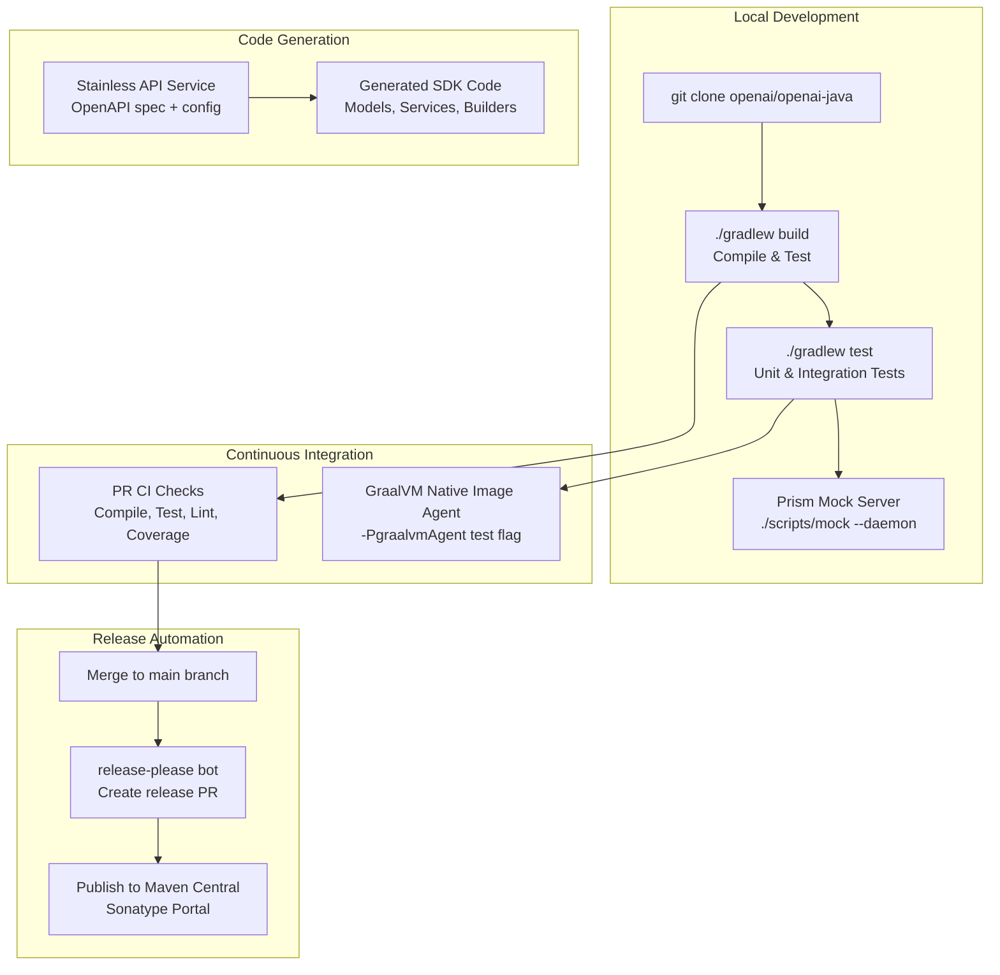
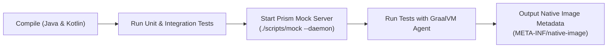
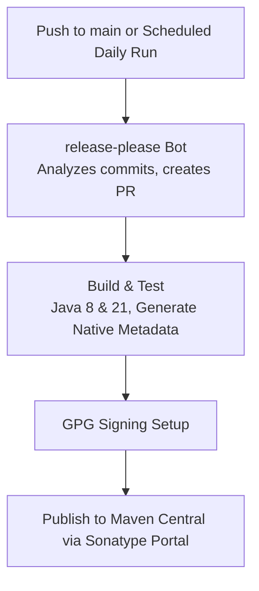
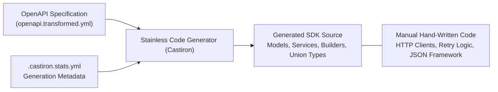
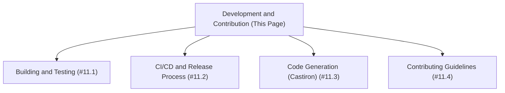

<!-- source: DeepWiki mcp.deepwiki.com · repo openai/openai-java · page 11 Development and Contribution · fetched 2026-10-26 -->

# Development and Contribution

<details>
<summary>Relevant source files</summary>

The following files were used as context for generating this wiki page:

- [.github/workflows/castiron-custom-code-comment.yml](.github/workflows/castiron-custom-code-comment.yml)
- [.github/workflows/castiron-custom-code.yml](.github/workflows/castiron-custom-code.yml)
- [.release-please-manifest.json](.release-please-manifest.json)
- [AGENTS.md](AGENTS.md)
- [CHANGELOG.md](CHANGELOG.md)
- [CONTRIBUTING.md](CONTRIBUTING.md)
- [README.md](README.md)
- [bedrock.md](bedrock.md)
- [build.gradle.kts](build.gradle.kts)
- [openai-java-client-okhttp/src/test/kotlin/com/openai/client/okhttp/LargePayloadContractTest.kt](openai-java-client-okhttp/src/test/kotlin/com/openai/client/okhttp/LargePayloadContractTest.kt)
- [scripts/castiron/CUSTOM_CODE.md](scripts/castiron/CUSTOM_CODE.md)
- [scripts/castiron/custom_code_budget.py](scripts/castiron/custom_code_budget.py)
- [scripts/castiron/custom_code_report.py](scripts/castiron/custom_code_report.py)
- [scripts/castiron/test_custom_code_budget.py](scripts/castiron/test_custom_code_budget.py)
- [scripts/castiron/test_custom_code_report.py](scripts/castiron/test_custom_code_report.py)

</details>


This document provides a high-level overview and guidance for contributors and developers working on the OpenAI Java SDK itself. It covers the development workflow, build and test infrastructure, continuous integration and delivery (CI/CD), code generation strategy, and contribution policies. For detailed technical instructions on each topic, see the linked child pages.

## Overview

The OpenAI Java SDK is a partly code-generated project that provides Java client APIs for the OpenAI REST API. The SDK source is divided into multiple Gradle modules including `openai-java-core` (core SDK logic), `openai-java-client-okhttp` (OkHttp-based HTTP transport), `openai-java-bedrock` (Amazon Bedrock integration), and the aggregate `openai-java` module.

Development involves a combination of generated code—derived from OpenAPI specifications by the Stainless code generator—and hand-written runtime components like HTTP clients, retry logic, and JSON serialization.

Key infrastructure:

- **Build System:** Gradle with Kotlin DSL, supporting multi-module builds and Java version compatibility management
- **Testing:** JUnit-based tests including large-payload contract tests and GraalVM native image metadata generation during tests
- **Code Generation:** OpenAPI-driven generation orchestrated by Stainless, producing models, service interfaces, and request/response builders
- **Release Automation:** GitHub Actions workflows using release-please to create releases and publish artifacts to Maven Central
- **Security & Quality Gates:** Custom-code budget to limit manual edits in generated code, strict secret management, and code style enforcement

Sources: [.github/workflows/create-releases.yml:1-82](), [build.gradle.kts:1-178](), [CONTRIBUTING.md:1-128]()

---

## Development Workflow

Local development typically follows these steps:

1. **Clone the repository** from GitHub.
2. **Build and test locally** using Gradle commands (`./gradlew build`, `./gradlew test`).
3. **Run the Steady Prism mock server** for stable API contract testing during development.
4. **Use the GraalVM native image agent** to generate native image metadata as part of testing.
5. **Make contributions via pull requests**, which are reviewed by collaborators as per contribution guidelines.

The development workflow integrates code generation, build, test, and release in a continuous chain.



Sources: [.github/workflows/create-releases.yml:1-82](), [CONTRIBUTING.md:20-97]()

---

## Build System and Testing

The SDK uses Gradle with Kotlin DSL to manage builds and dependencies, supporting multiple subprojects and Java runtime compatibility. The build is split across core compilation shards to optimize incremental builds.

### Key Build Aspects

- **Java Version Policy:** The SDK runtime requires Java 8 or later, with Java 21 used for development builds and GraalVM native image testing.
- **Formatting and Linting:** Separate Gradle tasks (`format`, `lint`) enforce consistent code style.
- **Tests:** Regular tests cover unit and integration cases, plus large payload contract tests and custom-code budget enforcement.
- **GraalVM Native Image Agent:** During tests, metadata for GraalVM native image compilation is generated and validated in `META-INF/native-image/` resources.

| Task                 | Description                                |
|----------------------|--------------------------------------------|
| `./gradlew build`    | Compiles, runs tests, and packages artifacts |
| `./gradlew test`     | Runs unit and integration tests            |
| `./gradlew test -PgraalvmAgent` | Runs tests with GraalVM agent to generate native image metadata |
| `./scripts/lint`     | Checks formatting                          |
| `./scripts/format`   | Auto-formats source files                  |



Sources: [build.gradle.kts:10-178](), [.github/workflows/create-releases.yml:40-68]()

---

## CI/CD and Release Process

Continuous integration runs on GitHub Actions, enforcing code quality, running tests, and checking custom-code budget. Releases are automated with the release-please bot, which creates release pull requests upon merges to the `main` branch and publishes artifacts to Maven Central.

### Release Workflow Overview



### Secrets and Configuration

The release process requires several GitHub secrets:

| Secret                      | Purpose                          |
|-----------------------------|---------------------------------|
| `STAINLESS_API_KEY`         | Authenticates with Stainless API for codegen triggers  |
| `SONATYPE_USERNAME` / `OPENAI_SONATYPE_USERNAME` | Sonatype Central publishing credentials |
| `SONATYPE_PASSWORD` / `OPENAI_SONATYPE_PASSWORD` | Sonatype Central publishing credentials |
| `GPG_SIGNING_KEY` / `OPENAI_SONATYPE_GPG_SIGNING_KEY` | GPG private key for artifact signing |
| `GPG_SIGNING_PASSWORD` / `OPENAI_SONATYPE_GPG_SIGNING_PASSWORD` | Passphrase for GPG key |

For detailed CI/CD workflow configuration, see the child page [CI/CD and Release Process](#11.2).

Sources: [.github/workflows/create-releases.yml:1-82](), [bin/check-release-environment:1-38](), [.github/workflows/release-doctor.yml:1-27]()

---

## Code Generation (Castiron)

The SDK's code generation pipeline uses the Stainless service, which processes OpenAPI specifications combined with custom overrides and templates to generate comprehensive SDK code.

### What is Generated?

- Service interfaces and clients (e.g., `ChatService`, `ResponsesService`)
- Request parameter builders (e.g., `ChatCompletionCreateParams.Builder`)
- Response and model classes
- Union types (e.g., `Tool`, `ResponseContent`)
- JSON schema-based validators and data classes

### Custom Code Budget

To maintain the integrity of generated code and avoid manual modifications that may be overwritten, the SDK enforces a strict "custom-code budget." This limits how much generated code can be manually patched. Changes to this budget require a dedicated, reviewable pull request modifying `.castiron-ratchet.json`.

### Diagram: How Code Generation Links to SDK Code



For full details on the code generation approach, see the child page [Code Generation (Castiron)](#11.3).

Sources: [scripts/castiron/custom_code_report.py:1-189](), [CONTRIBUTING.md:27-39]()

---

## Contributing Guidelines

Contributions are welcome subject to the project's policies:

- Pull requests are **restricted to collaborators only**; non-collaborators should open issues instead.
- Bug reports, feature requests, and minimal reproductions should be submitted via GitHub Issues.
- The SDK is mostly generated; any changes to generated code must respect the custom-code budget.
- Security-sensitive issues and credentials must never be committed to the repository. Follow the security model outlined in `SECURITY.md`.
- Follow conventional commit message formats to facilitate automated changelog generation and release versioning.

### Development Environment Setup

- Use JDK 21 for development Kotlin toolchain, but ensure generated SDK artifacts are compatible with Java 8.
- Validate environment early with `./scripts/check-env` and maintain formatting with `./scripts/lint`.
- Run tests locally before submitting PRs.

### Example: Creating and Running Examples

The `openai-java-example/` directory contains runnable example code outside generated sources. New examples should be added here and can be run via:

```shell
./gradlew :openai-java-example:run -PmainClass=com.openai.example.YourExample
```

For comprehensive contribution information, see the child page [Contributing Guidelines](#11.4).

Sources: [CONTRIBUTING.md:1-128](), [AGENTS.md:1-66]()

---

# Summary of Relationships

This page serves as a parent overview connecting to detailed child pages:



Each child page offers in-depth guidance on its focused domain, enabling maintainers to navigate the SDK's complex development lifecycle efficiently.

---

For further information and detailed procedures, contributors and maintainers should refer to the child pages linked above.

---

# Citations

- [README.md:1-169]()
- [build.gradle.kts:1-178]()
- [CONTRIBUTING.md:1-128]()
- [.github/workflows/create-releases.yml:1-82]()
- [.github/workflows/publish-sonatype.yml:1-68]()
- [.github/workflows/release-doctor.yml:1-27]()
- [bin/check-release-environment:1-38]()
- [scripts/castiron/custom_code_report.py:1-189]()
- [AGENTS.md:1-66]()

---

