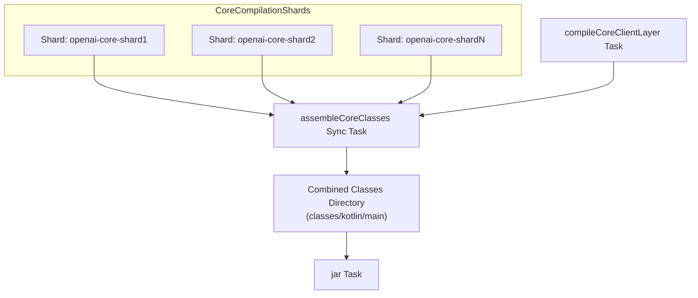
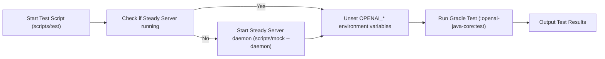

<!-- source: DeepWiki mcp.deepwiki.com · repo openai/openai-java · page 11.1 Building and Testing · fetched 2026-10-26 -->

# Building and Testing

<details>
<summary>Relevant source files</summary>

The following files were used as context for generating this wiki page:

- [.github/dependabot.yml](.github/dependabot.yml)
- [.gitignore](.gitignore)
- [buildSrc/src/main/kotlin/com/openai/gradle/CoreCompilationDependencies.kt](buildSrc/src/main/kotlin/com/openai/gradle/CoreCompilationDependencies.kt)
- [buildSrc/src/main/kotlin/com/openai/gradle/VerifyVersionSupportPolicyTask.kt](buildSrc/src/main/kotlin/com/openai/gradle/VerifyVersionSupportPolicyTask.kt)
- [buildSrc/src/main/kotlin/com/openai/gradle/VersionSupportPolicy.kt](buildSrc/src/main/kotlin/com/openai/gradle/VersionSupportPolicy.kt)
- [buildSrc/src/main/kotlin/openai.core-shard.gradle.kts](buildSrc/src/main/kotlin/openai.core-shard.gradle.kts)
- [buildSrc/src/main/kotlin/openai.java.gradle.kts](buildSrc/src/main/kotlin/openai.java.gradle.kts)
- [buildSrc/src/main/kotlin/openai.kotlin.gradle.kts](buildSrc/src/main/kotlin/openai.kotlin.gradle.kts)
- [buildSrc/src/test/kotlin/com/openai/gradle/CoreCompilationDependenciesTest.kt](buildSrc/src/test/kotlin/com/openai/gradle/CoreCompilationDependenciesTest.kt)
- [buildSrc/src/test/kotlin/com/openai/gradle/GradleWrapperTest.kt](buildSrc/src/test/kotlin/com/openai/gradle/GradleWrapperTest.kt)
- [buildSrc/src/test/kotlin/com/openai/gradle/JavaFormatScriptTest.kt](buildSrc/src/test/kotlin/com/openai/gradle/JavaFormatScriptTest.kt)
- [gradle.properties](gradle.properties)
- [gradle/kotlin-format.gradle.kts](gradle/kotlin-format.gradle.kts)
- [gradle/libs.versions.toml](gradle/libs.versions.toml)
- [openai-java-client-okhttp/build.gradle.kts](openai-java-client-okhttp/build.gradle.kts)
- [openai-java-core/build.gradle.kts](openai-java-core/build.gradle.kts)
- [openai-java-core/src/main/kotlin/com/openai/models/embeddings/EmbeddingValue.kt](openai-java-core/src/main/kotlin/com/openai/models/embeddings/EmbeddingValue.kt)
- [openai-java-core/src/test/kotlin/com/openai/core/WireMockHandlebarsCompatibilityTest.kt](openai-java-core/src/test/kotlin/com/openai/core/WireMockHandlebarsCompatibilityTest.kt)
- [scripts/build](scripts/build)
- [scripts/check-env](scripts/check-env)
- [scripts/fast-format](scripts/fast-format)
- [scripts/format](scripts/format)
- [scripts/gradle](scripts/gradle)
- [scripts/java-format](scripts/java-format)
- [scripts/kotlin-format](scripts/kotlin-format)
- [scripts/lint](scripts/lint)
- [scripts/mock](scripts/mock)
- [scripts/run-steady](scripts/run-steady)
- [scripts/steady/install](scripts/steady/install)
- [scripts/steady/manifest.json](scripts/steady/manifest.json)
- [scripts/steady/publication.test.cjs](scripts/steady/publication.test.cjs)
- [scripts/steady/publish.cjs](scripts/steady/publish.cjs)
- [scripts/steady/settings](scripts/steady/settings)
- [scripts/steady/source-sha256.cjs](scripts/steady/source-sha256.cjs)
- [scripts/test](scripts/test)

</details>


This page details the process of building and testing the OpenAI Java SDK. It includes explanations of the Gradle build system architecture with convention plugins and core compilation shards, the usage of build and test scripts, the Steady mock server leveraged for API mocking, formatting and linting scripts, and integration with the GraalVM native image agent for producing reflection and resource metadata.

---

## Gradle Build System

The OpenAI Java SDK uses Gradle as its build tool configured with advanced multi-module organization and compilation optimization.

### Convention Plugins and Core Compilation Shards

- **Convention Plugins**: Custom Gradle plugins are applied in modules like `openai-java-core` and `openai-java-client-okhttp` to centralize configuration such as Kotlin compilation settings, dependency resolution, testing options, and publishing conventions. For example, the `openai.kotlin`, `openai.wiremock-test`, and `openai.publish` plugins are used to handle language-specific compilation, WireMock testing integration, and Maven publishing respectively ([openai-java-core/build.gradle.kts:22-27](), [openai-java-client-okhttp/build.gradle.kts:3-7]()).

- **Core Compilation Shards**: The `openai-java-core` module is divided into compilation shards, where different internal subprojects compile in isolation to improve build caching and parallelism. These shards' Kotlin source sets are excluded from the main source set using a claim specification ([openai-java-core/build.gradle.kts:38-45]()).

- **Client Layer Compilation**: The client layer Kotlin compilation outputs classes to a dedicated directory (`classes/kotlin/client-layer`). These outputs and the shard outputs are merged via a `Sync` task named `assembleCoreClasses` into a combined classes directory `classes/kotlin/main`. This composite output becomes the canonical classes directory for tests and publishing ([openai-java-core/build.gradle.kts:40-79]()).

- **Artifact and Verification**: The `jar` task excludes the client-layer classes separately compiled and uses the combined directory for packaging. A custom task `verifyCoreCompilationArtifact` checks that core classes and sources are published exactly once matching a public API manifest verifying API stability ([openai-java-core/build.gradle.kts:80-106]()).

### Kotlin and Java Compilation

- Kotlin compilation targets align with Java runtime floor versions as dictated by a version support policy. The Kotlin compile task is configured with `friendPaths` to include outputs from core shard projects, enabling internal module visibility for Kotlin (`compileCoreClientLayer`) ([openai-java-core/build.gradle.kts:43-54](), [buildSrc/src/main/kotlin/openai.kotlin.gradle.kts:15-38]()).

- Java compilation is configured similarly with Java toolchains locked to the build JDK and release targets set according to the runtime floor ensuring Java 8 compatibility where required ([buildSrc/src/main/kotlin/openai.java.gradle.kts:18-51]()).

### Dependency Management and Jackson Versioning

- Both `openai-java-core` and `openai-java-client-okhttp` lock their test runtime classpaths to a secure, published Jackson BOM version to prevent conflicts and ensure security. WireMock tests use this aligned Jackson version to avoid runtime issues ([openai-java-core/build.gradle.kts:129-139](), [openai-java-client-okhttp/build.gradle.kts:14-28]()).

---

## Build and Test Scripts

Several scripts automate common development tasks such as building, testing, running mock servers, and code formatting.

### Build Script (`scripts/build`)

- This script wraps Gradle commands for building the SDK, compiling core and client modules, and assembling artifacts.
- It ensures a clean environment and consistent build execution.

### Test Script (`scripts/test`)

- This script sets up the environment to run the automated test suite.
- It verifies if the Steady mock server is running on port 4010 and starts it in daemon mode if not.
- If an environment variable `TEST_API_BASE_URL` is set, tests run against this custom base URL instead.
- The script unsets sensitive OpenAI environment variables to keep test expectations consistent across CI and local environments.
- It then invokes the Gradle `test` task targeting the core modules ([scripts/test:1-64]()).

### Mock Server Script (`scripts/mock`)

- Starts the Steady mock server either pointing to a given OpenAPI spec URL/path or defaults to a local `api_reference/openapi.transformed.yml`.
- Validates the OpenAPI spec hash against Castiron generation metadata for consistency.
- Supports running in foreground or daemon background mode.
- Waits for the server to be healthy by querying the `/health` endpoint on localhost:4010 before continuing ([scripts/mock:1-64]()).

---

## Steady Mock Server

- The Steady mock server is a crucial part of the testing infrastructure.
- It mocks OpenAI API endpoints according to the OpenAPI specification, allowing tests to simulate real API interactions without network dependency.
- The SDK's tests rely on this for predictable and fast test execution.
- The server is launched automatically by the `scripts/test` script if needed or can be manually started using `scripts/mock --daemon` ([scripts/mock:1-64](), [scripts/test:12-34]()).

---

## Code Formatting and Linting

Formatting and linting are enforced to maintain code quality and consistency.

### Java Formatting with Palantir Java Format

- Formatting and linting for Java source files use Palantir's Java Format tool wrapped in Gradle tasks and invoked by scripts.
- Tasks `format` and `lint` are registered through `registerPalantir()` in the build configuration to run formatting and lint checks, respectively.
- The lint task performs a dry run and exits with an error if files are not formatted.
- The format task performs an in-place rewrite of source files ([buildSrc/src/main/kotlin/openai.java.gradle.kts:50-134](), [scripts/java-format:1-31]()).

### Kotlin Formatting

- Kotlin files are formatted with the ktfmt tool.
- The `scripts/fast-format` script takes a file listing and applies ktfmt to Kotlin files for quick incremental formatting.
- The Kotlin format task is configured from `gradle/kotlin-format.gradle.kts` applied in Kotlin modules ([scripts/fast-format:1-46](), [buildSrc/src/main/kotlin/openai.kotlin.gradle.kts:49]()).

### Linting Script (`scripts/lint`)

- Runs Kotlin lints via Gradle and Java lints (palantir or Gradle fallback).
- Ensures source code does not violate formatting rules before committing or merging ([scripts/lint:1-22]()).

---

## GraalVM Native Image Agent

The SDK supports GraalVM native image builds by generating required reflection and resource configuration metadata.

### Why The Agent Is Needed

- Native image compilation in GraalVM needs explicit JSON metadata describing reflection use, dynamic proxies, resource access, JNI, and serialization.
- The native image agent dynamically observes the runtime behavior during tests to auto-generate this metadata.

### Usage

- The CI job runs tests with the property `-PgraalvmAgent` which activates the native image agent JVM argument integrated in the Kotlin compile/test tasks ([openai-java-core/build.gradle.kts:15-20]()).
- Typical test run command with agent:

```bash
./gradlew :openai-java-core:test -PgraalvmAgent -x compileJava -x compileTestJava -x compileKotlin -x compileTestKotlin
```

- After tests run, metadata files such as `reflect-config.json`, `resource-config.json`, `proxy-config.json` etc. appear in the `META-INF/native-image/` resource directory for inclusion in native image builds.
- CI validates the existence and content of these files to ensure completeness ([.github/workflows/create-releases.yml:47-68]()).

---

## Overview Diagrams

### Gradle Multi-Module Compilation and Assembly



**Sources:** [openai-java-core/build.gradle.kts:38-79]()

---

### Test Execution Flow with Steady Mock Server and Gradle



**Sources:** [scripts/test:1-64](), [scripts/mock:1-64]()

---

## Summary

- Building the SDK uses a multi-shard Gradle architecture merging compilation outputs carefully.
- Scripts automate building, testing, mock server startup, and formatting enforcement.
- The Steady mock server simulates OpenAI APIs during tests, ensuring network-independent reliability.
- Formatting employs Palantir Java Format for Java and ktfmt for Kotlin with dedicated tasks and scripts.
- GraalVM native image agent integration produces needed native image metadata during test runs.
- CI workflows utilize these systems for reliable build/test/publish automation.

---

# References and Sources

- `openai-java-core/build.gradle.kts:1-161`  
- `openai-java-client-okhttp/build.gradle.kts:1-40`  
- `buildSrc/src/main/kotlin/openai.java.gradle.kts:1-134`  
- `buildSrc/src/main/kotlin/openai.kotlin.gradle.kts:1-49`  
- `scripts/test:1-65`  
- `scripts/mock:1-65`  
- `scripts/java-format:1-32`  
- `scripts/fast-format:1-47`  
- `scripts/lint:1-23`

---

