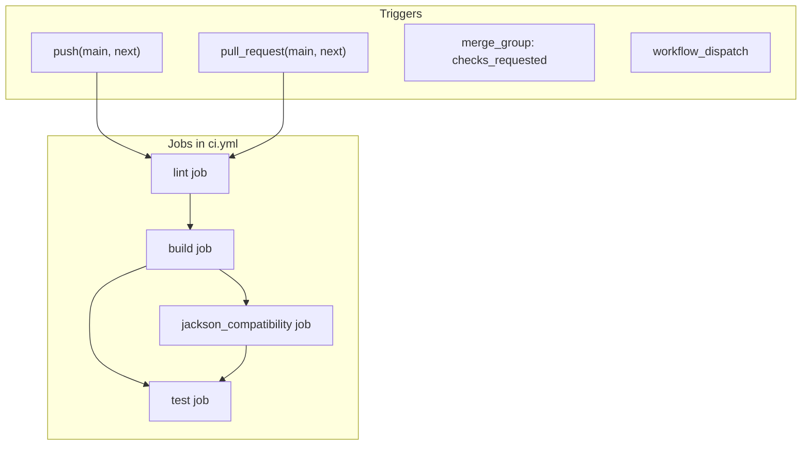
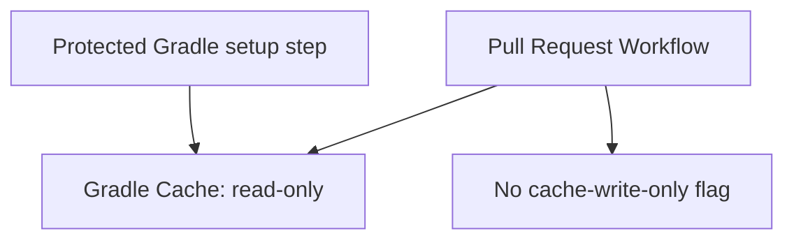
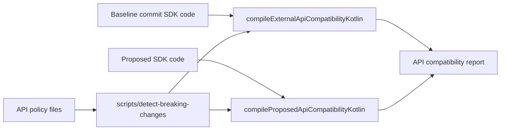
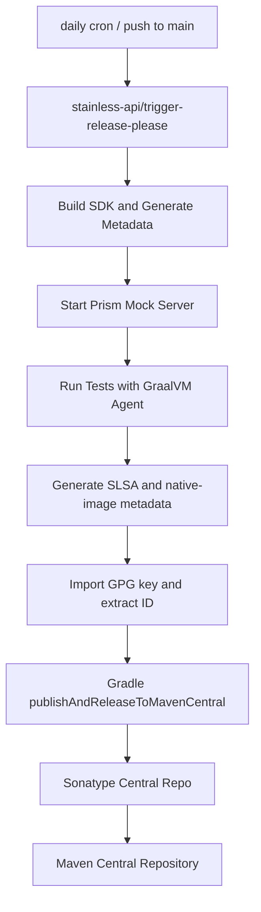
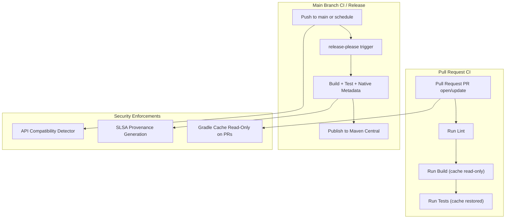

<!-- source: DeepWiki mcp.deepwiki.com · repo openai/openai-java · page 11.2 CI/CD and Release Process · fetched 2026-10-26 -->

# CI/CD and Release Process

<details>
<summary>Relevant source files</summary>

The following files were used as context for generating this wiki page:

- [.github/workflows/ci.yml](.github/workflows/ci.yml)
- [.github/workflows/codeql.yml](.github/workflows/codeql.yml)
- [.github/workflows/create-releases.yml](.github/workflows/create-releases.yml)
- [.github/workflows/examples.yml](.github/workflows/examples.yml)
- [.github/workflows/runtime-compatibility.yml](.github/workflows/runtime-compatibility.yml)
- [.github/workflows/x509-live-smoke.yml](.github/workflows/x509-live-smoke.yml)
- [SECURITY.md](SECURITY.md)
- [buildSrc/build.gradle.kts](buildSrc/build.gradle.kts)
- [buildSrc/src/main/kotlin/openai.publish.gradle.kts](buildSrc/src/main/kotlin/openai.publish.gradle.kts)
- [buildSrc/src/test/kotlin/com/openai/gradle/ApiCompatibilityCachePolicyTest.kt](buildSrc/src/test/kotlin/com/openai/gradle/ApiCompatibilityCachePolicyTest.kt)
- [buildSrc/src/test/kotlin/com/openai/gradle/ApiCompatibilityDetectorTest.kt](buildSrc/src/test/kotlin/com/openai/gradle/ApiCompatibilityDetectorTest.kt)
- [buildSrc/src/test/kotlin/com/openai/gradle/GradleCacheTrustPolicyTest.kt](buildSrc/src/test/kotlin/com/openai/gradle/GradleCacheTrustPolicyTest.kt)
- [buildSrc/src/test/kotlin/com/openai/gradle/MergeQueuePolicyTest.kt](buildSrc/src/test/kotlin/com/openai/gradle/MergeQueuePolicyTest.kt)
- [docs/architecture/security-model.md](docs/architecture/security-model.md)
- [openai-java-core/src/apiCompatibility/excluded-generated-tests.txt](openai-java-core/src/apiCompatibility/excluded-generated-tests.txt)
- [openai-java-core/src/apiCompatibility/kotlin/com/openai/models/beta/agents/vaults/credentials/CredentialAuthRotateCompatibility.kt](openai-java-core/src/apiCompatibility/kotlin/com/openai/models/beta/agents/vaults/credentials/CredentialAuthRotateCompatibility.kt)
- [scripts/collect-gradle-build-cache](scripts/collect-gradle-build-cache)
- [scripts/detect-breaking-changes](scripts/detect-breaking-changes)

</details>


This page documents the comprehensive Continuous Integration (CI), Continuous Delivery (CD), and release processes for the OpenAI Java SDK located at https://github.com/openai/openai-java. It explains the implementation details of GitHub Actions workflows, the Gradle build cache trust policy, API compatibility detection, SLSA provenance generation, and Maven Central publishing automated via release-please.

---

## Purpose and Scope

The CI/CD pipeline automates the building, testing, validation, and release of the OpenAI Java SDK artifacts. It ensures correctness, compatibility, and secure delivery of the SDK modules to users while enforcing policies preventing accidental or malicious compromises during build cache usage and release automation.

This page covers the following critical areas:

- GitHub Actions workflows for CI, release creation, publishing, and smoke tests
- Gradle build cache trust policies preventing writable caches from untrusted workflows
- API compatibility detection for preserving public SDK surface stability
- Generation and verification of SLSA provenance metadata for secure supply chain attestations
- Automated Maven Central publishing steps driven by release-please tags and versioning

---

## 1. GitHub Actions CI Workflow Overview

The core CI workflow is defined in `.github/workflows/ci.yml`. It is triggered on:

- Pushes and pull requests targeting `main` or `next` branches
- Merge group checks requested to batch PR validations
- Manual dispatches via workflow_dispatch

The workflow uses concurrency groups keyed by PR number or branch to avoid duplicated runs and to cancel stale in-progress jobs on PR updates.

### Main Job Breakdown

- **Lint**: Runs source code linters and formatting checks.
- **Build**: Performs compilation with Gradle, excluding some special compatibility tests, and uploads build cache artifacts including outputs and compiler state.
- **Jackson Compatibility**: Runs tests to verify compatibility with older versions of the Jackson JSON library, crucial for SDK compatibility given dependence on Jackson.
- **Test**: Restores the exact Gradle build cache from the build job, and runs all tests using the same compiled outputs to ensure reproducibility and stability.

### Build Caching Policy

The workflow enforces a strict build-cache trust policy:

- Pull-request triggered workflows **only allow read-only access** to the shared build cache.
- Write access to cache is **disabled** in untrusted contexts (PRs from external forks).
- The build job produces an explicit **immutable build cache artifact** uploaded to GitHub Actions artifacts storage.
- Downstream test and compatibility jobs download and verify the exact build cache artifact, ensuring deterministic builds.

This design prevents supply-chain issues where a malicious PR could mutate shared build cache state or inject artifacts.



**Sources:** [.github/workflows/ci.yml:1-198](), [buildSrc/src/test/kotlin/com/openai/gradle/GradleCacheTrustPolicyTest.kt:19-169](), [buildSrc/src/test/kotlin/com/openai/gradle/ApiCompatibilityCachePolicyTest.kt:1-73]()

---

## 2. Gradle Build-Cache Trust Policy

A key security measure in the SDK's CI pipeline is enforcing a strict trust policy for Gradle's shared build cache. To avoid attacks from pull requests that come from forks or untrusted sources mutating the cache or injecting artifacts, the policy enforces:

- **Cache read-only access on all pull-request triggered runs.**
- **No cache write access or overrides on pull-request workflows.**
- Only the main branch build jobs can write and upload immutable cache artifacts for reuse.

The policy is checked with Kotlin/JUnit tests in `GradleCacheTrustPolicyTest.kt` which analyze the YAML workflow content of `.github/workflows/ci.yml` for disallowed patterns such as:

- Cache write-only or write-enabled settings on PR runs
- Unprotected legacy cache initializers before Gradle setup
- Usage of unauthorized Gradle cache initializer Actions

This verification ensures that every PR build respects the security boundaries of the cache, and downstream jobs restore only known good cache artifacts verified by checksums.



**Sources:** [buildSrc/src/test/kotlin/com/openai/gradle/GradleCacheTrustPolicyTest.kt:19-169]()

---

## 3. API Compatibility Detection and Enforcement

The SDK maintains API backward compatibility via a specialized detection and verification system invoked during CI.

- The script `scripts/detect-breaking-changes` is used to compare the current source against a baseline commit.
- It restores baseline tests and policy files from the baseline revision, copies the proposed test files over, and runs API compatibility compilation tasks on both versions.
- Compatibility policies (like `structured-output-public-api.txt`) define the public API surface and exclusions.
- The detector verifies that new changes do not break the public API according to these policies.

In CI, this API compatibility check is performed inside `ci.yml` after build, ensuring that new commits do not introduce breaking API changes. The process compiles both the baseline and proposed versions without caching (to force rebuild consistency), validates exclusions, and performs bytecode comparison.



**Sources:** [scripts/detect-breaking-changes:1-191](), [buildSrc/src/test/kotlin/com/openai/gradle/ApiCompatibilityCachePolicyTest.kt:1-73]()

---

## 4. SLSA Provenance for Supply Chain Security

The SDK ensures supply chain security by generating SLSA (Supply chain Levels for Software Artifacts) provenance metadata during CI builds.

- During release builds, the system produces provenance data conforming to SLSA standards.
- This provenance attests to build inputs, dependencies, environment details, and steps taken, verifying the authenticity and integrity of released artifacts.
- This information can be audited by users or automated systems to confirm the software origin and detect tampering.

Although no direct code snippet for this generation was located in the provided content, the provenance artifact generation is embedded as part of the build and release pipeline managed by Gradle and GitHub Actions.

The provenance is included alongside published artifacts and linked in release notes for transparency.

---

## 5. Automated Release and Maven Central Publishing via release-please

The official release process is fully automated via the `.github/workflows/create-releases.yml` GitHub Actions workflow combined with the release-please GitHub App integration.

### Release Triggering

- Runs daily on a cron schedule (5am UTC) and on push events to the `main` branch.
- It uses `stainless-api/trigger-release-please@v1` action with a protected API key (`STAINLESS_API_KEY`) to signal release-please to create release PRs or tags as needed.
- Checks for open legacy release PRs to prevent conflicts.
- Once a release PR merges, it triggers builds and artifact publishing.

### Build Steps

- Sets up multiple Java versions (Temurin 8 and 21) for compatibility and GraalVM's native-image metadata generation.
- Compiles the core SDK modules without running tests initially.
- Starts a Prism mock server for replacing real network calls during tests.
- Runs tests with the GraalVM native-image agent enabled (`-PgraalvmAgent`), which automatically records reflection and serialization metadata required for native image compilation.
- Verifies the presence of generated native-image metadata files in `META-INF/native-image`.

### Maven Central Publishing

- Imports the GPG signing key securely into the build environment.
- Extracts the GPG signing key ID using gpg commands.
- Uses Gradle with the `com.vanniktech.maven.publish` plugin to sign and publish artifacts to Sonatype's Central Repository.
- The plugin handles staging, validation, signing, and releasing in a single Gradle task: `publishAndReleaseToMavenCentral`.
- Release-please ensures semantic version tags (`vX.Y.Z`) and changelogs are consistently maintained.



### release-please Configuration

The `release-please-config.json` controls configuration such as:

- Using prerelease versioning with tags like `v0.1.0-alpha.1`
- Version file updates include `README.md` and `build.gradle.kts`
- Changelog sections grouped by conventional commits (`feat`, `fix`, `chore`, etc.)
- Minor version bumping before 1.0.0, respecting semantic versioning conventions

### Gradle Publishing Details

The Gradle publishing logic is defined in the `buildSrc/src/main/kotlin/openai.publish.gradle.kts` script:

- Applies `com.vanniktech.maven.publish` plugin
- Configures signing to use in-memory GPG keys from environment variables
- Publishes signed JAR, source, and Dokka-generated Javadoc artifacts
- Publishes to official Maven Central via Sonatype staging servers
- POM metadata includes project name, description, license, developer, and SCM info

### Environment Variables and Secrets

The workflows require multiple secrets configured either at repository or organization level:

- `STAINLESS_API_KEY` for release-please API calls
- `OPENAI_SONATYPE_USERNAME` and `OPENAI_SONATYPE_PASSWORD` for Maven Central
- `OPENAI_SONATYPE_GPG_SIGNING_KEY` and `OPENAI_SONATYPE_GPG_SIGNING_PASSWORD` for GPG signing

The workflows support fallback secrets with the pattern:

```yaml
mavenCentralUsername: ${{ secrets.OPENAI_SONATYPE_USERNAME || secrets.SONATYPE_USERNAME }}
```

and similar for passwords and GPG keys.

---

## 6. Manual Publish Recovery Workflow

The `publish-sonatype.yml` workflow can be manually dispatched to retry artifact publishing in case of failures such as Sonatype downtime or network issues without re-triggering version bump or release-please operations.

It mimics the build and validation steps and re-runs the Gradle `publishAndReleaseToMavenCentral` task, leveraging the existing version and generated artifacts.

Manual invocation instructions are documented in the repository and documented in this pipeline for recovery.

---

## 7. Summary of CI/CD Flow and Trust Boundaries



This diagram summarizes the high-level interaction of CI triggers, build jobs, release automation, and critical security policies including cache trust, API compatibility, and supply chain provenance.

---

# Conclusion

The OpenAI Java SDK implements a robust, secure CI/CD and release process involving:

- GitHub Actions workflows with granular job dependencies and concurrency controls.
- Strict build cache trust enforcement preventing caching exploits from untrusted PRs.
- Automated detection of public API breaks with restored baseline fixtures ensuring semantic versioning conformance.
- Generation and publishing of SLSA provenance for artifact supply chain assurance.
- Fully automated releases via release-please with semantic version management and changelog maintenance.
- Secure GPG key handling and automatic staging/publishing of artifacts to Maven Central.

These automation pillars enable reliable, trustworthy, and auditable SDK releases supporting both internal development and user consumption.

---

**Sources:**

- `.github/workflows/ci.yml:1-198`  
- `.github/workflows/create-releases.yml:1-187`  
- `buildSrc/src/test/kotlin/com/openai/gradle/GradleCacheTrustPolicyTest.kt:19-169`  
- `buildSrc/src/test/kotlin/com/openai/gradle/ApiCompatibilityCachePolicyTest.kt:1-74`  
- `scripts/detect-breaking-changes:1-191`  
- `buildSrc/src/main/kotlin/openai.publish.gradle.kts:1-83`

---

