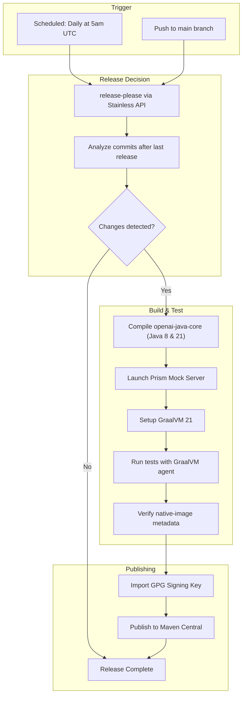
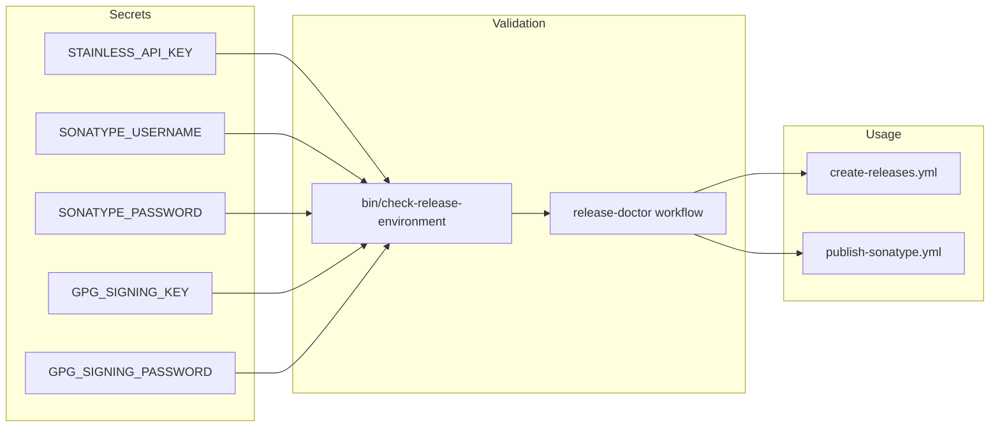
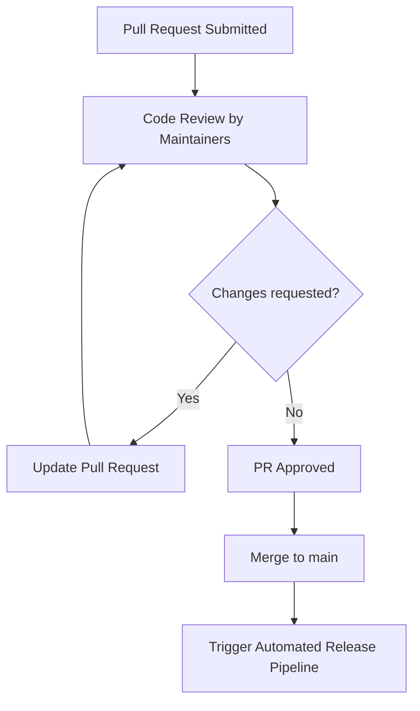
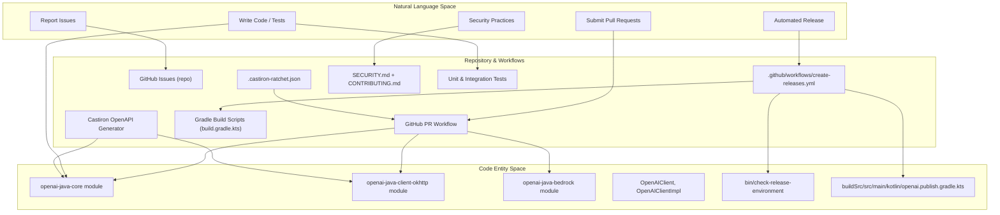

<!-- source: DeepWiki mcp.deepwiki.com · repo openai/openai-java · page 11.4 Contributing Guidelines · fetched 2026-10-26 -->

# Contributing Guidelines

<details>
<summary>Relevant source files</summary>

The following files were used as context for generating this wiki page:

- [.github/workflows/ci.yml](.github/workflows/ci.yml)
- [.github/workflows/codeql.yml](.github/workflows/codeql.yml)
- [.github/workflows/create-releases.yml](.github/workflows/create-releases.yml)
- [.github/workflows/examples.yml](.github/workflows/examples.yml)
- [.github/workflows/runtime-compatibility.yml](.github/workflows/runtime-compatibility.yml)
- [.github/workflows/x509-live-smoke.yml](.github/workflows/x509-live-smoke.yml)
- [.release-please-manifest.json](.release-please-manifest.json)
- [CHANGELOG.md](CHANGELOG.md)
- [CONTRIBUTING.md](CONTRIBUTING.md)
- [README.md](README.md)
- [SECURITY.md](SECURITY.md)
- [bedrock.md](bedrock.md)
- [build.gradle.kts](build.gradle.kts)
- [buildSrc/build.gradle.kts](buildSrc/build.gradle.kts)
- [buildSrc/src/main/kotlin/openai.publish.gradle.kts](buildSrc/src/main/kotlin/openai.publish.gradle.kts)
- [buildSrc/src/test/kotlin/com/openai/gradle/ApiCompatibilityCachePolicyTest.kt](buildSrc/src/test/kotlin/com/openai/gradle/ApiCompatibilityCachePolicyTest.kt)
- [buildSrc/src/test/kotlin/com/openai/gradle/GradleCacheTrustPolicyTest.kt](buildSrc/src/test/kotlin/com/openai/gradle/GradleCacheTrustPolicyTest.kt)
- [buildSrc/src/test/kotlin/com/openai/gradle/MergeQueuePolicyTest.kt](buildSrc/src/test/kotlin/com/openai/gradle/MergeQueuePolicyTest.kt)
- [docs/architecture/security-model.md](docs/architecture/security-model.md)
- [scripts/collect-gradle-build-cache](scripts/collect-gradle-build-cache)

</details>


This document provides comprehensive guidelines for contributing to the OpenAI Java SDK project. It covers issue reporting, pull request process, project conventions including AGENTS.md, automated release workflows, security expectations, and development environment requirements. The goal is to streamline collaboration, maintain code quality, and ensure secure practices in the contribution lifecycle.

## Purpose and Scope

These guidelines are intended for external contributors and maintainers who interact with the `openai/openai-java` repository. They clarify how to submit issues, what pull request policies are in place, how Releases are automated, and the security model used throughout the project. Complementary topics such as build and test procedures and code generation are detailed in related documentation.

---

## Repository Information

| **Aspect**                 | **Details**                                              |
|----------------------------|----------------------------------------------------------|
| Repository                 | `openai/openai-java`                                     |
| License                    | Apache-2.0                                               |
| Publishing Target          | Maven Central via Sonatype Central Portal                |
| Release Automation         | release-please action via Stainless API                   |
| Versioning Strategy        | Semantic Versioning with prerelease versions             |

The project consists of multiple modules including:
- `openai-java-core`: Core SDK logic without HTTP dependencies.
- `openai-java-client-okhttp`: OkHttp-based HTTP client implementation.
- `openai-java-bedrock`: Amazon Bedrock-specific client and authentication.
- `openai-java`: Main bundled artifact depending on core and OkHttp modules.

Sources: [buildSrc/src/main/kotlin/openai.publish.gradle.kts:1-60](), [release-please-config.json:1-65]()

---

## Issue Reporting

Contributors are encouraged to report bugs, request features, or ask questions via GitHub Issues. When opening an issue, please provide:

- A clear title and description.
- Reproduction steps if applicable.
- Expected behavior vs. actual behavior observed.
- SDK and Java runtime versions in use.
- Minimal, sanitized code snippets or test cases demonstrating the problem.

Please consult existing documentation and open issues to avoid duplicates.

Security vulnerabilities must **never** be reported in public issues; see the Security section below.

Sources: General GitHub practices (no direct file references).

---

## Pull Request Process

### Submission Guidelines

- Fork the `openai/openai-java` repository and create a feature branch from `main`.
- Implement your changes, adhering to the project coding style and conventions.
- Run tests locally, including unit and integration tests.
- Submit a Pull Request (PR) targeted to `main`.

### Important Policies

- **Pull requests are limited to repository collaborators only.** Non-collaborators cannot submit PRs directly. Instead, file an issue describing your contribution.
- Most SDK code is OpenAPI-generated. Do not manually edit generated code files unless coordinating with maintainers.
- Changes should focus on custom code, documentation, tests, or utility modules unless explicitly authorized for generated code.
- Address maintainers' review comments promptly and update your PR accordingly.

Sources: [CONTRIBUTING.md:1-96](), [buildSrc/src/main/kotlin/openai.publish.gradle.kts:49-53]()

---

## AGENTS.md Conventions

The project uses AGENTS.md to document conventions for contributors acting as "agents" (human or automated) in the development process. This document includes guidelines about authoring, reviewing, and merging code, as well as managing custom-code budgets and ratchets for generated content.

- Custom code budget defines allowed manual code modifications outside of generation output.
- Agents must respect custom-code ceilings declared in `.castiron-ratchet.json`.
- Agents may propose increases in custom-code budgets but cannot self-approve such changes, requiring human maintainer reviews.

This methodological framework ensures consistency in contributions while managing generated and manual code boundaries.

Sources: [CONTRIBUTING.md:27-42]()

---

## Security Model

Security is integral to the project’s contribution and release workflows:

- Never commit secrets such as API keys, tokens, passwords, or private keys into the repository.
- Use environment variables like `OPENAI_API_KEY` to supply secrets during development and CI/CD.
- Avoid logging sensitive credentials in error messages, logs, or test outputs unless explicitly sanitized.
- Review dependencies, GitHub Actions workflows, Gradle plugins, and all build/install scripts for security risks before adding or updating.
- Pin GitHub Actions to immutable specific commit SHAs to prevent supply-chain tampering.
- Private vulnerability disclosures must be handled via the documented mechanism in `SECURITY.md` and never in public issues or PRs.
- Critical code changes related to authentication, signing, HTTP transport, or IAM integrations require additional security-focused scrutiny and testing.

Sources: [CONTRIBUTING.md:44-63](), [docs/architecture/security-model.md]()

---

## Automated Release Workflow

Releases are fully automated via GitHub Actions using the `release-please` tool and the Stainless API. This process ensures reliable versioning, publishing, and changelog generation.

### Release Pipeline Overview



**Diagram: Automated Release Pipeline**

The workflow triggers on pushes to `main` or on a daily schedule, but only executes for the official repository to safeguard against unauthorized releases.

Sources: [.github/workflows/create-releases.yml:1-82]()

### Release-Please and Changelog Configuration

- The release-please tool detects version changes via conventional commit messages.
- The changelog organizes commits into sections such as Features, Bug Fixes, Chores, etc.
- Commit message types map to changelog sections as defined in `release-please-config.json`.
- Only relevant commit types appear in release notes; test and CI commits are hidden.

| Commit Type | Changelog Section        | Visibility |
|-------------|-------------------------|------------|
| feat        | Features                | Visible    |
| fix         | Bug Fixes               | Visible    |
| perf        | Performance Improvements| Visible    |
| revert      | Reverts                 | Visible    |
| chore       | Chores                  | Visible    |
| docs        | Documentation           | Visible    |
| style       | Styles                  | Visible    |
| refactor    | Refactors               | Visible    |
| test        | Tests                   | Hidden     |
| build       | Build System            | Visible    |
| ci          | Continuous Integration  | Hidden     |

Sources: [release-please-config.json:14-61]()

### Build and Test in Release Workflow

- Compiles core code with required JDK versions.
- Starts a Prism mock server to enable API integration tests.
- Runs tests with the GraalVM native image agent to produce metadata files for native compilation compatibility.
- Verifies that native image metadata is correctly generated.

This comprehensive testing ensures reliability and compatibility before publishing.

Sources: [.github/workflows/create-releases.yml:39-68]()

### Publishing to Maven Central

- Releases are signed with GPG keys imported dynamically from secure environment secrets.
- Publishing is handled by Gradle's Maven Publish plugin with fine-tuned POM metadata.
- All publications are signed to verify package authenticity during distribution.

Sources: [.github/workflows/create-releases.yml:70-81](), [buildSrc/src/main/kotlin/openai.publish.gradle.kts:1-60]()

---

## Required Secrets and Validation

Maintainers must configure these GitHub secrets in repository or organization settings:

| Secret Name              | Purpose                      |
|--------------------------|------------------------------|
| `STAINLESS_API_KEY`      | release-please API key        |
| `SONATYPE_USERNAME`      | Maven Central authentication |
| `SONATYPE_PASSWORD`      | Maven Central authentication |
| `GPG_SIGNING_KEY`        | Private key for signing       |
| `GPG_SIGNING_PASSWORD`   | Passphrase for GPG key        |

Organization-specific variants starting with `OPENAI_` prefix are supported and preferred for security hygiene.

The repository includes a `release-doctor` workflow and `bin/check-release-environment` script to validate secret presence before allowing releases.



Sources: [bin/check-release-environment:1-38](), [.github/workflows/release-doctor.yml:1-27](), [.github/workflows/create-releases.yml:78-81](), [.github/workflows/publish-sonatype.yml:65-68]()

---

## Manual Publishing Workflow

If the automated release fails or manual intervention is needed, maintainers can trigger the `publish-sonatype` GitHub Actions workflow manually from the Actions tab. This performs the same build, test, and publishing steps as the automated pipeline.

This practice allows re-publishing artifacts without merging new code.

Sources: [.github/workflows/publish-sonatype.yml:1-68]()

---

## Development Environment and Build Requirements

To contribute efficiently, set up a matching local development environment:

| Tool                 | Version         | Purpose                                |
|----------------------|-----------------|--------------------------------------|
| Java                 | 8 and 21        | Multi-version compilation and testing|
| Gradle Wrapper       | Latest          | Build automation                     |
| GraalVM Community    | 21              | Native image metadata generation      |
| Prism                | Latest          | Mock server for API integration tests |

Run tests with GraalVM agent locally to generate native image metadata:

```bash
./gradlew :openai-java-core:test -PgraalvmAgent
```

This metadata is necessary to support GraalVM native image compilation.

Sources: [.github/workflows/create-releases.yml:54-68]()

---

## Code Review and Merge Process



Pull requests require review and approval by maintainers before merging. After merging, the changes are incorporated into the next automated release, which runs daily or on subsequent main branch pushes.

Sources: [.github/workflows/create-releases.yml:2-7]()

---

## Best Practices for Contributors

### Commit Message Conventions

Use conventional commit formats for clear commit history and release changelogs:

- `feat:` Introduce new features.
- `fix:` Bug fixes.
- `perf:` Performance improvements.
- `docs:` Documentation updates.
- `refactor:` Code restructuring without behavior changes.
- `test:` Tests addition or modification.
- `chore:` Maintenance tasks.

These conventions support automated changelog generation and versioning.

Sources: [release-please-config.json:14-61]()

### Testing Checklist Before PR Submission

- [x] Compile with Java 8 and Java 21.
- [x] Run all unit and integration tests.
- [x] Execute tests with GraalVM native-image agent enabled.
- [x] Ensure no unintended modifications to generated code.
- [x] Validate formatting and lint passes (`./scripts/lint`).

Sources: [.github/workflows/create-releases.yml:39-68]()

### Awareness of Code Generation

The majority of the SDK code is generated from OpenAPI specs. To avoid merge conflicts and maintain consistency:

- Avoid manual edits to generated files.
- Coordinate with maintainers on changes requiring generator updates.
- Focus on adding utilities, tests, documentation, and examples.

Sources: [CONTRIBUTING.md:93-95]()

---

## Getting Help and Contact

- Use GitHub Issues for questions or clarifications.
- Review the SDK documentation at [platform.openai.com/docs](https://platform.openai.com/docs).
- Examine open issues and pull requests for answers.
- Contact OpenAI support via `support@openai.com` for direct assistance.

Sources: [buildSrc/src/main/kotlin/openai.publish.gradle.kts:44-46]()

---

# Summary Diagram: Natural Language to Code Entity Mapping

This diagram illustrates the flow from contributory actions in natural language space to their corresponding code and configuration artifacts in the repository.



Sources: [CONTRIBUTING.md](), [.github/workflows/create-releases.yml](), [buildSrc/src/main/kotlin/openai.publish.gradle.kts]()

---

These guidelines encompass the essential practices and processes for contributing effectively, securely, and efficiently to the OpenAI Java SDK project. Adherence ensures a stable, maintainable, and secure codebase for all users and collaborators.

---

