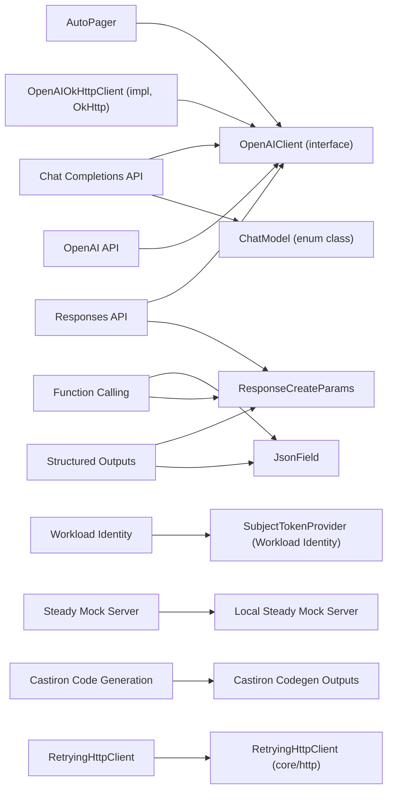
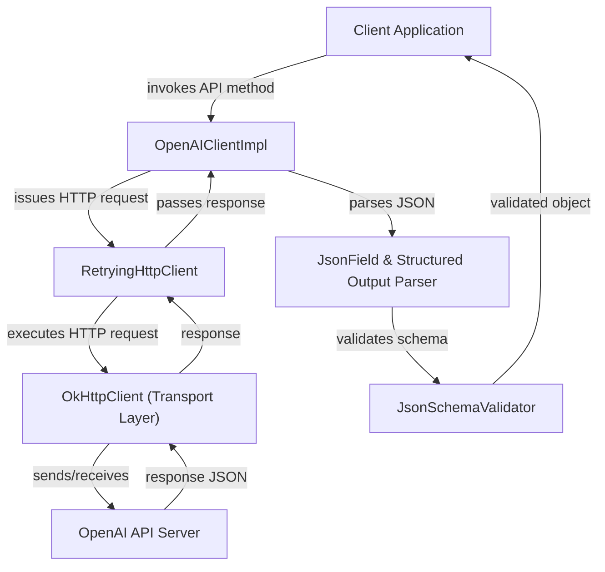

<!-- source: DeepWiki mcp.deepwiki.com · repo openai/openai-java · page 12 Glossary · fetched 2026-10-26 -->

# Glossary

Relevant source files

The following files were used as context for generating this wiki page:

- [.castiron.stats.yml](.castiron.stats.yml)
- [.release-please-manifest.json](.release-please-manifest.json)
- [CHANGELOG.md](CHANGELOG.md)
- [CONTRIBUTING.md](CONTRIBUTING.md)
- [LICENSE](LICENSE)
- [README.md](README.md)
- [api_reference/openapi.transformed.yml](api_reference/openapi.transformed.yml)
- [bedrock.md](bedrock.md)
- [build.gradle.kts](build.gradle.kts)
- [buildSrc/src/main/kotlin/openai.java.gradle.kts](buildSrc/src/main/kotlin/openai.java.gradle.kts)
- [buildSrc/src/main/kotlin/openai.kotlin.gradle.kts](buildSrc/src/main/kotlin/openai.kotlin.gradle.kts)
- [openai-java-core/src/main/kotlin/com/openai/core/Check.kt](openai-java-core/src/main/kotlin/com/openai/core/Check.kt)
- [openai-java-core/src/main/kotlin/com/openai/core/Values.kt](openai-java-core/src/main/kotlin/com/openai/core/Values.kt)
- [openai-java-core/src/main/kotlin/com/openai/core/http/HttpRequest.kt](openai-java-core/src/main/kotlin/com/openai/core/http/HttpRequest.kt)
- [openai-java-core/src/main/kotlin/com/openai/core/http/RetryingHttpClient.kt](openai-java-core/src/main/kotlin/com/openai/core/http/RetryingHttpClient.kt)
- [openai-java-core/src/main/kotlin/com/openai/errors/OpenAIRetryableException.kt](openai-java-core/src/main/kotlin/com/openai/errors/OpenAIRetryableException.kt)
- [openai-java-core/src/main/kotlin/com/openai/models/AllModels.kt](openai-java-core/src/main/kotlin/com/openai/models/AllModels.kt)
- [openai-java-core/src/main/kotlin/com/openai/models/ChatModel.kt](openai-java-core/src/main/kotlin/com/openai/models/ChatModel.kt)
- [openai-java-core/src/main/kotlin/com/openai/models/ResponsesModel.kt](openai-java-core/src/main/kotlin/com/openai/models/ResponsesModel.kt)
- [openai-java-core/src/main/kotlin/com/openai/models/beta/responses/BetaResponse.kt](openai-java-core/src/main/kotlin/com/openai/models/beta/responses/BetaResponse.kt)
- [openai-java-core/src/main/kotlin/com/openai/models/beta/responses/BetaResponsesClientEvent.kt](openai-java-core/src/main/kotlin/com/openai/models/beta/responses/BetaResponsesClientEvent.kt)
- [openai-java-core/src/main/kotlin/com/openai/models/beta/responses/ResponseCompactParams.kt](openai-java-core/src/main/kotlin/com/openai/models/beta/responses/ResponseCompactParams.kt)
- [openai-java-core/src/main/kotlin/com/openai/models/beta/responses/ResponseCreateParams.kt](openai-java-core/src/main/kotlin/com/openai/models/beta/responses/ResponseCreateParams.kt)
- [openai-java-core/src/main/kotlin/com/openai/models/responses/ResponseCompactParams.kt](openai-java-core/src/main/kotlin/com/openai/models/responses/ResponseCompactParams.kt)
- [openai-java-core/src/test/kotlin/com/openai/core/UtilsTest.kt](openai-java-core/src/test/kotlin/com/openai/core/UtilsTest.kt)
- [openai-java-core/src/test/kotlin/com/openai/core/ValuesTest.kt](openai-java-core/src/test/kotlin/com/openai/core/ValuesTest.kt)
- [openai-java-core/src/test/kotlin/com/openai/core/http/HttpRequestTest.kt](openai-java-core/src/test/kotlin/com/openai/core/http/HttpRequestTest.kt)
- [openai-java-core/src/test/kotlin/com/openai/core/http/MultipartContentTypeBoundaryTest.kt](openai-java-core/src/test/kotlin/com/openai/core/http/MultipartContentTypeBoundaryTest.kt)
- [openai-java-core/src/test/kotlin/com/openai/core/http/RetryDateOverflowTest.kt](openai-java-core/src/test/kotlin/com/openai/core/http/RetryDateOverflowTest.kt)
- [openai-java-core/src/test/kotlin/com/openai/core/http/RetryingHttpClientCloseTest.kt](openai-java-core/src/test/kotlin/com/openai/core/http/RetryingHttpClientCloseTest.kt)
- [openai-java-core/src/test/kotlin/com/openai/core/http/RetryingHttpClientTest.kt](openai-java-core/src/test/kotlin/com/openai/core/http/RetryingHttpClientTest.kt)
- [scripts/fast-format](scripts/fast-format)
- [scripts/mock](scripts/mock)
- [scripts/test](scripts/test)

This glossary defines key technical terms, domain jargon, abbreviations, and important concepts specific to the OpenAI Java SDK codebase. It provides detailed explanations of their implementation, data flow, and the main classes or functions involved, with code pointers for deeper inspection.

---

## Castiron

**Castiron** is the OpenAPI-based code generation system used to generate most of the SDK's API client code and model classes from the OpenAI API OpenAPI specification. The generation process transforms the OpenAPI YAML spec into strongly typed Kotlin classes for API requests, responses, and models, facilitating easier maintenance and consistency.

- Controls the generation budget via `.castiron-ratchet.json` to limit custom manual changes.
- Works from the transformed OpenAPI spec file (`api_reference/openapi.transformed.yml`) to produce generated files.
- Integrates tightly in CI with budget checks to maintain generation correctness and limit manual patch drift.

Castiron-generated code includes model enums, request/response classes, and client interfaces. For example, the `ChatModel` class is generated from Castiron and represents known model names as enums with raw string values.

Sources:  
- `.castiron.stats.yml` (generation metadata)  
- `api_reference/openapi.transformed.yml`  
- `CONTRIBUTING.md` (11.3 Code Generation (Castiron))  
- `openai-java-core/src/main/kotlin/com/openai/models/ChatModel.kt:1-200`()

---

## Steady

**Steady** is a local mock server used for API testing and development. It hosts a runtime mock version of the OpenAI API based on the OpenAPI spec, validating requests and providing fixed or configurable responses.

- Start the server using scripts like `./scripts/mock` which wraps running `steady`.
- Works with local or remote OpenAPI specs.
- Supports validation configuration for query and form parameters.
- Enables offline, deterministic SDK testing and integration validation.

This tool is crucial for local development, CI integration tests, and ensuring client correctness against OpenAI API specs.

Sources:  
- `scripts/mock:1-65`  
- `scripts/test:1-65`  
- `CONTRIBUTING.md:12-55`()

---

## JsonField and JsonMissing

**JsonField<T>** is a core wrapper class used throughout the SDK model classes to represent a JSON value that may be present or missing. It supports:

- Detecting if the field was omitted (`JsonMissing`) vs. explicitly set.
- Lazily deserializing field content.
- Ensures safer partial deserialization and robust handling of evolving API changes.
  
`JsonMissing` is a singleton representing a missing field, distinguished from `null`. This system improves the reliability of polymorphic and optional data fields across many API model classes.

Sources:  
- `openai-java-core/src/main/kotlin/com/openai/core/JsonField.kt` (implied usage in models)  
- `openai-java-core/src/main/kotlin/com/openai/models/ChatModel.kt:10-19`()

---

## Validity Scoring and Union Types

**Validity scoring** is a technique used in union types (sealed class hierarchies) representing polymorphic API responses where multiple JSON schema variants are possible. To determine how well a particular parsed union variant matches the JSON input, a validity score is calculated based on matched fields and constraints.

- The SDK uses this to select the best deserialized Java class instance from multiple union candidates.
- Enhances type-safe handling of polymorphic JSON APIs such as `ResponseInputItem` or `ResponseOutputItem`.
- Underpins structured outputs and function calling parameter parsing.

Sources:  
- `openai-java-core/src/main/kotlin/com/openai/models/ResponsesModel.kt` (union type handling)  
- `openai-java-core/src/main/kotlin/com/openai/core/JsonField.kt` (parsing logic) ()

---

## Structured Outputs

**Structured Outputs** refer to typed, validated data representations that are automatically derived from Java/Kotlin class JSON schemas for API responses requesting or returning structured data.

- The SDK generates JSON schemas from annotated classes.
- Local validation occurs with `JsonSchemaValidator` before sending or after receiving data, reducing runtime errors.
- Enables type-safe function calling by strongly typed argument and response objects.
- Response format helper configures output format (e.g. JSON vs plain text).

This system adds significant safety and expressiveness to interacting with advanced capabilities like function calls.

Sources:  
- `openai-java-core/src/main/kotlin/com/openai/core/JsonSchemaValidator.kt` (reference)  
- `6.1. JSON Schema Generation` page (not shown, referenced concept)  
- `6.2. Function Calling` page (not shown, referenced concept) ()

---

## PhantomReachable

**PhantomReachable** is a utility or framework concept for managing resources that must be cleaned up after use, specifically auto-closing streams or data structures that implement finalization tracking.

- Used internally for resource management when streaming or multipart uploads may abandon underlying streams.
- Helps avoid resource leaks in the asynchronous or synchronous HTTP client layers.
- Ensures that ByteStreams or InputStreams related to multipart forms are properly closed upon failures or cancellations.

Sources:  
- Implied from `openai-java-core/src/main/kotlin/com/openai/core/http/RetryingHttpClient.kt:33-180` (resource management in retries)  
- `9.4 Resource Management` page (not shown, referenced concept) ()

---

## AutoPager

**AutoPager** is an abstraction over paginated API endpoints to enable convenient iteration over multi-page list results in synchronous or asynchronous modes.

- Provides `Page` and `PageAsync` types with iteration helpers.
- Automatically fetches subsequent pages as needed.
- Supports streaming results with backpressure control.
- Simplifies client code to iterate over large lists from endpoints like model listing or files.

AutoPager delegates to list endpoint response models and provides out-of-the-box iteration patterns.

Sources:  
- `3.4. Pagination` page (not shown, referenced concept)  
- Typical usage in `openai-java-core/src/main/kotlin/com/openai/client/OpenAIClient.kt` (client layering)

---

## Core Compilation Shards

**Core compilation shards** are build partitions applied in the Gradle build system to split the SDK core codebase compilation into smaller independent shards for faster incremental builds and parallel testing.

- Declared in the Gradle scripts such as `build.gradle.kts`.
- Separates modules and source sets for isolated compilation and verification.
- Helps scaling development and CI workflows.

This ensures efficient build times despite the complex modular structure of the SDK.

Sources:  
- `build.gradle.kts:1-175` (CoreCompilationShards usage)  
- `CONTRIBUTING.md:22-90` (build overview)

---

## Workload Identity

**Workload Identity** interfaces with cloud provider identity tokens for authentication, enabling token exchange and mutual TLS authentication with X.509 certificates.

- Supports Kubernetes, Azure managed identity, and GCP ID tokens.
- Implements `SubjectTokenProvider` interfaces.
- Used to fetch tokens for API authentication transparently in cloud environments.
- Allows secure mTLS transport with certificate credentials.

This authentication mechanism enhances security by integrating with cloud workloads' native identity systems.

Sources:  
- `2.3.1 Workload Identity and X.509` page (not shown, referenced concept)  
- `CONTRIBUTING.md:22-70` (environment, configuration)  
- README usage examples (lines 62-71 showing environment config) ()

---

## Service Tiers

**Service Tiers** represent service-level groupings or API product tiers related to organization, project, or admin API keys and usage.

- Managed via the Admin API.
- Used for billing, usage quotas, and feature availability distinctions.
- SDK supports administration interfaces for these concepts.

They form a structural layer governing resource access and permissions across different organizational entities.

Sources:  
- `7.10. Admin, Safety and Agents (Beta)` page (not shown, referenced concept)  
- Various Admin API model classes generated by Castiron.

---

## Compaction

**Compaction** is an operation for conversation management that reduces state size by removing redundant or obsolete conversation items.

- Applied on conversation histories to optimize storage and speed.
- Supported in API calls as parameters for compacting conversation data.
- Useful during conversation management to keep payloads minimal.

This reduces overhead when working with extensive conversational contexts.

Sources:  
- `5.5. Conversation Management` page (not shown, referenced concept)  
- Model classes for `ResponseCompactParams` related to compaction

---

## Steering

**Steering** refers to mechanisms controlling and guiding the behavior of language model responses and conversations.

- Supported by injection or manipulation of context or state.
- SDK includes steering parameters and events in the Responses API.
- Utilized in the persistent WebSocket transport for real-time control.

Steering enables customization and control of AI responses beyond standard prompts.

Sources:  
- `5.6. Beta Responses and WebSocket Transport` page (not shown)  
- `openai-java-core/src/main/kotlin/com/openai/models/beta/responses/BetaResponsesClientEvent.kt` (event handling)

---

## MCP (Model Control Protocol)

**MCP** is a specialized tool or system type representing model control commands or actions invoked via the tool system API.

- Represented as part of the polymorphic Tool union type.
- Allows integration of custom model functions or system commands.
- Supports streaming and buffering of tool arguments.

MCP ensures extensible function calling and tooling beyond standard APIs.

Sources:  
- `5.4. Tool System` page (not shown, referenced concept)  
- `BetaTool` and `Tool` union model classes in generated code

---

## Ratchet (Custom-Code Budget Ratchet)

The **Ratchet** is a custom-code budget enforcement mechanism tracked via `.castiron-ratchet.json`.

- Limits the number of lines that can be added or removed outside generated code.
- Ensures minimal manual post-generation code patches.
- Part of CI validation to maintain codebase maintainability and consistency.

Ratchet is crucial for managing complexity in a generated-heavy codebase.

Sources:  
- `CONTRIBUTING.md:27-42`  
- `.castiron.stats.yml` (related metadata)  
- `11.3 Code Generation (Castiron)` page (not shown) ()

---

## SLSA Provenance

**SLSA (Supply-chain Levels for Software Artifacts) provenance** documents and certifies the build and release provenance of the SDK artifacts.

- Generated during CI/CD workflows.
- Enforces supply-chain security best practices.
- Provides traceable metadata for artifact integrity.

This provenance is part of the SDK's secured build and release infrastructure.

Sources:  
- `11.2 CI/CD and Release Process` page (not shown, referenced concept)  
- Gradle build scripts and GitHub Actions workflows (implied) ()

---

## Mermaid Diagrams

### Diagram 1: Mapping Key System Components ("Natural Language Space" to "Code Entity Space")

### Diagram 2: Data Flow in API Call with Retry and Structured Output

---

# Term Summary Table

| Term                   | Description                                                                                     | Key File / Location Reference                          |
|------------------------|-------------------------------------------------------------------------------------------------|-------------------------------------------------------|
| Castiron               | OpenAPI spec-based code generation system producing SDK classes and API interfaces             | `.castiron.stats.yml`, `api_reference/openapi.transformed.yml`, `ChatModel.kt` |
| Steady                 | Local mock server for API testing and validation                                                | `scripts/mock`, `scripts/test`                         |
| JsonField / JsonMissing | JSON field wrapper for optionality and missing value handling                                  | `ChatModel.kt:10-19`                                   |
| Validity Scoring       | Selection mechanism for union type deserialization based on schema compliance scores            | `ResponsesModel.kt`, `JsonField.kt`                    |
| Structured Outputs     | Type-safe, validated structured output handling via generated JSON schema and validators         | `JsonSchemaValidator.kt`, 6.1/6.2 (doc pages)          |
| PhantomReachable       | Auto resource/stream cleanup utility to prevent leaks                                           | `RetryingHttpClient.kt` (resource handling)           |
| AutoPager              | Pagination abstraction for automatic page iteration                                            | 3.4 Pagination (doc page), client source               |
| Core Compilation Shards| Build system partitioning of the SDK for faster incremental compilation                         | `build.gradle.kts`                                     |
| Workload Identity      | Cloud identity token-based authentication with token exchange and X.509 transport              | 2.3.1 Workload Identity (doc), environment config      |
| Service Tiers          | Organizational/billing tier management in Admin API                                            | 7.10 Admin (doc pages)                                 |
| Compaction             | Conversation management operation to reduce conversation state size                            | `ResponseCompactParams` and conversation API           |
| Steering               | Real-time control/injection of model response behavior                                         | `BetaResponsesClientEvent.kt`                           |
| MCP                    | Model Control Protocol, custom tooling and function calling infrastructure                      | Tool union types in response API                        |
| Ratchet                | Custom-code budget enforcement mechanism for castiron-generated code                           | `.castiron-ratchet.json`, CONTRIBUTING.md              |
| SLSA Provenance        | Build and release supply-chain provenance documentation                                        | CI/CD workflows, release scripts                        |

---

This glossary will grow as the system evolves and new terms emerge in the SDK development and usage.

# End of Glossary

---

Sources:  
- `README.md:1-172`()  
- `CONTRIBUTING.md:1-128`()  
- `build.gradle.kts:1-175`()  
- `scripts/mock:1-65`()  
- `scripts/test:1-65`()  
- `openai-java-core/src/main/kotlin/com/openai/models/ChatModel.kt:1-200`()  
- `openai-java-core/src/main/kotlin/com/openai/core/http/RetryingHttpClient.kt:1-181`()  
- `bedrock.md:1-183`()