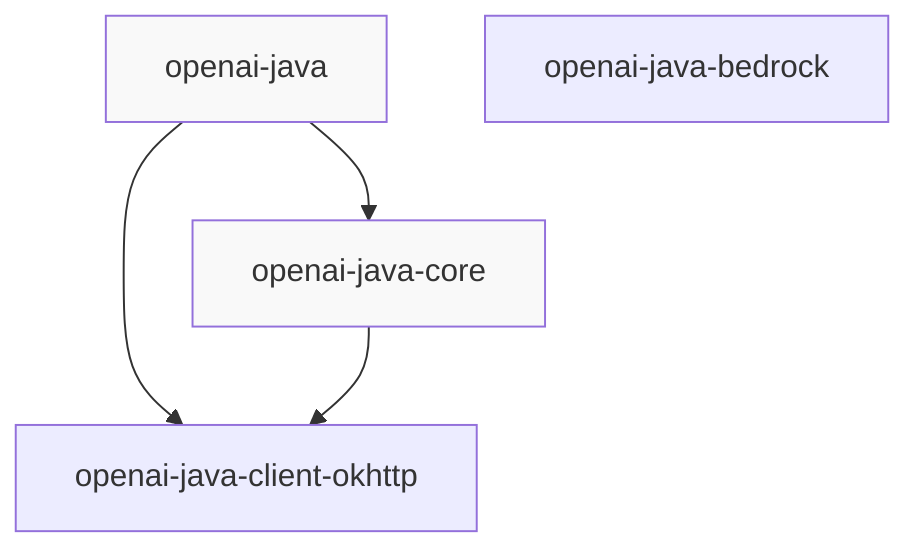
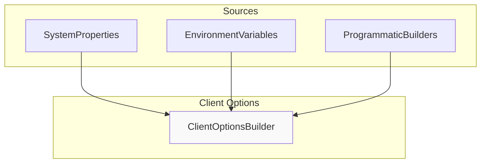
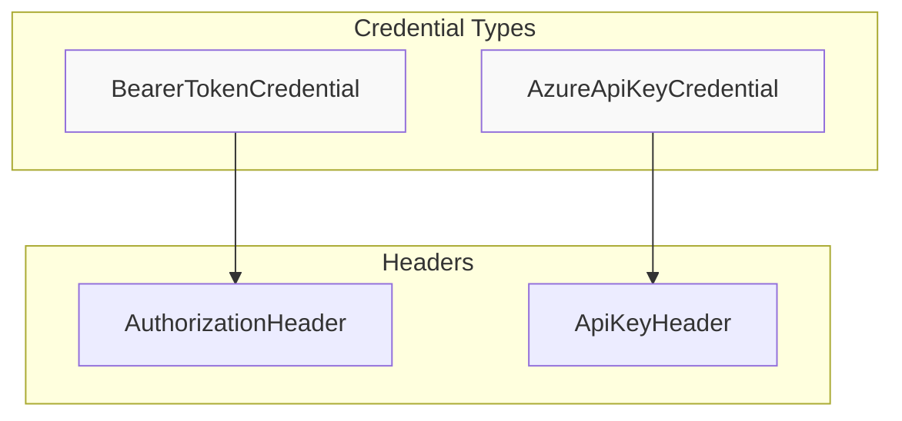

<!-- source: DeepWiki mcp.deepwiki.com · repo openai/openai-java · page 2 Getting Started · fetched 2026-10-26 -->

# Getting Started

<details>
<summary>Relevant source files</summary>

The following files were used as context for generating this wiki page:

- [.release-please-manifest.json](.release-please-manifest.json)
- [CHANGELOG.md](CHANGELOG.md)
- [CONTRIBUTING.md](CONTRIBUTING.md)
- [README.md](README.md)
- [bedrock.md](bedrock.md)
- [build.gradle.kts](build.gradle.kts)

</details>


This page serves as a high-level guide for initializing, configuring, and executing your first requests with the OpenAI Java SDK. It outlines project setup, client configuration, and credential management.

For deep technical details, refer to the child pages:
- For dependency management, artifact coordinates, and runtime floors, see [Installation](#2.1).
- For advanced builder patterns, timeouts, and data residency, see [Configuration](#2.2).
- For credentials, bearer tokens, Azure keys, and workload identities, see [Authentication](#2.3).

Sources: [README.md:1-55](), [CONTRIBUTING.md:20-30]()

## Installation

The OpenAI Java SDK artifacts are distributed via Maven Central and require Java 8 or later for framework-neutral components [README.md:33-36](). The SDK consists of core logic (`openai-java-core`), the OkHttp transport layer (`openai-java-client-okhttp`), a unified facade (`openai-java`), and optional extensions like Amazon Bedrock (`openai-java-bedrock`) [README.md:11-30](), [CONTRIBUTING.md:67-81]().

For detailed dependency configurations, artifact versions, and runtime support policies, see [Installation](#2.1).

**Module Hierarchy**


Sources: [README.md:11-30](), [CONTRIBUTING.md:67-81]()

## Configuration

Client initialization relies on the `ClientOptions` builder pattern, resolving settings from system properties, environment variables, or explicit programmatic parameters [README.md:123-160](). The SDK evaluates system properties first, followed by environment variables (`OPENAI_API_KEY`, `OPENAI_ORG_ID`, `OPENAI_PROJECT_ID`, `OPENAI_BASE_URL`), and finally programmatic setters.

For comprehensive details on base URLs, data residency, timeouts, and environment precedence, see [Configuration](#2.2).

**Configuration Resolution Flow**


Sources: [README.md:123-169](), [openai-java-client-okhttp/src/main/kotlin/com/openai/client/okhttp/OpenAIOkHttpClient.kt:1-50]()

## Authentication

Authentication is handled through the `Credential` abstraction. The SDK supports standard bearer tokens (`BearerTokenCredential`), Azure API keys (`AzureApiKeyCredential`), and administrative keys [README.md:164-169](), [openai-java-core/src/main/kotlin/com/openai/credential/BearerTokenCredential.kt:1-36](). 

For advanced workload identity providers (Kubernetes, Azure Managed Identity, GCP ID tokens), X.509 mTLS transport, and Amazon Bedrock integration, see [Authentication](#2.3).

**Credential Resolution**


Sources: [README.md:164-169](), [openai-java-core/src/main/kotlin/com/openai/credential/BearerTokenCredential.kt:1-36]()

## Your First API Call

Once the client is configured using `OpenAIOkHttpClient.fromEnv()`, you can execute requests against the recommended [Responses API](https://platform.openai.com/docs/api-reference/responses) or the [Chat Completions API](https://platform.openai.com/docs/api-reference/chat) [README.md:50-92]().

```java
import com.openai.client.OpenAIClient;
import com.openai.client.okhttp.OpenAIOkHttpClient;
import com.openai.models.ChatModel;
import com.openai.models.responses.Response;
import com.openai.models.responses.ResponseCreateParams;

// Initialize client from environment variables
OpenAIClient client = OpenAIOkHttpClient.fromEnv();

// Build and execute a request
ResponseCreateParams params = ResponseCreateParams.builder()
        .input("Say this is a test")
        .model(ChatModel.GPT_5_2)
        .build();
Response response = client.responses().create(params);
```

Sources: [README.md:50-92]()

---

