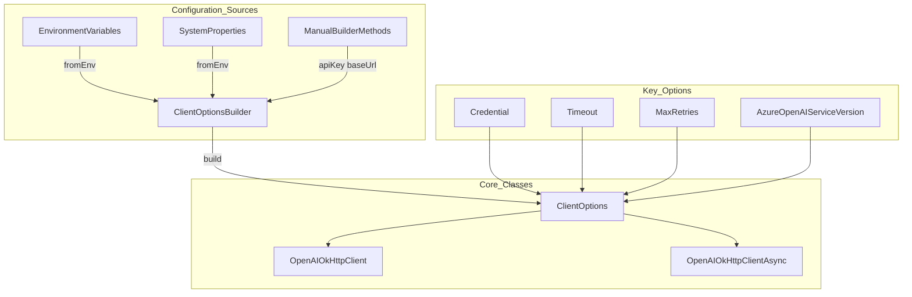
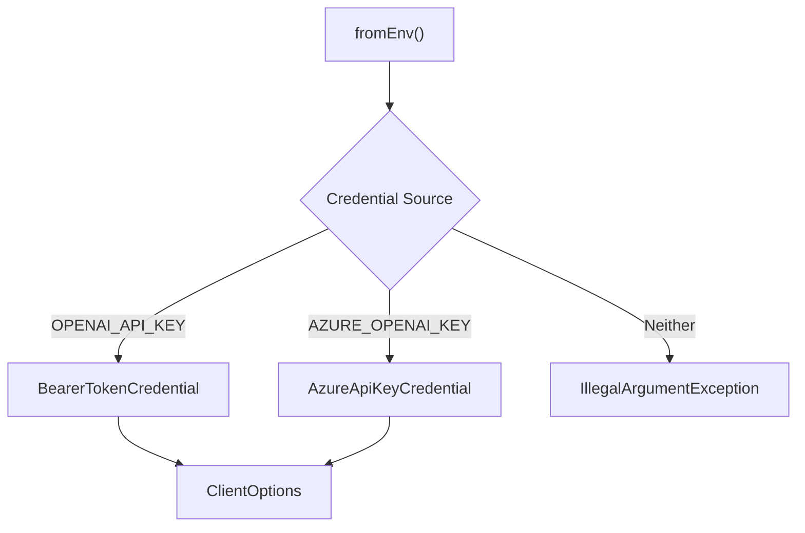
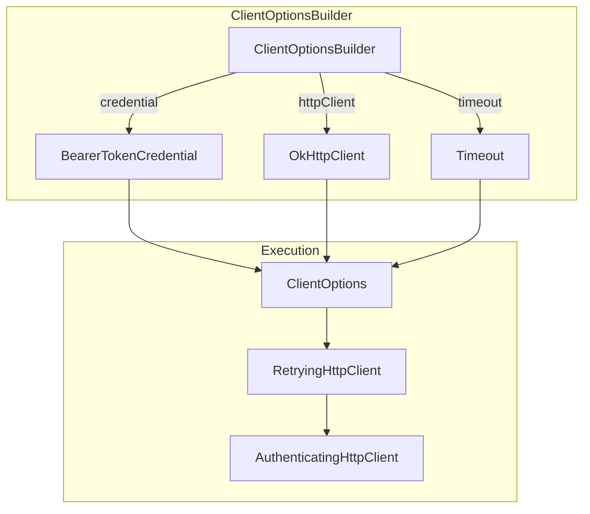

<!-- source: DeepWiki mcp.deepwiki.com · repo openai/openai-java · page 2.2 Configuration · fetched 2026-10-26 -->

# Configuration

<details>
<summary>Relevant source files</summary>

The following files were used as context for generating this wiki page:

- [openai-java-client-okhttp/src/main/kotlin/com/openai/client/okhttp/OkHttpClient.kt](openai-java-client-okhttp/src/main/kotlin/com/openai/client/okhttp/OkHttpClient.kt)
- [openai-java-client-okhttp/src/main/kotlin/com/openai/client/okhttp/OpenAIOkHttpClient.kt](openai-java-client-okhttp/src/main/kotlin/com/openai/client/okhttp/OpenAIOkHttpClient.kt)
- [openai-java-client-okhttp/src/main/kotlin/com/openai/client/okhttp/OpenAIOkHttpClientAsync.kt](openai-java-client-okhttp/src/main/kotlin/com/openai/client/okhttp/OpenAIOkHttpClientAsync.kt)
- [openai-java-client-okhttp/src/test/kotlin/com/openai/client/okhttp/ProxyAuthenticationBoundaryTest.kt](openai-java-client-okhttp/src/test/kotlin/com/openai/client/okhttp/ProxyAuthenticationBoundaryTest.kt)
- [openai-java-client-okhttp/src/test/kotlin/com/openai/client/okhttp/RedirectCredentialBoundaryTest.kt](openai-java-client-okhttp/src/test/kotlin/com/openai/client/okhttp/RedirectCredentialBoundaryTest.kt)
- [openai-java-core/src/main/kotlin/com/openai/azure/AzureOpenAIServiceVersion.kt](openai-java-core/src/main/kotlin/com/openai/azure/AzureOpenAIServiceVersion.kt)
- [openai-java-core/src/main/kotlin/com/openai/azure/credential/AzureApiKeyCredential.kt](openai-java-core/src/main/kotlin/com/openai/azure/credential/AzureApiKeyCredential.kt)
- [openai-java-core/src/main/kotlin/com/openai/core/ClientOptions.kt](openai-java-core/src/main/kotlin/com/openai/core/ClientOptions.kt)
- [openai-java-core/src/main/kotlin/com/openai/core/Properties.kt](openai-java-core/src/main/kotlin/com/openai/core/Properties.kt)
- [openai-java-core/src/main/kotlin/com/openai/credential/BearerTokenCredential.kt](openai-java-core/src/main/kotlin/com/openai/credential/BearerTokenCredential.kt)
- [openai-java-core/src/main/kotlin/com/openai/credential/Credential.kt](openai-java-core/src/main/kotlin/com/openai/credential/Credential.kt)
- [openai-java-core/src/test/kotlin/com/openai/core/http/ClientOptionsTest.kt](openai-java-core/src/test/kotlin/com/openai/core/http/ClientOptionsTest.kt)

</details>


This document covers how to configure the OpenAI Java SDK client, including setting up credentials, base URLs, data residency, timeouts, retry behavior, and other client options. Configuration is handled through the builder pattern using `ClientOptions` and client builders.

For authentication details (API keys, Azure credentials), see [Authentication](#2.3). For installation and basic setup, see [Installation](#2.1).

## Configuration Overview

The SDK uses a builder pattern centered around `ClientOptions` defined in `openai-java-core/src/main/kotlin/com/openai/core/ClientOptions.kt` [openai-java-core/src/main/kotlin/com/openai/core/ClientOptions.kt:36-146](). Clients can be configured manually via builder methods or automatically using environment variables and system properties via `OpenAIOkHttpClient.fromEnv()` [openai-java-client-okhttp/src/main/kotlin/com/openai/client/okhttp/OpenAIOkHttpClient.kt:48]().


Sources: [openai-java-core/src/main/kotlin/com/openai/core/ClientOptions.kt:36-146](), [openai-java-client-okhttp/src/main/kotlin/com/openai/client/okhttp/OpenAIOkHttpClient.kt:38-49]()

## Basic Configuration Patterns

The SDK supports three main configuration approaches:

### Environment-Based Configuration
```java
// Automatically configures using environment variables and system properties
OpenAIClient client = OpenAIOkHttpClient.fromEnv();
```
Sources: [openai-java-client-okhttp/src/main/kotlin/com/openai/client/okhttp/OpenAIOkHttpClient.kt:48]()

### Manual Configuration
```java
OpenAIClient client = OpenAIOkHttpClient.builder()
    .apiKey("My API Key")
    .baseUrl("https://api.openai.com/v1")
    .maxRetries(3)
    .build();
```
Sources: [openai-java-client-okhttp/src/main/kotlin/com/openai/client/okhttp/OpenAIOkHttpClient.kt:41]()

### Mixed Configuration
```java
OpenAIClient client = OpenAIOkHttpClient.builder()
    .fromEnv()  // Load defaults from environment
    .apiKey("Override API Key")  // Override specific values
    .maxRetries(5)
    .build();
```
Sources: [openai-java-client-okhttp/src/main/kotlin/com/openai/client/okhttp/OpenAIOkHttpClient.kt:41-48]()

## Environment Variables and System Properties

The `fromEnv()` method configures `ClientOptions` by checking specific system properties and falling back to environment variables (system properties take precedence) [openai-java-core/src/main/kotlin/com/openai/core/ClientOptions.kt]().

| Configuration | System Property | Environment Variable | Required | Default |
|---------------|-----------------|---------------------|----------|---------|
| API Key | `openai.apiKey` | `OPENAI_API_KEY` | true* | - |
| Base URL | `openai.baseUrl` | `OPENAI_BASE_URL` | false | `https://api.openai.com/v1` |
| Organization | `openai.orgId` | `OPENAI_ORG_ID` | false | - |
| Project | `openai.projectId` | `OPENAI_PROJECT_ID` | false | - |
| Webhook Secret | `openai.webhookSecret` | `OPENAI_WEBHOOK_SECRET` | false | - |

*Required unless using Azure credentials via `AZURE_OPENAI_KEY`.


Sources: [openai-java-core/src/main/kotlin/com/openai/core/ClientOptions.kt:1-173](), [openai-java-core/src/test/kotlin/com/openai/core/http/ClientOptionsTest.kt:50-63]()

## Key Configuration Options

### Network Configuration

#### Base URL Configuration
The base URL defaults to the production endpoint `https://api.openai.com/v1` [openai-java-core/src/main/kotlin/com/openai/core/ClientOptions.kt:168-170](), but can be pointed to custom gateways or Azure deployments.
```java
.baseUrl("https://api.openai.com/v1")
.baseUrl("https://example.openai.azure.com")
```
Sources: [openai-java-core/src/main/kotlin/com/openai/core/ClientOptions.kt:166-170](), [openai-java-core/src/test/kotlin/com/openai/core/http/ClientOptionsTest.kt:26-32]()

#### Timeout Configuration
Timeouts control request lifecycles (connect, read, write, call) via `Timeout` [openai-java-core/src/main/kotlin/com/openai/core/ClientOptions.kt:107-112]().
```java
.timeout(Duration.ofMinutes(2))
```
Sources: [openai-java-core/src/main/kotlin/com/openai/core/ClientOptions.kt:107-112]()

#### Retry Configuration
`maxRetries` defaults to `2` and specifies the maximum number of times to retry failed requests on connection errors, 408, 409, 429, or 5xx status codes [openai-java-core/src/main/kotlin/com/openai/core/ClientOptions.kt:113-128]().
```java
.maxRetries(3)
```
Sources: [openai-java-core/src/main/kotlin/com/openai/core/ClientOptions.kt:113-128]()

### HTTP Client Configuration

#### Proxy and SSL Settings
Underlying OkHttp transport properties can be configured via `OpenAIOkHttpClient.Builder` [openai-java-client-okhttp/src/main/kotlin/com/openai/client/okhttp/OpenAIOkHttpClient.kt:52-168]().
```java
.proxy(new Proxy(Proxy.Type.HTTP, new InetSocketAddress("proxy.example.com", 8080)))
.sslSocketFactory(customSSLFactory, customTrustManager)
```
Sources: [openai-java-client-okhttp/src/main/kotlin/com/openai/client/okhttp/OpenAIOkHttpClient.kt:52-168]()

#### Headers and Query Parameters
```java
.putHeader("User-Agent", "CustomAgent/1.0")
.putQueryParam("beta", "true")
```
Sources: [openai-java-core/src/main/kotlin/com/openai/core/ClientOptions.kt:91-96]()

## Azure Configuration

Azure OpenAI integrations require specifying Azure service versions (`AzureOpenAIServiceVersion`) and URL path modes (`AzureUrlPathMode`) [openai-java-core/src/main/kotlin/com/openai/core/ClientOptions.kt:139-142]().

```java
.azureServiceVersion(AzureOpenAIServiceVersion.V2024_10_21)
.azureUrlPathMode(AzureUrlPathMode.LEGACY)
```
Valid URL path modes include `LEGACY`, `UNIFIED`, and `AUTO` [openai-java-core/src/test/kotlin/com/openai/core/http/ClientOptionsTest.kt:73-105]().

Sources: [openai-java-core/src/main/kotlin/com/openai/azure/AzureOpenAIServiceVersion.kt:5-46](), [openai-java-core/src/test/kotlin/com/openai/core/http/ClientOptionsTest.kt:73-105]()

## Temporary Configuration Changes

Clients support generating derived instances with overridden settings while sharing underlying connection pools using `withOptions()`:
```java
OpenAIClient modifiedClient = client.withOptions(optionsBuilder -> {
    optionsBuilder.maxRetries(5);
});
```
Sources: [openai-java-core/src/main/kotlin/com/openai/core/ClientOptions.kt:36-146]()

## ClientOptions Builder Architecture

The construction pipeline coordinates raw credentials, interceptors, and network settings into immutable `ClientOptions`.


Sources: [openai-java-core/src/main/kotlin/com/openai/core/ClientOptions.kt:36-173](), [openai-java-client-okhttp/src/main/kotlin/com/openai/client/okhttp/OpenAIOkHttpClient.kt:41-49]()

---

