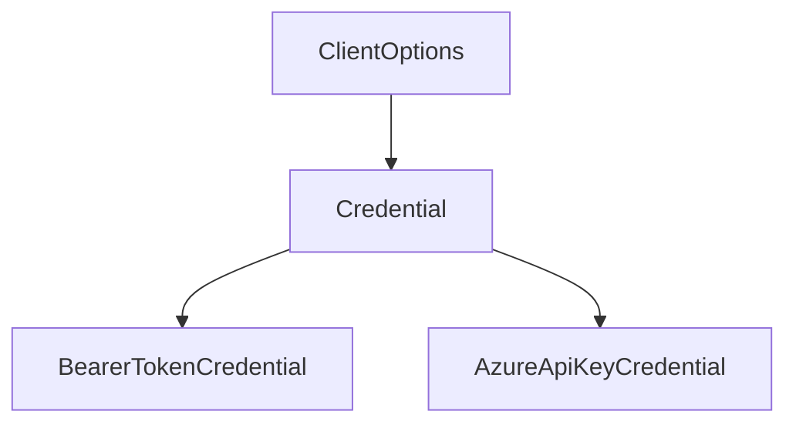
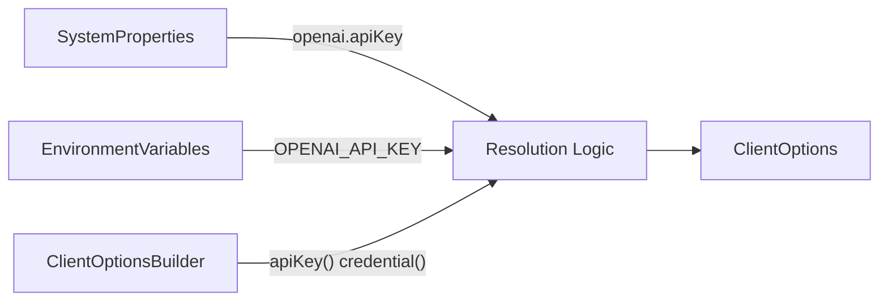

<!-- source: DeepWiki mcp.deepwiki.com · repo openai/openai-java · page 2.3 Authentication · fetched 2026-10-26 -->

# Authentication

<details>
<summary>Relevant source files</summary>

The following files were used as context for generating this wiki page:

- [openai-java-client-okhttp/src/main/kotlin/com/openai/client/okhttp/OkHttpClient.kt](openai-java-client-okhttp/src/main/kotlin/com/openai/client/okhttp/OkHttpClient.kt)
- [openai-java-client-okhttp/src/main/kotlin/com/openai/client/okhttp/OpenAIOkHttpClient.kt](openai-java-client-okhttp/src/main/kotlin/com/openai/client/okhttp/OpenAIOkHttpClient.kt)
- [openai-java-client-okhttp/src/main/kotlin/com/openai/client/okhttp/OpenAIOkHttpClientAsync.kt](openai-java-client-okhttp/src/main/kotlin/com/openai/client/okhttp/OpenAIOkHttpClientAsync.kt)
- [openai-java-client-okhttp/src/test/kotlin/com/openai/client/okhttp/ProxyAuthenticationBoundaryTest.kt](openai-java-client-okhttp/src/test/kotlin/com/openai/client/okhttp/ProxyAuthenticationBoundaryTest.kt)
- [openai-java-client-okhttp/src/test/kotlin/com/openai/client/okhttp/RedirectCredentialBoundaryTest.kt](openai-java-client-okhttp/src/test/kotlin/com/openai/client/okhttp/RedirectCredentialBoundaryTest.kt)
- [openai-java-core/src/main/kotlin/com/openai/auth/AzureManagedIdentityTokenProvider.kt](openai-java-core/src/main/kotlin/com/openai/auth/AzureManagedIdentityTokenProvider.kt)
- [openai-java-core/src/main/kotlin/com/openai/auth/GcpIdTokenProvider.kt](openai-java-core/src/main/kotlin/com/openai/auth/GcpIdTokenProvider.kt)
- [openai-java-core/src/main/kotlin/com/openai/auth/K8sServiceAccountTokenProvider.kt](openai-java-core/src/main/kotlin/com/openai/auth/K8sServiceAccountTokenProvider.kt)
- [openai-java-core/src/main/kotlin/com/openai/auth/SubjectTokenProvider.kt](openai-java-core/src/main/kotlin/com/openai/auth/SubjectTokenProvider.kt)
- [openai-java-core/src/main/kotlin/com/openai/auth/TokenExchangeResponse.kt](openai-java-core/src/main/kotlin/com/openai/auth/TokenExchangeResponse.kt)
- [openai-java-core/src/main/kotlin/com/openai/auth/WorkloadIdentity.kt](openai-java-core/src/main/kotlin/com/openai/auth/WorkloadIdentity.kt)
- [openai-java-core/src/main/kotlin/com/openai/auth/WorkloadIdentityAuth.kt](openai-java-core/src/main/kotlin/com/openai/auth/WorkloadIdentityAuth.kt)
- [openai-java-core/src/main/kotlin/com/openai/azure/AzureOpenAIServiceVersion.kt](openai-java-core/src/main/kotlin/com/openai/azure/AzureOpenAIServiceVersion.kt)
- [openai-java-core/src/main/kotlin/com/openai/azure/credential/AzureApiKeyCredential.kt](openai-java-core/src/main/kotlin/com/openai/azure/credential/AzureApiKeyCredential.kt)
- [openai-java-core/src/main/kotlin/com/openai/core/ClientOptions.kt](openai-java-core/src/main/kotlin/com/openai/core/ClientOptions.kt)
- [openai-java-core/src/main/kotlin/com/openai/credential/BearerTokenCredential.kt](openai-java-core/src/main/kotlin/com/openai/credential/BearerTokenCredential.kt)
- [openai-java-core/src/main/kotlin/com/openai/credential/Credential.kt](openai-java-core/src/main/kotlin/com/openai/credential/Credential.kt)
- [openai-java-core/src/test/kotlin/com/openai/auth/WorkloadIdentityAuthTest.kt](openai-java-core/src/test/kotlin/com/openai/auth/WorkloadIdentityAuthTest.kt)
- [openai-java-core/src/test/kotlin/com/openai/core/ClientOptionsTest.kt](openai-java-core/src/test/kotlin/com/openai/core/ClientOptionsTest.kt)
- [openai-java-core/src/test/kotlin/com/openai/core/http/ClientOptionsTest.kt](openai-java-core/src/test/kotlin/com/openai/core/http/ClientOptionsTest.kt)

</details>


This page documents the authentication mechanisms supported by the OpenAI Java SDK. It covers the `Credential` interface, core credential implementations (`BearerTokenCredential` for OpenAI API, `AzureApiKeyCredential` for Azure OpenAI), admin API keys, and configuration methods.

For advanced workload identity providers (Kubernetes, Azure managed identity, GCP ID token), token exchange, and X.509 mTLS transport, see [Workload Identity and X.509](#2.3.1). For general client configuration beyond authentication, see [Configuration](#2.2). For Azure-specific configuration including service versions and URL path modes, see [Alternative Endpoints and Providers](#8).

---

## Authentication System Overview

The SDK uses a `Credential` interface to abstract authentication across different OpenAI deployment types and security schemes. This design allows client code to work with standard OpenAI APIs, administrative routes, and Azure OpenAI services using unified configuration patterns in `ClientOptions`.

### Credential Interface Architecture



**Sources:** [openai-java-core/src/main/kotlin/com/openai/credential/Credential.kt:1-4](), [openai-java-core/src/main/kotlin/com/openai/core/ClientOptions.kt:136-146]()

### Supported Credential Types & Schemes

| Credential / Key Type | Use Case | Authentication Scheme | Header Applied |
|-----------------------|----------|----------------------|----------------|
| `BearerTokenCredential` | Standard OpenAI API | Bearer Token | `Authorization: Bearer {token}` |
| `AzureApiKeyCredential` | Azure OpenAI Service | API Key | `api-key: {apiKey}` |
| `adminApiKey` | Administrative / Org APIs | Bearer Token (Admin) | `Authorization: Bearer {adminApiKey}` |
| Workload Identity | Automated Cloud Deployments | Token Exchange / JWT | `Authorization: Bearer {exchangedToken}` |

**Sources:** [openai-java-core/src/main/kotlin/com/openai/core/ClientOptions.kt:137-139](), [openai-java-core/src/test/kotlin/com/openai/core/ClientOptionsTest.kt:29-111]()

---

## BearerTokenCredential (OpenAI API)

`BearerTokenCredential` authenticates requests against the standard OpenAI API. It implements the bearer token scheme where the secret key is transmitted via the `Authorization` header.

### Creating a BearerTokenCredential

You can instantiate a `BearerTokenCredential` directly or utilize convenience methods on `ClientOptions`:

```java
// Direct token string
Credential credential = BearerTokenCredential.create("sk-...");

// Via ClientOptions.apiKey() builder method
ClientOptions options = ClientOptions.builder()
    .httpClient(httpClient)
    .apiKey("sk-...")
    .build();

// Using a dynamic token supplier for rotation
Supplier<String> tokenSupplier = () -> retrieveTokenFromVault();
Credential credential = BearerTokenCredential.create(tokenSupplier);
```

**Sources:** [openai-java-core/src/main/kotlin/com/openai/credential/BearerTokenCredential.kt:1-36](), [openai-java-core/src/main/kotlin/com/openai/core/ClientOptions.kt:172-172]()

---

## Admin API Keys

For administrative services (such as organization management, user invites, audit logs, and project configurations), the SDK supports route-specific admin API keys via `adminApiKey` in `ClientOptions`.

### Configuration

You can configure an admin API key alongside or independently of standard API keys:

```java
ClientOptions options = ClientOptions.builder()
    .httpClient(httpClient)
    .apiKey("sk-standard-key")
    .adminApiKey("sk-admin-key")
    .build();
```

When admin-scoped requests are executed, the client applies the admin API key to the `Authorization` header instead of the standard bearer token.

**Sources:** [openai-java-core/src/main/kotlin/com/openai/core/ClientOptions.kt:138](), [openai-java-core/src/test/kotlin/com/openai/core/ClientOptionsTest.kt:76-111]()

---

## AzureApiKeyCredential (Azure OpenAI)

`AzureApiKeyCredential` is designed for authenticating with Azure OpenAI Service deployments. Azure endpoints expect the API key in a custom `api-key` header rather than the standard `Authorization` header.

### Creating and Updating an AzureApiKeyCredential

```java
Credential credential = AzureApiKeyCredential.create("your-azure-api-key");

ClientOptions options = ClientOptions.builder()
    .httpClient(httpClient)
    .credential(credential)
    .baseUrl("https://your-resource.openai.azure.com")
    .build();

// Updating the key at runtime
((AzureApiKeyCredential) credential).update("new-azure-api-key");
```

Upon creation or update, `AzureApiKeyCredential` validates that the key is non-empty, throwing an `IllegalArgumentException` if blank.

**Sources:** [openai-java-core/src/main/kotlin/com/openai/azure/credential/AzureApiKeyCredential.kt:1-26](), [openai-java-core/src/test/kotlin/com/openai/core/http/ClientOptionsTest.kt:66-70]()

---

## Workload Identity and Advanced Authentication

For environments running in Kubernetes, Azure, or GCP where static API keys should be avoided, the SDK supports `WorkloadIdentityCredential` backed by `WorkloadIdentityAuth` and various `SubjectTokenProvider` implementations. 

For full details on token exchange flows, cloud-specific providers (Kubernetes service accounts, Azure managed identities, GCP ID tokens), and X.509 mTLS transport configurations, see [Workload Identity and X.509](#2.3.1).

**Sources:** [openai-java-core/src/main/kotlin/com/openai/auth/WorkloadIdentityAuth.kt:30-70](), [openai-java-core/src/main/kotlin/com/openai/credential/WorkloadIdentityCredential.kt:1-9]()

---

## Configuration Methods and Precedence

The SDK resolves credentials using a strict precedence order across programmatic builders, environment variables, and system properties.

### Precedence Flow & Resolution



### Configuration Vectors

1. **Programmatic Builders**: Explicitly invoke `.apiKey(String)`, `.adminApiKey(String)`, or `.credential(Credential)` on `ClientOptions.builder()` or client-specific builders like `OpenAIOkHttpClient.builder()`.
2. **Environment Variables**: Use `fromEnv()` to automatically parse `OPENAI_API_KEY`, `AZURE_OPENAI_KEY`, `OPENAI_ORG_ID`, and `OPENAI_PROJECT_ID`.
3. **System Properties**: Set JVM arguments such as `-Dopenai.apiKey=sk-...` which take precedence over environment variables.

**Sources:** [openai-java-core/src/main/kotlin/com/openai/core/ClientOptions.kt:457-488](), [openai-java-client-okhttp/src/main/kotlin/com/openai/client/okhttp/OpenAIOkHttpClient.kt:43-48]()

---

## Additional Authentication Headers

The SDK also injects organizational and project scoping headers when configured:

* **Organization Header (`OpenAI-Organization`)**: Configured via `.organization("org-...")` or `OPENAI_ORG_ID` / `openai.orgId`.
* **Project Header (`OpenAI-Project`)**: Configured via `.project("proj_...")` or `OPENAI_PROJECT_ID` / `openai.projectId`.

**Sources:** [openai-java-core/src/main/kotlin/com/openai/core/ClientOptions.kt:142-143](), [openai-java-core/src/main/kotlin/com/openai/core/ClientOptions.kt:535-536]()

---

