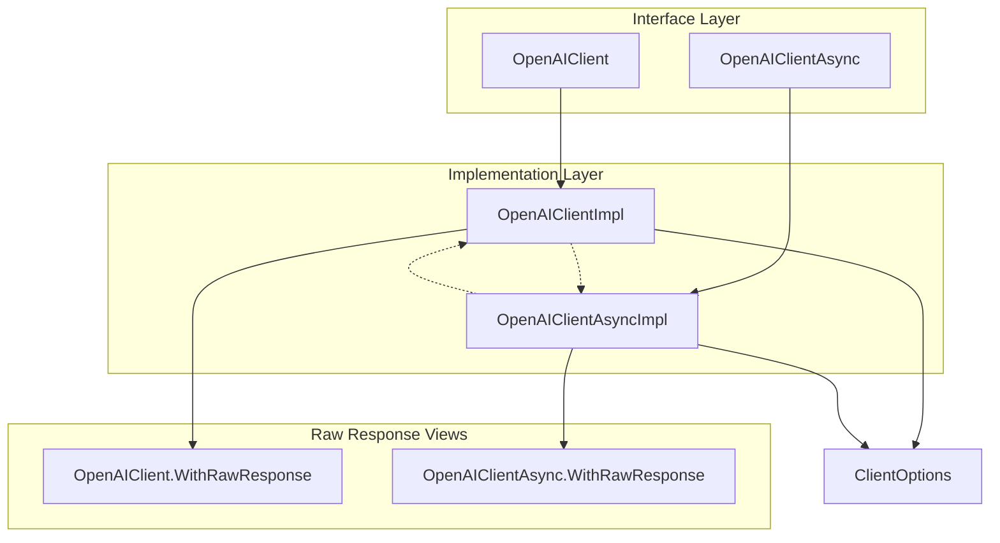
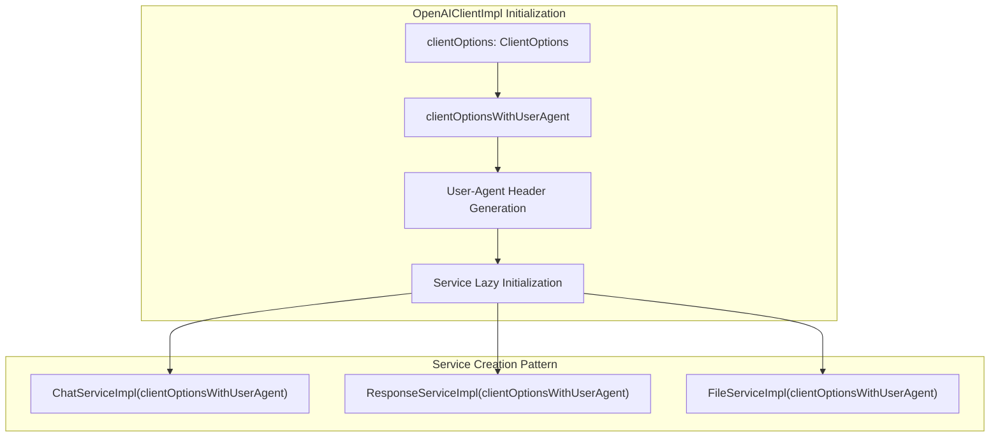
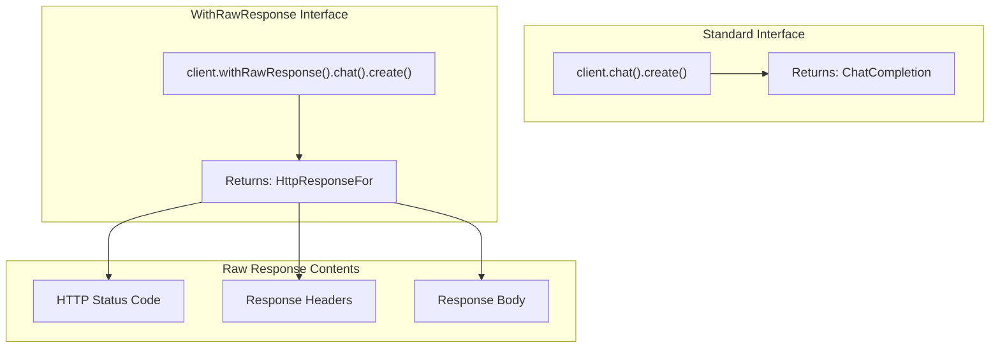

<!-- source: DeepWiki mcp.deepwiki.com · repo openai/openai-java · page 3 Client Interfaces · fetched 2026-10-26 -->

# Client Interfaces

Relevant source files

The following files were used as context for generating this wiki page:

- [openai-java-core/src/main/kotlin/com/openai/client/OpenAIClient.kt](openai-java-core/src/main/kotlin/com/openai/client/OpenAIClient.kt)
- [openai-java-core/src/main/kotlin/com/openai/client/OpenAIClientAsync.kt](openai-java-core/src/main/kotlin/com/openai/client/OpenAIClientAsync.kt)
- [openai-java-core/src/main/kotlin/com/openai/client/OpenAIClientAsyncImpl.kt](openai-java-core/src/main/kotlin/com/openai/client/OpenAIClientAsyncImpl.kt)
- [openai-java-core/src/main/kotlin/com/openai/client/OpenAIClientImpl.kt](openai-java-core/src/main/kotlin/com/openai/client/OpenAIClientImpl.kt)
- [openai-java-core/src/main/kotlin/com/openai/services/async/ModerationServiceAsync.kt](openai-java-core/src/main/kotlin/com/openai/services/async/ModerationServiceAsync.kt)
- [openai-java-core/src/main/kotlin/com/openai/services/blocking/ModerationService.kt](openai-java-core/src/main/kotlin/com/openai/services/blocking/ModerationService.kt)

This document covers the main client interfaces provided by the OpenAI Java SDK and their usage patterns. It explains the relationship between synchronous and asynchronous execution modes, raw response access, and service organization.

For detailed information about configuring clients, see [Configuration](#2.2). For authentication setup, see [Authentication](#2.3). For specific usage examples of synchronous and asynchronous APIs, see [Synchronous API](#3.1) and [Asynchronous API](#3.2).

## Overview

The OpenAI Java SDK provides two primary client interfaces: `OpenAIClient` for synchronous operations and `OpenAIClientAsync` for asynchronous operations. Both clients share the same underlying resources and provide access to identical OpenAI API services, differing only in their execution model.

## Client Interface Architecture

The following diagram shows the relationship between the main client interfaces and their implementations:

**Sources:** [openai-java-core/src/main/kotlin/com/openai/client/OpenAIClient.kt](), [openai-java-core/src/main/kotlin/com/openai/client/OpenAIClientAsync.kt](), [openai-java-core/src/main/kotlin/com/openai/client/OpenAIClientImpl.kt](), [openai-java-core/src/main/kotlin/com/openai/client/OpenAIClientAsyncImpl.kt]()

## Client Interface Methods

Both client interfaces expose identical service methods, differing only in their return types. The synchronous client returns results directly, while the asynchronous client returns `CompletableFuture` objects.

```mermaid
graph LR
    subgraph "OpenAIClient Interface"
        A1["chat(): ChatService"]
        A2["completions(): CompletionService"]
        A3["responses(): ResponseService"]
        A4["files(): FileService"]
        A5["images(): ImageService"]
        A6["audio(): AudioService"]
        A7["embeddings(): EmbeddingService"]
        A8["models(): ModelService"]
        A9["fineTuning(): FineTuningService"]
        A10["moderations(): ModerationService"]
        A11["batches(): BatchService"]
        A12["vectorStores(): VectorStoreService"]
    end
    
    subgraph "OpenAIClientAsync Interface"
        B1["chat(): ChatServiceAsync"]
        B2["completions(): CompletionServiceAsync"]
        B3["responses(): ResponseServiceAsync"]
        B4["files(): FileServiceAsync"]
        B5["images(): ImageServiceAsync"]
        B6["audio(): AudioServiceAsync"]
        B7["embeddings(): EmbeddingServiceAsync"]
        B8["models(): ModelServiceAsync"]
        B9["fineTuning(): FineTuningServiceAsync"]
        B10["moderations(): ModerationServiceAsync"]
        B11["batches(): BatchServiceAsync"]
        B12["vectorStores(): VectorStoreServiceAsync"]
    end
```

**Sources:** [openai-java-core/src/main/kotlin/com/openai/client/OpenAIClient.kt:74-134](), [openai-java-core/src/main/kotlin/com/openai/client/OpenAIClientAsync.kt:74-134]()

## Core Client Interface Features

| Feature | `OpenAIClient` | `OpenAIClientAsync` |
|---------|----------------|-------------------|
| Execution Mode | Synchronous/Blocking | Asynchronous/Non-blocking |
| Return Types | Direct objects | `CompletableFuture<T>` |
| Resource Sharing | Shares with async() | Shares with sync() |
| Raw Response Access | `withRawResponse()` | `withRawResponse()` |
| Option Modification | `withOptions()` | `withOptions()` |
| Resource Management | `close()` | `close()` |

**Sources:** [openai-java-core/src/main/kotlin/com/openai/client/OpenAIClient.kt:34-47](), [openai-java-core/src/main/kotlin/com/openai/client/OpenAIClientAsync.kt:34-47]()

## Client Implementation Details

The client implementations use lazy initialization for services and maintain User-Agent headers automatically:

The implementations automatically add User-Agent headers in the format `${javaClass.simpleName}/Java ${getPackageVersion()}` if not already present [openai-java-core/src/main/kotlin/com/openai/client/OpenAIClientImpl.kt:61-69](), [openai-java-core/src/main/kotlin/com/openai/client/OpenAIClientAsyncImpl.kt:61-69]().

**Sources:** [openai-java-core/src/main/kotlin/com/openai/client/OpenAIClientImpl.kt:61-148](), [openai-java-core/src/main/kotlin/com/openai/client/OpenAIClientAsyncImpl.kt:61-166]()

## Cross-Client Conversion

Both client types provide methods to convert between synchronous and asynchronous execution modes while sharing the same underlying resources:

| Client Type | Conversion Method | Shared Resources |
|-------------|------------------|------------------|
| `OpenAIClient` | `async()` | Connection pools, thread pools |
| `OpenAIClientAsync` | `sync()` | Connection pools, thread pools |

The conversion preserves the original `ClientOptions` configuration and ensures resource efficiency.

**Sources:** [openai-java-core/src/main/kotlin/com/openai/client/OpenAIClient.kt:50-57](), [openai-java-core/src/main/kotlin/com/openai/client/OpenAIClientAsync.kt:50-57](), [openai-java-core/src/main/kotlin/com/openai/client/OpenAIClientImpl.kt:61-73](), [openai-java-core/src/main/kotlin/com/openai/client/OpenAIClientAsyncImpl.kt:61-73]()

## WithRawResponse Interface Pattern

Both client types provide `WithRawResponse` views that expose the same service methods but return raw HTTP responses wrapped in `HttpResponseFor<T>` objects:

For detailed usage, see [Raw Response Access](#3.3).

**Sources:** [openai-java-core/src/main/kotlin/com/openai/client/OpenAIClient.kt:58-62](), [openai-java-core/src/main/kotlin/com/openai/client/OpenAIClientAsync.kt:58-62](), [openai-java-core/src/main/kotlin/com/openai/client/OpenAIClientImpl.kt:74-76](), [openai-java-core/src/main/kotlin/com/openai/client/OpenAIClientAsyncImpl.kt:74-76]()

## Resource Management

Both client interfaces implement resource management through the `close()` method. The method is intentionally not inherited from `AutoCloseable` because clients are designed to be long-lived:

- Automatic resource cleanup occurs when threads and connections remain idle [openai-java-core/src/main/kotlin/com/openai/client/OpenAIClient.kt:44-52]()
- Manual cleanup is available via `close()` for applications requiring aggressive resource management [openai-java-core/src/main/kotlin/com/openai/client/OpenAIClient.kt:143-153]()
- Shared resources between sync/async clients are managed collectively [openai-java-core/src/main/kotlin/com/openai/client/OpenAIClient.kt:50-57]()

**Sources:** [openai-java-core/src/main/kotlin/com/openai/client/OpenAIClient.kt:143-154](), [openai-java-core/src/main/kotlin/com/openai/client/OpenAIClientAsync.kt:143-154](), [openai-java-core/src/main/kotlin/com/openai/client/OpenAIClientImpl.kt:61-73](), [openai-java-core/src/main/kotlin/com/openai/client/OpenAIClientAsyncImpl.kt:61-73]()

---

## Child Pages
- [Synchronous API](#3.1)
- [Asynchronous API](#3.2)
- [Raw Response Access](#3.3)
- [Pagination](#3.4)

---

