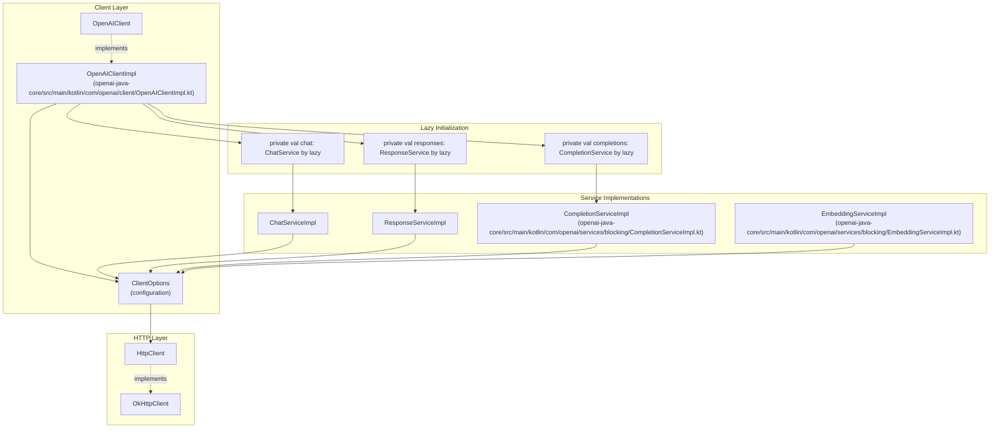
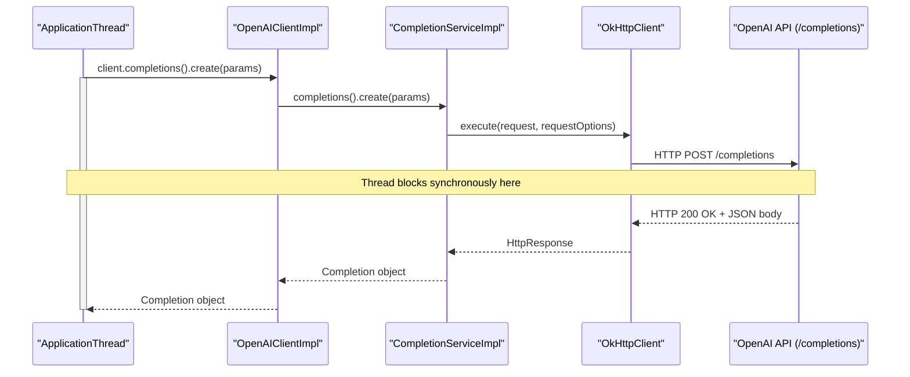

<!-- source: DeepWiki mcp.deepwiki.com · repo openai/openai-java · page 3.1 Synchronous API · fetched 2026-10-26 -->

# Synchronous API

<details>
<summary>Relevant source files</summary>

The following files were used as context for generating this wiki page:

- [openai-java-core/src/main/kotlin/com/openai/client/OpenAIClient.kt](openai-java-core/src/main/kotlin/com/openai/client/OpenAIClient.kt)
- [openai-java-core/src/main/kotlin/com/openai/client/OpenAIClientAsync.kt](openai-java-core/src/main/kotlin/com/openai/client/OpenAIClientAsync.kt)
- [openai-java-core/src/main/kotlin/com/openai/client/OpenAIClientAsyncImpl.kt](openai-java-core/src/main/kotlin/com/openai/client/OpenAIClientAsyncImpl.kt)
- [openai-java-core/src/main/kotlin/com/openai/client/OpenAIClientImpl.kt](openai-java-core/src/main/kotlin/com/openai/client/OpenAIClientImpl.kt)
- [openai-java-core/src/main/kotlin/com/openai/services/async/CompletionServiceAsyncImpl.kt](openai-java-core/src/main/kotlin/com/openai/services/async/CompletionServiceAsyncImpl.kt)
- [openai-java-core/src/main/kotlin/com/openai/services/async/EmbeddingServiceAsyncImpl.kt](openai-java-core/src/main/kotlin/com/openai/services/async/EmbeddingServiceAsyncImpl.kt)
- [openai-java-core/src/main/kotlin/com/openai/services/async/ImageServiceAsyncImpl.kt](openai-java-core/src/main/kotlin/com/openai/services/async/ImageServiceAsyncImpl.kt)
- [openai-java-core/src/main/kotlin/com/openai/services/async/ModerationServiceAsync.kt](openai-java-core/src/main/kotlin/com/openai/services/async/ModerationServiceAsync.kt)
- [openai-java-core/src/main/kotlin/com/openai/services/async/ModerationServiceAsyncImpl.kt](openai-java-core/src/main/kotlin/com/openai/services/async/ModerationServiceAsyncImpl.kt)
- [openai-java-core/src/main/kotlin/com/openai/services/blocking/CompletionServiceImpl.kt](openai-java-core/src/main/kotlin/com/openai/services/blocking/CompletionServiceImpl.kt)
- [openai-java-core/src/main/kotlin/com/openai/services/blocking/EmbeddingServiceImpl.kt](openai-java-core/src/main/kotlin/com/openai/services/blocking/EmbeddingServiceImpl.kt)
- [openai-java-core/src/main/kotlin/com/openai/services/blocking/ImageServiceImpl.kt](openai-java-core/src/main/kotlin/com/openai/services/blocking/ImageServiceImpl.kt)
- [openai-java-core/src/main/kotlin/com/openai/services/blocking/ModerationService.kt](openai-java-core/src/main/kotlin/com/openai/services/blocking/ModerationService.kt)
- [openai-java-core/src/main/kotlin/com/openai/services/blocking/ModerationServiceImpl.kt](openai-java-core/src/main/kotlin/com/openai/services/blocking/ModerationServiceImpl.kt)

</details>


## Purpose and Scope

This page documents the `OpenAIClient` interface and its synchronous execution model within the OpenAI Java SDK. It details blocking operations, service accessors, client implementation details via `OpenAIClientImpl`, and guidelines for when to choose synchronous execution over asynchronous alternatives.

---

## The OpenAIClient Interface

The `OpenAIClient` interface is the primary entry point for synchronous API interactions. It provides blocking, thread-safe access to all OpenAI REST API endpoints and manages underlying HTTP connection pools and thread pools.

```mermaid
graph TB
    subgraph "Client Creation"
        Factory["OpenAIOkHttpClient.fromEnv()"]
        Builder["OpenAIOkHttpClient.builder()"]
    end
    
    subgraph "OpenAIClient Interface"
        Client["OpenAIClient<br/>(openai-java-core/src/main/kotlin/com/openai/client/OpenAIClient.kt)"]
        AsyncView["async(): OpenAIClientAsync"]
        RawView["withRawResponse(): WithRawResponse"]
        Options["withOptions(): OpenAIClient"]
    end
    
    subgraph "Service Access Methods"
        Chat["chat(): ChatService"]
        Responses["responses(): ResponseService"]
        Completions["completions(): CompletionService"]
        Files["files(): FileService"]
        Images["images(): ImageService"]
        Audio["audio(): AudioService"]
        Models["models(): ModelService"]
        Embeddings["embeddings(): EmbeddingService"]
        FineTuning["fineTuning(): FineTuningService"]
        Batches["batches(): BatchService"]
        Beta["beta(): BetaService"]
        Evals["evals(): EvalService"]
    end
    
    subgraph "Resource Management"
        Close["close(): Unit"]
    end
    
    Factory --> Client
    Builder --> Client
    
    Client --> AsyncView
    Client --> RawView
    Client --> Options
    
    Client --> Chat
    Client --> Responses
    Client --> Completions
    Client --> Files
    Client --> Images
    Client --> Audio
    Client --> Models
    Client --> Embeddings
    Client --> FineTuning
    Client --> Batches
    Client --> Beta
    Client --> Evals
    
    Client --> Close
```



Sources: [openai-java-core/src/main/kotlin/com/openai/client/OpenAIClient.kt:1-154]()

The interface defines three key categories of methods:

| Category | Methods | Purpose |
|----------|---------|---------|
| **Mode Switching** | `async()`, `withRawResponse()`, `withOptions()` | Switch execution modes or apply configuration |
| **Service Access** | `chat()`, `responses()`, `completions()`, etc. | Access specific API endpoints |
| **Resource Management** | `close()` | Release HTTP connections and threads |

Sources: [openai-java-core/src/main/kotlin/com/openai/client/OpenAIClient.kt:48-153]()

---

## Client Implementation Architecture

The `OpenAIClient` interface is implemented by `OpenAIClientImpl`, which coordinates all service implementations and manages shared configuration via `ClientOptions`.



Sources: [openai-java-core/src/main/kotlin/com/openai/client/OpenAIClientImpl.kt:1-156](), [openai-java-core/src/main/kotlin/com/openai/services/blocking/CompletionServiceImpl.kt:32-57]()

### Key Implementation Details

**Lazy Service Initialization:** All services are initialized lazily on first access to reduce startup overhead:

```kotlin
private val chat: ChatService by lazy { ChatServiceImpl(clientOptionsWithUserAgent) }
private val responses: ResponseService by lazy { ResponseServiceImpl(clientOptionsWithUserAgent) }
```

Sources: [openai-java-core/src/main/kotlin/com/openai/client/OpenAIClientImpl.kt:82-127]()

**User-Agent Header:** The implementation automatically injects a `User-Agent` header if one is not already present:

```kotlin
private val clientOptionsWithUserAgent =
    if (clientOptions.headers.names().contains("User-Agent")) clientOptions
    else
        clientOptions
            .toBuilder()
            .putHeader("User-Agent", "${javaClass.simpleName}/Java ${getPackageVersion()}")
            .build()
```

Sources: [openai-java-core/src/main/kotlin/com/openai/client/OpenAIClientImpl.kt:63-69]()

---

## Blocking Execution Model

The synchronous API blocks the calling thread until the HTTP request completes and the response is fully received, parsed, and validated.



Sources: [openai-java-core/src/main/kotlin/com/openai/services/blocking/CompletionServiceImpl.kt:44-50]()

---

## Service Access

The `OpenAIClient` provides type-safe accessors for all API services.

### Available Services

| Method | Return Type | API Category |
|--------|-------------|--------------|
| `chat()` | `ChatService` | Chat completions |
| `responses()` | `ResponseService` | Responses API (recommended) |
| `completions()` | `CompletionService` | Legacy text completions |
| `embeddings()` | `EmbeddingService` | Text embeddings |
| `files()` | `FileService` | File upload and management |
| `images()` | `ImageService` | Image generation |
| `audio()` | `AudioService` | Speech and transcription |
| `models()` | `ModelService` | Model listing and management |
| `fineTuning()` | `FineTuningService` | Fine-tuning jobs |
| `beta()` | `BetaService` | Beta features |
| `batches()` | `BatchService` | Batch processing |
| `evals()` | `EvalService` | Model evaluations |
| `moderations()` | `ModerationService` | Content moderation |
| `vectorStores()` | `VectorStoreService` | Vector storage |

Sources: [openai-java-core/src/main/kotlin/com/openai/client/OpenAIClient.kt:74-135]()

---

## When to Use Synchronous Execution

### ✓ Use Synchronous When:
- Writing simple scripts, command-line tools, or blocking server apps (e.g., traditional servlet containers).
- Request-response flow is strictly sequential and thread blocking is acceptable.
- Prototyping or learning the SDK.

### ✗ Prefer Asynchronous When:
- High-throughput concurrency is required.
- Integrating with non-blocking architectures (reactive frameworks, Kotlin coroutines).
- Performing fan-out API calls where multiple requests must execute in parallel.

Sources: [openai-java-core/src/main/kotlin/com/openai/client/OpenAIClient.kt:34-47]()

---

## Switching Execution Modes and Options

### Asynchronous Switch
You can obtain an asynchronous equivalent of the client via `async()`:

```kotlin
val asyncClient: OpenAIClientAsync = client.async()
```

Sources: [openai-java-core/src/main/kotlin/com/openai/client/OpenAIClient.kt:56](), [openai-java-core/src/main/kotlin/com/openai/client/OpenAIClientImpl.kt:150]()

### Configuration Override via `withOptions()`
To create a derived client view with modified options without altering the parent instance:

```kotlin
val customClient = client.withOptions { builder ->
    builder.baseUrl("https://custom.endpoint.com/v1")
}
```

Sources: [openai-java-core/src/main/kotlin/com/openai/client/OpenAIClient.kt:68](), [openai-java-core/src/main/kotlin/com/openai/client/OpenAIClientImpl.kt:154-155]()

---

## Resource Management

The client manages shared connection pools and thread pools. While resources are released automatically when idle, explicit closure is available via `close()`:

```kotlin
client.close()
```

Sources: [openai-java-core/src/main/kotlin/com/openai/client/OpenAIClient.kt:143-153]()

---

