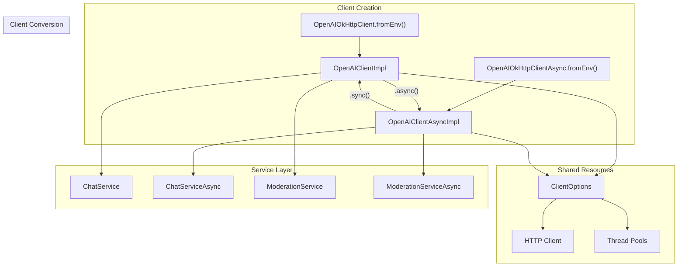
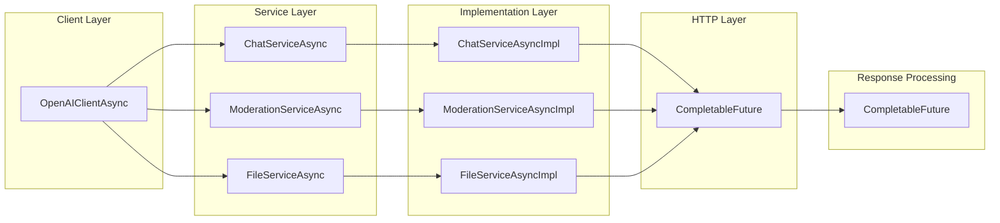
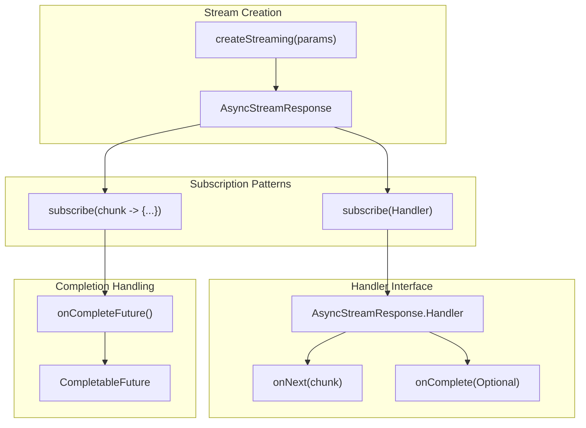
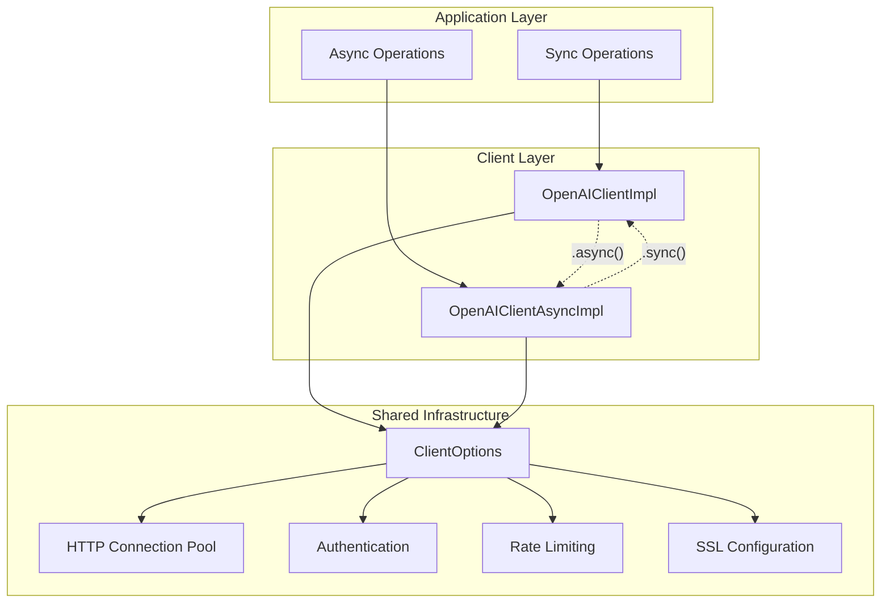

<!-- source: DeepWiki mcp.deepwiki.com · repo openai/openai-java · page 3.2 Asynchronous API · fetched 2026-10-26 -->

# Asynchronous API

<details>
<summary>Relevant source files</summary>

The following files were used as context for generating this wiki page:

- [openai-java-core/src/main/kotlin/com/openai/client/OpenAIClient.kt](openai-java-core/src/main/kotlin/com/openai/client/OpenAIClient.kt)
- [openai-java-core/src/main/kotlin/com/openai/client/OpenAIClientAsync.kt](openai-java-core/src/main/kotlin/com/openai/client/OpenAIClientAsync.kt)
- [openai-java-core/src/main/kotlin/com/openai/client/OpenAIClientAsyncImpl.kt](openai-java-core/src/main/kotlin/com/openai/client/OpenAIClientAsyncImpl.kt)
- [openai-java-core/src/main/kotlin/com/openai/client/OpenAIClientImpl.kt](openai-java-core/src/main/kotlin/com/openai/client/OpenAIClientImpl.kt)
- [openai-java-core/src/main/kotlin/com/openai/core/PhantomReachable.kt](openai-java-core/src/main/kotlin/com/openai/core/PhantomReachable.kt)
- [openai-java-core/src/main/kotlin/com/openai/core/http/AsyncStreamResponse.kt](openai-java-core/src/main/kotlin/com/openai/core/http/AsyncStreamResponse.kt)
- [openai-java-core/src/main/kotlin/com/openai/core/http/PhantomReachableClosingAsyncStreamResponse.kt](openai-java-core/src/main/kotlin/com/openai/core/http/PhantomReachableClosingAsyncStreamResponse.kt)
- [openai-java-core/src/main/kotlin/com/openai/services/async/CompletionServiceAsync.kt](openai-java-core/src/main/kotlin/com/openai/services/async/CompletionServiceAsync.kt)
- [openai-java-core/src/main/kotlin/com/openai/services/async/ModerationServiceAsync.kt](openai-java-core/src/main/kotlin/com/openai/services/async/ModerationServiceAsync.kt)
- [openai-java-core/src/main/kotlin/com/openai/services/blocking/ModerationService.kt](openai-java-core/src/main/kotlin/com/openai/services/blocking/ModerationService.kt)
- [openai-java-core/src/test/kotlin/com/openai/core/http/AsyncStreamResponseTest.kt](openai-java-core/src/test/kotlin/com/openai/core/http/AsyncStreamResponseTest.kt)

</details>


The OpenAI Java SDK provides comprehensive asynchronous support through `OpenAIClientAsync` and related service interfaces, enabling non-blocking operations that return `CompletableFuture` objects. This allows for efficient concurrent processing and integration with reactive programming patterns.

For synchronous blocking operations, see [Synchronous API](#3.1). For accessing raw HTTP responses, see [Raw Response Access](#3.3).

## Getting an Async Client

You can obtain an async client in two ways: by converting from a synchronous client or by creating one directly.

### Converting from Sync Client

The most common approach is to call `async()` on an existing synchronous client:

```java
OpenAIClient syncClient = OpenAIOkHttpClient.fromEnv();
OpenAIClientAsync asyncClient = syncClient.async();
```
Sources: [openai-java-core/src/main/kotlin/com/openai/client/OpenAIClient.kt:56]()

### Creating Directly

Alternatively, create an async client directly using `OpenAIOkHttpClientAsync`:

```java
OpenAIClientAsync asyncClient = OpenAIOkHttpClientAsync.fromEnv();
```

Both clients share the same underlying resources (connection pools, thread pools), making conversion efficient.

**Client Relationship Architecture**



Sources: [openai-java-core/src/main/kotlin/com/openai/client/OpenAIClient.kt:56](), [openai-java-core/src/main/kotlin/com/openai/client/OpenAIClientAsync.kt:56](), [openai-java-core/src/main/kotlin/com/openai/client/OpenAIClientImpl.kt:72](), [openai-java-core/src/main/kotlin/com/openai/client/OpenAIClientAsyncImpl.kt:72]()

## Making Async Requests

All async service methods return `CompletableFuture` objects instead of blocking for results. The method signatures are identical to their synchronous counterparts, except for the return type.

### Basic Async Request Pattern

```java
CompletableFuture<ModerationCreateResponse> future = 
    asyncClient.moderations().create(params);

// Handle result asynchronously
future.thenAccept(response -> {
    System.out.println("Moderation result: " + response);
});
```
Sources: [openai-java-core/src/main/kotlin/com/openai/services/async/ModerationServiceAsync.kt:32-39]()

### Service Method Mapping

Each synchronous service has a corresponding async service with identical method names:

| Synchronous Service | Async Service | Return Type Change |
|-------------------|---------------|-------------------|
| `ChatService` | `ChatServiceAsync` | `ChatCompletion` → `CompletableFuture<ChatCompletion>` |
| `ModerationService` | `ModerationServiceAsync` | `ModerationCreateResponse` → `CompletableFuture<ModerationCreateResponse>` |
| `FileService` | `FileServiceAsync` | `FileObject` → `CompletableFuture<FileObject>` |

**Async Request Flow**



Sources: [openai-java-core/src/main/kotlin/com/openai/client/OpenAIClientAsync.kt:74-140](), [openai-java-core/src/main/kotlin/com/openai/client/OpenAIClientAsyncImpl.kt:78-166](), [openai-java-core/src/main/kotlin/com/openai/services/async/ModerationServiceAsync.kt:32-39]()

## CompletableFuture Usage Patterns

The SDK returns standard `CompletableFuture` objects, enabling various composition and error handling patterns.

### Chaining Operations

```java
CompletableFuture<String> result = asyncClient
    .chat().completions().create(params)
    .thenApply(completion -> completion.choices().get(0).message().content())
    .thenApply(content -> "Processed: " + content);
```

### Combining Multiple Requests

```java
CompletableFuture<ChatCompletion> chat1 = asyncClient.chat().completions().create(params1);
CompletableFuture<ChatCompletion> chat2 = asyncClient.chat().completions().create(params2);

CompletableFuture<Void> combined = CompletableFuture.allOf(chat1, chat2);
combined.thenRun(() -> {
    // Both requests completed
});
```

### Error Handling

```java
asyncClient.chat().completions().create(params)
    .thenAccept(result -> processSuccess(result))
    .exceptionally(throwable -> {
        handleError(throwable);
        return null;
    });
```

## Async Streaming

Async streaming uses a different pattern from synchronous streaming, employing `AsyncStreamResponse` with subscription-based processing.

### Basic Streaming

```java
asyncClient.chat().completions().createStreaming(params).subscribe(chunk -> {
    System.out.println(chunk);
});
```
Sources: [openai-java-core/src/main/kotlin/com/openai/services/async/CompletionServiceAsync.kt:53-54]()

### Advanced Streaming with Handlers

```java
asyncClient.chat().completions().createStreaming(params).subscribe(
    new AsyncStreamResponse.Handler<>() {
        @Override
        public void onNext(ChatCompletionChunk chunk) {
            System.out.println(chunk);
        }

        @Override
        public void onComplete(Optional<Throwable> error) {
            if (error.isPresent()) {
                System.out.println("Stream error: " + error.get());
            } else {
                System.out.println("Stream completed");
            }
        }
    }
);
```
Sources: [openai-java-core/src/main/kotlin/com/openai/core/http/AsyncStreamResponse.kt:49-62]()

### Future-Based Streaming Completion

```java
asyncClient.chat().completions().createStreaming(params)
    .subscribe(chunk -> System.out.println(chunk))
    .onCompleteFuture()
    .whenComplete((unused, error) -> {
        if (error != null) {
            System.out.println("Stream failed");
        } else {
            System.out.println("Stream completed");
        }
    });
```
Sources: [openai-java-core/src/main/kotlin/com/openai/core/http/AsyncStreamResponse.kt:38]()

**Async Streaming Architecture**



Sources: [openai-java-core/src/main/kotlin/com/openai/core/http/AsyncStreamResponse.kt:14-47](), [openai-java-core/src/main/kotlin/com/openai/services/async/CompletionServiceAsync.kt:53-60]()

## Thread Pool Management

Async streaming operations use a dedicated cached thread pool per client to handle stream processing without blocking the calling thread.

### Default Thread Pool

The SDK automatically provides a suitable thread pool for most use cases:

```java
// Uses default cached thread pool
asyncClient.chat().completions().createStreaming(params)
    .subscribe(chunk -> processChunk(chunk));
```
Sources: [openai-java-core/src/main/kotlin/com/openai/core/http/AsyncStreamResponse.kt:83-84]()

### Custom Thread Pool per Subscription

You can specify a custom executor for individual streaming operations:

```java
Executor customExecutor = Executors.newFixedThreadPool(4);

asyncClient.chat().completions().createStreaming(params)
    .subscribe(chunk -> processChunk(chunk), customExecutor);
```
Sources: [openai-java-core/src/main/kotlin/com/openai/core/http/AsyncStreamResponse.kt:86-89]()

### Global Thread Pool Configuration

Configure the thread pool globally when building the client:

```java
OpenAIClient client = OpenAIOkHttpClient.builder()
    .fromEnv()
    .streamHandlerExecutor(Executors.newFixedThreadPool(4))
    .build();
```

## Error Handling

Async operations require different error handling approaches compared to synchronous code, as exceptions are wrapped in `CompletableFuture` completion.

### CompletableFuture Exception Handling

```java
asyncClient.chat().completions().create(params)
    .handle((result, throwable) -> {
        if (throwable != null) {
            // Handle OpenAIException, networking errors, etc.
            logger.error("Request failed", throwable);
            return null;
        }
        return result;
    });
```

### Streaming Error Handling

Stream errors are reported through the completion callback:

```java
asyncClient.chat().completions().createStreaming(params)
    .subscribe(
        chunk -> processChunk(chunk),
        error -> handleStreamError(error)
    );
```
Sources: [openai-java-core/src/main/kotlin/com/openai/core/http/AsyncStreamResponse.kt:61]()

## Integration with Synchronous Client

The async and synchronous clients are designed to work together seamlessly, sharing resources and allowing easy conversion between modes.

### Shared Resource Management

Both client types share:
- HTTP connection pools
- Authentication configuration  
- Rate limiting state
- SSL/TLS configuration

### Conversion Patterns

```java
// Start with sync, convert to async for specific operations
OpenAIClient syncClient = OpenAIOkHttpClient.fromEnv();
CompletableFuture<ChatCompletion> asyncResult = 
    syncClient.async().chat().completions().create(params);

// Convert back to sync when needed
ChatCompletion syncResult = syncClient.chat().completions().create(otherParams);
```
Sources: [openai-java-core/src/main/kotlin/com/openai/client/OpenAIClient.kt:56](), [openai-java-core/src/main/kotlin/com/openai/client/OpenAIClientAsync.kt:56]()

### Resource Cleanup

Both clients use the same cleanup mechanism:

```java
// Closing either client releases shared resources
asyncClient.close(); // or syncClient.close()
```
Sources: [openai-java-core/src/main/kotlin/com/openai/client/OpenAIClient.kt:143-153](), [openai-java-core/src/main/kotlin/com/openai/client/OpenAIClientAsync.kt:143-153]()

**Shared Resource Architecture**



Sources: [openai-java-core/src/main/kotlin/com/openai/client/OpenAIClientImpl.kt:61](), [openai-java-core/src/main/kotlin/com/openai/client/OpenAIClientAsyncImpl.kt:61]()

---

