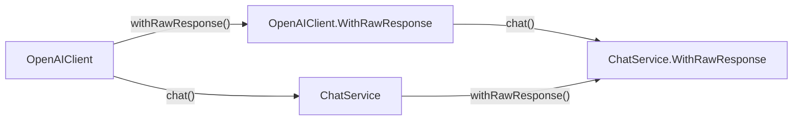
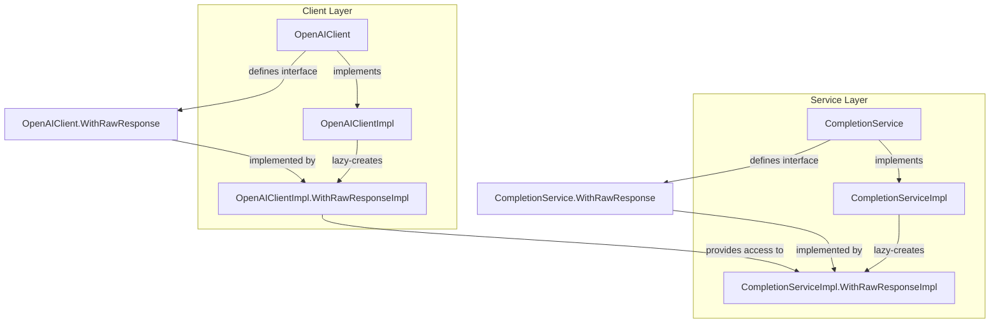
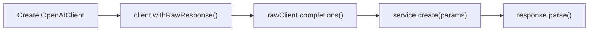
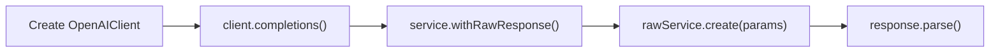
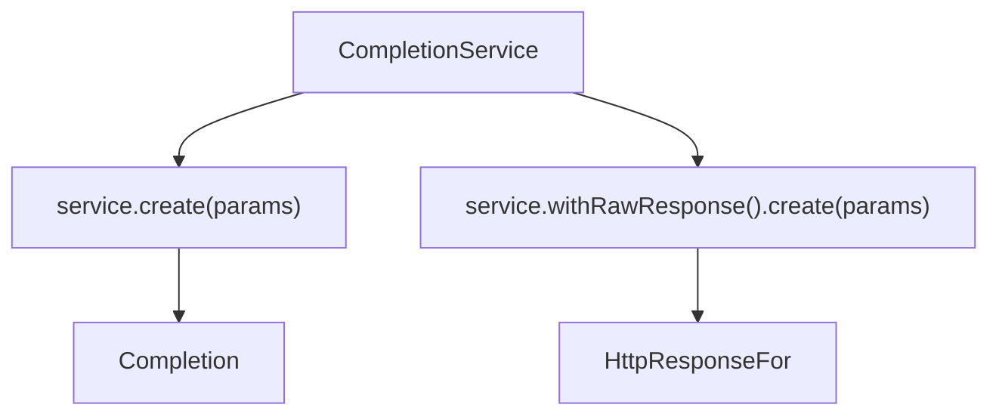
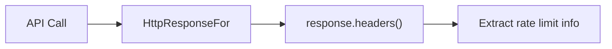
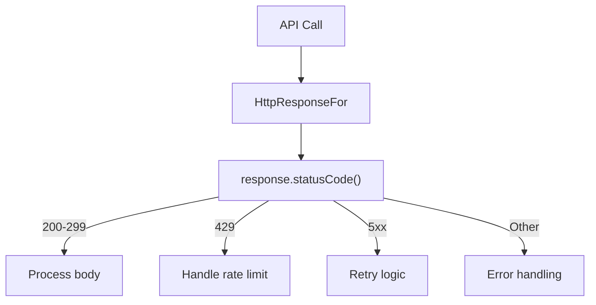

<!-- source: DeepWiki mcp.deepwiki.com · repo openai/openai-java · page 3.3 Raw Response Access · fetched 2026-10-26 -->

# Raw Response Access

<details>
<summary>Relevant source files</summary>

The following files were used as context for generating this wiki page:

- [openai-java-core/src/main/kotlin/com/openai/core/handlers/SseHandler.kt](openai-java-core/src/main/kotlin/com/openai/core/handlers/SseHandler.kt)
- [openai-java-core/src/main/kotlin/com/openai/core/handlers/StreamHandler.kt](openai-java-core/src/main/kotlin/com/openai/core/handlers/StreamHandler.kt)
- [openai-java-core/src/main/kotlin/com/openai/core/http/HttpResponse.kt](openai-java-core/src/main/kotlin/com/openai/core/http/HttpResponse.kt)
- [openai-java-core/src/main/kotlin/com/openai/core/http/HttpResponseFor.kt](openai-java-core/src/main/kotlin/com/openai/core/http/HttpResponseFor.kt)
- [openai-java-core/src/main/kotlin/com/openai/core/http/LoggingHttpClient.kt](openai-java-core/src/main/kotlin/com/openai/core/http/LoggingHttpClient.kt)
- [openai-java-core/src/main/kotlin/com/openai/core/http/SseMessage.kt](openai-java-core/src/main/kotlin/com/openai/core/http/SseMessage.kt)
- [openai-java-core/src/main/kotlin/com/openai/services/blocking/CompletionService.kt](openai-java-core/src/main/kotlin/com/openai/services/blocking/CompletionService.kt)
- [openai-java-core/src/test/kotlin/com/openai/core/handlers/SseHandlerTest.kt](openai-java-core/src/test/kotlin/com/openai/core/handlers/SseHandlerTest.kt)
- [openai-java-core/src/test/kotlin/com/openai/core/handlers/SseTerminalEventTest.kt](openai-java-core/src/test/kotlin/com/openai/core/handlers/SseTerminalEventTest.kt)
- [openai-java-core/src/test/kotlin/com/openai/core/handlers/StreamHandlerTest.kt](openai-java-core/src/test/kotlin/com/openai/core/handlers/StreamHandlerTest.kt)
- [openai-java-core/src/test/kotlin/com/openai/core/http/HttpResponseForTest.kt](openai-java-core/src/test/kotlin/com/openai/core/http/HttpResponseForTest.kt)
- [openai-java-core/src/test/kotlin/com/openai/core/http/LoggingHttpClientTest.kt](openai-java-core/src/test/kotlin/com/openai/core/http/LoggingHttpClientTest.kt)

</details>


This page documents the `WithRawResponse` pattern, which provides access to complete HTTP responses including status codes, headers, and raw response bodies. This feature is available for both synchronous and asynchronous client interfaces and applies to all service methods across the SDK.

For general client configuration and setup, see [Configuration](#2.2). For information about the base client interfaces, see [Synchronous API](#3.1) and [Asynchronous API](#3.2).

## Overview

By default, service methods in the OpenAI Java SDK return deserialized response objects (e.g., `ChatCompletion`, `Response`, `ModerationCreateResponse`). The `WithRawResponse` pattern provides an alternative view of each service that returns the complete HTTP response wrapped in an `HttpResponseFor<T>` type, allowing access to:

- HTTP status codes
- Response headers
- The deserialized response body
- Raw response metadata

## Access Pattern

Every client and service in the SDK exposes a `withRawResponse()` method that returns a view providing raw response access:



Sources: [openai-java-core/src/main/kotlin/com/openai/services/blocking/CompletionService.kt:23-24]()

## Client-Level Raw Response Access

Both `OpenAIClient` and `OpenAIClientAsync` provide a `withRawResponse()` method that returns a view of the entire client where all service methods return raw responses.

### Synchronous Client

The `OpenAIClient` interface defines the `withRawResponse()` method:

```kotlin
/**
 * Returns a view of this service that provides access to raw HTTP responses for each method.
 */
fun withRawResponse(): WithRawResponse
```

The `WithRawResponse` interface mirrors all service accessors from the main client. Each service accessor returns the corresponding `WithRawResponse` variant of that service.

### Asynchronous Client

The async client provides an identical pattern:

```kotlin
/**
 * Returns a view of this service that provides access to raw HTTP responses for each method.
 */
fun withRawResponse(): WithRawResponse
```

Sources: [openai-java-core/src/main/kotlin/com/openai/services/blocking/CompletionService.kt:23-24]()

## Implementation Architecture

The implementation follows a consistent pattern across all clients and services:



Each service implementation contains a nested `WithRawResponseImpl` class that implements the raw response variant of the service interface. The main client's `WithRawResponseImpl` lazily instantiates these service-level implementations as needed.

Sources: [openai-java-core/src/main/kotlin/com/openai/services/blocking/CompletionService.kt:62-104]()

## Service-Level Raw Response Access

Every service interface provides its own `withRawResponse()` method, allowing you to obtain raw responses for a specific service without affecting others.

### Service Interface Pattern

Each service interface defines a `WithRawResponse` nested interface. For example, `CompletionService`:

[openai-java-core/src/main/kotlin/com/openai/services/blocking/CompletionService.kt:23-24]()

```kotlin
/**
 * Returns a view of this service that provides access to raw HTTP responses for each method.
 */
fun withRawResponse(): WithRawResponse
```

The nested `WithRawResponse` interface contains methods with identical signatures to the main service, but returning `HttpResponseFor<T>` instead of `T`:

[openai-java-core/src/main/kotlin/com/openai/services/blocking/CompletionService.kt:77-104]()

### Synchronous vs Asynchronous Return Types

| Client Type | Normal Method Return | Raw Response Method Return |
|------------|---------------------|---------------------------|
| Synchronous | `T` | `HttpResponseFor<T>` |
| Asynchronous | `CompletableFuture<T>` | `CompletableFuture<HttpResponseFor<T>>` |

For synchronous services, raw response methods are annotated with `@MustBeClosed` to ensure proper resource management:

[openai-java-core/src/main/kotlin/com/openai/services/blocking/CompletionService.kt:77-78]()

Sources: [openai-java-core/src/main/kotlin/com/openai/services/blocking/CompletionService.kt:77-104]()

## HttpResponseFor Type

The `HttpResponseFor<T>` type is the wrapper returned by all raw response methods. It provides access to:

- **Status Code**: The HTTP status code (e.g., 200, 201, 404) via `statusCode()` [openai-java-core/src/main/kotlin/com/openai/core/http/HttpResponse.kt:8]()
- **Headers**: All HTTP response headers via `headers()` [openai-java-core/src/main/kotlin/com/openai/core/http/HttpResponse.kt:10]()
- **Body**: The deserialized response body of type `T` via `parse()` [openai-java-core/src/main/kotlin/com/openai/core/http/HttpResponseFor.kt:8]()
- **Raw Body**: The original response body as an `InputStream` via `body()` [openai-java-core/src/main/kotlin/com/openai/core/http/HttpResponse.kt:19]()

The `HttpResponseFor` interface extends `HttpResponse` and adds the `parse()` method. The SDK provides an internal utility function `parseable()` [openai-java-core/src/main/kotlin/com/openai/core/http/HttpResponseFor.kt:11-32]() to create instances of `HttpResponseFor`.

Sources: [openai-java-core/src/main/kotlin/com/openai/core/http/HttpResponse.kt:6-28](), [openai-java-core/src/main/kotlin/com/openai/core/http/HttpResponseFor.kt:5-32]()

## Usage Patterns

### Pattern 1: Client-Level Raw Response Access

Obtain a raw response view of the entire client:



This pattern is useful when you need raw response access across multiple services.

### Pattern 2: Service-Level Raw Response Access

Obtain a raw response view for a specific service:



This pattern is useful when you only need raw response access for specific API calls.

### Pattern 3: Selective Raw Response Access

Mix normal and raw response calls within the same application:



Sources: Patterns inferred from interface design [openai-java-core/src/main/kotlin/com/openai/services/blocking/CompletionService.kt:18-104]()

## withOptions Support

Both the main client and raw response views support the `withOptions()` method for per-request configuration changes:

[openai-java-core/src/main/kotlin/com/openai/services/blocking/CompletionService.kt:28-31]()

```kotlin
/**
 * Returns a view of this service with the given option modifications applied.
 *
 * The original service is not modified.
 */
fun withOptions(modifier: Consumer<ClientOptions.Builder>): CompletionService
```

This allows you to customize HTTP client options (e.g., timeouts, headers) while maintaining raw response access.

Sources: [openai-java-core/src/main/kotlin/com/openai/services/blocking/CompletionService.kt:28-31]()

## Resource Management

### Synchronous Clients

Synchronous raw response methods return `HttpResponseFor<T>` objects that may hold resources such as network connections. These methods are annotated with `@MustBeClosed`:

[openai-java-core/src/main/kotlin/com/openai/services/blocking/CompletionService.kt:77-78]()

The `@MustBeClosed` annotation indicates that the returned object should be closed after use, typically in a try-with-resources block or by explicitly calling `close()`. The `HttpResponseFor` implementation ensures that the underlying `HttpResponse` is closed when `HttpResponseFor.close()` is called [openai-java-core/src/main/kotlin/com/openai/core/http/HttpResponseFor.kt:27-31]().

### Asynchronous Clients

Asynchronous raw response methods return `CompletableFuture<HttpResponseFor<T>>`. The `CompletableFuture` handles resource management automatically, but you must still consume or close the `HttpResponseFor<T>` once the future completes.

Sources: [openai-java-core/src/main/kotlin/com/openai/services/blocking/CompletionService.kt:77-78](), [openai-java-core/src/main/kotlin/com/openai/core/http/HttpResponseFor.kt:27-31]()

## Service Coverage

The `WithRawResponse` pattern is implemented consistently across all services in the SDK:

| Service | Synchronous Interface | Asynchronous Interface |
|---------|----------------------|------------------------|
| Completions | `CompletionService.WithRawResponse` | `CompletionServiceAsync.WithRawResponse` |
| Chat | `ChatService.WithRawResponse` | `ChatServiceAsync.WithRawResponse` |
| Embeddings | `EmbeddingService.WithRawResponse` | `EmbeddingServiceAsync.WithRawResponse` |
| Files | `FileService.WithRawResponse` | `FileServiceAsync.WithRawResponse` |
| Images | `ImageService.WithRawResponse` | `ImageServiceAsync.WithRawResponse` |
| Audio | `AudioService.WithRawResponse` | `AudioServiceAsync.WithRawResponse` |
| Moderations | `ModerationService.WithRawResponse` | `ModerationServiceAsync.WithRawResponse` |
| Models | `ModelService.WithRawResponse` | `ModelServiceAsync.WithRawResponse` |
| Fine-tuning | `FineTuningService.WithRawResponse` | `FineTuningServiceAsync.WithRawResponse` |
| Responses | `ResponseService.WithRawResponse` | `ResponseServiceAsync.WithRawResponse` |
| Assistants (Beta) | `BetaService.WithRawResponse` | `BetaServiceAsync.WithRawResponse` |
| Batches | `BatchService.WithRawResponse` | `BatchServiceAsync.WithRawResponse` |
| Uploads | `UploadService.WithRawResponse` | `UploadServiceAsync.WithRawResponse` |
| Vector Stores | `VectorStoreService.WithRawResponse` | `VectorStoreServiceAsync.WithRawResponse` |
| Evals | `EvalService.WithRawResponse` | `EvalServiceAsync.WithRawResponse` |
| Realtime | `RealtimeService.WithRawResponse` | `RealtimeServiceAsync.WithRawResponse` |
| Conversations | `ConversationService.WithRawResponse` | `ConversationServiceAsync.WithRawResponse` |
| Containers | `ContainerService.WithRawResponse` | `ContainerServiceAsync.WithRawResponse` |
| Videos | `VideoService.WithRawResponse` | `VideoServiceAsync.WithRawResponse` |
| Graders | `GraderService.WithRawResponse` | `GraderServiceAsync.WithRawResponse` |
| Webhooks | `WebhookService.WithRawResponse` | `WebhookServiceAsync.WithRawResponse` |

Sources: [openai-java-core/src/main/kotlin/com/openai/services/blocking/CompletionService.kt:18-104]() (inferred from code generation pattern)

## Common Use Cases

### Rate Limit Inspection

Access rate limit headers from the response:



Common rate limit headers include:
- `x-ratelimit-limit-requests`
- `x-ratelimit-remaining-requests`
- `x-ratelimit-reset-requests`
- `x-ratelimit-limit-tokens`
- `x-ratelimit-remaining-tokens`

### Status Code-Based Logic

Implement custom handling based on HTTP status codes:



### Custom Error Handling

Access the raw error response for detailed error analysis when standard exception handling is insufficient.

### Debugging and Logging

Log complete HTTP responses including headers for troubleshooting API interactions. The `LoggingHttpClient` [openai-java-core/src/main/kotlin/com/openai/core/http/LoggingHttpClient.kt:25-49]() can be configured to log request and response details, including headers and body sizes, at different `LogLevel`s [openai-java-core/src/main/kotlin/com/openai/core/http/LoggingHttpClient.kt:91-142]().

Sources: [openai-java-core/src/main/kotlin/com/openai/core/http/LoggingHttpClient.kt:25-49](), [openai-java-core/src/main/kotlin/com/openai/core/http/LoggingHttpClient.kt:91-142]()

## Implementation Details

### Lazy Initialization

The `WithRawResponse` implementations are lazily initialized in both client and service implementations. This pattern ensures that raw response views are only created when needed, avoiding unnecessary object allocation.

### ClientOptions Sharing

The `WithRawResponse` implementations receive the same `ClientOptions` as the parent client or service. This ensures consistent configuration (authentication, base URL, timeout, etc.) between normal and raw response views.

Sources: [openai-java-core/src/main/kotlin/com/openai/services/blocking/CompletionService.kt:62-63]()

## Relationship to Other Features

The raw response pattern integrates with other SDK features:

- **Retry Logic**: Raw responses include the status codes and headers from the final successful response after any retries. See [Retry Logic](#9.2) for details on automatic retry behavior.
- **Error Handling**: Exceptions are still thrown for error responses, but raw response access allows inspection before exception processing. See [Error Handling](#9.1).
- **Streaming**: Raw response access is available for streaming methods, returning `HttpResponseFor<StreamResponse<T>>`. The `StreamResponse` itself provides a `Stream<T>` for iterating over events. For Server-Sent Events (SSE), the `SseHandler` [openai-java-core/src/main/kotlin/com/openai/core/handlers/SseHandler.kt:20-55]() processes the raw HTTP stream into `SseMessage` objects, which can then be mapped to specific types. The `StreamHandler` [openai-java-core/src/main/kotlin/com/openai/core/handlers/StreamHandler.kt:16-72]() is a generic handler for processing line-based streams.
- **Async Execution**: Raw responses work seamlessly with `CompletableFuture` in async clients. See [Asynchronous API](#3.2).

Sources: [openai-java-core/src/main/kotlin/com/openai/services/blocking/CompletionService.kt:92-104](), [openai-java-core/src/main/kotlin/com/openai/core/handlers/SseHandler.kt:20-55](), [openai-java-core/src/main/kotlin/com/openai/core/handlers/StreamHandler.kt:16-72]()

---

