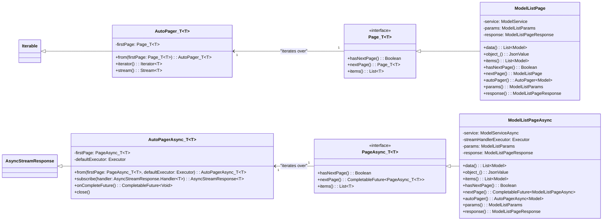

<!-- source: DeepWiki mcp.deepwiki.com · repo openai/openai-java · page 3.4 Pagination · fetched 2026-10-26 -->

# Pagination

<details>
<summary>Relevant source files</summary>

The following files were used as context for generating this wiki page:

- [openai-java-core/src/main/kotlin/com/openai/core/AutoPager.kt](openai-java-core/src/main/kotlin/com/openai/core/AutoPager.kt)
- [openai-java-core/src/main/kotlin/com/openai/core/AutoPagerAsync.kt](openai-java-core/src/main/kotlin/com/openai/core/AutoPagerAsync.kt)
- [openai-java-core/src/main/kotlin/com/openai/core/Page.kt](openai-java-core/src/main/kotlin/com/openai/core/Page.kt)
- [openai-java-core/src/main/kotlin/com/openai/core/PageAsync.kt](openai-java-core/src/main/kotlin/com/openai/core/PageAsync.kt)
- [openai-java-core/src/main/kotlin/com/openai/models/finetuning/checkpoints/permissions/PermissionCreatePage.kt](openai-java-core/src/main/kotlin/com/openai/models/finetuning/checkpoints/permissions/PermissionCreatePage.kt)
- [openai-java-core/src/main/kotlin/com/openai/models/finetuning/checkpoints/permissions/PermissionCreatePageAsync.kt](openai-java-core/src/main/kotlin/com/openai/models/finetuning/checkpoints/permissions/PermissionCreatePageAsync.kt)
- [openai-java-core/src/main/kotlin/com/openai/models/models/ModelListPage.kt](openai-java-core/src/main/kotlin/com/openai/models/models/ModelListPage.kt)
- [openai-java-core/src/main/kotlin/com/openai/models/models/ModelListPageAsync.kt](openai-java-core/src/main/kotlin/com/openai/models/models/ModelListPageAsync.kt)
- [openai-java-core/src/main/kotlin/com/openai/models/vectorstores/VectorStoreSearchPage.kt](openai-java-core/src/main/kotlin/com/openai/models/vectorstores/VectorStoreSearchPage.kt)
- [openai-java-core/src/main/kotlin/com/openai/models/vectorstores/VectorStoreSearchPageAsync.kt](openai-java-core/src/main/kotlin/com/openai/models/vectorstores/VectorStoreSearchPageAsync.kt)
- [openai-java-core/src/main/kotlin/com/openai/models/vectorstores/files/FileContentPage.kt](openai-java-core/src/main/kotlin/com/openai/models/vectorstores/files/FileContentPage.kt)
- [openai-java-core/src/main/kotlin/com/openai/models/vectorstores/files/FileContentPageAsync.kt](openai-java-core/src/main/kotlin/com/openai/models/vectorstores/files/FileContentPageAsync.kt)
- [openai-java-core/src/test/kotlin/com/openai/core/AutoPagerFirstPageFailureTest.kt](openai-java-core/src/test/kotlin/com/openai/core/AutoPagerFirstPageFailureTest.kt)

</details>


This page details the pagination mechanisms provided by the OpenAI Java SDK, including the `Page` and `PageAsync` abstractions, the `AutoPager` for simplified iteration, and the structure of page response models for list endpoints.

## Page and PageAsync Abstractions

The SDK provides two core interfaces for handling paginated responses: `Page<T>` for synchronous operations and `PageAsync<T>` for asynchronous operations. These interfaces abstract away the details of fetching subsequent pages, allowing developers to focus on processing the items.

### `Page<T>` (Synchronous)

The `Page<T>` interface represents a single page of results from a paginated endpoint. It provides methods to access the items on the current page and to retrieve the next page synchronously.

```kotlin
interface Page<T> {
    fun hasNextPage(): Boolean
    fun nextPage(): Page<T>
    fun items(): List<T>
}
```
[openai-java-core/src/main/kotlin/com/openai/core/Page.kt:10-31]()

*   `hasNextPage()`: This method checks if there is a subsequent page available. It typically does not make a network request and relies on information within the current page's response to determine if more data exists [openai-java-core/src/main/kotlin/com/openai/core/Page.kt:19-20]().
*   `nextPage()`: This method fetches the next page of results. Calling this method will trigger a new API request. An `IllegalStateException` is thrown if there is no next page, which can be avoided by first checking `hasNextPage()` [openai-java-core/src/main/kotlin/com/openai/core/Page.kt:22-27]().
*   `items()`: Returns the list of items contained within the current page [openai-java-core/src/main/kotlin/com/openai/core/Page.kt:30]().

### `PageAsync<T>` (Asynchronous)

The `PageAsync<T>` interface is the asynchronous counterpart to `Page<T>`, designed for non-blocking operations. It returns `CompletableFuture` for fetching the next page.

```kotlin
interface PageAsync<T> {
    fun hasNextPage(): Boolean
    fun nextPage(): CompletableFuture<PageAsync<T>>
    fun items(): List<T>
}
```
[openai-java-core/src/main/kotlin/com/openai/core/PageAsync.kt:10-31]()

*   `hasNextPage()`: Similar to its synchronous counterpart, this method indicates if a next page exists without making a network request [openai-java-core/src/main/kotlin/com/openai/core/PageAsync.kt:19-20]().
*   `nextPage()`: This method asynchronously fetches the next page, returning a `CompletableFuture` that will complete with the next `PageAsync<T>` instance. An `IllegalStateException` is thrown if there is no next page [openai-java-core/src/main/kotlin/com/openai/core/PageAsync.kt:22-27]().
*   `items()`: Returns the list of items contained within the current page [openai-java-core/src/main/kotlin/com/openai/core/PageAsync.kt:30]().

Sources:
- [openai-java-core/src/main/kotlin/com/openai/core/Page.kt:10-31]()
- [openai-java-core/src/main/kotlin/com/openai/core/PageAsync.kt:10-31]()

## AutoPager Iteration

The `AutoPager` and `AutoPagerAsync` classes provide a convenient way to iterate over all items across multiple pages without manually managing `nextPage()` calls.

### `AutoPager<T>` (Synchronous)

The `AutoPager<T>` class implements `Iterable<T>`, allowing it to be used directly in `for-each` loops or converted to a `Stream<T>`. It automatically fetches subsequent pages as needed.

```kotlin
class AutoPager<T> private constructor(private val firstPage: Page<T>) : Iterable<T> {
    companion object {
        fun <T> from(firstPage: Page<T>): AutoPager<T> = AutoPager(firstPage)
    }

    override fun iterator(): Iterator<T> =
        generateSequence(firstPage) { if (it.hasNextPage()) it.nextPage() else null }
            .flatMap { it.items() }
            .iterator()

    fun stream(): Stream<T> = StreamSupport.stream(spliterator(), false)
}
```
[openai-java-core/src/main/kotlin/com/openai/core/AutoPager.kt:6-19]()

The `iterator()` method uses `generateSequence` to repeatedly call `nextPage()` as long as `hasNextPage()` returns `true`, flattening the `items()` from each page into a single sequence [openai-java-core/src/main/kotlin/com/openai/core/AutoPager.kt:13-16]().

### `AutoPagerAsync<T>` (Asynchronous)

The `AutoPagerAsync<T>` class is designed for asynchronous iteration. It implements `AsyncStreamResponse<T>`, allowing consumers to subscribe to a stream of items.

```kotlin
class AutoPagerAsync<T>
private constructor(private val firstPage: PageAsync<T>, private val defaultExecutor: Executor) :
    AsyncStreamResponse<T> {

    // ... (constructor, companion object, state management)

    override fun subscribe(handler: AsyncStreamResponse.Handler<T>): AsyncStreamResponse<T> =
        subscribe(handler, defaultExecutor)

    override fun subscribe(
        handler: AsyncStreamResponse.Handler<T>,
        executor: Executor,
    ): AsyncStreamResponse<T> = apply {
        // ... (state check)

        fun PageAsync<T>.handle(): CompletableFuture<Void?> {
            if (state.get() == State.CLOSED) {
                return CompletableFuture.completedFuture(null)
            }

            items().forEach { handler.onNext(it) }
            return if (hasNextPage()) nextPage().thenCompose { it.handle() }
            else CompletableFuture.completedFuture(null)
        }

        executor.execute {
            CompletableFuture.completedFuture(firstPage)
                .thenCompose { it.handle() }
                .whenComplete { _, error ->
                    // ... (error handling and completion)
                }
        }
    }

    override fun onCompleteFuture(): CompletableFuture<Void?> = onCompleteFuture

    override fun close() {
        // ... (close logic)
    }
}
```
[openai-java-core/src/main/kotlin/com/openai/core/AutoPagerAsync.kt:10-82]()

The `subscribe` method takes an `AsyncStreamResponse.Handler<T>` and an `Executor`. It recursively calls `handle()` on each `PageAsync<T>`, emitting items via `handler.onNext()` and then fetching the `nextPage()` asynchronously using `thenCompose` [openai-java-core/src/main/kotlin/com/openai/core/AutoPagerAsync.kt:36-44](). The `onCompleteFuture()` provides a `CompletableFuture` that completes when all items have been processed or an error occurs [openai-java-core/src/main/kotlin/com/openai/core/AutoPagerAsync.kt:70]().

### AutoPager Flow Diagram

The following diagram illustrates the flow of items through the `AutoPagerAsync` when a client subscribes to it.

```mermaid
graph TD
    A[Client] --> B{AutoPagerAsync.subscribe()};
    B --> C{Executor.execute()};
    C --> D[CompletableFuture.completedFuture(firstPage)];
    D --> E{firstPage.handle()};
    E --> F{PageAsync.items()};
    F --> G[handler.onNext(item)];
    G --> H{PageAsync.hasNextPage()};
    H -- Yes --> I{PageAsync.nextPage()};
    I --> J{nextPage.handle()};
    J --> F;
    H -- No --> K[CompletableFuture.completedFuture(null)];
    K --> L{whenComplete()};
    L --> M[handler.onComplete()];
    M --> N[onCompleteFuture.complete()];
    N --> O[AutoPagerAsync.close()];
```
Sources:
- [openai-java-core/src/main/kotlin/com/openai/core/AutoPager.kt:6-19]()
- [openai-java-core/src/main/kotlin/com/openai/core/AutoPagerAsync.kt:10-82]()
- [openai-java-core/src/test/kotlin/com/openai/core/AutoPagerFirstPageFailureTest.kt:13-48]()

## List-Endpoint Page Response Models

For each list endpoint in the OpenAI API, the SDK generates specific page response models. These models encapsulate the `Page` or `PageAsync` interface and provide access to the list of items and other response-specific data.

These generated classes follow a consistent naming convention: `[Resource]ListPage` for synchronous and `[Resource]ListPageAsync` for asynchronous.

### Example: `ModelListPage` and `ModelListPageAsync`

The `ModelListPage` and `ModelListPageAsync` classes are examples of generated page response models for the `ModelService.list` endpoint.

#### `ModelListPage`
```kotlin
class ModelListPage
private constructor(
    private val service: ModelService,
    private val params: ModelListParams,
    private val response: ModelListPageResponse,
) : Page<Model> {

    fun data(): List<Model> = response._data().getOptional("data").getOrNull() ?: emptyList()

    fun object_(): JsonValue = response._object_()

    override fun items(): List<Model> = data()

    override fun hasNextPage(): Boolean = false // Example: This specific endpoint might not have pagination

    fun nextPageParams(): ModelListParams =
        throw IllegalStateException("Cannot construct next page params")

    override fun nextPage(): ModelListPage = service.list(nextPageParams())

    fun autoPager(): AutoPager<Model> = AutoPager.from(this)

    fun params(): ModelListParams = params

    fun response(): ModelListPageResponse = response

    // ... (builder, equals, hashCode, toString)
}
```
[openai-java-core/src/main/kotlin/com/openai/models/models/ModelListPage.kt:14-49]()

#### `ModelListPageAsync`
```kotlin
class ModelListPageAsync
private constructor(
    private val service: ModelServiceAsync,
    private val streamHandlerExecutor: Executor,
    private val params: ModelListParams,
    private val response: ModelListPageResponse,
) : PageAsync<Model> {

    fun data(): List<Model> = response._data().getOptional("data").getOrNull() ?: emptyList()

    fun object_(): JsonValue = response._object_()

    override fun items(): List<Model> = data()

    override fun hasNextPage(): Boolean = false // Example: This specific endpoint might not have pagination

    fun nextPageParams(): ModelListParams =
        throw IllegalStateException("Cannot construct next page params")

    override fun nextPage(): CompletableFuture<ModelListPageAsync> = service.list(nextPageParams())

    fun autoPager(): AutoPagerAsync<Model> = AutoPagerAsync.from(this, streamHandlerExecutor)

    fun params(): ModelListParams = params

    fun response(): ModelListPageResponse = response

    // ... (builder, equals, hashCode, toString)
}
```
[openai-java-core/src/main/kotlin/com/openai/models/models/ModelListPageAsync.kt:16-52]()

Key characteristics of these generated page models:

*   **Delegation**: They delegate to an internal `response` object (e.g., `ModelListPageResponse`) to extract the actual data items [openai-java-core/src/main/kotlin/com/openai/models/models/ModelListPage.kt:29]().
*   **Service Reference**: They hold a reference to the `Service` (e.g., `ModelService` or `ModelServiceAsync`) that was used to fetch the page, enabling the `nextPage()` method to make subsequent requests [openai-java-core/src/main/kotlin/com/openai/models/models/ModelListPage.kt:16]().
*   **Parameters**: They store the `params` used for the current request, which can be useful for debugging or constructing `nextPageParams()` [openai-java-core/src/main/kotlin/com/openai/models/models/ModelListPage.kt:17]().
*   **`hasNextPage()` Implementation**: The implementation of `hasNextPage()` varies based on the API endpoint's pagination strategy. For some endpoints, like listing models, there might not be traditional pagination, so `hasNextPage()` always returns `false` [openai-java-core/src/main/kotlin/com/openai/models/models/ModelListPage.kt:36](). For others, it might check for a `next_cursor` or similar field in the response.
*   **`autoPager()` Method**: Each page model provides an `autoPager()` method to easily create an `AutoPager` or `AutoPagerAsync` instance, simplifying iteration over all results [openai-java-core/src/main/kotlin/com/openai/models/models/ModelListPage.kt:40]().

### Other Examples of Page Response Models

The SDK generates similar page models for various list endpoints:

*   `PermissionCreatePage` / `PermissionCreatePageAsync` for fine-tuning checkpoint permissions [openai-java-core/src/main/kotlin/com/openai/models/finetuning/checkpoints/permissions/PermissionCreatePage.kt:14]()
*   `VectorStoreSearchPage` / `VectorStoreSearchPageAsync` for vector store searches [openai-java-core/src/main/kotlin/com/openai/models/vectorstores/VectorStoreSearchPage.kt:14]()
*   `FileContentPage` / `FileContentPageAsync` for vector store file content [openai-java-core/src/main/kotlin/com/openai/models/vectorstores/files/FileContentPage.kt:16]()

Sources:
- [openai-java-core/src/main/kotlin/com/openai/models/models/ModelListPage.kt:14-49]()
- [openai-java-core/src/main/kotlin/com/openai/models/models/ModelListPageAsync.kt:16-52]()
- [openai-java-core/src/main/kotlin/com/openai/models/finetuning/checkpoints/permissions/PermissionCreatePage.kt:14]()
- [openai-java-core/src/main/kotlin/com/openai/models/finetuning/checkpoints/permissions/PermissionCreatePageAsync.kt:16]()
- [openai-java-core/src/main/kotlin/com/openai/models/vectorstores/VectorStoreSearchPage.kt:14]()
- [openai-java-core/src/main/kotlin/com/openai/models/vectorstores/VectorStoreSearchPageAsync.kt:16]()
- [openai-java-core/src/main/kotlin/com/openai/models/vectorstores/files/FileContentPage.kt:16]()
- [openai-java-core/src/main/kotlin/com/openai/models/vectorstores/files/FileContentPageAsync.kt:16]()

### Page Model Structure



---

