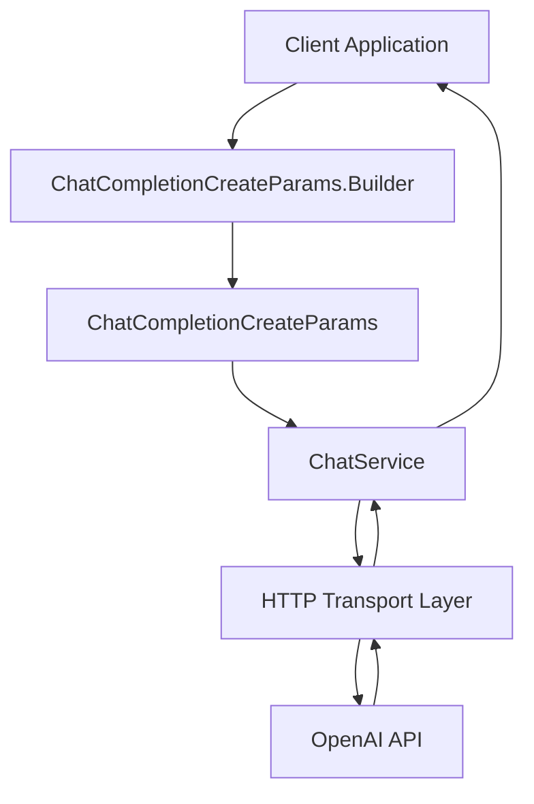
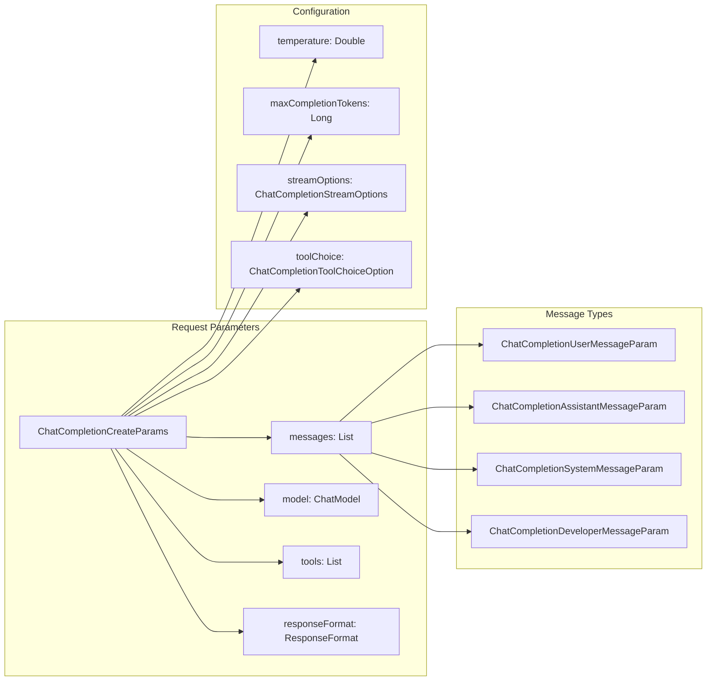
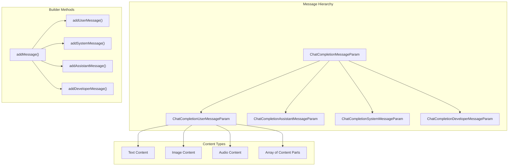
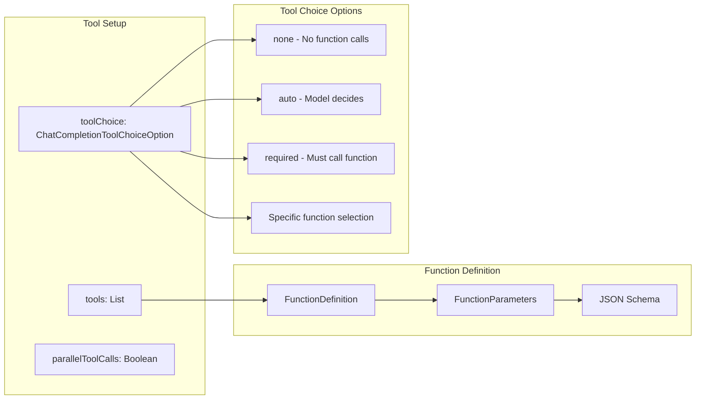
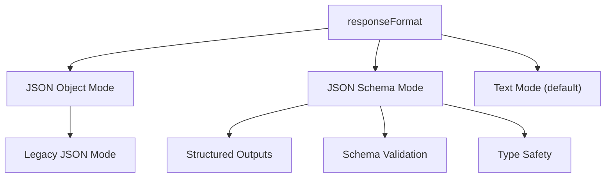

<!-- source: DeepWiki mcp.deepwiki.com · repo openai/openai-java · page 4 Chat Completions · fetched 2026-10-26 -->

# Chat Completions

Relevant source files

The following files were used as context for generating this wiki page:

- [openai-java-core/src/main/kotlin/com/openai/models/chat/completions/ChatCompletion.kt](openai-java-core/src/main/kotlin/com/openai/models/chat/completions/ChatCompletion.kt)
- [openai-java-core/src/main/kotlin/com/openai/models/chat/completions/ChatCompletionChunk.kt](openai-java-core/src/main/kotlin/com/openai/models/chat/completions/ChatCompletionChunk.kt)
- [openai-java-core/src/main/kotlin/com/openai/models/chat/completions/ChatCompletionCreateParams.kt](openai-java-core/src/main/kotlin/com/openai/models/chat/completions/ChatCompletionCreateParams.kt)
- [openai-java-core/src/main/kotlin/com/openai/models/responses/Response.kt](openai-java-core/src/main/kotlin/com/openai/models/responses/Response.kt)
- [openai-java-core/src/main/kotlin/com/openai/models/responses/ResponseCreateParams.kt](openai-java-core/src/main/kotlin/com/openai/models/responses/ResponseCreateParams.kt)
- [openai-java-core/src/main/kotlin/com/openai/models/responses/ResponsesClientEvent.kt](openai-java-core/src/main/kotlin/com/openai/models/responses/ResponsesClientEvent.kt)
- [openai-java-core/src/test/kotlin/com/openai/models/beta/responses/BetaResponsesClientEventTest.kt](openai-java-core/src/test/kotlin/com/openai/models/beta/responses/BetaResponsesClientEventTest.kt)
- [openai-java-core/src/test/kotlin/com/openai/models/beta/responses/ResponseCreateParamsTest.kt](openai-java-core/src/test/kotlin/com/openai/models/beta/responses/ResponseCreateParamsTest.kt)
- [openai-java-core/src/test/kotlin/com/openai/models/responses/ResponseCreateParamsTest.kt](openai-java-core/src/test/kotlin/com/openai/models/responses/ResponseCreateParamsTest.kt)
- [openai-java-core/src/test/kotlin/com/openai/models/responses/ResponsesClientEventTest.kt](openai-java-core/src/test/kotlin/com/openai/models/responses/ResponsesClientEventTest.kt)
- [openai-java-core/src/test/kotlin/com/openai/services/async/ResponseServiceAsyncTest.kt](openai-java-core/src/test/kotlin/com/openai/services/async/ResponseServiceAsyncTest.kt)
- [openai-java-core/src/test/kotlin/com/openai/services/blocking/ResponseServiceTest.kt](openai-java-core/src/test/kotlin/com/openai/services/blocking/ResponseServiceTest.kt)

This document covers the Chat Completions API functionality in the OpenAI Java SDK, including request creation, parameter configuration, message handling, and advanced features like function calling and structured outputs. Chat Completions enable conversational AI interactions by sending a series of messages and receiving model-generated responses.

For information about streaming chat completions, see [Streaming Chat Completions](#4.2). For structured outputs and function calling, see [Structured Outputs](#6). For the newer Responses API with advanced reasoning capabilities, see [Responses API](#5).

## Architecture Overview

The Chat Completions system is built around the `ChatCompletionCreateParams` class, which encapsulates all configuration options for a chat completion request. The system supports various message types, response formats, and advanced features like tool usage.

### Core Request Flow

**Core Chat Completion Request Processing**

Sources: [openai-java-core/src/main/kotlin/com/openai/models/chat/completions/ChatCompletionCreateParams.kt:1-100]()

### Code Entity Mapping

**Chat Completion Parameter Structure and Code Entities**

Sources: [openai-java-core/src/main/kotlin/com/openai/models/chat/completions/ChatCompletionCreateParams.kt:64-446]()

## Core Parameters

The `ChatCompletionCreateParams` class provides comprehensive configuration options for chat completion requests. The two required parameters are `messages` and `model`.

### Required Parameters

| Parameter | Type | Description |
|-----------|------|-------------|
| `messages()` | `List<ChatCompletionMessageParam>` | List of messages comprising the conversation |
| `model()` | `ChatModel` | Model ID like `gpt-4o` or `o3` |

### Key Optional Parameters

| Parameter | Type | Description |
|-----------|------|-------------|
| `temperature()` | `Optional<Double>` | Sampling temperature between 0 and 2 |
| `maxCompletionTokens()` | `Optional<Long>` | Upper bound for tokens including reasoning tokens |
| `tools()` | `Optional<List<ChatCompletionTool>>` | Function tools the model may call |
| `responseFormat()` | `Optional<ResponseFormat>` | Output format specification |
| `streamOptions()` | `Optional<ChatCompletionStreamOptions>` | Streaming configuration |

Sources: [openai-java-core/src/main/kotlin/com/openai/models/chat/completions/ChatCompletionCreateParams.kt:82-401]()

## Message Structure

Chat completions support multiple message types with different roles and content formats. The builder pattern provides convenient methods for adding various message types.

### Message Types and Roles

**Message Types and Builder Methods**

### Builder Convenience Methods

The `ChatCompletionCreateParams.Builder` provides several convenience methods for adding messages:

- `addUserMessage(String text)` - Adds a simple text user message
- `addSystemMessage(String text)` - Adds a simple text system message
- `addAssistantMessage(Content content)` - Adds an assistant message
- `addDeveloperMessage(String text)` - Adds a developer message
- `addMessage(ChatCompletionMessage assistant)` - Converts from response message

Sources: [openai-java-core/src/main/kotlin/com/openai/models/chat/completions/ChatCompletionCreateParams.kt:770-888]()

## Advanced Configuration

### Token Management

The SDK provides multiple token-related parameters for controlling response length:

- `maxCompletionTokens()` - Modern parameter including reasoning tokens
- `maxTokens()` - Deprecated parameter not compatible with o-series models
- `n()` - Number of completion choices to generate

### Sampling Control

| Parameter | Range | Purpose |
|-----------|-------|---------|
| `temperature()` | 0.0 - 2.0 | Controls randomness vs determinism |
| `topP()` | 0.0 - 1.0 | Nucleus sampling probability mass |
| `presencePenalty()` | -2.0 - 2.0 | Penalizes new topics |
| `frequencyPenalty()` | -2.0 - 2.0 | Penalizes token repetition |

### Reasoning Models Support

For o-series reasoning models, the SDK provides specific parameters:

- `reasoningEffort()` - Controls reasoning effort (`minimal`, `low`, `medium`, `high`)
- `verbosity()` - Controls response verbosity (`low`, `medium`, `high`)

Sources: [openai-java-core/src/main/kotlin/com/openai/models/chat/completions/ChatCompletionCreateParams.kt:167-445]()

## Tools and Function Calling

The chat completion system supports function calling through the `tools` parameter, enabling models to invoke external functions during response generation.

### Tool Configuration

**Function Calling Configuration Structure**

### Deprecated Function Parameters

The SDK maintains backward compatibility with deprecated function calling parameters:

- `functions()` - Deprecated in favor of `tools`
- `functionCall()` - Deprecated in favor of `toolChoice`

Sources: [openai-java-core/src/main/kotlin/com/openai/models/chat/completions/ChatCompletionCreateParams.kt:132-143](), [openai-java-core/src/main/kotlin/com/openai/models/chat/completions/ChatCompletionCreateParams.kt:380-401]()

## Response Format Control

### Structured Output Options

The `responseFormat` parameter enables structured JSON responses:

**Response Format Options and Capabilities**

- **JSON Schema Mode**: Uses `ResponseFormatJsonSchema` for structured outputs with validation
- **JSON Object Mode**: Uses `ResponseFormatJsonObject` for basic JSON responses
- **Text Mode**: Uses `ResponseFormatText` for plain text responses

Sources: [openai-java-core/src/main/kotlin/com/openai/models/chat/completions/ChatCompletionCreateParams.kt:279-293]()

## Streaming Configuration

For streaming responses, the `streamOptions` parameter configures streaming behavior:

- `includeUsage` - Whether to include token usage in stream
- Various streaming-specific settings for real-time response processing

Sources: [openai-java-core/src/main/kotlin/com/openai/models/chat/completions/ChatCompletionCreateParams.kt:362-367]()

## Audio and Multimodal Support

The chat completion system supports multimodal inputs including audio:

### Audio Parameters

- `audio()` - Audio output parameters via `ChatCompletionAudioParam`
- `modalities()` - Output types like `["text"]` or `["text", "audio"]`

### Multimodal Content

The `gpt-4o-audio-preview` model supports generating both text and audio responses when configured with appropriate modalities.

Sources: [openai-java-core/src/main/kotlin/com/openai/models/chat/completions/ChatCompletionCreateParams.kt:96-218]()

## Service Tier and Processing

### Service Tier Options

The `serviceTier` parameter controls request processing:

- `auto` - Uses project default settings
- `default` - Standard pricing and performance
- `flex` - Flexible processing tier
- `priority` - Priority processing tier

### Caching and Optimization

- `promptCacheKey()` - Optimizes cache hit rates for similar requests
- `user()` - Deprecated identifier replaced by `safetyIdentifier` and `promptCacheKey`
- `safetyIdentifier()` - Helps detect policy violations

Sources: [openai-java-core/src/main/kotlin/com/openai/models/chat/completions/ChatCompletionCreateParams.kt:318-435]()

---

