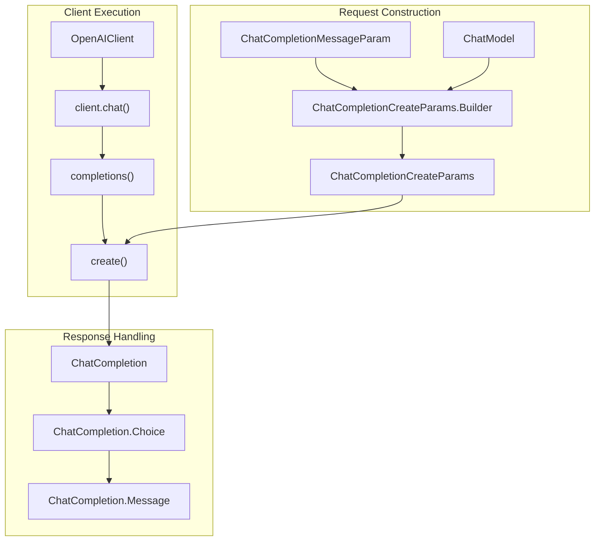
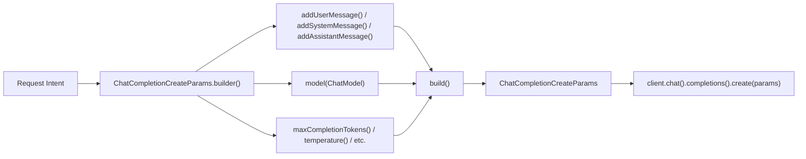
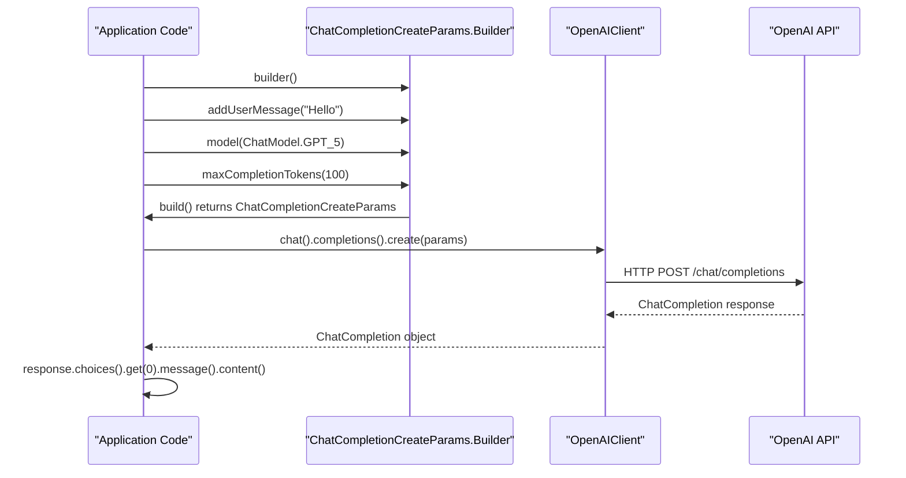

<!-- source: DeepWiki mcp.deepwiki.com · repo openai/openai-java · page 4.1 Basic Chat Completions · fetched 2026-10-26 -->

# Basic Chat Completions

<details>
<summary>Relevant source files</summary>

The following files were used as context for generating this wiki page:

- [openai-java-core/src/main/kotlin/com/openai/models/chat/completions/ChatCompletion.kt](openai-java-core/src/main/kotlin/com/openai/models/chat/completions/ChatCompletion.kt)
- [openai-java-core/src/main/kotlin/com/openai/models/chat/completions/ChatCompletionChunk.kt](openai-java-core/src/main/kotlin/com/openai/models/chat/completions/ChatCompletionChunk.kt)
- [openai-java-core/src/main/kotlin/com/openai/models/chat/completions/ChatCompletionCreateParams.kt](openai-java-core/src/main/kotlin/com/openai/models/chat/completions/ChatCompletionCreateParams.kt)
- [openai-java-core/src/main/kotlin/com/openai/models/embeddings/Embedding.kt](openai-java-core/src/main/kotlin/com/openai/models/embeddings/Embedding.kt)
- [openai-java-core/src/main/kotlin/com/openai/models/embeddings/EmbeddingCreateParams.kt](openai-java-core/src/main/kotlin/com/openai/models/embeddings/EmbeddingCreateParams.kt)
- [openai-java-core/src/main/kotlin/com/openai/models/responses/Response.kt](openai-java-core/src/main/kotlin/com/openai/models/responses/Response.kt)
- [openai-java-core/src/main/kotlin/com/openai/models/responses/ResponseCreateParams.kt](openai-java-core/src/main/kotlin/com/openai/models/responses/ResponseCreateParams.kt)
- [openai-java-core/src/main/kotlin/com/openai/models/responses/ResponsesClientEvent.kt](openai-java-core/src/main/kotlin/com/openai/models/responses/ResponsesClientEvent.kt)
- [openai-java-core/src/test/kotlin/com/openai/models/beta/responses/BetaResponsesClientEventTest.kt](openai-java-core/src/test/kotlin/com/openai/models/beta/responses/BetaResponsesClientEventTest.kt)
- [openai-java-core/src/test/kotlin/com/openai/models/beta/responses/ResponseCreateParamsTest.kt](openai-java-core/src/test/kotlin/com/openai/models/beta/responses/ResponseCreateParamsTest.kt)
- [openai-java-core/src/test/kotlin/com/openai/models/chat/completions/ChatCompletionCreateParamsTest.kt](openai-java-core/src/test/kotlin/com/openai/models/chat/completions/ChatCompletionCreateParamsTest.kt)
- [openai-java-core/src/test/kotlin/com/openai/models/embeddings/EmbeddingTest.kt](openai-java-core/src/test/kotlin/com/openai/models/embeddings/EmbeddingTest.kt)
- [openai-java-core/src/test/kotlin/com/openai/models/embeddings/EmbeddingValueTest.kt](openai-java-core/src/test/kotlin/com/openai/models/embeddings/EmbeddingValueTest.kt)
- [openai-java-core/src/test/kotlin/com/openai/models/responses/ResponseCreateParamsTest.kt](openai-java-core/src/test/kotlin/com/openai/models/responses/ResponseCreateParamsTest.kt)
- [openai-java-core/src/test/kotlin/com/openai/models/responses/ResponsesClientEventTest.kt](openai-java-core/src/test/kotlin/com/openai/models/responses/ResponsesClientEventTest.kt)
- [openai-java-core/src/test/kotlin/com/openai/services/async/ResponseServiceAsyncTest.kt](openai-java-core/src/test/kotlin/com/openai/services/async/ResponseServiceAsyncTest.kt)
- [openai-java-core/src/test/kotlin/com/openai/services/blocking/ResponseServiceTest.kt](openai-java-core/src/test/kotlin/com/openai/services/blocking/ResponseServiceTest.kt)

</details>


This page covers creating and configuring basic (non-streaming) chat completion requests using the OpenAI Java SDK. It focuses on the fundamental patterns for constructing requests with messages, models, and essential parameters. For streaming chat completions, see [Streaming Chat Completions](#4.2). For advanced features like structured outputs and function calling, see [Structured Outputs](#6) and [Function Calling](#6.2).

## Core Components Overview

The basic chat completion system centers around building request parameters and executing them through the client. The main components work together to transform user intent into API calls and responses.


Sources: [openai-java-core/src/main/kotlin/com/openai/models/chat/completions/ChatCompletionCreateParams.kt:67-72]()

## Request Parameter Construction

Chat completion requests are built using the builder pattern with `ChatCompletionCreateParams.Builder`. The builder provides a fluent interface for setting all request parameters before creating the immutable params object.


Sources: [openai-java-core/src/main/kotlin/com/openai/models/chat/completions/ChatCompletionCreateParams.kt:230-243]()

## Message Configuration

Messages form the core of chat completions, representing the conversation history sent to the model. The SDK provides convenient builder methods for different message roles.

### Message Types and Builder Methods

| Method | Purpose | Role | Content Types |
|--------|---------|------|---------------|
| `addUserMessage()` | User input | `user` | Text, images, audio |
| `addSystemMessage()` | System instructions | `system` | Text only |
| `addAssistantMessage()` | Assistant responses | `assistant` | Text, tool calls |

### Basic Message Example

The simplest approach uses the convenience methods on the builder:

```java
ChatCompletionCreateParams params = ChatCompletionCreateParams.builder()
    .addUserMessage("Say this is a test")
    .model(ChatModel.GPT_5)
    .build();
```

### Complex Message Construction

For more complex scenarios, messages can be constructed explicitly using `ChatCompletionMessageParam`:

```java
ChatCompletionUserMessageParam userMessage = ChatCompletionUserMessageParam.builder()
    .role(ChatCompletionUserMessageParam.Role.USER)
    .content("Your message content here")
    .build();

ChatCompletionCreateParams params = ChatCompletionCreateParams.builder()
    .addMessage(userMessage)
    .model(ChatModel.GPT_5)
    .build();
```
Sources: [openai-java-core/src/main/kotlin/com/openai/models/chat/completions/ChatCompletionCreateParams.kt:84]()

## Model Selection

Models are specified using the `ChatModel` enum, which provides type-safe constants for available models. The model determines the capabilities, cost, and performance characteristics of the request.

### Common Models

| Model Constant | Description | Use Case |
|---------------|-------------|----------|
| `ChatModel.GPT_5` | Latest GPT-5 model | General purpose, highest capability |
| `ChatModel.GPT_4_1` | GPT-4 Turbo | Balanced performance and cost |
| `ChatModel.GPT_3_5_TURBO` | GPT-3.5 Turbo | Cost-effective for simpler tasks |

### Model Configuration

```java
ChatCompletionCreateParams params = ChatCompletionCreateParams.builder()
    .addUserMessage("Hello, world!")
    .model(ChatModel.GPT_5)  // Type-safe model selection
    .build();
```

For Azure deployments or custom models, use the string-based model method:

```java
.model("my-custom-deployment-name")
```
Sources: [openai-java-core/src/main/kotlin/com/openai/models/chat/completions/ChatCompletionCreateParams.kt:95]()

## Essential Parameters

Beyond messages and model, several key parameters control the behavior of chat completions:

### Token Limits

```java
.maxCompletionTokens(1000)  // Limit response length
```

### Randomness Control

```java
.temperature(0.7)           // Controls randomness (0.0 to 2.0)
.topP(0.9)                 // Nucleus sampling parameter
```

### Response Behavior

```java
.n(1)                      // Number of completions to generate
.stop(Arrays.asList("END", "STOP"))  // Stop sequences
```

### Advanced Options

```java
.presencePenalty(0.1)      // Reduce repetition
.frequencyPenalty(0.1)     // Discourage frequent tokens
.logprobs(true)           // Include log probabilities
.topLogprobs(5)           // Number of logprobs to return
```
Sources: [openai-java-core/src/main/kotlin/com/openai/models/chat/completions/ChatCompletionCreateParams.kt:175-176](), [openai-java-core/src/main/kotlin/com/openai/models/chat/completions/ChatCompletionCreateParams.kt:369-374]()

## Complete Request Flow

The following diagram shows the complete flow from request construction to response handling:


Sources: [openai-java-core/src/main/kotlin/com/openai/models/chat/completions/ChatCompletionCreateParams.kt:67-72]()

## Response Handling

The `create()` method returns a `ChatCompletion` object containing the model's response. The response structure mirrors the OpenAI API format:

### Accessing Response Content

```java
ChatCompletion response = client.chat().completions().create(params);

// Get the first (and typically only) choice
String content = response.choices().get(0).message().content().orElse("");

// Access metadata
String model = response.model();
CompletionUsage usage = response.usage();
String systemFingerprint = response.systemFingerprint().orElse("");
```
Sources: [openai-java-core/src/main/kotlin/com/openai/models/chat/completions/ChatCompletion.kt:96](), [openai-java-core/src/main/kotlin/com/openai/models/chat/completions/ChatCompletion.kt:118](), [openai-java-core/src/main/kotlin/com/openai/models/chat/completions/ChatCompletion.kt:124]()

### Multiple Choices

When `n > 1`, multiple response choices are available:

```java
for (ChatCompletion.Choice choice : response.choices()) {
    String content = choice.message().content().orElse("");
    String finishReason = choice.finishReason().toString();
    // Process each choice
}
```
Sources: [openai-java-core/src/main/kotlin/com/openai/models/chat/completions/ChatCompletion.kt:96]()

## Error Handling

Basic error handling should account for API errors and network issues:

```java
try {
    ChatCompletion response = client.chat().completions().create(params);
    // Process response
} catch (OpenAIException e) {
    // Handle API errors (rate limits, invalid requests, etc.)
    System.err.println("API Error: " + e.getMessage());
} catch (Exception e) {
    // Handle network or other errors
    System.err.println("Request failed: " + e.getMessage());
}
```

---

